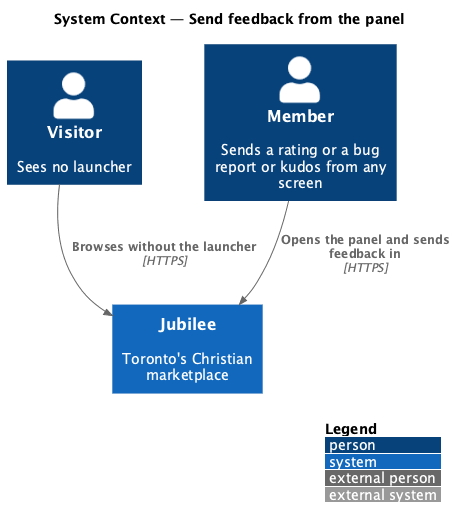
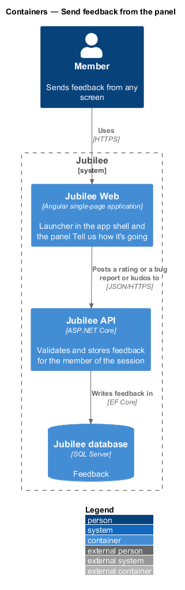
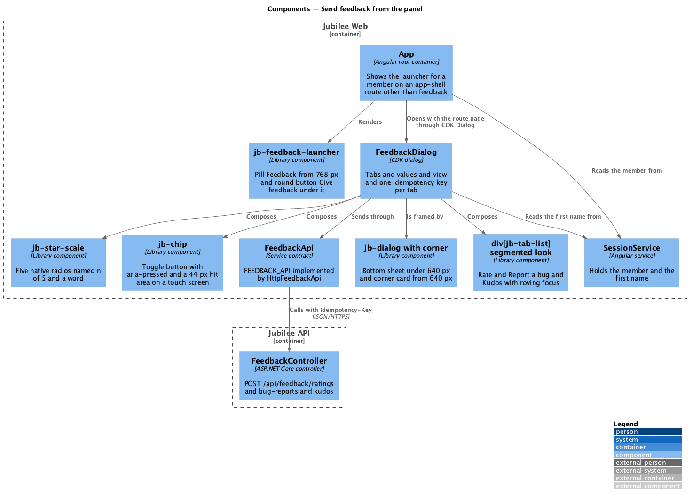
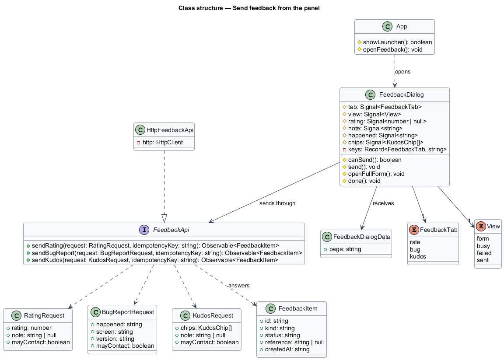
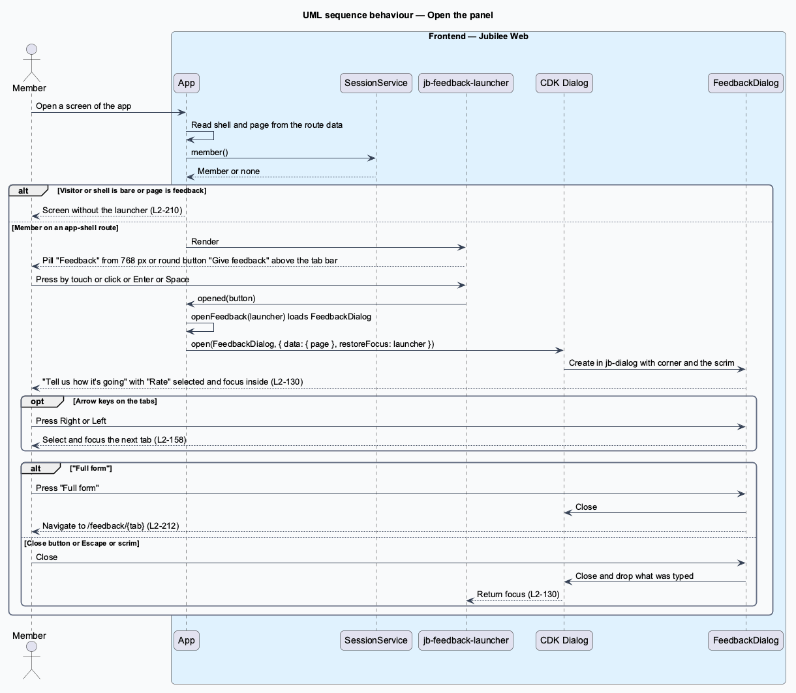
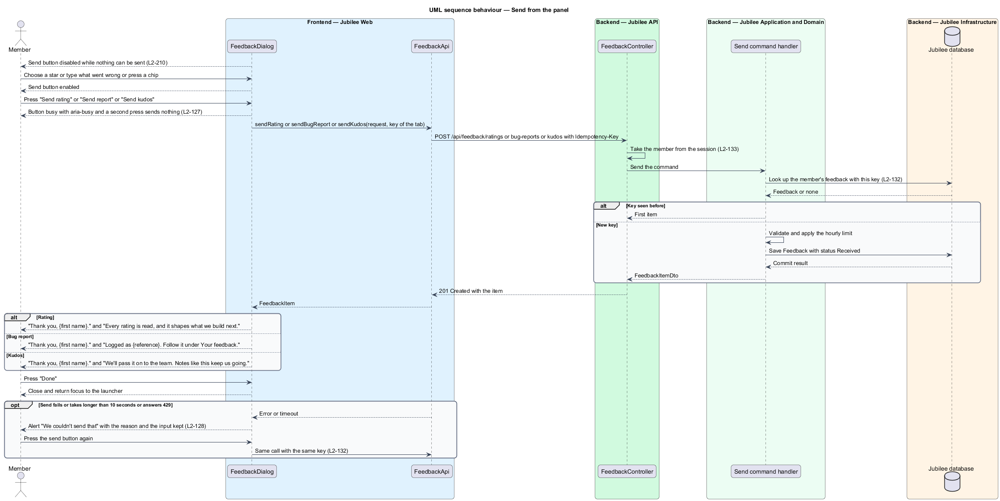

# Send feedback from the panel

## Overview

Jubilee is Toronto's Christian marketplace. A member who has something to say
about the app says it where they are: a launcher on every screen of the app opens
a short panel, "Tell us how it's going", and the member sends a rating, a bug
report or kudos without leaving the screen. This feature covers the launcher, the
panel and its three tabs, the sent view and the failed send.

The terms below are local to this feature.

- **launcher** — control fixed at the bottom right of the app shell that opens the panel
- **panel** — modal dialog "Tell us how it's going" with the tabs "Rate", "Report a bug" and "Kudos"
- **rating** — overall score of 1 to 5 stars for Jubilee, with an optional note
- **bug report** — statement of what went wrong, stored with the screen, the browser and device and the app's version
- **kudos** — praise made of chips, a note, or both; from the panel it is always for the Jubilee team
- **chip** — one of five fixed phrases a member presses to say what stood out
- **reference** — identifier of a bug report, `FB-` and six characters, shown to the member
- **idempotency key** — client-generated identifier that lets the server recognise a repeated send

The panel is the short form. "Full form" closes the panel and opens the feedback
page on the same tab (`send-feedback-from-page`, `L2-212`). The API side of every
send is described in `receive-and-store-feedback` (`L2-214`). The decisions behind
the panel are recorded in ADR 0043.

A visitor sees no launcher. A screen without the app's bars (sign in, join, the
error pages) and the feedback page itself show none either.

The panel differs from the Magic Patterns frame in two known ways (ADR 0043). It
has no "Include a screenshot of this screen" control, because a page cannot
capture itself on every phone browser. It is modal with a scrim at every width,
where the frame has no scrim on a desktop.

## Description

The feature is a vertical slice from the app shell to `FeedbackController`. The
presentation is in the `components` library and the app declares containers only
(ADR 0035).

- **`App`** — root container of the app
  (`frontend/projects/jubilee/src/app/app.ts`, `app.html`). It renders
  `jb-feedback-launcher` when the route's `shell` is `app`, `SessionService`
  holds a member and the route's `page` is not `feedback`. On the launcher's
  press `openFeedback(launcher)` loads `FeedbackDialog` the first time it is
  needed, opens it through the CDK `Dialog` with `restoreFocus` set to the
  launcher, and passes the current `page` as `FeedbackDialogData`.
- **`jb-feedback-launcher`** — component `FeedbackLauncher` of the `components`
  library (`feedback-launcher/`). Its output `opened` gives the pressed button.
  From 768 px it is a pill "Feedback" with the `feedback` icon. Under 768 px it is a round icon button with the accessible
  name "Give feedback" that sits above `jb-tab-bar` and never covers it. It is a
  native `button`, so touch, click, Enter and Space press it. It is fixed at the
  bottom right on the `--z-sticky` layer, below dialogs and toasts. It appears
  without movement under `prefers-reduced-motion: reduce`, reads its colours
  from the tokens in both themes and has a target of at least 44 px.
- **`FeedbackDialog`** — CDK dialog of the app
  (`frontend/projects/jubilee/src/app/dialogs/feedback/`, `feedback.dialog.ts`
  and `feedback.dialog.html`, no stylesheet). It is a container: it holds the
  selected tab (`FeedbackTab`), the values of each tab and the view (`form`,
  `busy`, `failed`, `sent`) as signals, holds one idempotency key per tab, and
  composes `jb-*` components. The CDK dialog restores focus to the launcher
  when it closes.
- **`corner` input of `jb-dialog`** — boolean input of the dialog frame
  `DialogFrame` (`components/src/lib/dialog/`), which adds `dialog--corner`.
  Under 640 px the dialog is a bottom sheet; from 640 px it is a narrow card in
  the bottom right corner.
  The CDK dialog stays modal with its scrim at every width, so focus is held
  inside, the page behind is inert, and Escape, the close button and the scrim
  close it (`L2-130`). What was typed is not kept after a close.
- **`segmented` look of `div[jb-tab-list]`** — the value `segmented` of the
  `look` input of `TabList` (`components/src/lib/tabs/tab-list.ts`), with an
  icon per tab: `star` for "Rate", `bug` for "Report a bug" and `heart` for
  "Kudos". The tab list keeps
  its behaviour: only the selected tab is in the tab order and the arrow keys
  move between tabs (`L2-158`). "Rate" is selected when the panel opens.
- **`fieldset[jb-star-scale]`** — component `StarScale` of the `components`
  library (`star-scale/`). Five native radio inputs in one group draw the stars, so the
  arrow keys and assistive technology work without script. Each is named
  "{n} of 5: {word}" with the words "Frustrating", "Not great", "Okay", "Good"
  and "Love it". The word of the chosen star shows beside the stars, and "Tap to
  rate" shows before any is chosen. The words are `RATING_WORDS` of the `api`
  library.
- **"Rate" tab** — asks "How's Jubilee working for you so far?" with
  `jb-star-scale` and an optional note in `jb-textarea`. The placeholder is
  "What would make it better? (optional)" below four stars and "What's working
  well? (optional)" from four. The send button reads "Send rating".
- **"Report a bug" tab** — asks "What went wrong?" and states "We'll attach:
  {the name of the screen} · your browser and device · version {the app's
  version}". The name of the screen comes from `screenName` in
  `dialogs/feedback/feedback-words.ts`, which maps each route `page` to the name
  the mocks show. The version is the `APP_VERSION` injection token
  (`app-version.ts`), which `app.config.ts` provides from `environment.version`.
  The send button reads "Send report".
- **"Kudos" tab** — asks "What made your day?" with the chips "Found someone I
  trust", "Easy to list", "Quick replies", "Feels like church family" and "Fair
  prices" (`KUDOS_CHIPS` of the `api` library) as `button[jb-chip]` toggles,
  whose `selected` input sets `aria-pressed`, and the note "Say more, or name
  someone who helped (optional)". Any number of chips can be chosen. A chip is
  drawn 32 px tall; on a touch screen (`pointer: coarse`) the chip mixin
  `chip/_chip-base.scss` gives it an invisible `::after` hit area of
  `max(100%, --target-comfortable)` centred on it, so it is pressed over at
  least 44 × 44 px (`L2-210` AC12, `L2-162`, ADR 0060). The send button reads
  "Send kudos".
- **Send button** — disabled while nothing can be sent: no star chosen, no bug
  text, or no chip and no kudos note. It is enabled as soon as there is something
  to send. Each note is held to 1,000 characters (`NOTE_MAX`) by the field.
- **Sending** — `send()` calls `FeedbackApi` with the tab's idempotency key
  from `newKey()` and applies the 10-second `timeout` of `SUBMIT_TIMEOUT_MS`, as
  `ReportListingDialog` does. While the request is in flight the button is busy with
  `aria-busy="true"` and a second press sends nothing (`L2-127`). A rating sends
  the rating and the note. A bug report sends what happened, the `page` it was
  opened on and the app's version. Kudos sends the chips and the note with no
  business. The panel never sends "You can message me about this"; the value
  stays false (ADR 0043).
- **Sent view** — "Thank you, {first name}." with the first name from
  `SessionService`. A rating adds "Every rating is read, and it shapes what we
  build next." A bug report adds "Logged as {reference}. Follow it under Your
  feedback." with the reference of the answer. Kudos adds "We'll pass it on to
  the team. Notes like this keep us going." The button "Done" closes the panel.
- **Failed view** — a `jb-alert` at the top of the panel titled "We couldn't
  send that" with the reason: the connection, the time it took, or "Slow down a
  little" on HTTP 429, as `feedbackFailure` words it. Everything chosen and typed
  is kept. The send button
  tries again with the same idempotency key, so one item is stored however many
  attempts are made (`L2-128`, `L2-132`).
- **"Full form"** — `routerLink` in the panel's footer. It closes the dialog
  and navigates to `/feedback/rate`, `/feedback/bug` or `/feedback/kudos` to
  match the selected tab (`L2-212`).
- **`FeedbackApi`** — service contract in the `api` library
  (`frontend/projects/api/src/lib/api/feedback-api.ts`) with the injection token
  `FEEDBACK_API`, implemented by `HttpFeedbackApi` and provided in
  `app.config.ts`. The panel uses `sendRating`, `sendBugReport` and `sendKudos`,
  which post to `/api/feedback/ratings`, `/api/feedback/bug-reports` and
  `/api/feedback/kudos` with the `Idempotency-Key` header.
- **`FeedbackController`** — ASP.NET Core controller at `api/feedback`. It takes
  the member from the session and answers 201 with the stored item
  (`receive-and-store-feedback`).
- **Icons** — the panel and the launcher use the `jb-icon` names `star`, `bug`,
  `heart`, `feedback` and `arrow-up-right`.
- **Tests** — `e2e/tests/feedback-panel.spec.ts` and
  `feedback-panel-kinds.spec.ts` drive the panel through the page objects
  `e2e/pages/feedback.dialog.ts` (`FeedbackDialog`) and
  `e2e/pages/feedback.screens.ts`. On a touch screen they measure each target
  by pressing points out from its middle (`targetsSmallerThan`), so the chip's
  hit area counts (ADR 0060).
  Each library component has a parity spec in `e2e/tests/parity/` (ADR 0036).
  The Magic Patterns Feedback frame is not captured, so their specs declare
  their reference `absent`; `e2e/fixtures/parity.ts` then looks for
  `docs/design-reference/magic-patterns/components/<component>/<case>-<width>.png`
  and, once the owner saves one, compares that case with it at 3 % without the
  spec being edited (ADR 0060). The absent specs of this feature are
  `feedback-launcher` and `star-scale`; `chip` is compared with crops of
  captured frames.

## Requirements

The feature realizes the following level-2 (L2) requirements. Each L2
requirement refines a level-1 (L1) requirement, cited by identifier.

| L2 ID | Refines (L1) | Requirement |
|-------|--------------|-------------|
| `L2-210` | `L1-029` | A member shall be able to open a short panel from any screen of the app and send a rating, a bug report or kudos without leaving the screen. |
| `L2-127` | `L1-018` | While a form or dialog is submitting, the primary button shall show a spinner with `aria-busy="true"` and keep its label, a second press shall send nothing, and a submission that takes longer than 10 seconds shall fail with the failed state. |
| `L2-128` | `L1-018` | A failed dialog submission shall show an error alert at the top of the dialog that says what did not happen, and shall keep everything typed. |
| `L2-130` | `L1-018` | An open dialog shall take focus, cycle Tab within itself and make the page behind inert, and shall return focus to the control that opened it when it closes. |
| `L2-132` | `L1-018` | Each create request shall carry a client-generated idempotency key, and the server shall return the original result for a repeated key within 24 hours without creating a duplicate. |
| `L2-158` | `L1-022` | Every interactive control shall be reachable by keyboard in visual order and operable with standard keys, and tabs shall follow the WAI-ARIA Authoring Practices pattern with roving focus. |
| `L2-162` | `L1-022` | Every interactive target shall be at least 24 × 24 CSS px, and primary controls on touch devices, chips included, shall be at least 44 × 44 CSS px. |

## Diagrams

### System context

A member opens the panel from any screen of the app and sends feedback to
Jubilee. A visitor sees no launcher.

### Containers

`Jubilee Web` shows the launcher and the panel and posts the feedback to
`Jubilee API`, which stores it in `Jubilee database`.

### Components

`App` shows `jb-feedback-launcher` and opens `FeedbackDialog`. The dialog
composes `jb-dialog` with `corner`, the `segmented` tab list,
`jb-star-scale` and the reused chips and fields, and sends through
`FeedbackApi` to `FeedbackController`.

### Class structure

`FeedbackDialog` depends on the `FeedbackApi` contract, not on
`HttpFeedbackApi`. Each send method takes a request and an idempotency key and
answers a `FeedbackItem`, which carries the reference of a bug report.

### Behaviour — open the panel

`App` decides whether the launcher shows from the route data and the session.
The dialog opens with "Rate" selected and returns focus to the launcher when it
closes (`L2-130`).

### Behaviour — send from the panel

The send button is disabled until there is something to send. A send is busy
until the answer arrives, a failure keeps the input, and a retry reuses the
idempotency key (`L2-127`, `L2-128`, `L2-132`).

