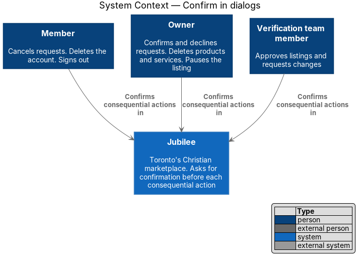
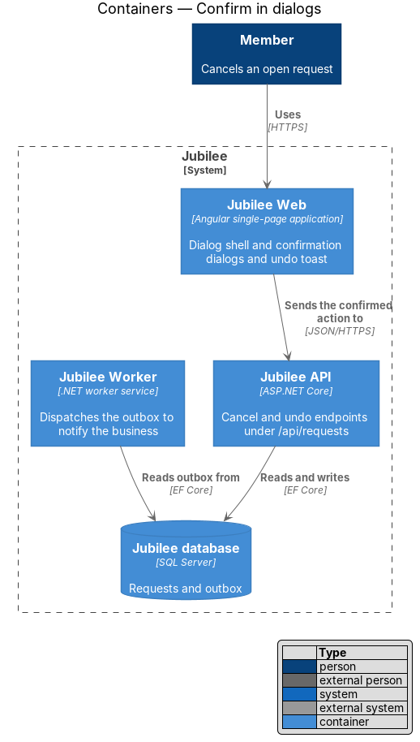
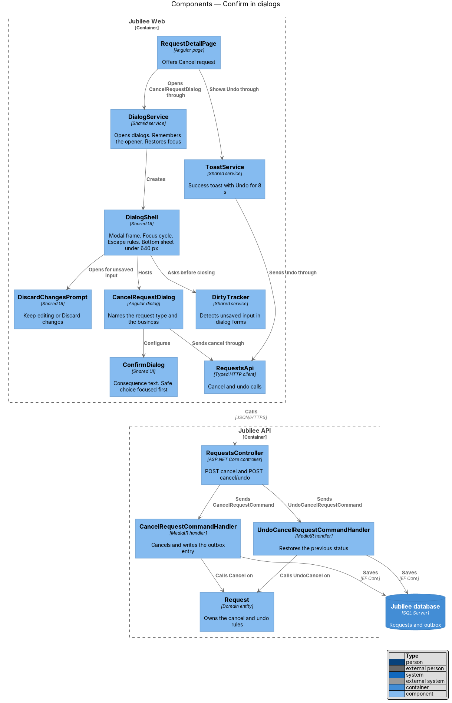
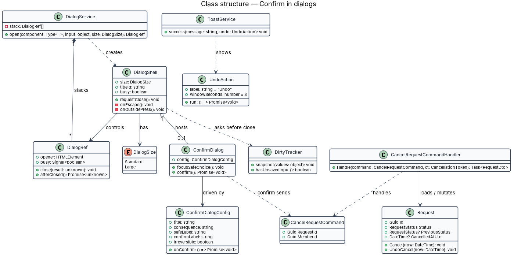
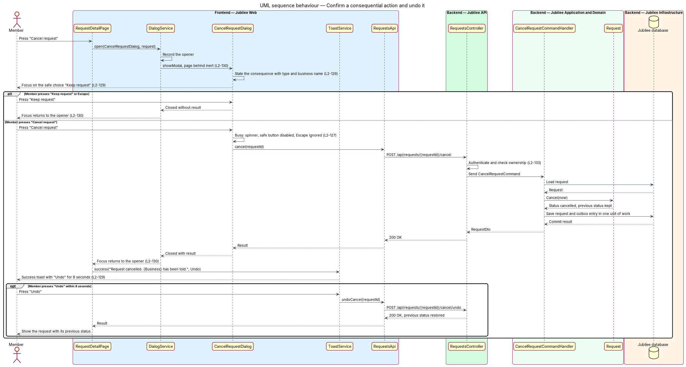
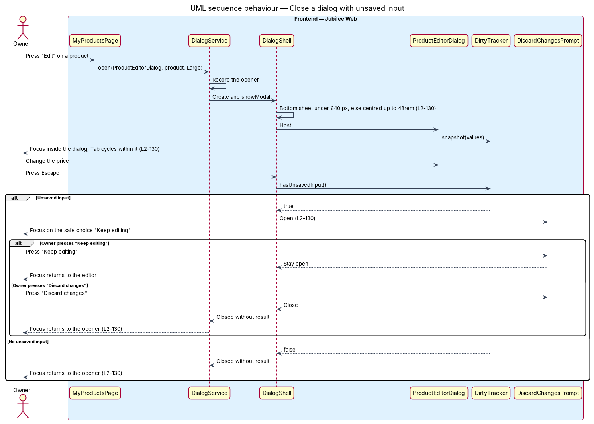

# Confirm in dialogs

## Overview

Jubilee is Toronto's Christian marketplace. Some actions in it cannot be taken
back, or reach another person the moment they are taken: cancelling a request
tells the business, deleting a product removes it from the shop, signing out
ends the session. This feature makes each such action pass through a
confirmation dialog, and it defines how every dialog in `Jubilee Web` behaves
with focus, the keyboard and the viewport.

Four terms are used throughout:

- **consequential action** — action that deletes data, notifies another person, publishes or unpublishes
- **safe choice** — dialog button that leaves everything as it is, such as "Keep request" or "Stay signed in"
- **opener** — control that had focus when the dialog opened and receives focus again when it closes
- **bottom sheet** — dialog layout anchored to the bottom edge of a narrow viewport, with a sticky footer for its buttons

The consequential actions are: delete account, product or service; cancel,
confirm or decline a request; pause a listing; approve a listing; request
changes; sign out. Each confirmation dialog states the consequence with real
counts and names, and the safe choice holds focus when the dialog opens. A
dialog for an irreversible action says "This can't be undone." A reversible
action instead produces a success toast that carries "Undo".

Every dialog, confirmation or form, follows the same behaviour. Focus moves
into it and Tab cycles within it. The page behind is inert. Escape or the close
button closes it unless it is busy, and focus then returns to the opener. A
dialog with unsaved input asks whether to discard or keep editing before it
closes.

The diagrams use cancelling a request (`CancelRequestDialog`, L2-049) as the
worked example.

## Description

The slice consists of the shared dialog infrastructure in `Jubilee Web` and,
for the worked example, the cancel and undo endpoints of `Jubilee API`.

- **`DialogService`** — opens a dialog component with typed input and returns a
  `DialogRef`. It records `document.activeElement` as the opener, keeps a stack
  of open dialogs, and restores focus to the opener when the `DialogRef` closes.
- **`DialogShell`** — shared frame around every dialog, built on the native
  `<dialog>` element opened with `showModal()`. The browser makes the page
  behind inert and keeps Tab within the dialog. The shell sets
  `aria-labelledby` to the title, handles Escape, the close button and a press
  outside, and refuses all three while `busy` is true.
- **`DialogSize`** — `Standard` or `Large`. Under a viewport width of 640 px
  the shell is a bottom sheet with a sticky footer. From 640 px it is centred,
  at most `32rem` wide for `Standard` and `48rem` for `Large` (the product and
  service editors).
- **`ConfirmDialog`** — shared confirmation layout inside `DialogShell`. Its
  `ConfirmDialogConfig` holds the title, the consequence sentence, the safe
  label, the confirm label, the `irreversible` flag and the confirm callback.
  The safe button carries the initial focus. When `irreversible` is true the
  body ends with "This can't be undone."
- **`CancelRequestDialog`** — one consequential-action dialog built on
  `ConfirmDialog`. It reads the request type and business name from
  `RequestsStore`: "Cancel your {type} request to {business}?" with "{Business}
  is told straight away. You can ask again later.", "Keep request" and "Cancel
  request".
- **Consequence data** — names and counts come from the store of the page that
  opens the dialog. Where the page does not hold a count, the dialog fetches it
  before it enables the confirm button; the endpoints for those counts are
  `<TO SUPPLY>`.
- **`DirtyTracker`** — service provided per dialog form. It compares current
  values with the values at open. When it reports unsaved input, Escape or a
  press outside opens `DiscardChangesPrompt` instead of closing.
- **`DiscardChangesPrompt`** — nested `ConfirmDialog` with "Keep editing" as the
  safe choice and "Discard changes" as the other. "Discard changes" closes both
  dialogs.
- **`ToastService`** and **`UndoAction`** — after a reversible action succeeds,
  the page asks `ToastService` for a success toast with an `UndoAction`. The
  toast auto-dismisses after 8 seconds, which bounds the time "Undo" is
  offered. For the example: "Request cancelled. {Business} has been told." with
  "Undo".
- **`RequestsController`** — `POST /api/requests/{requestId}/cancel` sends
  `CancelRequestCommand`; `POST /api/requests/{requestId}/cancel/undo` sends
  `UndoCancelRequestCommand`. Both check that the caller owns the request
  (L2-133).
- **`CancelRequestCommandHandler`** — loads the `Request`, calls
  `Request.Cancel(now)`, and saves the change with an `OutboxMessage` that
  notifies the business, in one unit of work.
- **`UndoCancelRequestCommandHandler`** — calls `Request.UndoCancel(now)`, which
  restores `PreviousStatus` when at most 8 seconds have passed since
  `CancelledAtUtc`, and writes the outbox entry that tells the business the
  cancellation was withdrawn.
- **Dialog behaviour tests** — component tests that assert, for each dialog in
  `docs/mocks/dialogs`, the initial focus, the Tab cycle, Escape while idle and
  while busy, focus return to the opener, and both layouts at 639 px and 640 px.

## Requirements

The feature realizes the following level-2 (L2) requirements. Each L2
requirement refines a level-1 (L1) requirement, cited by identifier.

| L2 ID | Refines (L1) | Requirement |
|-------|--------------|-------------|
| `L2-129` | `L1-018` | An action that deletes data, notifies another person, publishes or unpublishes shall open a confirmation dialog that states the consequence with real counts and names, with the safe choice as the default focused button. The dialog for an irreversible action shall say "This can't be undone."; a reversible action shall produce a success toast that carries "Undo". |
| `L2-130` | `L1-018` | An open dialog shall hold focus, cycle Tab within itself, make the page behind inert, and close on Escape or the close button unless it is busy; on close, focus shall return to the control that opened it. A dialog with unsaved input shall ask to discard or keep editing, and a dialog shall be a bottom sheet with a sticky footer under 640 px and centred at most 32rem wide (48rem for large editors) from 640 px. |
| `L2-127` | `L1-018` | While a dialog is submitting, the primary button shall show a spinner with `aria-busy="true"` and keep its label, the cancel button shall be disabled, and a second press shall send nothing. |
| `L2-128` | `L1-018` | When a dialog submission fails, an error alert at the top of the dialog shall say what did not happen, and the primary button shall read "Try again" for confirmations. |
| `L2-133` | `L1-019` | The server shall check the caller's role and ownership of the specific object on every API endpoint before doing anything. |

## Diagrams

### System context

A `Member`, an `Owner` and a `Verification team member` each confirm
consequential actions. No external system takes part in the dialog pattern.

### Containers

`Jubilee Web` hosts every dialog. For the worked example, `Jubilee API` applies
the cancellation in the `Jubilee database` and `Jubilee Worker` notifies the
business from the outbox.

### Components

`DialogService` opens `CancelRequestDialog` inside `DialogShell` and restores
focus afterwards. `ConfirmDialog` supplies the confirmation layout, and
`ToastService` offers "Undo" after success.

### Class structure

`DialogService` creates a `DialogRef` per open dialog and remembers the opener.
`ConfirmDialog` is driven by a `ConfirmDialogConfig`; on the server, `Request`
owns the cancel and undo rules.

### Behaviour — confirm a consequential action and undo it

The dialog opens with focus on "Keep request". Confirming sends the command;
the success toast carries "Undo", which restores the previous status within
8 seconds.

### Behaviour — close a dialog with unsaved input

Escape on a dialog form with unsaved input opens `DiscardChangesPrompt`. "Keep
editing" returns to the form; "Discard changes" closes the dialog and returns
focus to the opener.

