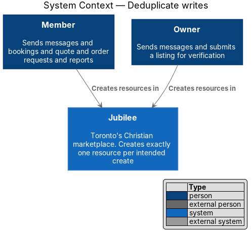
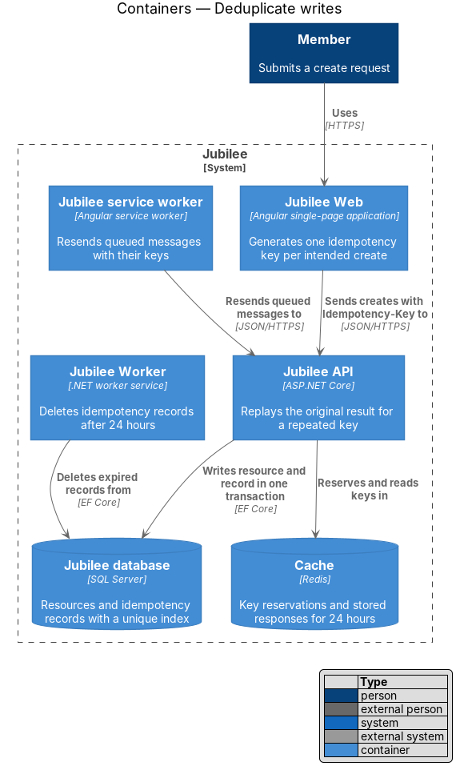
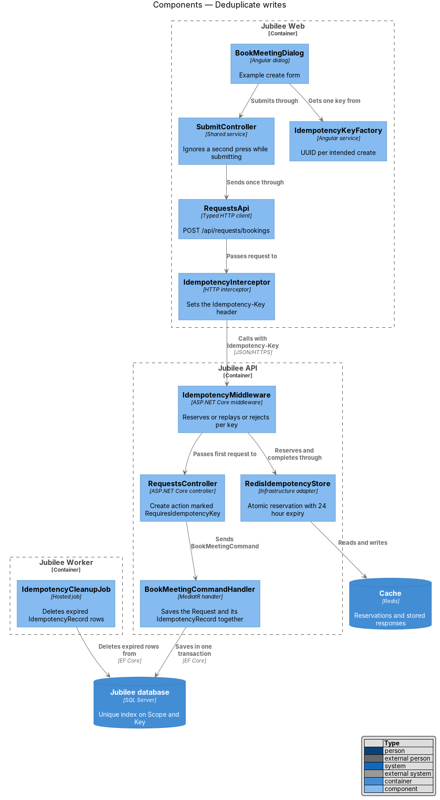
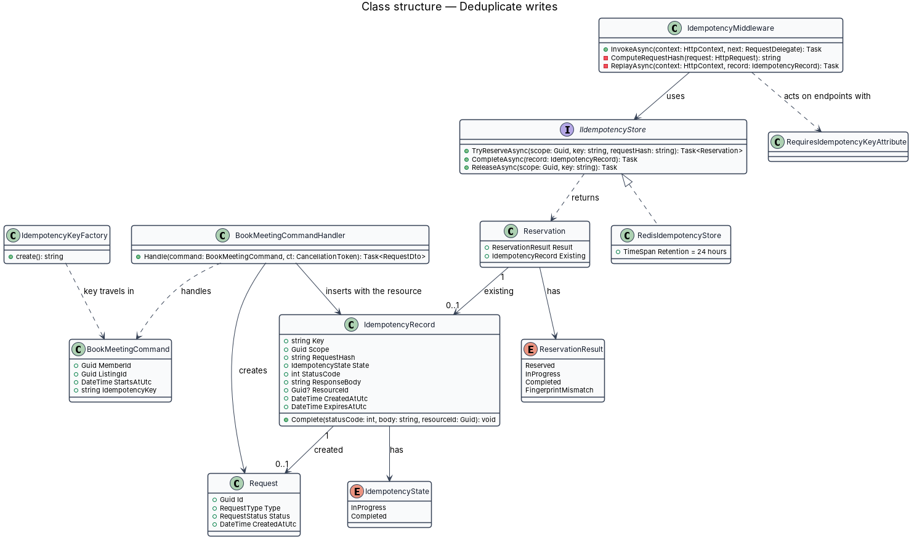
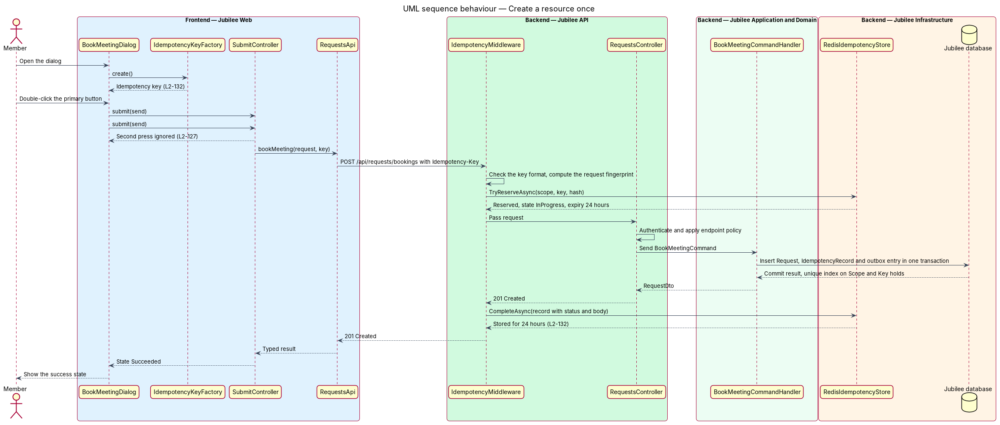
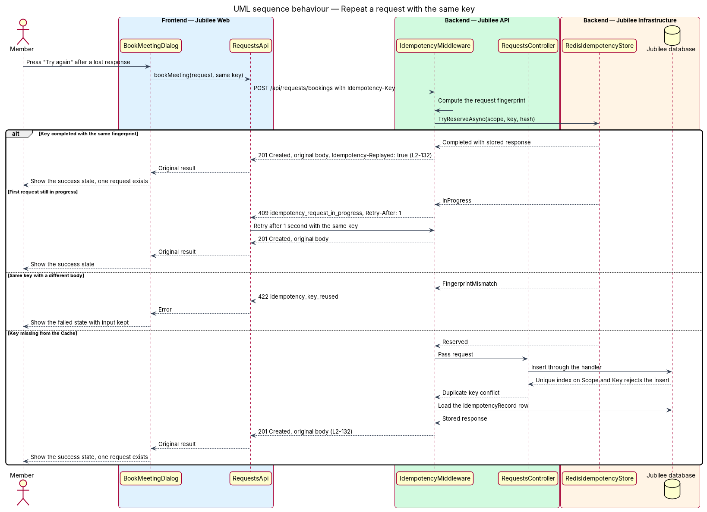

# Deduplicate writes

## Overview

Jubilee is Toronto's Christian marketplace. A member creates things in it: a
message, a booking, a quote request, an order request, a report, a listing
submission. On a phone and a mobile network the same create request can reach
the server twice: the member double-clicks the button, the browser retries
after a dropped connection, or the outgoing message queue resends a message
whose first response was lost. This feature guarantees that each intended
create produces exactly one resource.

Three terms are used throughout:

- **idempotency key** — identifier that the client generates once per intended create and sends with each attempt of it
- **replay** — response to a repeated key that returns the stored original result without running the create again
- **request fingerprint** — SHA-256 hash of the HTTP method, the route and the request body, stored with the key to detect a key reused for a different request

The client attaches the key in the `Idempotency-Key` header. The first request
with a key runs normally, and its result is stored under the key for 24 hours.
A repeated request with the same key inside that window receives the original
result and creates nothing.

The feature is cross-cutting. The diagrams use booking a meeting (`POST
/api/requests/bookings`) as the worked example; every create endpoint uses the
same parts.

## Description

The slice consists of the key source in `Jubilee Web`, one middleware in
`Jubilee API`, and storage in the `Cache` and the `Jubilee database`.

- **`IdempotencyKeyFactory`** — frontend service. `create()` returns a UUID
  version 4 from `crypto.randomUUID()`. A form or dialog obtains one key when it
  opens and keeps it for every attempt of that submission, including "Try
  again" after a failure. A new key is taken only after a success or when the
  form is reset.
- **`SubmitController`** — shared submit lifecycle. While a request is in
  flight it ignores further presses, so that a double-click sends one request
  (L2-127). The idempotency key covers the cases the button cannot: retries and
  resends.
- **`IdempotencyInterceptor`** — Angular HTTP interceptor. It copies the key
  that a typed client such as `RequestsApi` attaches to the request context into
  the `Idempotency-Key` header. Automatic retries reuse the same request object
  and therefore the same key.
- **`RequiresIdempotencyKeyAttribute`** — endpoint metadata on each create
  action: messages, bookings, quotes, orders, reports and listing submissions.
  `IdempotencyMiddleware` acts only on endpoints that carry it.
- **`IdempotencyMiddleware`** — `Jubilee.Api` middleware that runs after
  `SessionAuthenticationMiddleware` and `CsrfMiddleware`. It rejects a missing
  or malformed key with `400`, looks the key up through `IIdempotencyStore`,
  and either replays the stored response, rejects the request, or passes it on
  and stores the outcome.
- **`IdempotencyRecord`** — stored outcome: `Key`, `Scope`, `RequestHash`,
  `State`, `StatusCode`, `ResponseBody`, `ResourceId`, `CreatedAtUtc`,
  `ExpiresAtUtc`. `Scope` is the member ID of the caller, so that a key is
  unique per member; the scope for a create by a `Visitor` is `<TO SUPPLY>`.
  `ExpiresAtUtc` is `CreatedAtUtc` plus 24 hours.
- **`IdempotencyState`** — `InProgress` or `Completed`.
- **`IIdempotencyStore`** and **`RedisIdempotencyStore`** — the store reserves
  a key atomically in the `Cache` (Redis `SET` with `NX` and a 24-hour expiry)
  in state `InProgress`, and later completes it with the response.
- **Durable guard** — the command handler inserts the `IdempotencyRecord` row
  through `JubileeDbContext` in the same transaction as the created resource. A
  unique index on (`Scope`, `Key`) makes the database reject a second insert,
  so that exactly one resource exists even when the `Cache` loses the key. On
  that conflict the middleware loads the row and replays it.
- **Outcomes** — a `Completed` key with the same fingerprint returns the stored
  status code and body with the header `Idempotency-Replayed: true`. A key with
  a different fingerprint returns `422` with the code `idempotency_key_reused`.
  A key still `InProgress` returns `409` with the code
  `idempotency_request_in_progress` and `Retry-After: 1`. A handler failure
  with a `5xx` status releases the reservation, so that a retry runs again;
  `4xx` results are stored and replayed.
- **`BookMeetingCommandHandler`** — example create handler. It saves the
  `Request`, the `IdempotencyRecord` and the `OutboxMessage` in one unit of
  work.
- **`IdempotencyCleanupJob`** — hosted job in `Jubilee Worker` that deletes
  `IdempotencyRecord` rows whose `ExpiresAtUtc` has passed. Its schedule is
  `<TO SUPPLY>`.
- **Duplicate-create tests** — integration tests that send each create
  endpoint the same request twice in sequence and twice in parallel, and assert
  one resource and identical responses.

## Requirements

The feature realizes the following level-2 (L2) requirements. Each L2
requirement refines a level-1 (L1) requirement, cited by identifier.

| L2 ID | Refines (L1) | Requirement |
|-------|--------------|-------------|
| `L2-132` | `L1-018` | Each create request (message, booking, quote, order, report, listing submission) shall carry a client-generated idempotency key, and the server shall return the original result for a repeated key within 24 hours without creating a duplicate. A double-click or network retry shall create exactly one resource. |
| `L2-127` | `L1-018` | While a form or dialog is submitting, a second press of the primary button shall send nothing. |
| `L2-120` | `L1-017` | Queued messages shall be sent automatically when the connection returns, in order, each with its idempotency key. |

## Diagrams

### System context

A `Member` or an `Owner` creates messages, requests, reports and listing
submissions. No external system takes part.

### Containers

`Jubilee Web` generates the key. `Jubilee API` reserves it in the `Cache` and
writes the durable record with the resource in the `Jubilee database`;
`Jubilee Worker` removes expired records.

### Components

`IdempotencyInterceptor` adds the header on the way out. `IdempotencyMiddleware`
sits in front of `RequestsController` and decides between running the handler
and replaying a stored response.

### Class structure

`IdempotencyMiddleware` depends on `IIdempotencyStore`, which
`RedisIdempotencyStore` implements. Each `IdempotencyRecord` holds one
`IdempotencyState` and refers to the one `Request` it created.

### Behaviour — create a resource once

The first request with a key reserves it, runs the handler, and commits the
resource with its `IdempotencyRecord` in one transaction. The middleware then
stores the response for 24 hours.

### Behaviour — repeat a request with the same key

A network retry arrives with the key of an earlier request. The middleware
replays the stored response, answers `409` while the first request is still
running, or answers `422` when the body differs.

