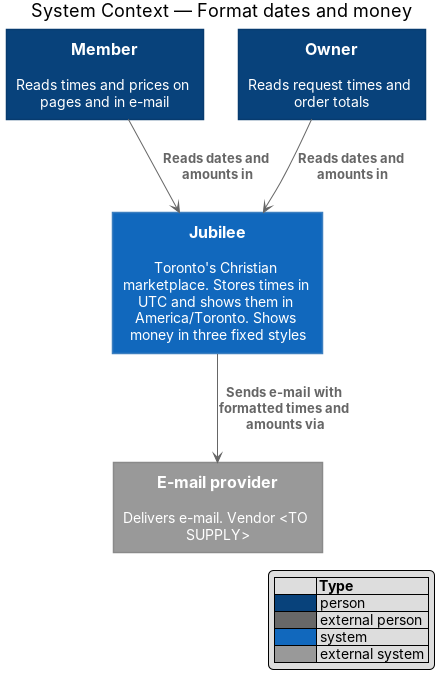
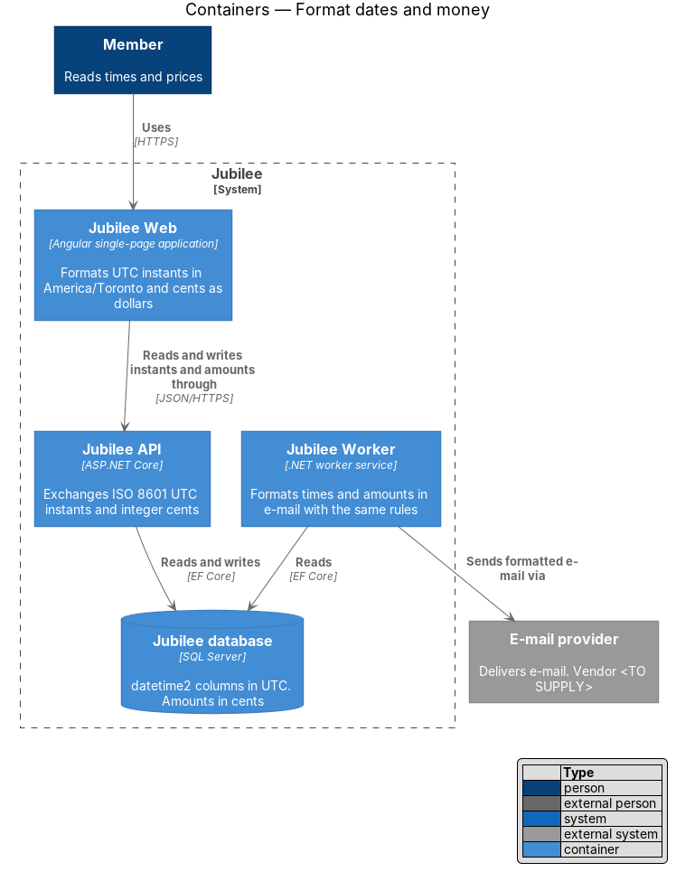
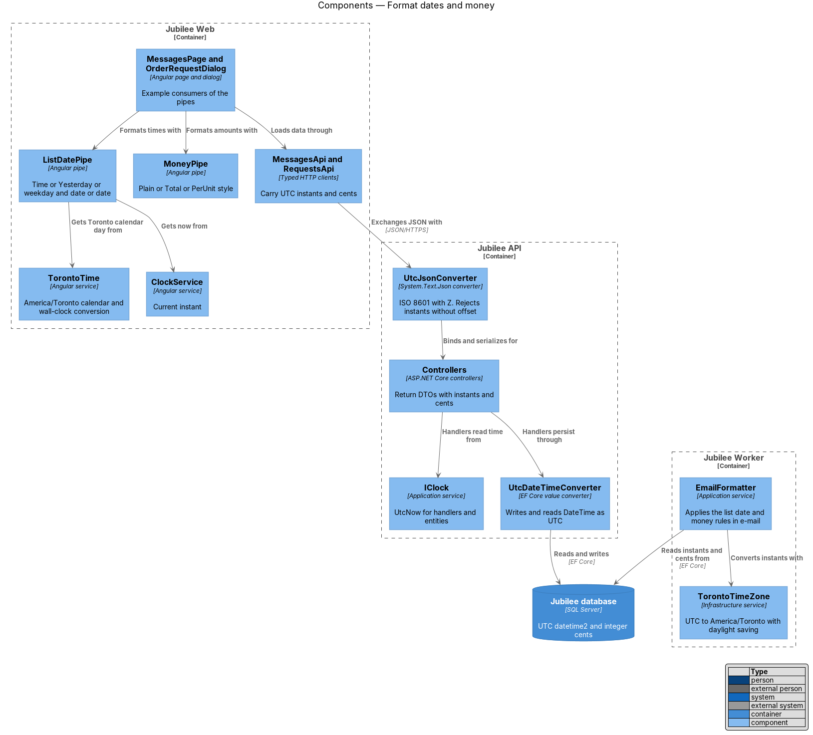
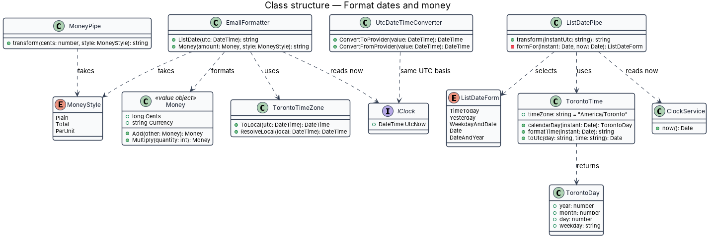
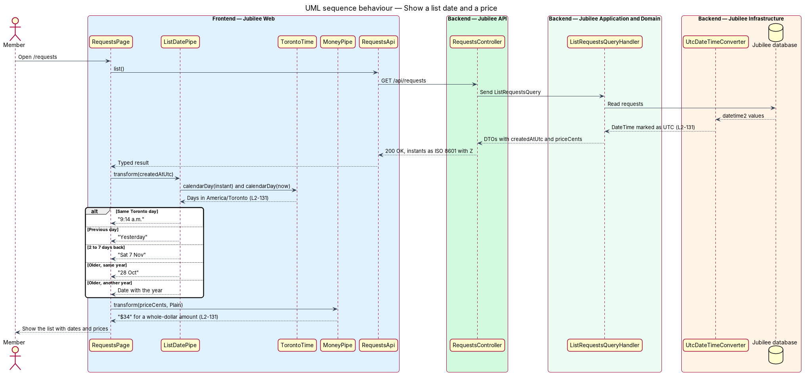
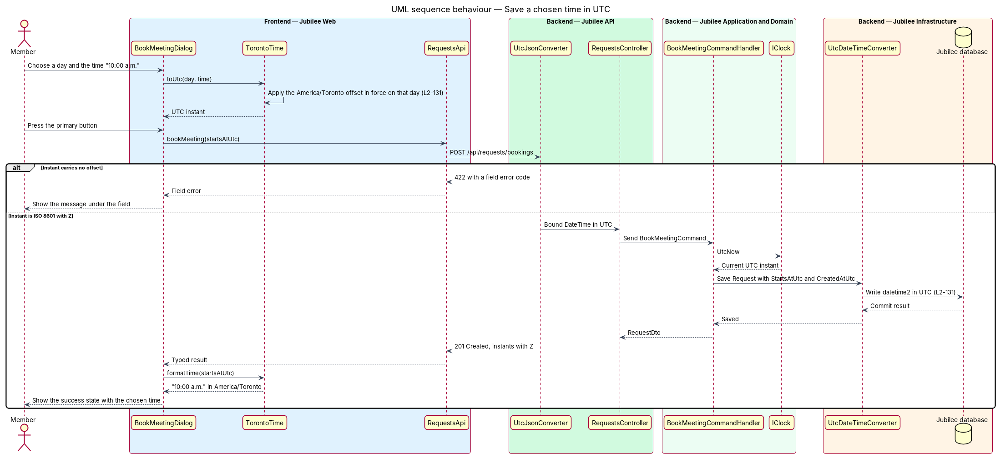

# Format dates and money

## Overview

Jubilee is Toronto's Christian marketplace. Its pages show times (when a message
arrived, when a meeting starts) and prices (what a product costs, what an order
totals). This feature fixes one way to store and one way to display both, so
that the same instant and the same amount read identically on every page, in
every dialog and in every e-mail.

Three terms are used throughout:

- **list date** — compact form of a past time used in lists such as the inbox and "Your requests"
- **wall-clock time** — date and time as a clock in Toronto shows it, without an offset
- **money style** — one of three display forms for an amount: plain, total, per unit

Every stored time is in Coordinated Universal Time (UTC). Every displayed time
is in the `America/Toronto` time zone, whatever the time zone of the device,
and daylight saving changes are handled by the time-zone database, not by a
fixed offset.

A list date takes one of four forms according to its age: a time today shows
the time ("9:14 a.m."); yesterday shows "Yesterday"; a time within the last
7 days shows the weekday and date ("Sat 7 Nov"); an older time shows the date
("28 Oct"), with the year added when it is not the current year. Money shows
whole dollars without cents ("$34"), totals in dialogs with cents and the tax
note ("$528.00 + tax"), and per-unit prices with "ea".

## Description

The slice consists of display pipes in `Jubilee Web`, a small set of value
types and converters in the backend, and the tests that pin the rules.

- **`TorontoTime`** — frontend service that wraps `Intl.DateTimeFormat` with
  `timeZone: 'America/Toronto'` and the locale `en-CA`. It returns the Toronto
  calendar date, weekday and wall-clock time of an instant, and converts a
  Toronto wall-clock time chosen in a form to a UTC instant.
- **`ClockService`** — frontend source of the current instant. Pipes read it
  instead of `Date.now()`, so that tests fix the time.
- **`ListDatePipe`** — pure pipe `jbListDate`. It compares Toronto calendar
  days, not elapsed hours: same day gives the time ("9:14 a.m."); the previous
  day gives "Yesterday"; 2 to 7 days back gives weekday and date ("Sat 7 Nov");
  older gives the date ("28 Oct"), or the date and year when the Toronto year
  differs from the current one.
- **`MoneyPipe`** — pure pipe `jbMoney` with a `MoneyStyle` argument. `Plain`
  drops the cents of a whole-dollar amount ("$34") and keeps two decimals
  otherwise. `Total` always shows two decimals and appends " + tax" ("$528.00 +
  tax"). `PerUnit` formats as `Plain` and appends " ea".
- **`<time>` element** — every rendered time sits in a `<time>` element whose
  `datetime` attribute holds the ISO 8601 UTC instant.
- **`Money`** — domain value object in `Jubilee.Domain` with `long Cents` and
  `string Currency` (`CAD`). Amounts are stored and serialized as integer
  cents, which avoids rounding in transit. The API field is `priceCents`.
- **`IClock`** — application service that returns `UtcNow`. Entities receive
  the current time as an argument and never read the system clock.
- **`UtcDateTimeConverter`** — EF Core value converter registered for every
  `DateTime` property in `JubileeDbContext`. It writes UTC to `datetime2`
  columns and marks values read back as `DateTimeKind.Utc`. Column names end in
  `Utc`.
- **`UtcJsonConverter`** — `System.Text.Json` converter in `Jubilee.Api`. It
  writes instants as ISO 8601 with the `Z` suffix and rejects an incoming
  instant that carries no offset with a `422` field error.
- **`TorontoTimeZone`** — backend service over `TimeZoneInfo` for
  `America/Toronto`. `Jubilee Worker` uses it with `EmailFormatter` to render
  times and amounts in e-mail with the same rules as the pipes.
  `ResolveLocal` converts a Toronto wall-clock time to UTC; it rejects a time
  that falls in the hour skipped in spring and maps a time in the hour repeated
  in autumn to its first occurrence.
- **`format-cases.json`** — shared table of inputs and expected strings for
  list dates and money, including instants on both sides of each daylight
  saving change. `ListDatePipe`, `MoneyPipe` and `EmailFormatter` tests all
  read it, which keeps the browser and e-mail output identical.
- **Lint rule** — static check that fails the build when a template uses the
  Angular `date` or `currency` pipe, or when C# code reads `DateTime.Now`.

## Requirements

The feature realizes the following level-2 (L2) requirements. Each L2
requirement refines a level-1 (L1) requirement, cited by identifier.

| L2 ID | Refines (L1) | Requirement |
|-------|--------------|-------------|
| `L2-131` | `L1-018` | In lists, a time today shall show the time, yesterday shall show "Yesterday", a time within the last 7 days shall show the weekday and date, and an older time shall show the date, with the year added when it is not the current year. Money shall show whole dollars without cents, totals in dialogs with cents, and per-unit prices with "ea"; all times shall be stored in UTC and displayed in America/Toronto with daylight saving changes handled correctly. |
| `L2-126` | `L1-018` | For each rule enforced in the browser, the server shall enforce the same rule and return the same message code. |

## Diagrams

### System context

Each person who uses Jubilee reads dates and amounts in the same form. The
`E-mail provider` delivers messages whose times and amounts follow the same
rules.

### Containers

`Jubilee API` stores and returns UTC instants and integer cents. `Jubilee Web`
formats them for the page, and `Jubilee Worker` formats them for e-mail.

### Components

`ListDatePipe` and `MoneyPipe` format what the typed clients return.
`UtcJsonConverter` and `UtcDateTimeConverter` keep instants in UTC between the
API and the database, and `EmailFormatter` applies the display rules in
`Jubilee Worker`.

### Class structure

`ListDatePipe` depends on `TorontoTime` and `ClockService`; `MoneyPipe` takes a
`MoneyStyle`. On the server, `Money` and `IClock` are the value type and the
time source, and `TorontoTimeZone` converts between UTC and Toronto time.

### Behaviour — show a list date and a price

`Jubilee API` returns the instant in UTC and the price in cents. The pipes
produce the list date from Toronto calendar days and the amount in the
requested money style.

### Behaviour — save a chosen time in UTC

A member picks a day and time in a booking dialog. `TorontoTime` converts the
Toronto wall-clock time to a UTC instant, and the server stores it unchanged in
a `datetime2` column.

