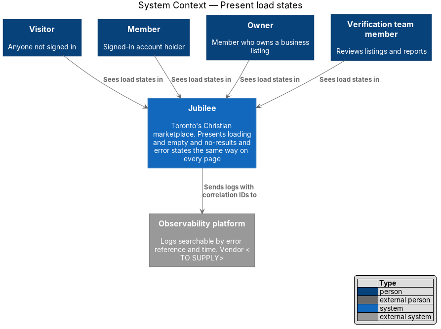
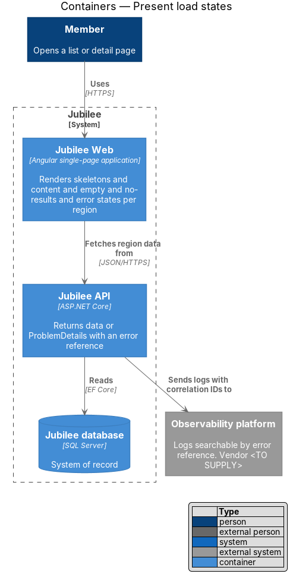
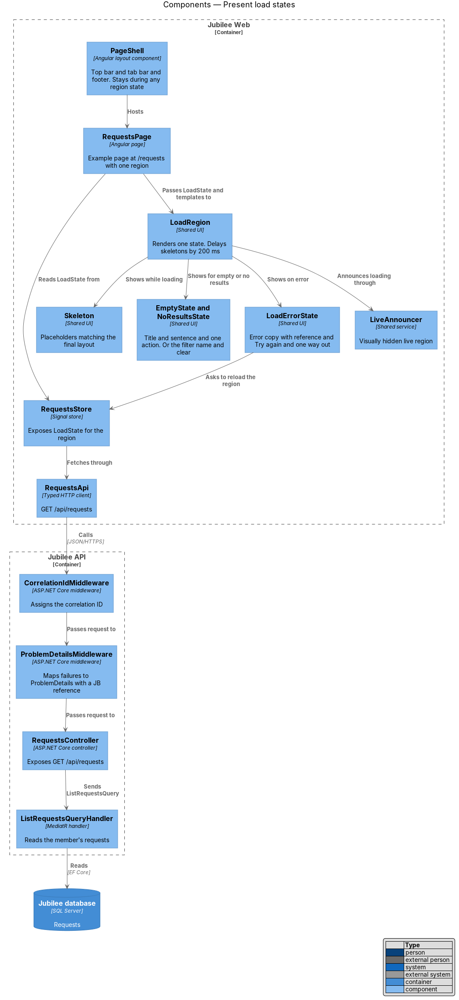
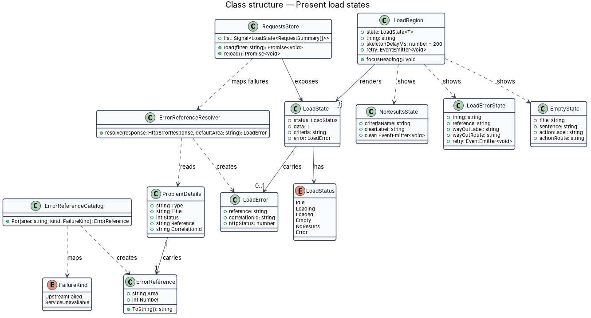
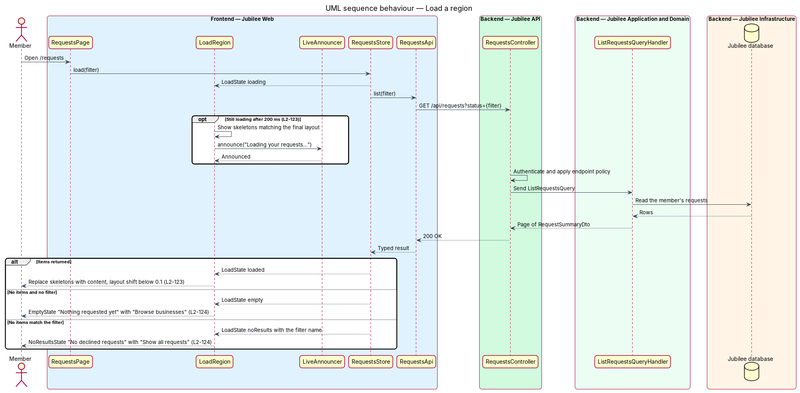
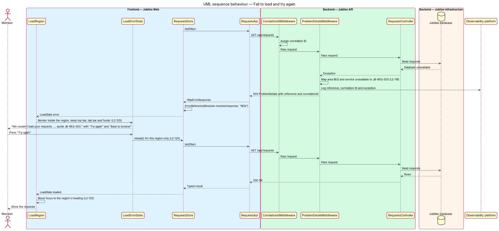

# Present load states

## Overview

Jubilee is Toronto's Christian marketplace. Every list and detail page in
`Jubilee Web` fetches data before it can show anything, and each fetch ends in
one of a small number of outcomes. This feature defines those outcomes once, as
a shared set of components, so that every page presents loading, empty,
no-results and error conditions in the same way.

Five terms are used throughout:

- **region** — part of a page that loads its own data and presents its own state, such as the list on `/requests`
- **skeleton** — grey placeholder with the same size and position as the content it stands in for
- **empty state** — presentation of a collection that holds no items at all
- **no-results state** — presentation of a collection whose active filter or search query matches nothing
- **error reference** — code of the form `JB-<AREA>-<NNN>` that a user quotes to support and that leads to the failing request in the logs (L2-118)

A region that is still fetching after 200 ms shows skeletons and announces
"Loading {thing}…" to screen readers. Skeletons match the final layout, so that
the content that replaces them causes a cumulative layout shift below `0.1`.
When the data arrives, the region shows the content, the empty state or the
no-results state. When the fetch fails, only that region shows the error; the
top bar, tab bar and footer stay in place, and "Try again" reloads only that
region.

The feature is cross-cutting. The page `/requests` ("Your requests") serves as
the worked example in the diagrams; every other page uses the same parts.

## Description

The slice consists of shared frontend parts, the server-side error contract and
the checks that hold both to the acceptance criteria.

- **`LoadState<T>`** — discriminated union every store exposes per region:
  `idle`, `loading`, `loaded` (with `data`), `empty`, `noResults` (with the
  active `criteria`), `error` (with `reference` and `correlationId`).
- **`LoadRegion`** — shared component `<jb-load-region>` that wraps a region. It
  takes a `LoadState`, the name of the thing being loaded and four templates:
  skeleton, content, empty and no-results. It renders exactly one of them, or
  `LoadErrorState`.
- **`SkeletonDelay`** — timer inside `LoadRegion`. Skeletons appear only when
  the state is still `loading` 200 ms after the fetch started; a faster response
  renders content directly.
- **`Skeleton`** — shared placeholder components (`SkeletonCard`,
  `SkeletonRow`, `SkeletonText`) sized from the same design tokens as the real
  components. The shimmer animation sits inside a
  `prefers-reduced-motion: no-preference` media query, so that skeletons do not
  animate under `prefers-reduced-motion: reduce`.
- **`LiveAnnouncer`** — visually hidden live region. `LoadRegion` writes
  "Loading {thing}…" to it when skeletons appear.
- **`EmptyState`** — shared component with a title, one sentence on how items
  get there and one primary action that leads to adding the first item. On
  `/requests`: "Nothing requested yet" with "Browse businesses".
- **`NoResultsState`** — shared component that names the active filter or query
  and offers to clear it. On `/requests` with the "Declined" filter: "No
  declined requests" with "Show all requests". The filter controls sit outside
  `LoadRegion` and stay visible.
- **`LoadErrorState`** — shared component with the copy "We couldn't load
  {thing}. Nothing is lost. Check your connection and try again. If it keeps
  happening, tell us and quote {reference}.", the button "Try again" and one way
  out (on `/requests`: "Back to browse"). "Try again" emits `retry`; the store
  reloads that region only. After a successful retry `LoadRegion` moves focus
  to the region's heading.
- **`PageShell`** — layout component that owns the top bar, tab bar and footer.
  It renders them independently of any region's `LoadState`.
- **`SessionGate`** — directive `jbSessionGate` on form pages. It sets the form
  `inert` and `aria-busy="true"` until `SessionService.ready()` resolves the
  session check.
- **`ProblemDetailsMiddleware`** — `Jubilee API` middleware that turns each
  unhandled failure into RFC 9457 `ProblemDetails` carrying `reference` and
  `correlationId`. `ErrorReferenceCatalog` maps the feature area of the endpoint
  and the failure kind to the code: `502` when an upstream dependency failed and
  `503` when the service was unavailable, for example `JB-REQ-503`.
- **`ErrorReferenceResolver`** — frontend service that reads `reference` from
  the `ProblemDetails`. When no response arrives at all, it returns the region's
  default `503` reference, for example `JB-REQ-503` for `/requests`.
- **`CorrelationIdMiddleware`** — assigns the correlation ID that each log entry
  of the request carries, so that support finds the entries from the reference
  and the time.
- **Layout-shift check** — CI step that measures cumulative layout shift for
  each page with a loading state and fails the build at `0.1` or above. The
  measuring tool is `<TO SUPPLY>`.

## Requirements

The feature realizes the following level-2 (L2) requirements. Each L2
requirement refines a level-1 (L1) requirement, cited by identifier.

| L2 ID | Refines (L1) | Requirement |
|-------|--------------|-------------|
| `L2-123` | `L1-018` | A list or detail page that fetches for longer than 200 ms shall show skeletons matching the final layout and announce "Loading {thing}…" in a visually hidden live region. Loaded content shall cause a cumulative layout shift below 0.1, skeletons shall not animate under `prefers-reduced-motion: reduce`, and a form page shall not be interactive until its session check completes. |
| `L2-124` | `L1-018` | An empty collection shall show a title, one sentence on how items get there and one primary action that leads to adding the first item. A filtered or searched collection with no matches shall name the filter or query and offer to clear it, with the filters kept visible. |
| `L2-125` | `L1-018` | When a page's data fails to load, the top bar, tab bar and footer shall stay, only the failed region shall show the error, and "Try again" shall reload only that region. After a successful retry, focus shall move to the region's heading. |
| `L2-118` | `L1-016` | Every load-error state shall show a reference the user can quote to support: the area code for the feature, `502` when an upstream dependency failed and `503` when the service was unavailable. The reference shall lead support to the failing request's correlation ID and log entries. |

## Diagrams

### System context

Every person who uses Jubilee sees load states. The `Observability platform`
holds the log entries that an error reference leads to.

### Containers

`Jubilee Web` renders the state of each region from the outcome of a request to
`Jubilee API`. The API reads the `Jubilee database` and sends its logs to the
`Observability platform`.

### Components

`RequestsPage` hands the `LoadState` of `RequestsStore` to `LoadRegion`, which
chooses between skeletons, content, `EmptyState`, `NoResultsState` and
`LoadErrorState`. On the server, `ProblemDetailsMiddleware` attaches the error
reference.

### Class structure

`LoadState` carries one `LoadStatus` and, on failure, a `LoadError`.
`LoadRegion` depends on the state components, and `ErrorReferenceCatalog`
produces the `ErrorReference` that `ProblemDetails` carries.

### Behaviour — load a region

`LoadRegion` waits 200 ms before it shows skeletons, then renders content, the
empty state or the no-results state according to the response.

### Behaviour — fail to load and try again

A failed request returns `ProblemDetails` with the error reference.
`LoadErrorState` shows it inside the region, and "Try again" reloads the region
and moves focus to its heading.

