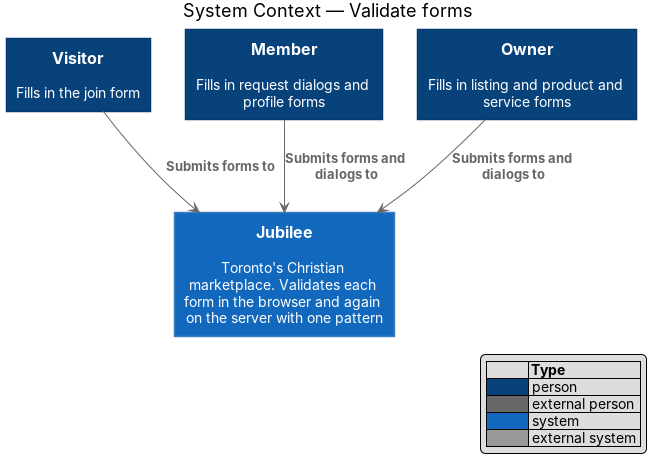
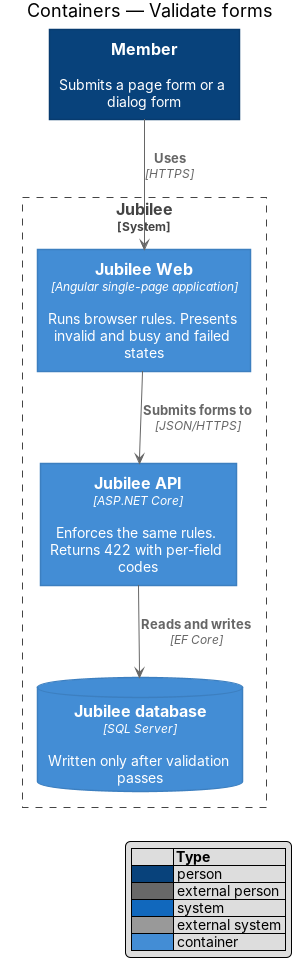
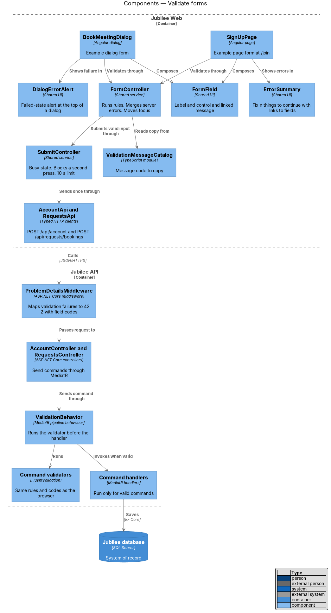
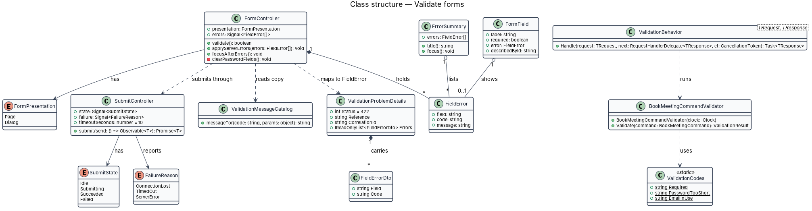
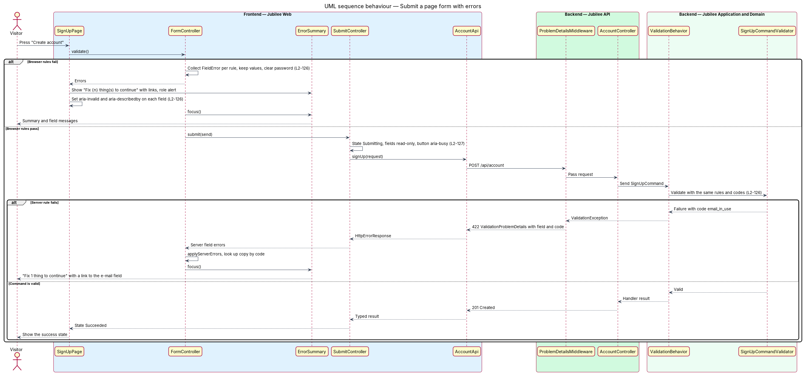
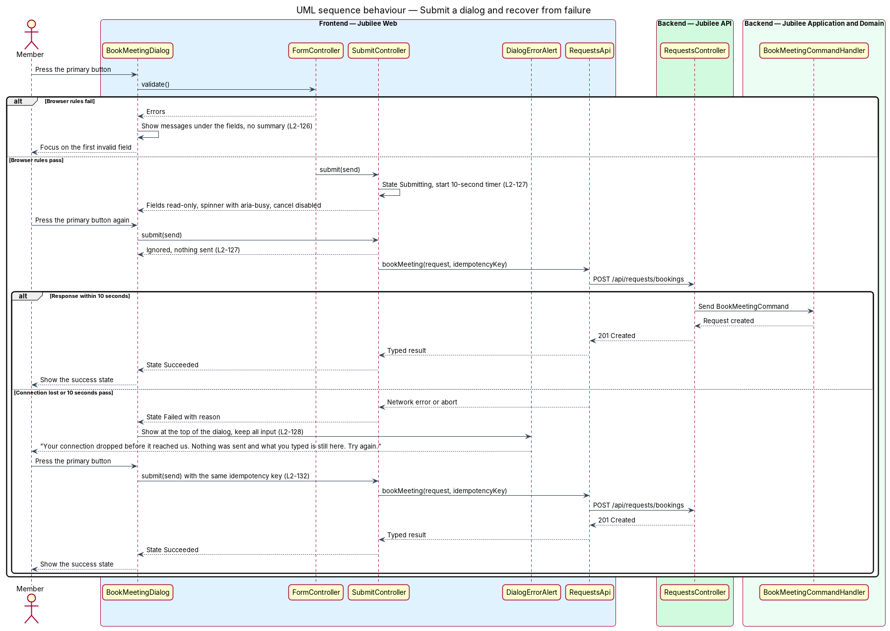

# Validate forms

## Overview

Jubilee is Toronto's Christian marketplace. Members fill in forms on full pages
(joining at `/join`, listing a business at `/list`) and in dialogs (booking a
meeting, asking for a quote, editing a product). This feature defines one
pattern for what happens between pressing the primary button and seeing the
result: how errors are shown, what the form looks like while the request is in
flight, and what a dialog shows when the submission fails.

Four terms are used throughout:

- **page form** — form that occupies a routed page
- **dialog form** — form inside a `DialogShell`
- **message code** — stable identifier of a validation rule's failure, such as `password_too_short`, shared by the browser and the server
- **failed state** — presentation of a submission that did not reach or was not completed by the server, with every typed value kept

A page form with errors shows a summary at the top, "Fix {n} thing(s) to
continue", that lists each error as a link to its field, and focus moves to the
summary. A dialog form shows messages under the fields with no summary, and
focus moves to the first invalid field. Values the user typed are kept, except
in password fields. Each rule the browser enforces is enforced again by the
server with the same message code.

While a submission is in flight the form is busy: fields are read-only and a
second press sends nothing. A submission that takes longer than 10 seconds
fails with the failed state instead of spinning indefinitely. A failed dialog
keeps its input and says what did not happen.

The feature is cross-cutting. The diagrams use `SignUpPage` (`/join`) as the
page form and `BookMeetingDialog` as the dialog form.

## Description

The slice consists of shared form parts in `Jubilee Web`, the validation
pipeline in `Jubilee API`, and a shared rule catalogue that keeps both sides
aligned.

- **`validation-rules.json`** — rule catalogue checked into the repository. Each
  entry holds a form, a field, a rule (`required`, `minLength: 10`, …) and its
  message code. A build step generates the TypeScript `ValidationRules`
  constants and the C# `ValidationCodes` class from it.
- **`ValidationMessageCatalog`** — frontend map from message code to copy. Each
  message says how to fix the error, for example "Use at least 10 characters.
  This one has 5." The copy comes from the `invalid.html` mocks.
- **`FormField`** — shared wrapper for a label, a control and its message. The
  label ends in "(required)" or "(optional)". When the field is invalid it sets
  `aria-invalid="true"` on the control, renders the message below it, and links
  the message with `aria-describedby`.
- **`ErrorSummary`** — shared component for page forms. It renders "Fix {n}
  thing(s) to continue" with `role="alert"` (singular for one error: "Fix 1
  thing to continue") and one link per error that moves focus to the field.
  `FormController` moves focus to the summary when it appears.
- **`FormController`** — shared service instantiated per form. It runs the
  client rules, merges server field errors, selects the presentation (`page`:
  summary and focus on the summary; `dialog`: no summary and focus on the first
  invalid field), and clears password controls while it keeps every other value.
- **`SubmitController`** — shared service that owns the submit lifecycle
  `Idle`, `Submitting`, `Succeeded`, `Failed`. While `Submitting` it ignores
  further submit events, sets fields read-only and starts a 10-second timer.
  When the timer ends first, it aborts the request and enters `Failed`.
- **`SubmitButton`** — shared primary button. While `Submitting` it shows a
  spinner, sets `aria-busy="true"` and keeps its label.
- **`DialogShell`** — shared dialog frame. While its form is busy it disables
  the cancel button and ignores Escape and the close button (L2-130).
- **`DialogErrorAlert`** — error alert at the top of a failed dialog. It says
  what did not happen and that the input is kept, for example "We couldn't send
  that". For a lost connection the copy is "Your connection dropped before it
  reached us. Nothing was sent and what you typed is still here. Try again."
  The primary button reads "Try again" in a confirmation dialog and keeps its
  label in a form dialog.
- **`ServerErrorMapper`** — maps a `422` response to field errors by `field` and
  `code`, and any other failure (network error, timeout, `5xx`) to the failed
  state.
- **`ValidationBehavior`** — MediatR pipeline behaviour in
  `Jubilee.Application`. It runs the FluentValidation validator of each command
  before the handler and throws `ValidationException` on failure.
- **`SignUpCommandValidator`**, **`BookMeetingCommandValidator`** —
  FluentValidation validators. Each rule sets its code with `WithErrorCode`
  from `ValidationCodes`.
- **`ProblemDetailsMiddleware`** — turns `ValidationException` into a `422`
  `ValidationProblemDetails` whose `errors` array holds one `FieldError`
  (`field`, `code`) per failure.
- **`ValidationParityTests`** — test suite that submits each catalogue entry's
  violating input to the matching endpoint and asserts the `422` response
  carries the catalogue's code for that field.

## Requirements

The feature realizes the following level-2 (L2) requirements. Each L2
requirement refines a level-1 (L1) requirement, cited by identifier.

| L2 ID | Refines (L1) | Requirement |
|-------|--------------|-------------|
| `L2-126` | `L1-018` | A page form submitted with errors shall show a summary "Fix {n} thing(s) to continue" that links each error to its field and receives focus; a dialog form shall show messages under the fields and focus the first invalid field. Each invalid field shall carry `aria-invalid="true"` and a linked message that says how to fix it, typed values shall be kept except passwords, the server shall enforce each browser rule with the same message code, and labels shall show "(optional)" or "(required)". |
| `L2-127` | `L1-018` | While a form or dialog is submitting, fields shall be read-only, the primary button shall show a spinner with `aria-busy="true"` and keep its label, the cancel button shall be disabled in dialogs, and a second press shall send nothing. A submission that takes longer than 10 seconds shall fail with the failed state. |
| `L2-128` | `L1-018` | When a dialog submission fails, an error alert at the top of the dialog shall say what did not happen and that the input is kept, everything typed shall be kept, and the primary button shall read "Try again" for confirmations or keep its label for forms. A lost connection shall show the dedicated connection-dropped copy. |
| `L2-132` | `L1-018` | Each create request shall carry a client-generated idempotency key, so that a double-click or network retry creates exactly one resource. |
| `L2-130` | `L1-018` | Escape or the close button shall close a dialog unless it is busy. |

## Diagrams

### System context

A `Visitor` joining, a `Member` sending a request and an `Owner` editing a
listing all meet the same form pattern. No external system takes part.

### Containers

`Jubilee Web` validates in the browser and presents every form state. `Jubilee
API` validates the same input again before it writes to the `Jubilee database`.

### Components

`FormController` and `SubmitController` sit between a form and its typed HTTP
client. On the server, `ValidationBehavior` runs the command's validator and
`ProblemDetailsMiddleware` returns the per-field codes.

### Class structure

`FormController` produces `FieldError` items, each with a `code` that both
`ValidationMessageCatalog` and the server validators share. `SubmitController`
holds one `SubmitState`.

### Behaviour — submit a page form with errors

`SignUpPage` shows the summary for errors found in the browser. A rule only the
server can check (an e-mail already in use) returns `422` with a message code,
and the same summary presents it.

### Behaviour — submit a dialog and recover from failure

`BookMeetingDialog` shows field messages without a summary, then enters the busy
state. A lost connection or the 10-second limit leads to the failed state with
the input kept; "Try again" resends with the same idempotency key.

