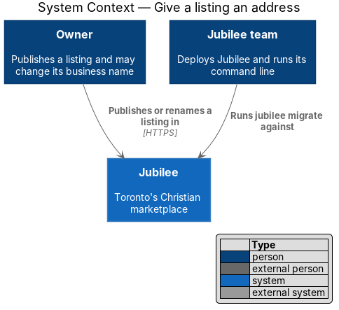
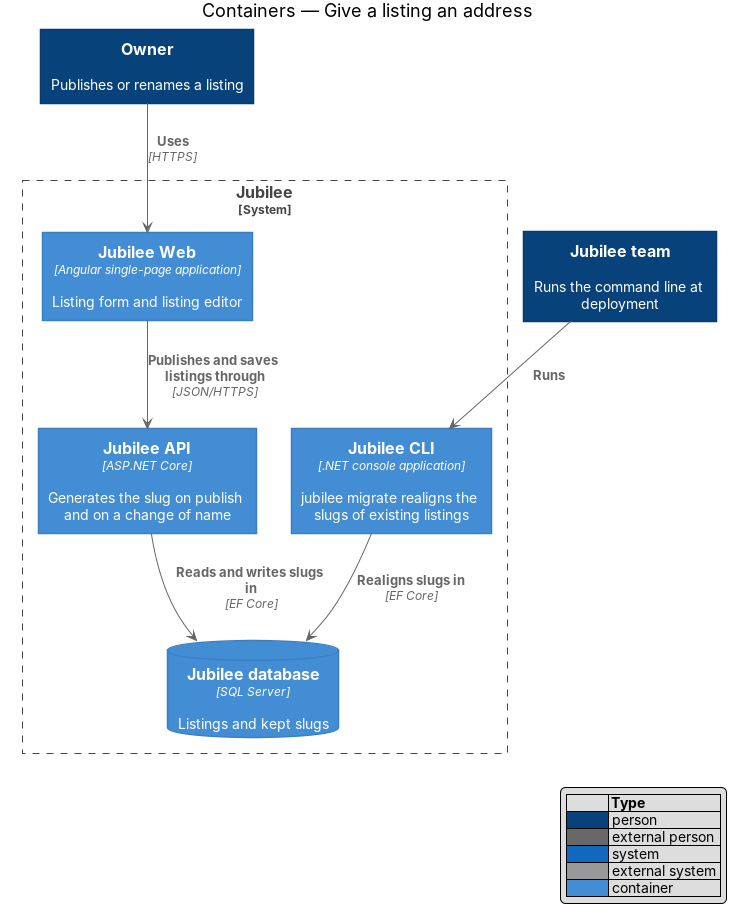
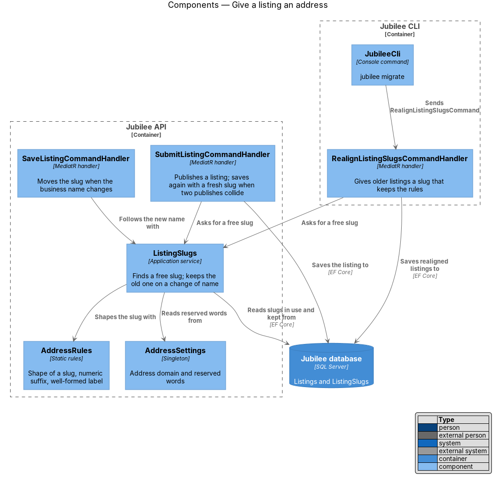
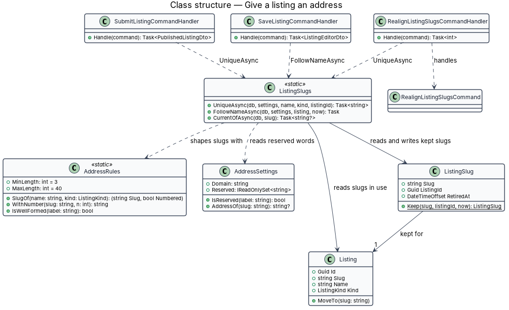
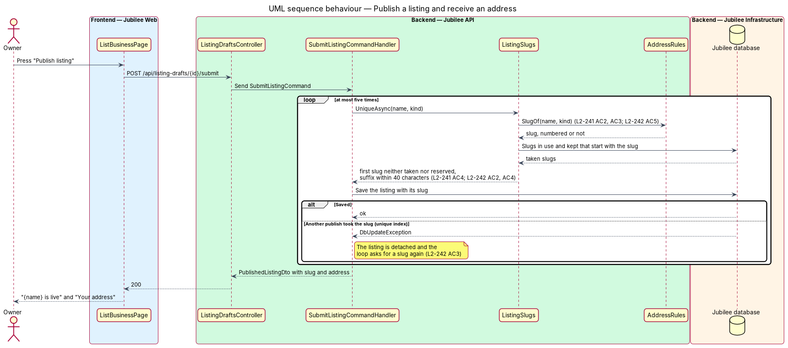
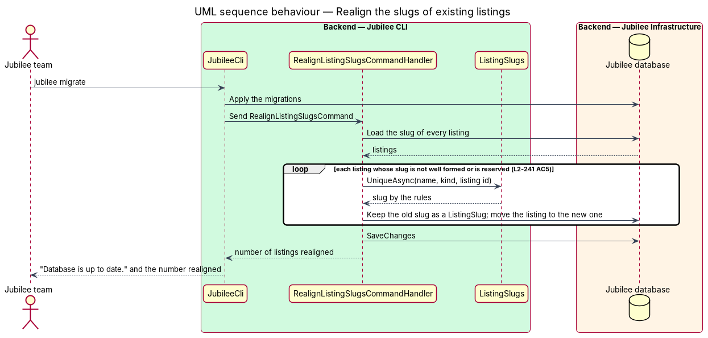

# Give a listing an address

## Overview

Jubilee is Toronto's Christian marketplace. Every listing (a business, a shop or
a space) has one public address of its own, `https://{slug}.jubilee.to`, short
enough for a card, a sign or a van. This feature covers how that address comes
to exist: how the slug is made from the business name, how it stays unique, and
how it follows the name while every earlier address keeps working.

The owner types no address. The slug is generated when the listing is published
and again when the business name changes. A draft that is not yet published has
no slug and therefore no address.

The feature uses the following local terms.

- **slug** — the part of a listing's links that names it, made from the business name, such as `luzandre-com`
- **address** — the public link `https://{slug}.{domain}` of a published listing, where the slug is one label directly under the address domain
- **address domain** — the domain addresses sit under (`jubilee.to` in production); empty where addresses are switched off
- **well-formed label** — 3 to 40 characters of `a` to `z`, `0` to `9` and single hyphens, with no hyphen at either end
- **reserved word** — a word that is never a slug because it names, or could be taken for, a host of Jubilee itself
- **kept slug** — a slug a listing had before its name changed; it redirects to the current slug and is never given to another listing (ADR 0056)
- **realign** — give a listing that existed before these rules a slug that keeps them

The feature has no screen. It sits in `Jubilee API` behind the publish and edit
commands, and in `Jubilee CLI` for listings that existed before the rules
(ADR 0067). Opening an address and showing it to the owner are separate designs:
[Open a listing by its address](../open-listing-by-address/README.md) and
[Share the address of a listing](../share-listing-address/README.md).

## Description

- **`AddressRules`** — static rules in `Jubilee.Application` (`Listings`).
  `SlugOf(name, kind)` lower-cases the name, removes accents, turns every other
  character into a hyphen, collapses runs of hyphens, trims hyphens, drops a
  leading `xn--`, and cuts the result to 40 characters without a trailing
  hyphen. A result shorter than 3 characters is replaced by the fallback
  `business`, or `space` for a space, and is marked as needing a number.
  `WithNumber(slug, n)` appends `-{n}` after cutting the base so the whole stays
  within 40 characters. `IsWellFormed(label)` tests a label against
  `^[a-z0-9]+(-[a-z0-9]+)*$` and the length bounds.
- **`AddressSettings`** — singleton bound from the `Addresses` configuration
  section. `Domain` is the address domain or empty. `Reserved` is the built-in
  list of `L2-242` AC4 joined with the words of `Addresses:Reserved`.
  `IsReserved(label)` compares in lower case. `AddressOf(slug)` answers
  `https://{slug}.{Domain}`, or null where `Domain` is empty.
- **`ListingSlugs.UniqueAsync`** — the existing lookup of a free slug, now
  given the listing kind and the settings. A candidate is taken when a reserved
  word equals it, when any listing has it (live, paused, removed, or deleted
  with its owner's account, since a deleted listing remains a row), or when a
  `ListingSlug` row keeps it for another listing. A fallback slug starts at
  number 1; every other slug is tried bare and then from number 2.
- **`ListingSlugs.FollowNameAsync`** — existing rule of ADR 0056, unchanged in
  behaviour: on a change of business name the listing moves to the slug of the
  new name, the old slug becomes a kept slug, and a kept slug of the same
  listing that it takes back stops being kept. No other command changes a slug,
  and no endpoint accepts one.
- **`SubmitListingCommandHandler`** — publishes a listing with the slug of
  `UniqueAsync`. When the save fails on the unique index of `Listings.Slug`
  because another publish took the same slug in the same moment, the handler
  asks for a free slug again and saves again, at most five times.
- **`RealignListingSlugsCommand`** and its handler — sent by `jubilee migrate`
  after the schema step. Every listing whose slug is not a well-formed label or
  is a reserved word receives a slug by the rules; the old slug becomes a kept
  slug of that listing. A listing whose slug keeps the rules is not touched, so
  a second run changes nothing. The command answers the number of listings
  realigned, which the CLI prints.
- **`Listing`** and **`ListingSlug`** — existing entities. `Listing.Slug` holds
  the current slug under a unique index; `ListingSlug` holds a kept slug with
  its listing and the time it was retired. The column widths do not change.

## Requirements

The feature realizes the following level-2 (L2) requirements. Each L2
requirement refines a level-1 (L1) requirement, cited by identifier.

| L2 ID | Refines (L1) | Requirement |
|-------|--------------|-------------|
| `L2-241` | `L1-032` | The address of a listing shall be `https://{slug}.jubilee.to`. The slug shall be the business name in lower case without accents, with single hyphens for every other run of characters, at most 40 characters, never ending in a hyphen. A slug shorter than 3 characters shall become "business" or "space" with a number. A numeric suffix shall keep the slug within 40 characters. A listing that existed before with a slug that breaks a rule shall receive a new slug and keep the old one as a redirect. A draft shall have no address. |
| `L2-242` | `L1-032` | Slugs that differ only in capitals shall be the same slug. A slug a listing has or had shall never be given to another listing. Two owners who publish the same business name at the same moment shall both succeed, each with a slug of its own. A reserved word shall be treated as taken, and the list of reserved words shall be a setting. A slug shall not begin with "xn--". |
| `L2-245` | `L1-032` | A change of business name shall move the address to the new slug and keep the old address for that listing. A name changed back shall give the listing its first address again. Nothing but a change of business name shall change an address, and no endpoint shall set a slug directly. |
| `L2-072` | `L1-010` | Publishing a listing shall generate a unique URL slug from the business name, with a numeric suffix if taken; the slug is the first label of the listing's address. |
| `L2-113` | `L1-016` | A change of business name shall give the listing a slug of the new name, and the old slug shall be kept for that listing and never given to another. |

## Diagrams

### System context

An owner publishes or renames a listing and Jubilee gives it an address. The
Jubilee team runs the CLI once per deployment, which realigns older listings.

### Containers

`Jubilee API` generates slugs inside the publish and edit commands. `Jubilee
CLI` realigns existing listings against the same database with the same rules.

### Components

`SubmitListingCommandHandler` and `SaveListingCommandHandler` reach the rules
through `ListingSlugs`. `RealignListingSlugsCommandHandler` uses the same path
from the CLI.

### Class structure

`AddressRules` holds the shape of a slug, `AddressSettings` the domain and the
reserved words, and `ListingSlugs` the uniqueness across `Listing` and
`ListingSlug`.

### Behaviour — publish a listing and receive an address

The handler asks for a free slug, saves, and tries again with a fresh slug when
another publish took the same one in the same moment.

### Behaviour — realign the slugs of existing listings

`jubilee migrate` sends the command after the schema step. Listings that keep
the rules are skipped; the others move and keep their old slug as a redirect.

