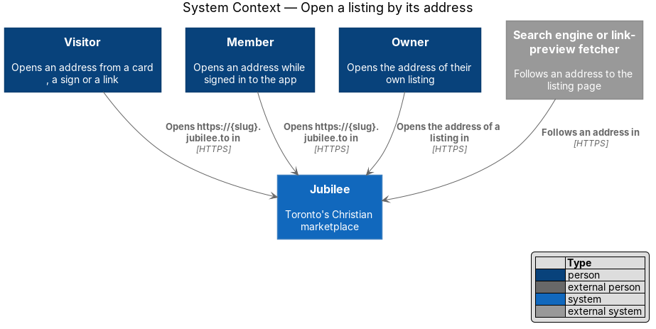
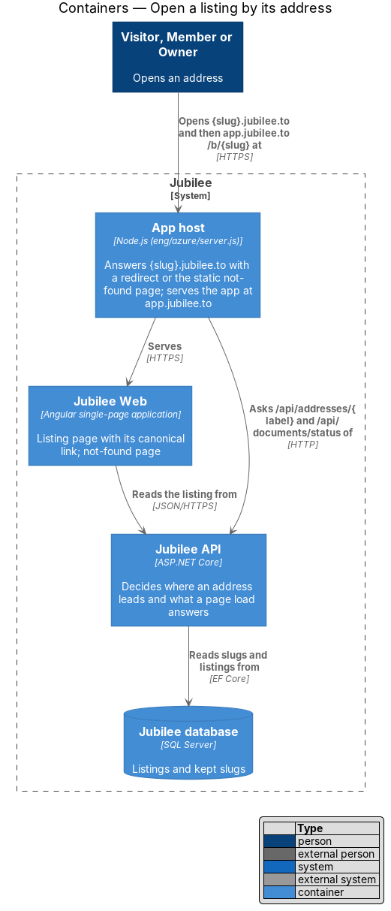
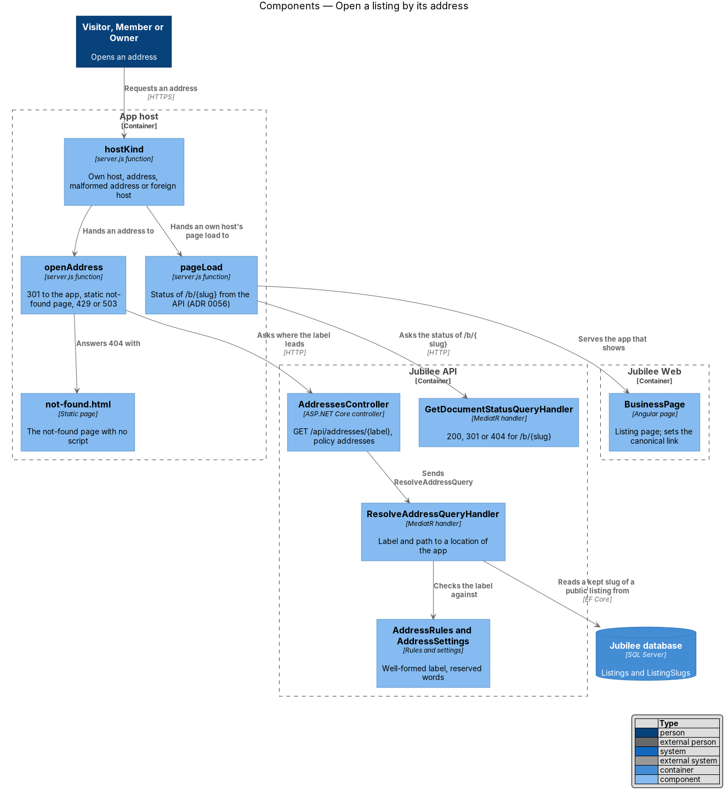
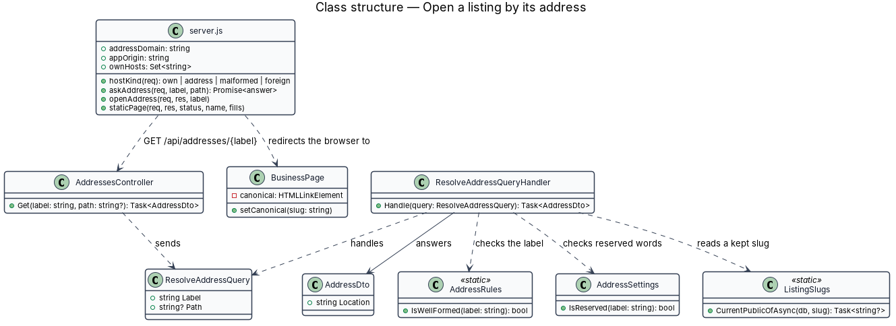
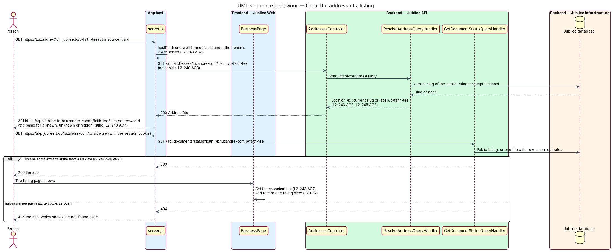
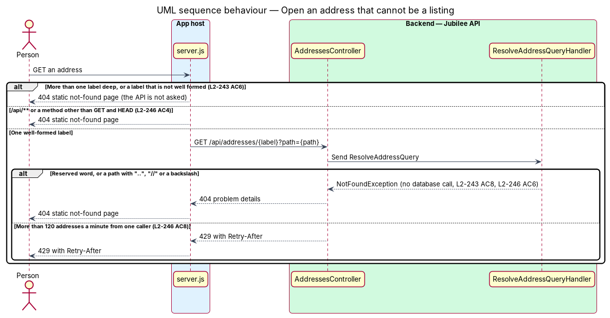

# Open a listing by its address

## Overview

Jubilee is Toronto's Christian marketplace. Every published listing has the
address `https://{slug}.jubilee.to`. This feature covers what happens when
someone opens that address: the person is redirected to the listing's public
page in the app, `https://app.jubilee.to/b/{slug}`, where the member's session
lives. The address itself shows nothing and keeps no session.

The address is what an owner prints on a card or a sign, so it has to keep
leading to the business. An address made from an earlier business name leads to
the same page under the current slug in one redirect. An address followed by a
path leads to the same path under the listing's page, so a product has an
address too.

The feature uses the following local terms.

- **address** — the public link `https://{slug}.{domain}` of a published listing
- **address domain** — the domain addresses sit under (`jubilee.to` in production)
- **label** — the first part of a host name; for an address, the slug
- **well-formed label** — 3 to 40 characters of `a` to `z`, `0` to `9` and single hyphens, with no hyphen at either end
- **own host** — a host name Jubilee serves itself, such as `app.jubilee.to`
- **app host** — the Node.js program (`eng/azure/server.js`) that serves the app's files and decides the status of a page load (ADR 0056)
- **kept slug** — a slug a listing had before its name changed (ADR 0056)
- **static not-found page** — a copy of the app's not-found page with no script, served where the app itself is not

The app host answers the address; no separate site exists for it (ADR 0067).
The host asks `Jubilee API` where the address leads, and the app's existing
page load decides whether the listing page or the not-found page shows.

## Description

- **`server.js`** (`eng/azure/`) — the app host. With `ADDRESS_DOMAIN` and
  `APP_ORIGIN` set, `hostKind(req)` classifies the `Host` header before any
  other routing: an own host (`OWN_HOSTS`, `WEBSITE_HOSTNAME`, a loopback name
  or an IP literal), an address (one label under the address domain), a
  malformed address (under the domain but more than one label deep, or a label
  that is not well formed), or a foreign host. An own host is answered as
  before. `openAddress(req, res, label)` answers an address.
- **`openAddress`** — for `GET` and `HEAD` outside `/api`, asks `Jubilee API`
  `GET /api/addresses/{label}?path={path}` (`askAddress`) with the caller's
  address and correlation ID and no cookie, waiting 3 seconds at most. A 200
  answers 301 to `APP_ORIGIN` + the location + the query of the request, with
  `Cache-Control: no-store`. A 404 answers the static not-found page with 404.
  A 429 is passed on with its `Retry-After`. No answer in time answers 503 with
  `Retry-After: 5`. Every other method and every `/api` path answer the static
  not-found page with 404 (`addressNotFound`). A location that is not a path
  under `/b/` is not followed.
- **`not-found.html`** — static not-found page built by
  `tools/static-pages/build.mjs` from the mock `pages/not-found/default.html`
  into `frontend/projects/jubilee/public/static/`. The host writes `APP_ORIGIN`
  into its "Back to browse" and "Search" links and into the addresses of its
  icon and font, since an address serves no file; the app's host lets any
  origin read a font file.
- **`AddressesController`** — anonymous ASP.NET Core controller in
  `Jubilee.Api` for `GET /api/addresses/{label}`, under the rate-limit policy
  `addresses`. It answers `AddressDto` with `Cache-Control: no-store`.
- **`ResolveAddressQuery`** and **`ResolveAddressQueryHandler`** — MediatR
  query and handler in `Jubilee.Application` (`Listings`). The handler lowers
  the label, answers `NotFoundException` for a label that is not well formed or
  is a reserved word before any database call, and answers `NotFoundException`
  for a path that holds an empty, `.` or `..` segment, a backslash or a control
  character. Otherwise it reads the current slug of the public listing that
  kept the label (`ListingSlugs.CurrentPublicOfAsync`) and answers the location
  `/b/{slug}{path}`, each path segment decoded and encoded again; without a
  kept slug the slug is the label itself. The handler does not report whether a
  listing exists or is public.
- **`AddressDto`** — the answer: `Location`, a path of the app.
- **Page load of `/b/{slug}`** — unchanged (ADR 0056). `GetDocumentStatusQuery`
  answers 200 for a public listing, 200 for the owner or the Jubilee team of a
  listing that is not public (the preview of `L2-219`), 301 for a kept slug and
  404 otherwise; the host serves the app with that status. A listing view is
  recorded by the listing page, not by the redirect.
- **`BusinessPage`** — sets `<link rel="canonical" href="{origin}/b/{slug}">`
  in the document head while a listing shows and removes it on leaving, so a
  crawler that followed an address indexes the listing once.

## Requirements

The feature realizes the following level-2 (L2) requirements. Each L2
requirement refines a level-1 (L1) requirement, cited by identifier.

| L2 ID | Refines (L1) | Requirement |
|-------|--------------|-------------|
| `L2-243` | `L1-032` | The address of a public listing shall answer 301 to the listing's page in the app, keeping a path and a query. An address with capitals shall lead to the same page. An address that no listing has, or whose listing is not public, shall arrive at the not-found page with HTTP 404, with no response telling the two cases apart. The owner and the Jubilee team shall arrive at the preview. An address more than one label deep or with a label that is not well formed shall answer 404. The listing page shall name its page in the app as its canonical link. The redirect shall call no database for a label that is not well formed or is reserved. |
| `L2-245` | `L1-032` | An old address, with or without a path, shall lead with 301 to the same page under the listing's current slug in one redirect. A listing that is paused and resumed shall be opened by its address again. |
| `L2-113` | `L1-016` | An unknown URL or a removed listing shall answer 404 with the not-found page, and an old slug shall redirect with 301 to the current slug. |
| `L2-028` | `L1-003` | A listing that is not public shall produce the not-found page with HTTP 404, except for the owner and the Jubilee team. |
| `L2-037` | `L1-005` | A listing view shall be counted when the listing page shows. |

## Diagrams

### System context

A person opens an address from a card, a sign or a shared link, and Jubilee
leads them to the listing page.

### Containers

The app host receives the address, asks `Jubilee API` where it leads, and
redirects the browser to the app, which the same host then serves.

### Components

`server.js` classifies the host and calls `AddressesController`.
`ResolveAddressQueryHandler` applies the rules and reads at most one kept slug.

### Class structure

The host holds the classification and the redirect. The handler turns a label
and a path into a location of the app.

### Behaviour — open the address of a listing

The host redirects to the app; the app's page load then answers the listing
page, or the not-found page for an unknown or hidden listing. Both cases receive
the same redirect.

### Behaviour — open an address that cannot be a listing

A label that is not well formed or is reserved, a deep host and an unsafe path
answer the static not-found page with 404 and never reach the database.

