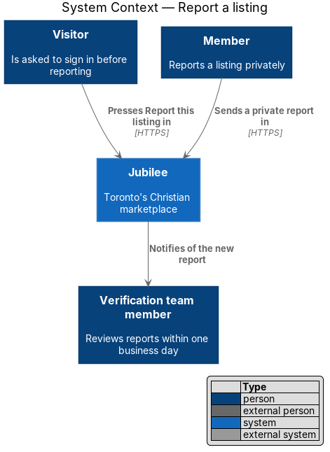
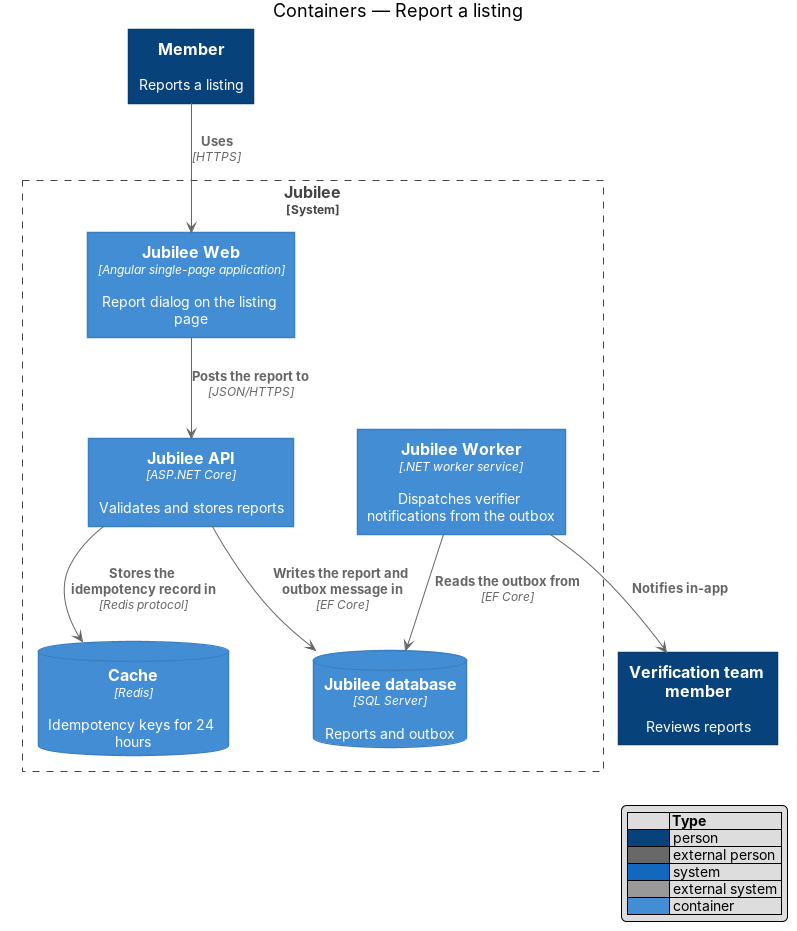
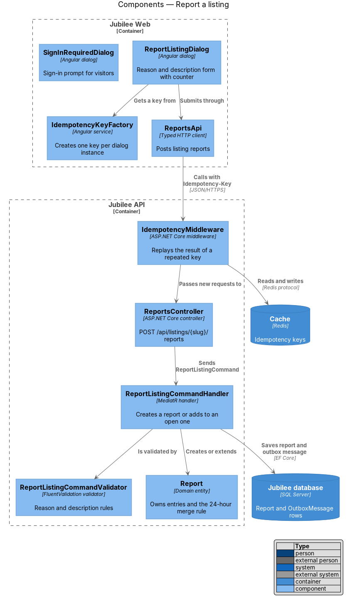
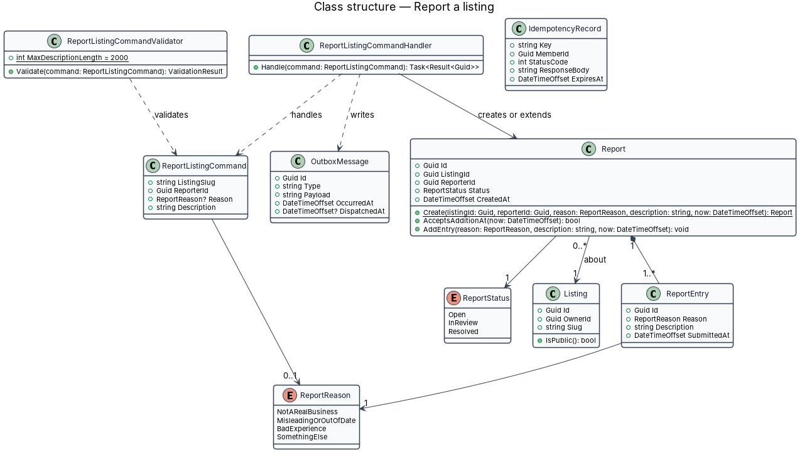
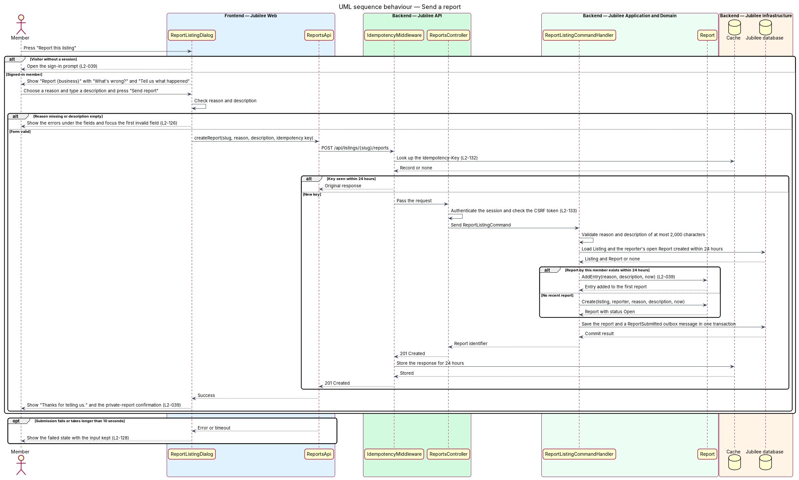

# Report a listing

## Overview

Jubilee is Toronto's Christian marketplace, and its value rests on listings
that members can trust. A member who believes a listing is false, misleading or
tied to a bad experience can report it. This feature covers the "Report this
listing" action on a listing page and the dialog that sends the report.

A report is private. The dialog states "Reports are private. The business is
not told who sent them." The report goes to the verification team, which
reviews it within one business day and may e-mail the reporter with a question.
The owner of the listing never sees who sent a report. Reviewing and resolving
reports is the reports-handling feature of the verification team (`L2-105`);
this feature ends when the report is stored and the team is notified.

The feature uses the following local terms.

- **report** — private statement from one member that something is wrong with one listing
- **reason** — one of four fixed choices that routes the report to the right reviewer
- **report entry** — one submission of reason and description; a report holds one or more entries
- **moderation queue** — list of reports that the verification team works through
- **idempotency key** — client-generated identifier that lets the server recognise a repeated submission

A visitor cannot report. Pressing "Report this listing" without a session opens
the sign-in prompt. An owner viewing their own listing does not see the action.

## Description

The feature is a vertical slice from the dialog to the database and the outbox.

- **`ReportListingDialog`** — Angular dialog titled "Report {business}". It
  shows the privacy statement, the radio group "What's wrong?" with the options
  "It isn't a real business", "The listing is misleading or out of date", "I had
  a bad experience" and "Something else", the text area "Tell us what happened"
  and the button "Send report". The text area stops input at 2,000 characters
  and a counter shows the characters remaining.
- **Dialog validation** — on "Send report" with no reason the dialog shows
  "Choose a reason so the right person looks at it."; with an empty description
  it shows "Add a sentence or two so we know what to check." Messages appear
  under the fields, and focus moves to the first invalid field. Typed values
  are kept.
- **Dialog states** — while the request is in flight the fields are read-only,
  the primary button shows a spinner and keeps its label, and a second press
  sends nothing. A submission that takes longer than 10 seconds fails. The
  failed state keeps the input. The success state reads "Thanks for telling
  us. Your report is private. Our verification team reviews it within one
  business day and may e-mail you with a question."
- **`SignInRequiredDialog`** — sign-in prompt opened in place of the report
  dialog when `SessionService` holds no session.
- **`IdempotencyKeyFactory`** — service that creates one key when the dialog
  opens. Every retry from the same dialog instance reuses that key.
- **`ReportsApi`** — typed Angular HTTP client for
  `POST /api/listings/{slug}/reports`. It sends the key in the
  `Idempotency-Key` header.
- **`IdempotencyMiddleware`** — middleware in `Jubilee.Api`. It stores an
  `IdempotencyRecord` per key and member in `Cache` for 24 hours and returns
  the original response for a repeated key, so a double press or a network
  retry creates one report.
- **`ReportsController`** — ASP.NET Core controller. The endpoint requires a
  session and a CSRF token and answers 201 on success. An unauthenticated call
  receives 401. A call from the listing's owner receives 403. A slug that
  names no public listing receives 404.
- **`ReportListingCommand`** and **`ReportListingCommandValidator`** — MediatR
  command and its FluentValidation validator. The validator requires a
  `ReportReason` and a non-blank description of at most 2,000 characters. A
  failure returns 422 with the per-field codes `REASON_REQUIRED`,
  `DESCRIPTION_REQUIRED` and `DESCRIPTION_TOO_LONG`.
- **`ReportListingCommandHandler`** — MediatR handler. It loads the listing
  and the reporter's most recent report for that listing. When that report was
  created less than 24 hours earlier, the handler adds the submission to it as
  a new `ReportEntry`; otherwise it creates a new `Report`. It saves the report
  and a `ReportSubmitted` outbox message in one transaction.
- **`Report`** — domain entity with `ListingId`, `ReporterId`, `ReportStatus`
  (`Open`, `InReview`, `Resolved`) and its entries. `AcceptsAdditionAt`
  expresses the 24-hour rule. `ReporterId` is returned only by verifier
  endpoints.
- **`ReportSubmitted`** — outbox message that `OutboxDispatcherJob` in
  `Jubilee.Worker` turns into a notification for the verification team. The
  report then appears in the moderation queue of `L2-105`.

## Requirements

The feature realizes the following level-2 (L2) requirements. Each L2
requirement refines a level-1 (L1) requirement, cited by identifier.

| L2 ID | Refines (L1) | Requirement |
|-------|--------------|-------------|
| `L2-039` | `L1-005` | Members shall be able to report a listing privately to the verification team. |
| `L2-126` | `L1-018` | A dialog form with errors shall show each message under its field, shall move focus to the first invalid field, and shall keep the values that the user typed. |
| `L2-128` | `L1-018` | A failed dialog submission shall show an error alert at the top of the dialog that says what did not happen, and shall keep everything typed. |
| `L2-132` | `L1-018` | Every create request shall carry a client-generated idempotency key, and the server shall return the original result for a repeated key within 24 hours without creating a duplicate. |
| `L2-133` | `L1-019` | The server shall check the caller's role and ownership of the specific object on every API endpoint; no check shall rely on the client hiding a control. |

## Diagrams

### System context

A member sends a private report, and Jubilee notifies the verification team. A
visitor is asked to sign in first.

### Containers

`Jubilee Web` posts the report to `Jubilee API`, which stores the idempotency
record in `Cache` and the report in `Jubilee database`. `Jubilee Worker`
notifies the verification team from the outbox.

### Components

The dialog obtains one idempotency key and submits through `ReportsApi`.
`IdempotencyMiddleware` screens repeats before `ReportsController` dispatches
the command to the handler.

### Class structure

A `Report` owns one or more `ReportEntry` values, each with a `ReportReason`.
The handler either creates a `Report` or extends an existing one, and writes an
`OutboxMessage`.

### Behaviour — send a report

The dialog validates the form, the middleware applies the `L2-132` idempotency
rule, and the handler applies the 24-hour merge rule of `L2-039` before it
saves the report and the outbox message in one transaction.

