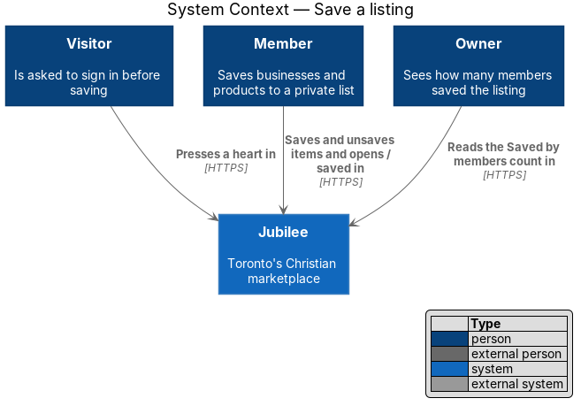
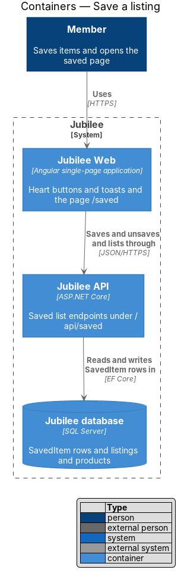
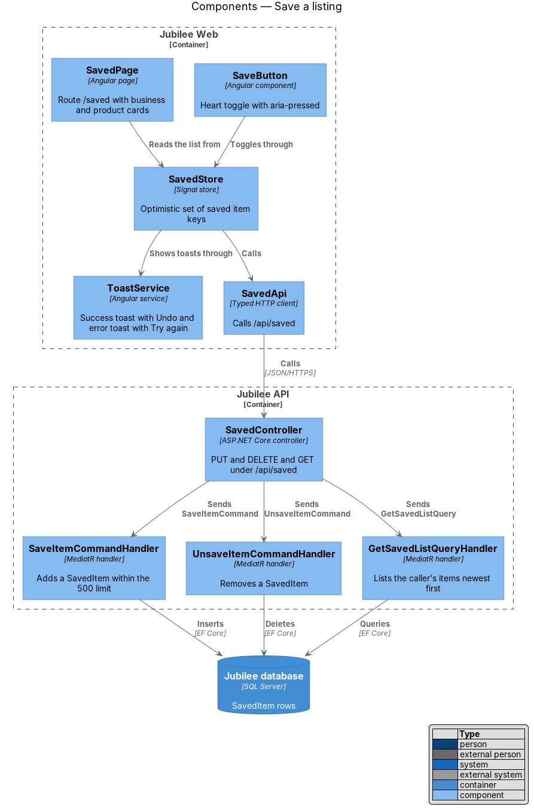
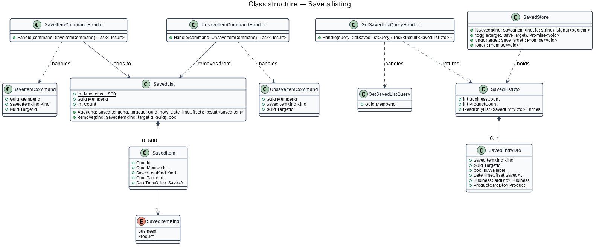
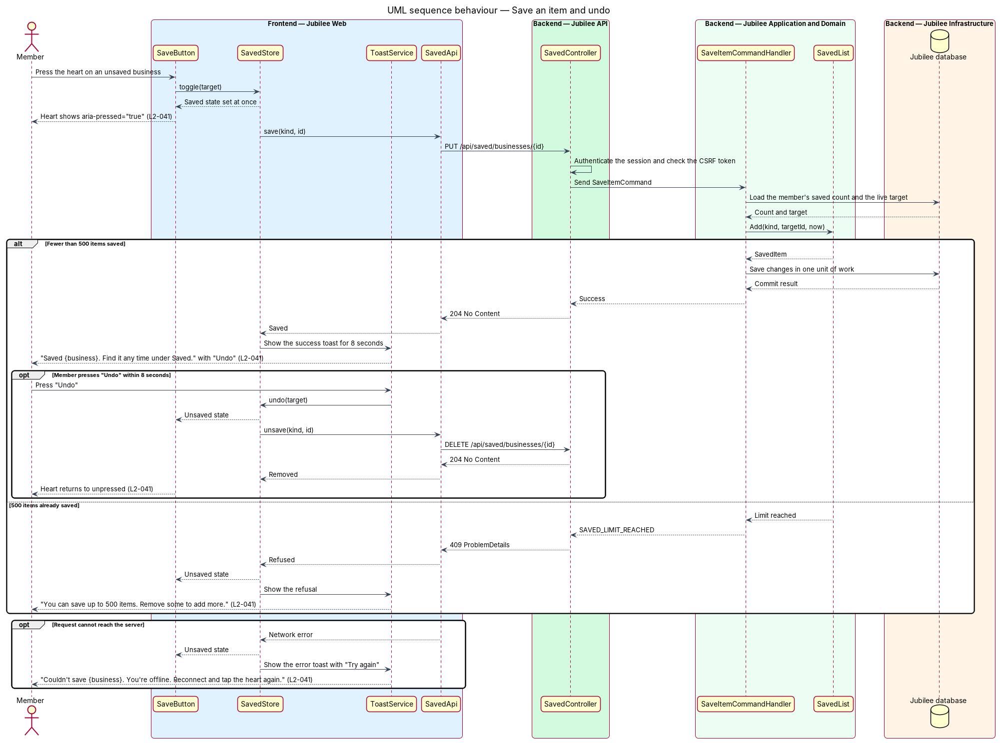
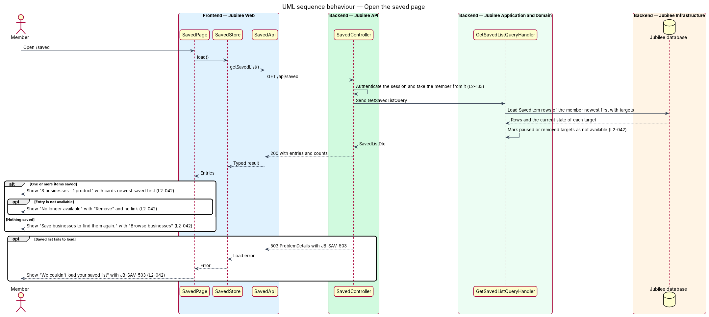

# Save a listing

## Overview

Jubilee is Toronto's Christian marketplace. A member who finds a business or a
product of interest can keep it for later by pressing a heart. This feature
covers the heart on business cards, listing pages and products, the toasts that
confirm or refuse a save, and the page `/saved` that lists what a member has
saved.

The saved list is private. No other member can read it, and an owner sees only
a count, "Saved by members", never the names behind it. Saving is open to every
signed-in member, including a member whose e-mail is not yet confirmed
(`L2-005`). A visitor who presses a heart is asked to sign in, and the item is
saved automatically after sign-in (`L2-012`).

The feature uses the following local terms.

- **saved item** — record that one member saved one business or one product
- **saved list** — set of all saved items of one member, limited to 500 items
- **optimistic update** — change that the interface shows before the server confirms it, and reverses when the server call fails
- **unavailable item** — saved item whose listing was later paused or removed

The heart responds at once: it shows pressed before the request completes. When
the request fails, the heart returns to unpressed and an error toast explains
why.

## Description

The feature is a vertical slice from the heart button to the database.

- **`SaveButton`** — Angular heart button used on `BusinessCard`,
  `ProductCard`, the listing page and the product page. It is a toggle button
  with `aria-pressed`. It reads its state from `SavedStore`. Without a session
  it opens `SignInRequiredDialog`. It is hidden for an owner on their own
  listing.
- **`SavedStore`** — signal store that holds the keys of the member's saved
  items and the loaded saved list. `toggle` applies the optimistic update,
  calls `SavedApi`, and reverses the update when the call fails.
- **`ToastService`** — shared toast service. After a save it shows "Saved
  {business}. Find it any time under Saved." with "Undo" for 8 seconds.
  Pressing "Undo" within the 8 seconds removes the item and returns the heart
  to unpressed. When the save cannot reach the server it shows the error toast
  "Couldn't save {business}. You're offline. Reconnect and tap the heart
  again." with "Try again". At the limit it shows "You can save up to 500
  items. Remove some to add more."
- **`SavedPage`** — Angular page for `/saved`, protected by `AuthGuard`. It
  shows a count line such as "3 businesses · 1 product", then business cards
  and product cards, newest saved first. With nothing saved it shows "Save
  businesses to find them again. Tap the heart on any listing or product. Your
  saved list is private." with "Browse businesses". An unavailable item shows
  as "No longer available" with "Remove" and has no link. On failure the page
  shows "We couldn't load your saved list" with the reference `JB-SAV-503`.
- **`SavedApi`** — typed Angular HTTP client for `GET /api/saved`,
  `PUT /api/saved/businesses/{id}`, `PUT /api/saved/products/{id}` and the two
  matching `DELETE` routes.
- **`SavedController`** — ASP.NET Core controller in `Jubilee.Api`. Every
  endpoint requires a session, and the member is always taken from the session.
  No route accepts a member identifier, so another member's saved list is not
  addressable; a request that names another member's list resolves to 404.
  The policy admits unconfirmed members.
- **`SaveItemCommand`** and **`SaveItemCommandHandler`** — MediatR command and
  handler behind `PUT`. The handler checks that the target is a live listing or
  a product of one, and adds the item through `SavedList`. Saving an item that
  is already saved succeeds without change, so a repeated `PUT` creates one
  row. At 500 items the handler returns 409 `ProblemDetails` with the code
  `SAVED_LIMIT_REACHED`.
- **`UnsaveItemCommand`** and **`UnsaveItemCommandHandler`** — MediatR command
  and handler behind `DELETE`. Removing an item that is not saved succeeds
  without change. The same endpoint serves the second press of the heart, the
  toast's "Undo" and the "Remove" button of an unavailable item.
- **`SavedList`** — domain aggregate for one member's items. `MaxItems` is 500.
  `Add` refuses the 501st item.
- **`SavedItem`** — entity with `MemberId`, `SavedItemKind` (`Business`,
  `Product`), `TargetId` and `SavedAt`. A unique index covers member, kind and
  target.
- **`GetSavedListQuery`** and **`GetSavedListQueryHandler`** — MediatR query
  and handler. The handler returns the caller's items ordered by `SavedAt`
  descending, with card data for each target and `IsAvailable` set to `false`
  when the listing is paused, removed or otherwise not public. A load failure
  returns 503 `ProblemDetails` with `JB-SAV-503`.
- **"Saved by members" count** — owner statistic computed as the number of
  distinct `MemberId` values among the `SavedItem` rows of a listing. The
  statistic exposes the count only. The owner statistics feature reads it.

## Requirements

The feature realizes the following level-2 (L2) requirements. Each L2
requirement refines a level-1 (L1) requirement, cited by identifier.

| L2 ID | Refines (L1) | Requirement |
|-------|--------------|-------------|
| `L2-041` | `L1-006` | A heart on business cards, listing pages and products shall save the item to the member's private saved list, and a second press shall remove it. |
| `L2-042` | `L1-006` | The page `/saved` shall list the member's saved businesses and products newest saved first, shall mark items that are no longer available, and shall be readable by that member only. |
| `L2-005` | `L1-001` | Until the e-mail is confirmed, a member shall be able to browse, search and save, and shall not be able to message, book, request or list a business. |
| `L2-012` | `L1-001` | A visitor who tries an action that needs an account shall be prompted to join or sign in and shall be brought straight back; when the action was a save, the item shall be saved automatically. |
| `L2-118` | `L1-016` | Every load-error state shall show a reference that the user can quote to support. |
| `L2-133` | `L1-019` | The server shall check the caller's role and ownership of the specific object on every API endpoint, and shall answer a request for another member's saved list with 404. |

## Diagrams

### System context

A member saves items and opens the saved page. A visitor is asked to sign in,
and an owner sees the "Saved by members" count. The feature involves no
external system.

### Containers

`Jubilee Web` calls the saved list endpoints of `Jubilee API`, which stores
`SavedItem` rows in `Jubilee database`.

### Components

`SaveButton` and `SavedPage` share `SavedStore`, which performs the optimistic
update and shows toasts. `SavedController` dispatches to one handler per
operation.

### Class structure

`SavedList` owns up to 500 `SavedItem` entities. The query handler returns a
`SavedListDto` whose entries carry the `IsAvailable` flag.

### Behaviour — save an item and undo

The heart changes at once, the handler applies the 500-item limit of `L2-041`,
and the success toast offers "Undo" for 8 seconds. A network failure reverses
the heart and shows the error toast.

### Behaviour — open the saved page

The controller takes the member from the session, and the handler returns that
member's items newest first with unavailable items marked.

