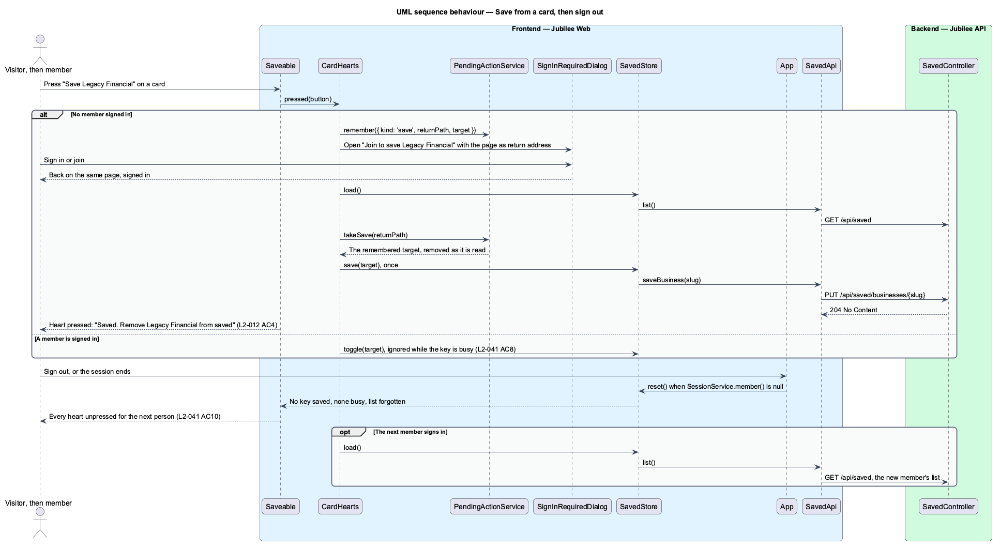

# Save a listing

## Overview

Jubilee is Toronto's Christian marketplace. A member who finds a business, a
product or a space of interest can keep it for later by pressing a heart. This
feature covers the heart on business, product and space cards, on listing pages
and on products, the toasts that confirm or refuse a save, and the page
`/saved` that lists what a member has saved.

The saved list is private. No other member can read it, and an owner sees only
a count, "Saved by members", never the names behind it. Saving is open to every
signed-in member, including a member whose e-mail is not yet confirmed
(`L2-005`). A visitor who presses a heart is asked to sign in, and the item is
saved automatically after sign-in (`L2-012`). Nothing of the list stays on the
device once the member signs out.

The feature uses the following local terms.

- **saved item** — record that one member saved one business or one product
- **saved list** — set of all saved items of one member, limited to 500 items
- **optimistic update** — change that the interface shows before the server confirms it, and reverses when the server call fails
- **busy heart** — heart whose save or removal the server has not answered yet
- **unavailable item** — saved item whose listing was later paused or removed

The heart responds at once: it shows pressed before the request completes, and
it is busy until the server answers. When the request fails, the heart returns
to unpressed and an error toast explains why. A space is a listing, so it is
saved as a business is.

## Description

The feature is a vertical slice from the heart button to the database.
Decisions are recorded in ADR 0027 and ADR 0054.

- **Heart on a page** — the toggle button of the listing page, the shop page
  and the product page (`jb-button` with `aria-pressed`), in
  `BusinessPage` and `ProductPage`. Its name is "Save", or "Saved. Remove
  from saved" once pressed. Without a session it opens
  `SignInRequiredDialog` titled "Join to save {name}" with a return address
  ending in `?save=1`; the page saves the item when it loads for a member
  and removes the parameter. It is hidden for an owner on their own listing.
- **`Saveable`** (`div[jb-saveable]`, block `saveable`) — component of the
  `components` library that wraps a business card, a product card or a space
  card and draws its heart, `saveable__heart`, over the top right of the
  card's picture. The heart is beside the card's link, never inside it. It is
  named "Save {name}", or "Saved. Remove {name} from saved" with
  `aria-pressed="true"` and a filled shape once pressed, and carries
  `aria-busy="true"` while busy. Its output `pressed` gives the page the
  button, for focus to return to.
- **`CardHearts`** (`services/card-hearts.ts`) — application service the pages
  with hearts on cards use: Browse, a category, search (its space cards), a
  business or shop page and a product page. `isSaved` and `isBusy` read
  `SavedStore`; `press` toggles for a member and, for a visitor, remembers
  the save in `PendingActionService` and opens `SignInRequiredDialog` titled
  "Join to save {name}" with the current page as its return address.
  `attach()`, called by each page, reads the saved list when a member is
  signed in and carries out a remembered save for the same page once.
- **`PendingActionService`** — keeps at most one started action of a visitor
  for the tab in `sessionStorage`: `{ kind: 'save', returnPath, target }` for
  a heart on a card.
- **`SavedStore`** — root signal store of the keys of the member's saved items
  (`b:{slug}` and `p:{shop}/{slug}`), the keys that are busy and the list last
  loaded. `toggle` ignores a busy key, applies the optimistic update, calls
  `SavedApi` and reverses the update when the call fails. `load` reads
  `GET /api/saved` once per session; a heart pressed while the list is on its
  way stays as pressed. `reset` forgets the keys, the busy keys, the list and
  any list read still on its way.
- **`App`** — the application root resets `SavedStore` whenever
  `SessionService.member()` is null: after sign-out, after the server ends
  the session, and for a visitor.
- **`ToastService`** — shared toast service. After a save it shows "Saved
  {business}. Find it any time under Saved." with "Undo" for 8 seconds.
  Pressing "Undo" within the 8 seconds removes the item and returns the heart
  to unpressed. When the save cannot reach the server it shows the error toast
  "Couldn't save {business}. You're offline. Reconnect and tap the heart
  again." with "Try again". At the limit it shows "You can save up to 500
  items. Remove some to add more."
- **`SavedPage`** — Angular page for `/saved`, behind the member guard. It
  shows a count line such as "3 businesses · 1 product", then business cards
  and product cards, newest saved first. With nothing saved it shows "Save
  businesses to find them again. Tap the heart on any listing or product. Your
  saved list is private." with "Browse businesses". An unavailable item shows
  as "No longer available" with "Remove" and has no link. On failure the page
  shows "We couldn't load your saved list" with the reference `JB-SAV-503`.
- **`SavedApi`** (`SAVED_API`) — typed Angular HTTP client for
  `GET /api/saved`, `PUT` and `DELETE /api/saved/businesses/{slug}`, `PUT` and
  `DELETE /api/saved/products/{shopSlug}/{productSlug}`, and
  `DELETE /api/saved/items/{id}`.
- **`SavedController`** — ASP.NET Core controller in `Jubilee.Api`. Every
  endpoint requires a session, and the member is always taken from the
  session. No route accepts a member identifier, so another member's saved
  list is not addressable; a request that names another member's list
  resolves to 404. Unconfirmed members are admitted. A failed list answers
  with `JB-SAV-503`, a failed save or removal with `JB-SAV-504`.
- **`SaveBusinessCommand`** and **`SaveProductCommand`** with their handlers —
  MediatR commands behind `PUT`. The handler finds the public listing, or the
  product of a public shop, by its slugs (404 `saved_target_not_found`
  otherwise) and adds the row through `SaveHandler.AddAsync`. Saving an item
  that is already saved succeeds without change, so a repeated `PUT` creates
  one row. At 500 items it answers 409 `ProblemDetails` with the code
  `SAVED_LIMIT_REACHED`.
- **`UnsaveBusinessCommand`**, **`UnsaveProductCommand`** and
  **`UnsaveItemCommand`** with their handlers — MediatR commands behind
  `DELETE`. Removing an item that is not saved succeeds without change. The
  slug routes serve the second press of a heart and the toast's "Undo"; the
  item route serves "Remove" on an unavailable item and finds only the
  caller's own row.
- **`SavedItem`** — entity with `MemberSubject`, `Kind` (`SavedItemKind`:
  `Business`, `Product`), `TargetId` and `SavedAt`; `MaxItems` is 500. A
  unique index covers member, kind and target.
- **`GetSavedListQuery`** and **`GetSavedListQueryHandler`** — MediatR query
  and handler. The handler returns the caller's items ordered by `SavedAt`
  descending as a `SavedListDto` of `SavedItemDto`, with card data for each
  target and `Available` set to `false` when the listing is paused, removed or
  otherwise not public; the counts include available items only.
- **"Saved by members" count** — owner statistic computed in the owner
  workspace as the number of distinct members among the `SavedItem` rows of a
  listing and its products. The statistic exposes the count only.

## Requirements

The feature realizes the following level-2 (L2) requirements. Each L2
requirement refines a level-1 (L1) requirement, cited by identifier.

| L2 ID | Refines (L1) | Requirement |
|-------|--------------|-------------|
| `L2-041` | `L1-006` | A heart on business, product and space cards, listing pages and products shall save the item to the member's private saved list, and a second press shall remove it; a busy heart ignores presses, and signing out leaves nothing of the list on the device. |
| `L2-042` | `L1-006` | The page `/saved` shall list the member's saved businesses and products newest saved first, shall mark items that are no longer available, and shall be readable by that member only. |
| `L2-005` | `L1-001` | Until the e-mail is confirmed, a member shall be able to browse, search and save, and shall not be able to message, book, request or list a business. |
| `L2-012` | `L1-001` | A visitor who tries an action that needs an account shall be prompted to join or sign in and shall be brought straight back; when the action was a save, the item shall be saved automatically. |
| `L2-118` | `L1-016` | Every load-error state shall show a reference that the user can quote to support. |
| `L2-133` | `L1-019` | The server shall check the caller's role and ownership of the specific object on every API endpoint, and shall answer a request for another member's saved list with 404. |

## Diagrams

### System context

A member saves items and opens the saved page. A visitor is asked to sign in,
and an owner sees the "Saved by members" count. The feature involves no
external system.

### Containers

`Jubilee Web` calls the saved list endpoints of `Jubilee API`, which stores
`SavedItem` rows in `Jubilee database`.

### Components

The hearts on pages and on cards (`Saveable`, wired by `CardHearts`) and
`SavedPage` share `SavedStore`, which performs the optimistic update and shows
toasts; the application root resets it when no member is signed in.
`SavedController` dispatches to one handler per operation.

### Class structure

A member owns up to 500 `SavedItem` rows. The query handler returns a
`SavedListDto` whose items carry the `Available` flag.

### Behaviour — save an item and undo

The heart changes at once, the handler applies the 500-item limit of `L2-041`,
and the success toast offers "Undo" for 8 seconds. A network failure reverses
the heart and shows the error toast.

### Behaviour — open the saved page

The controller takes the member from the session, and the handler returns that
member's items newest first with unavailable items marked.

### Behaviour — save from a card, then sign out

A visitor's press on a card is remembered for the tab and carried out once
after sign-in on the same page. Signing out resets the store, so the next
person on the device sees no saved heart and the next member's list is read
again.

