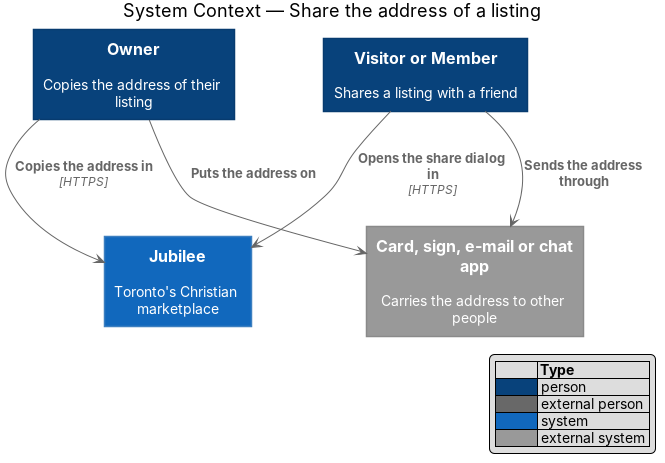
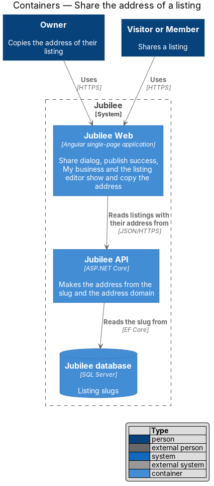
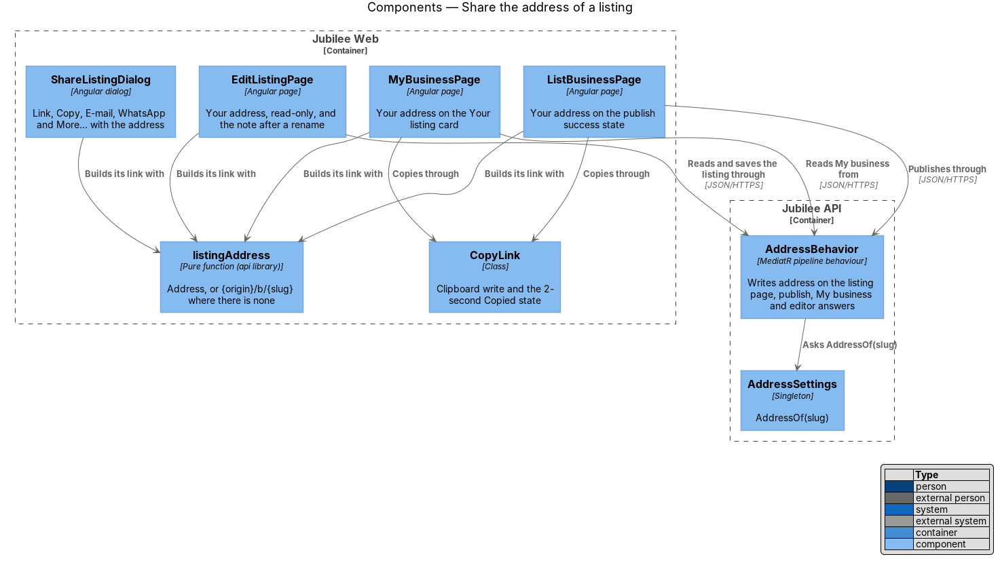
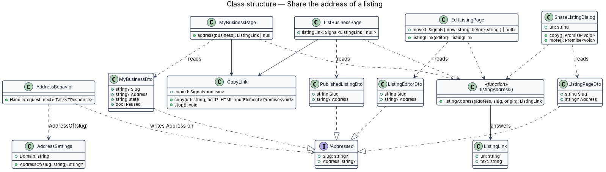
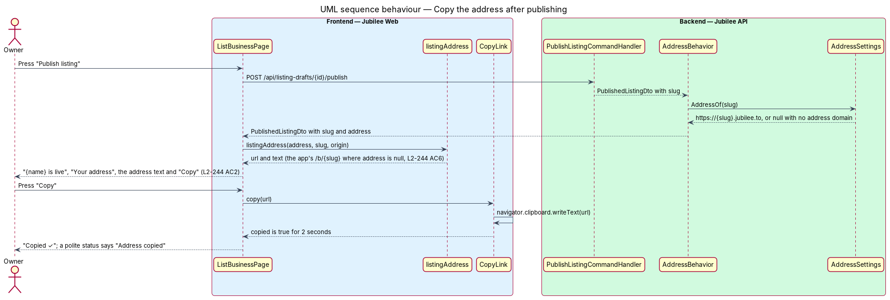
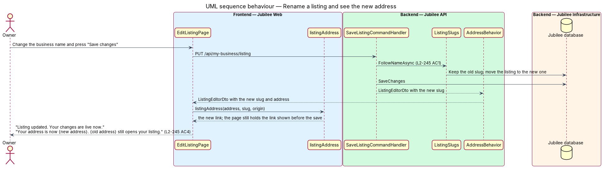

# Share the address of a listing

## Overview

Jubilee is Toronto's Christian marketplace. Every published listing has the
address `https://{slug}.jubilee.to`. This feature covers where Jubilee gives
that address out for people to pass on: the share dialog of a listing page, the
success state after an owner publishes, the overview of My business, and the
listing editor. Wherever Jubilee offers a link to a listing for sharing, the
link is the listing's address.

The owner does not choose the address; it comes from the business name. The
screens therefore show it as text that cannot be edited, with a "Copy" action,
and the editor says what happens to it when the name changes.

The feature uses the following local terms.

- **address** — the public link `https://{slug}.{domain}` of a published listing
- **address domain** — the domain addresses sit under; empty in local development and in the end-to-end suite
- **link to share** — the address, or, where no address domain is set, the listing's page on the app's own host, `{origin}/b/{slug}`
- **address text** — the link to share without its scheme, such as `luzandre-com.jubilee.to`
- **My business** — the owner's overview of a listing in the app
- **listing editor** — the Edit listing screen of the owner's workspace

The mocks and the Magic Patterns design reference do not draw the address; the
four places and their wording are set by `L2-244` and ADR 0067. E-mails and
notifications are outside this feature: their links need a session and stay
links of the app.

## Description

- **`address`** — field of `ListingPageDto`, `PublishedListingDto`,
  `MyBusinessDto` and `ListingEditorDto` in `Jubilee.Application`. Each of
  them implements `IAddressed`, and the MediatR pipeline behaviour
  `AddressBehavior` writes the field on every such answer with
  `AddressSettings.AddressOf(slug)`: `https://{slug}.{domain}`, or null where
  no address domain is set. No handler sets it.
- **`listingAddress(address, slug, origin)`** — pure helper of the `api`
  library. It answers the link to share as `{ url, text }`: the address where
  the API gave one, otherwise `{origin}/b/{slug}`; `text` is `url` without its
  scheme. Every screen below builds its link through it, so each criterion
  holds with either link (`L2-244` AC6).
- **`CopyLink`** — injectable of `Jubilee Web` (`services/copy-link.ts`) that
  the publish success state and My business each provide. `copy(url, field)` writes the link with
  `navigator.clipboard.writeText`, or selects the field and copies it where the
  clipboard is refused; `copied` is a signal that is true for 2 seconds.
- **`ShareListingDialog`** — existing dialog (`L2-038`). Its link, the body of
  "E-mail", the text of "WhatsApp" and the URL handed to the native share sheet
  become the link to share of the listing; `BusinessPage` passes the listing's
  `address` in the dialog data.
- **`ListBusinessPage`** — the publish success state gains a "Your address"
  card under the heading: the address text in a read-only field, "Copy", and
  "Share this address anywhere. It opens your listing on Jubilee." "Copy" reads
  "Copied ✓" for 2 seconds and a polite status region says "Address copied".
- **`MyBusinessPage`** — the "Your listing" card gains the same read-only field
  with "Copy" for a live listing. A paused listing also shows "Your address
  works again when you resume your listing." A listing that is neither live nor
  paused shows no address.
- **`EditListingPage`** — shows the address text in a read-only field labelled
  "Your address" with the hint "Your address comes from your business name. If
  you change the name, the address follows and the old one keeps working." The page
  keeps the link it showed before a save; when the save answers another slug,
  the success alert adds "Your address is now {new address}. {old address}
  still opens your listing."
- **Composition** — each screen composes `jb-field`, `jb-input-group`,
  `jb-input` and `jb-button` of the components library, as the share dialog
  does (ADR 0035). A read-only field keeps the whole address available to
  assistive technology at 360 px and scrolls inside itself, so the page never
  scrolls sideways. `jb-button` is at least 44 px tall on a touch screen.

## Requirements

The feature realizes the following level-2 (L2) requirements. Each L2
requirement refines a level-1 (L1) requirement, cited by identifier.

| L2 ID | Refines (L1) | Requirement |
|-------|--------------|-------------|
| `L2-244` | `L1-032` | The share dialog shall show, copy, e-mail, send to WhatsApp and hand to the native share sheet the listing's address. The publish success state shall show the address under "Your address" with "Share this address anywhere. It opens your listing on Jubilee." and "Copy", which shall confirm for 2 seconds and announce "Address copied". My business shall show the address of a live listing with "Copy", no address for a listing that is not public, and a note for a paused listing. The listing editor shall show the address as text that cannot be edited, with its explanation. E-mails and notifications shall keep the links of the app. Where no address domain is set, the link to share shall be the listing's page on the app's own host. At 360 px the address shall wrap or truncate with its full text available to assistive technology. |
| `L2-245` | `L1-032` | A save that changes the address shall say "Your address is now {new address}. {old address} still opens your listing." beside "Listing updated. Your changes are live now." |
| `L2-038` | `L1-005` | The share dialog "Share {business}" shall show the listing's address with "Copy", "E-mail", "WhatsApp", "More…" and "Done". |
| `L2-078` | `L1-010` | Publishing a listing shall show its success state. |
| `L2-085` | `L1-012` | My business shall show the overview of the owner's listing. |
| `L2-087` | `L1-012` | The owner shall edit the listing in the listing editor. |

## Diagrams

### System context

An owner or a member copies the address in Jubilee and passes it on outside
Jubilee.

### Containers

`Jubilee API` makes the address; `Jubilee Web` shows and copies it on the
person's device.

### Components

Four screens build their link through `listingAddress`; two copy it through
`CopyLink`, and the share dialog keeps its own copy. `AddressBehavior` writes
`address` on the four answers from `AddressSettings`.

### Class structure

The DTOs carry `address`; the helper turns it into the link to share; the
screens hold a `CopyLink`.

### Behaviour — copy the address after publishing

The success state shows the address the publish answered, and "Copy" puts it on
the clipboard with a polite announcement.

### Behaviour — rename a listing and see the new address

The save answers the new slug and address; the editor compares them with the
ones it showed before and says both addresses.

