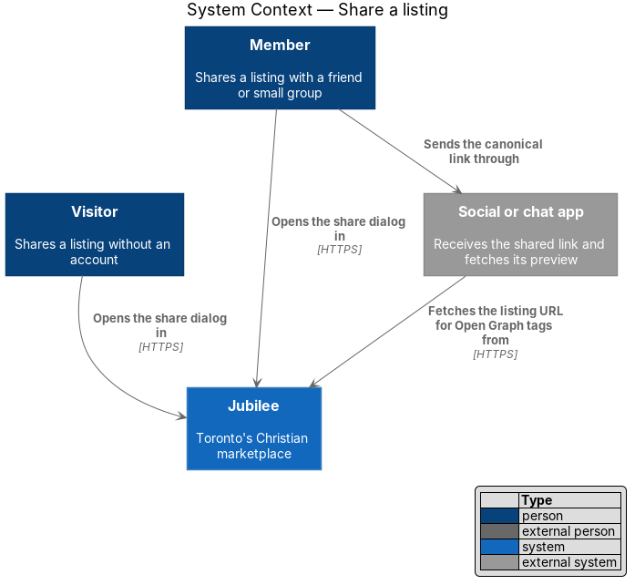
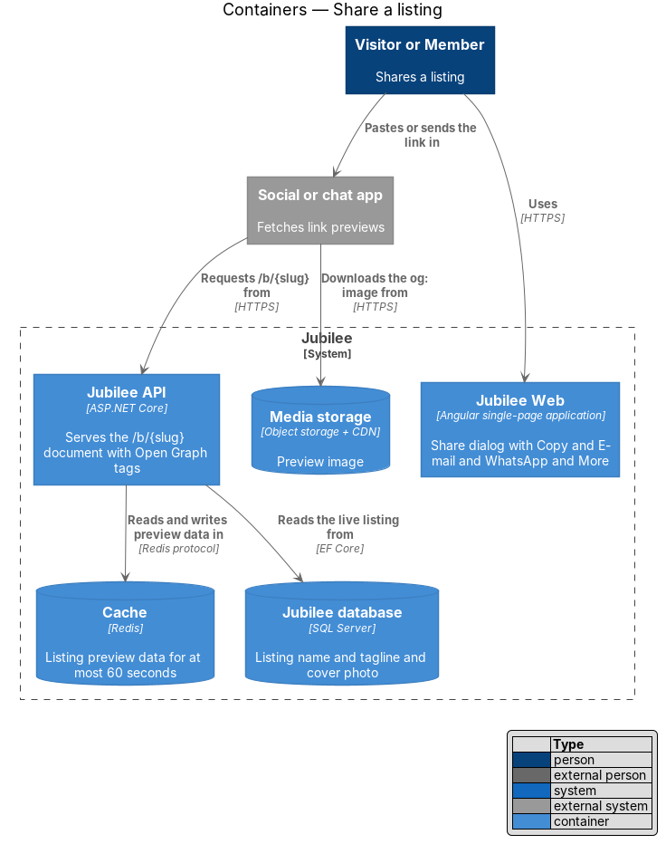
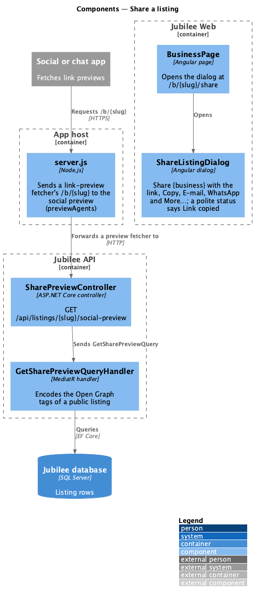
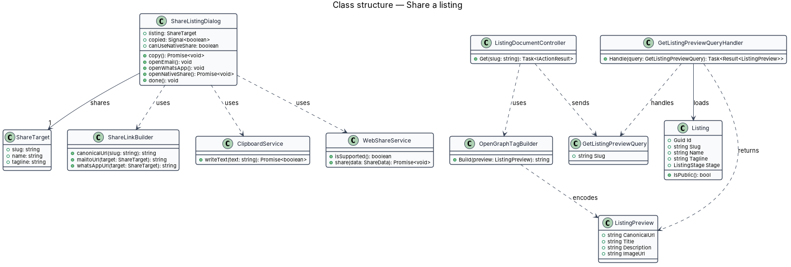
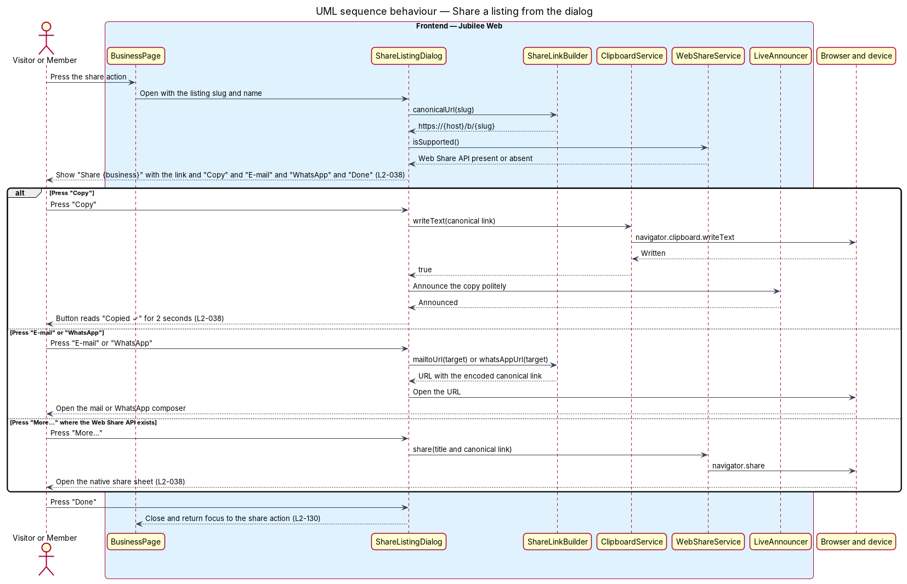
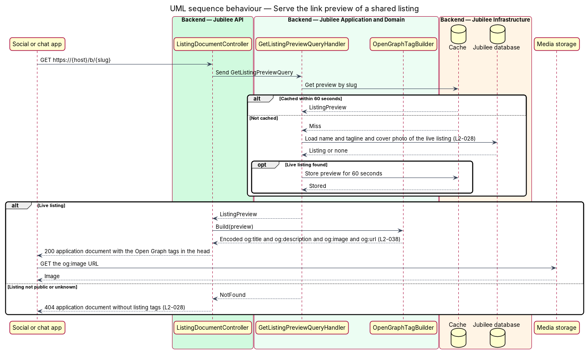

# Share a listing

## Overview

Jubilee is Toronto's Christian marketplace. Members often pass a business on to
a friend or a small group. This feature covers the share action on a listing
page: a dialog that offers the listing's link and four ways to send it, and the
link preview that social and chat apps show when the link arrives.

The share action is available to visitors and members alike. Pressing it opens
the dialog "Share {business}", which shows the canonical link with "Copy",
"E-mail", "WhatsApp", "More…" and "Done". Sharing happens on the person's own
device; Jubilee sends nothing on the person's behalf and stores no record of
who shared a listing.

The feature uses the following local terms.

- **canonical link** — one public address of a listing, of the form `https://{host}/b/{slug}`
- **Web Share API** — browser interface that opens the share sheet of the device
- **link preview** — card with title, description and image that a social or chat app builds from a shared link
- **link-preview fetcher** — the program of a social or chat app that requests a shared link to build its preview, named in its `User-Agent`
- **Open Graph tags** — `<meta>` elements in the head of a page that supply the title, description and image of its link preview

The dialog runs entirely in `Jubilee Web`. The link preview is the only part
with a backend: an app that fetches a link runs no script, so the app's host
answers a link-preview fetcher's `/b/{slug}` with a document that carries the
tags (ADR 0029, ADR 0055).

## Description

- **`ShareListingDialog`** — Angular dialog that `BusinessPage` opens at
  `/b/{slug}/share`. It is titled "Share {business}", carries the line "Send this
  listing to a friend or your small group.", shows the canonical link in a
  read-only "Link" field, and offers "Copy", "E-mail", "WhatsApp", "More…" and
  "Done". The canonical link is `{origin}/b/{slug}` of the current origin, with
  no query string. "E-mail" is a `mailto:` link with the subject "{business} on
  Jubilee" and the link as the body; "WhatsApp" is `https://wa.me/?text=` with
  "{business} on Jubilee {link}" encoded. The dialog is a CDK dialog: focus
  moves into it, and on close focus returns to "Share", the control focused when
  it opened (`L2-130` AC2).
- **Copy** — `copy()` writes the link with `navigator.clipboard.writeText`, or,
  without clipboard permission, selects the field and copies it. The button then
  reads "Copied ✓" for 2 seconds, and a visually hidden `role="status"`
  (`aria-live="polite"`) region says "Link copied", so a screen reader reports
  the change without moving focus.
- **More…** — rendered only when `navigator.share` is a function (`canShare`).
  `more()` calls `navigator.share` with the title "{business} on Jubilee" and the
  link; a closed share sheet is not an error.
- **`server.js`** (`eng/azure/`) — the host of the app. A `GET` or `HEAD` of
  `/b/{slug}` whose `User-Agent` matches `previewAgents` (the fetchers of
  Facebook and iMessage, X, LinkedIn, WhatsApp, Slack, Discord, Telegram,
  Pinterest, Reddit, Skype, Apple, Bluesky, Mastodon, Embedly and Iframely) is
  forwarded to `/api/listings/{slug}/social-preview` (`previewPath`), and only
  on a host that forwards that path to the API. Any other agent, a search engine
  among them, receives `index.html`. The host also serves `og-image.png` from
  the app's `public/` folder.
- **`SharePreviewController`** — anonymous ASP.NET Core controller in
  `Jubilee.Api` for `GET /api/listings/{slug}/social-preview`; it answers the
  document as `text/html`.
- **`GetSharePreviewQuery`** and **`GetSharePreviewQueryHandler`** — MediatR
  query and handler. The handler loads the listing through `WherePublic` and
  writes the document: `og:title` "{business} · Jubilee", `og:description` and
  `description` the tagline, `og:url` and `link rel="canonical"` the canonical
  link of `AccountSettings.PublicBaseUrl`, `og:image`
  `{PublicBaseUrl}/og-image.png`, `og:type` `website`, `og:site_name` "Jubilee"
  and `twitter:card` `summary_large_image`. Every value is HTML-encoded, so
  owner-entered text cannot add markup. A listing that is not public is
  `NotFoundException`, answered 404 with no listing tags.
- **`og-image.png`** — one 1200 × 630 image for every listing: the lockup of
  `docs/assets/jubilee-icon.svg` and the wordmark (Archivo bold, 110% width,
  −0.03em) with "Toronto's Christian marketplace", drawn in
  `docs/mocks/assets/og-image.html`.

## Requirements

The feature realizes the following level-2 (L2) requirements. Each L2
requirement refines a level-1 (L1) requirement, cited by identifier.

| L2 ID | Refines (L1) | Requirement |
|-------|--------------|-------------|
| `L2-038` | `L1-005` | The share action shall open a dialog "Share {business}" with the listing's canonical link, "Copy", "E-mail", "WhatsApp", "More…" and "Done". "Copy" shall confirm for 2 seconds with the polite announcement "Link copied", "More…" shall appear only where the Web Share API exists and open the native share sheet, and a link-preview fetcher of `/b/{slug}` shall receive the Open Graph title, description and image of the listing. |
| `L2-028` | `L1-003` | A non-public listing opened by its URL shall produce the not-found page with HTTP 404, except for the owner and the Jubilee team. |
| `L2-130` | `L1-018` | A dialog shall take focus when it opens, keep Tab within it, close on Escape or the close button, and return focus to the control that opened it. |

## Diagrams

### System context

A visitor or member shares the canonical link through a social or chat app,
which then fetches the listing URL from Jubilee to build its link preview.

### Containers

The dialog lives in `Jubilee Web`. The app host sends a link-preview
fetcher's `/b/{slug}` to `Jubilee API`, which serves the document with Open
Graph tags, and serves the preview image itself.

### Components

`BusinessPage` opens `ShareListingDialog`, which calls the browser itself. On
the server side, `server.js` forwards a preview fetcher to
`SharePreviewController`, which sends `GetSharePreviewQuery`.

### Class structure

The dialog holds its links and its two actions. The handler reads a public
`Listing` and the public host of `AccountSettings`.

### Behaviour — share a listing from the dialog

The dialog builds the canonical link, checks for the Web Share API, and then
performs the chosen action on the device. No request reaches `Jubilee API`. On
close, focus returns to "Share".

### Behaviour — serve the link preview of a shared listing

A social or chat app requests the shared link. The app host forwards a
link-preview fetcher to the social preview, which answers the Open Graph tags of
a public listing and 404 otherwise; every other agent gets the app.

