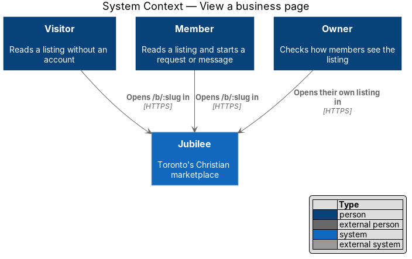
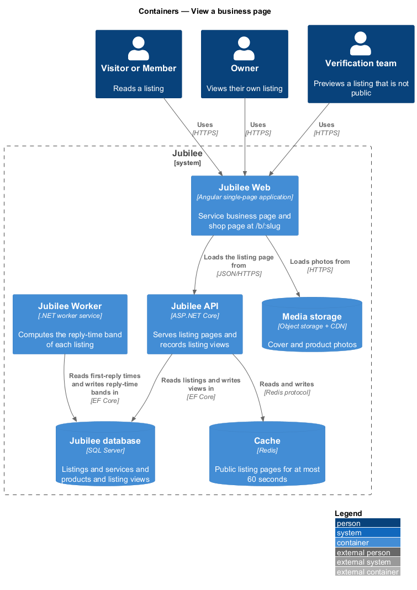
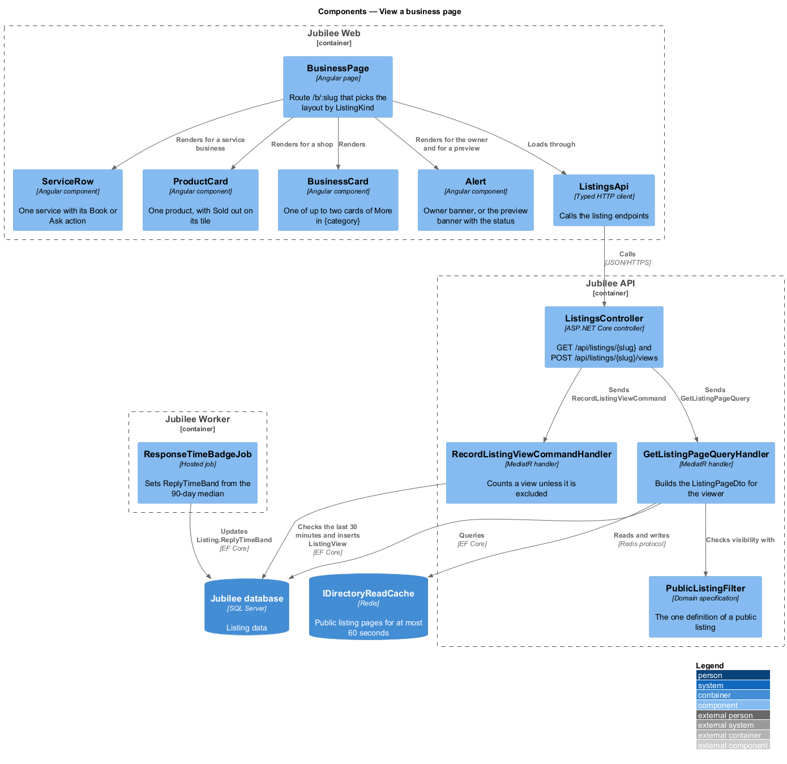
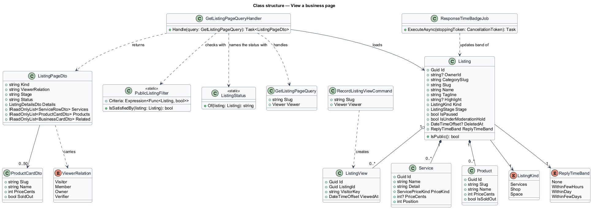
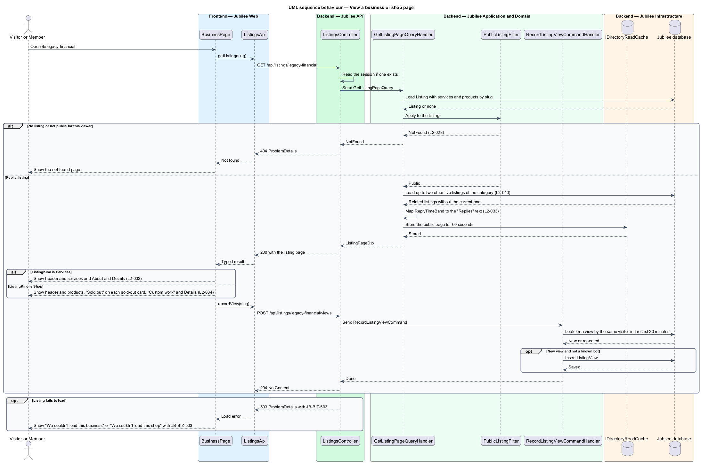
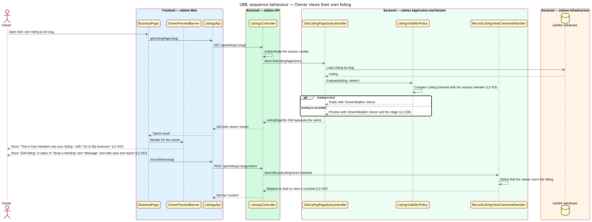

# View a business page

## Overview

Jubilee is Toronto's Christian marketplace. Each verified business has one
public page at `/b/:slug`, called its listing page. The listing page is where a
visitor or member reads what the business offers and starts a booking, a quote
request, an order or a message. This feature covers the listing page in its two
layouts, the view an owner gets of their own listing, and the related businesses
at the foot of the page.

The layout follows the main offer of the business. A business whose main offer
is services gets the service business page: header, primary actions "Book a
meeting" and "Message", the services list, "About" and "Details". A business
whose main offer is products gets the shop page: header, "Shop products", the
product cards, "Custom work", "About" and "Details". Both end with "More in
{category}".

The feature uses the following local terms.

- **listing** — public record of one business, addressed by its slug
- **listing kind** — main offer of a listing, either `Services` or `Shop`
- **viewer relation** — relation of the person viewing to the listing: visitor, member, owner or verifier
- **reply-time band** — text for the "Replies" detail, derived from the median first-reply time of the business over the last 90 days
- **listing view** — one counted visit to a listing page, used in the owner's statistics

The dialogs that the page opens (booking, quote, order, message, share, report)
and the save heart are separate features. This feature supplies the page and
the data that those actions start from.

## Description

The feature is a vertical slice from the Angular page to the database, with one
scheduled job.

- **`BusinessPage`** — Angular page for `/b/:slug`. It loads the listing page
  through `ListingsApi` and renders `ServiceBusinessView` or `ShopView`
  according to `ListingKind`. It renders "Back to browse" and the line "Verified
  Christian business · {category}". On failure it shows "We couldn't load this
  business" or "We couldn't load this shop" with the reference `JB-BIZ-503`.
- **`ServiceBusinessView`** — layout for a services listing. It shows the name,
  the owner's name with credentials, the tagline, credential tags, the
  highlight, and one row per service with name, short detail, price ("Free", an
  amount, or "Ask") and an action ("Book" or "Ask"). The action opens the
  booking or quote dialog for that service. Every service is listed; names and
  credential tags wrap and are not truncated. With no services the area reads
  "No services listed yet" with "Send a message", and "Send a message" takes
  the place of "Book a meeting".
- **Actions of later journeys** — "Book a meeting", "Book", "Ask", "Message",
  "Send a message", "Share", "Report this listing" and "Edit listing" are links
  to the routes of the features that own them (`/b/:slug/book`,
  `/b/:slug/quote`, `/b/:slug/message`, `/b/:slug/share`, `/b/:slug/report`,
  `/my-business/edit`). Until those features are built the links reach the
  not-found page, and the save heart is shown but has no effect (ADR 0007).
- **`ShopView`** — layout for a shop listing. It shows "Products" with the
  count and one `ProductCard` per product (without the shop's name), a "Sold out" badge on each sold-out
  product, and "Custom work" listing the shop's services with "Ask". With no
  products it reads "No products yet. {Name} is setting up shop." with "Send a
  message".
- **`DetailsList`** — definition list of the details. A services listing shows
  Where, Hours, Languages, On Jubilee since and Replies. A shop shows Where,
  Delivery, Made to order, On Jubilee since and Replies. "On Jubilee since" is
  the month the listing was created. A row whose value the owner has not given
  is omitted, and the Replies row is omitted when the API returns no reply
  text.
- **`RelatedBusinesses`** — section "More in {category}" with up to two
  `BusinessCard` components and a "See all" link to `/c/:category`. The section
  is omitted when the API returns no related listing.
- **`OwnerPreviewBanner`** — banner shown when the viewer relation is owner:
  "This is how members see your listing. It's live and verified. Changes you
  make are published straight away." with "Go to My business". In this view the
  page replaces "Book a meeting" and "Message" with "Edit listing" and hides
  save and report.
- **`ListingsApi`** — typed Angular HTTP client for `GET /api/listings/{slug}`
  and `POST /api/listings/{slug}/views`.
- **`ListingsController`** — ASP.NET Core controller in `Jubilee.Api`. Both
  endpoints accept anonymous callers, read the session when one exists and are
  rate limited per client address. A load failure returns 503 `ProblemDetails`
  with `JB-BIZ-503`. A visitor's answer may be cached publicly for 60 seconds;
  a signed-in caller's answer is never stored. The page lists every service and
  at most 50 products, with the shop's product count (`L2-153`).
- **`GetListingPageQuery`** and **`GetListingPageQueryHandler`** — MediatR
  query and handler. The handler loads the `Listing` with its `Service` and
  `Product` rows, evaluates `ListingVisibilityPolicy`, selects the related
  listings, and returns a `ListingPageDto` that carries the `ViewerRelation`.
  Public responses are kept in `Cache` for at most 60 seconds; owner and
  verifier responses bypass the cache.
- **`ListingVisibilityPolicy`** — authorization policy for one listing. A live
  listing is public. A listing that is not live resolves to not found, except
  for its owner and the verification team, who receive a preview with the stage.
  The server decides the viewer relation from the session, never from the
  client: the owner is the member whose subject is `Listing.OwnerId`, and the
  verification team holds the `verifier` role (ADR 0007). The page for such a
  preview is built with the owner workspace and the review queue; this
  feature serves its data.
- **Related listings selection** — query for up to two other live listings in
  the same category, excluding the current listing. The two are the first in
  the category's Recommended order (`ListingSortPolicy`, ADR 0004), so the
  section agrees with the category page that "See all" opens.
- **`ReplyTimeBand`** and **`ResponseTimeBadgeJob`** — enumeration on `Listing`
  and the hosted job in `Jubilee.Worker` that maintains it. The job computes
  the median first-reply time of each business over the last 90 days: under
  6 hours gives "Usually within a few hours", under 24 hours gives "Usually
  within a day", otherwise "Usually within a few days". With fewer than
  3 replies the band is `None`. The job runs hourly. Until messaging records
  replies (journey 6), the band is derived from the stored
  `Listing.MedianResponseMinutes`, which is null for every listing without
  enough replies, and the job itself is built with messaging (ADR 0007).
- **`RecordListingViewCommand`** and **`ListingView`** — command sent after the
  page renders, and the row that it inserts. The handler skips the insert when
  the viewer owns the listing, so the owner's visits do not appear in the
  owner's statistics. It also skips a repeat view by the same visitor within
  30 minutes and views by known bots. A visitor is the member's subject, or a
  one-way hash of the client address and user agent for a caller without a
  session; no address is stored.

### Spaces

When `ListingPageDto.Kind` is `space`, `BusinessPage` renders the space layout
on the same route, with the same load states and not-found rule.
`ListingPageDto` gains `Space` (`SpacePageDto?`, without the exact address
for every caller, with the call to action), `RelatedSpaces` (the four newest
other live spaces as `SpaceCardDto`) and `OpenRequestId` (the signed-in member's
open space request, added after the public cache read). The
layout is the feature [View a space](../view-space/README.md) (ADR 0042).

## Requirements

The feature realizes the following level-2 (L2) requirements. Each L2
requirement refines a level-1 (L1) requirement, cited by identifier.

| L2 ID | Refines (L1) | Requirement |
|-------|--------------|-------------|
| `L2-033` | `L1-005` | The page `/b/:slug` shall present a business whose main offer is services, with its header, actions, services list, About, Details and related businesses. |
| `L2-034` | `L1-005` | The page `/b/:slug` shall present a business whose main offer is products, with its header, product cards, Custom work, About, Details and related businesses. |
| `L2-037` | `L1-005` | An owner who opens their own live listing shall see an owner banner and "Edit listing" in place of the member actions, with save and report hidden, and the visit shall not count as a listing view. |
| `L2-040` | `L1-005` | A listing page shall show up to two other live businesses of the same category, never the current one, and shall omit the section when the category has no other live business. |
| `L2-028` | `L1-003` | Browse, category, search, featured and related lists shall show only listings that are verified and not paused, deleted or under a moderation hold. |
| `L2-118` | `L1-016` | Every load-error state shall show a reference that the user can quote to support. |
| `L2-133` | `L1-019` | The server shall check the caller's role and ownership of the specific object on every API endpoint; no check shall rely on the client hiding a control. |
| `L2-205` | `L1-028` | `/b/:slug` for a space shall show the space page and never send the exact address to anyone but the owner. |

## Diagrams

### System context

Visitors, members and owners open a listing page. The feature involves no
external system.

### Containers

`Jubilee Web` loads the listing page from `Jubilee API` and photos from
`Media storage`. `Jubilee Worker` computes the reply-time band that the page
shows under "Replies".

### Components

`BusinessPage` picks one of two layouts. In `Jubilee API`, the query handler
applies `ListingVisibilityPolicy`, and a separate command handler records the
listing view.

### Class structure

A `Listing` owns its `Service` and `Product` rows and holds a `ListingKind` and
a `ReplyTimeBand`. `ListingPageDto` carries the `ViewerRelation` that selects
the owner view.

### Behaviour — view a business or shop page

The handler resolves the listing, returns 404 for a listing that is not public
for the viewer, adds up to two related listings, and the page then records one
listing view.

### Behaviour — owner views their own listing

The policy recognises the owner from the session. The page shows the owner
banner and "Edit listing", and the view command handler counts no view.

