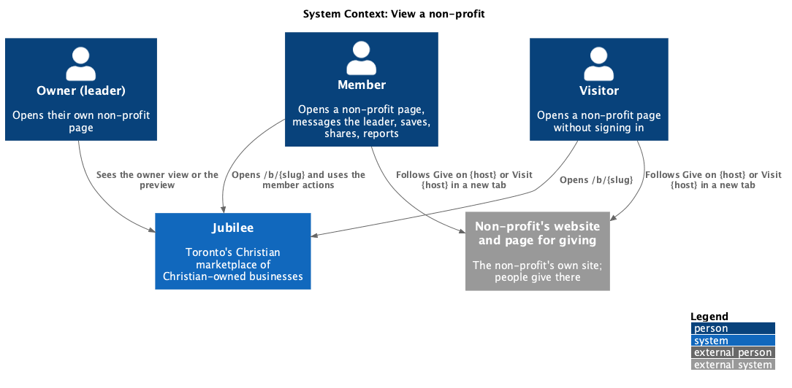
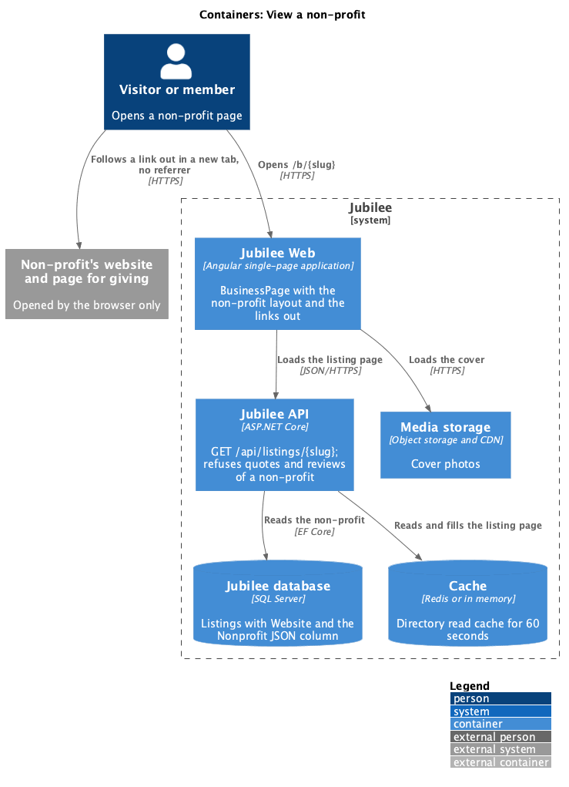
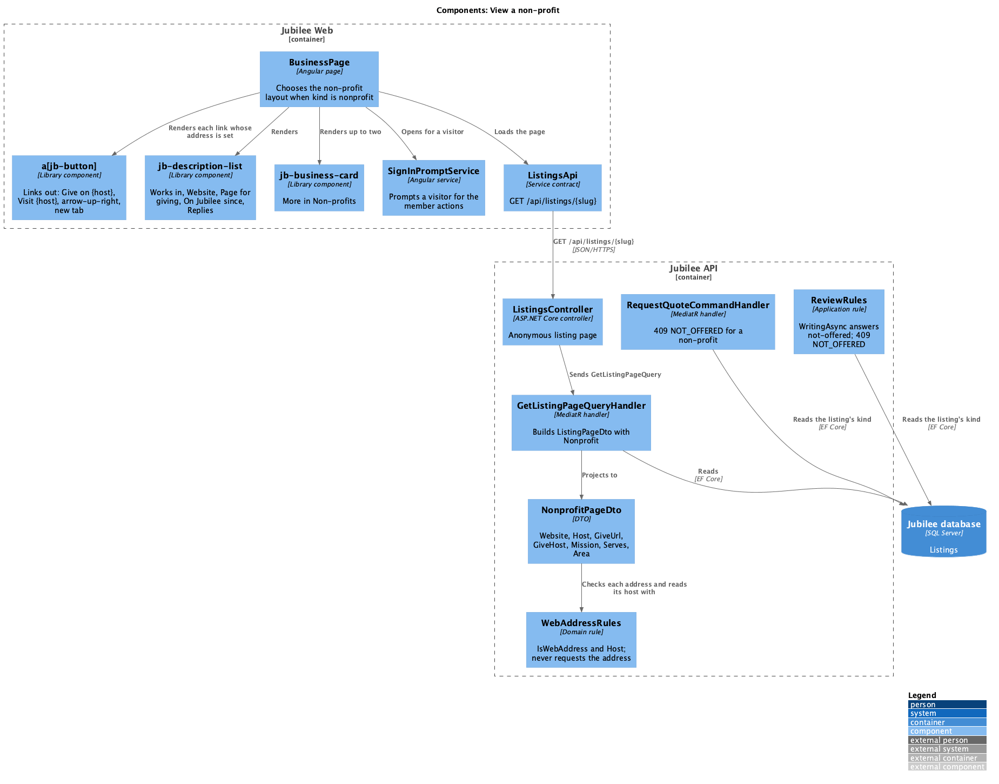
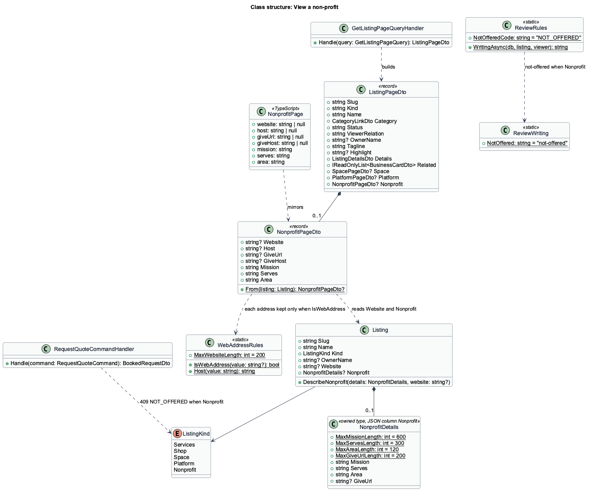
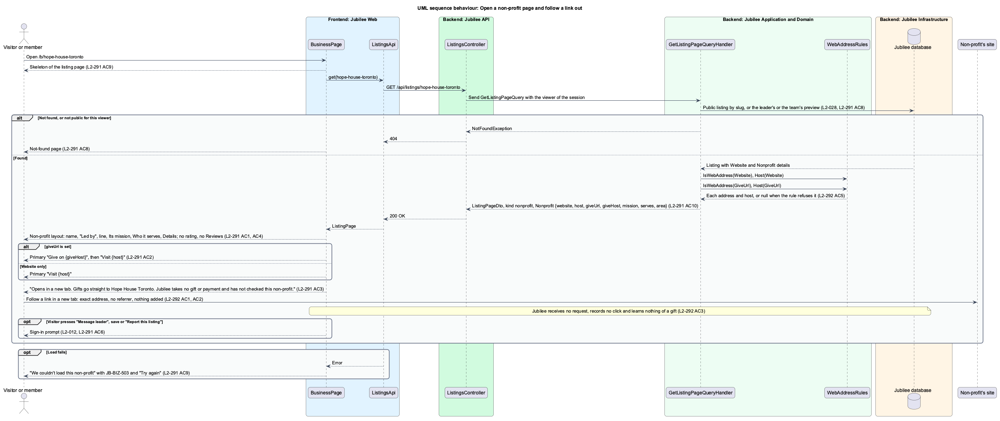
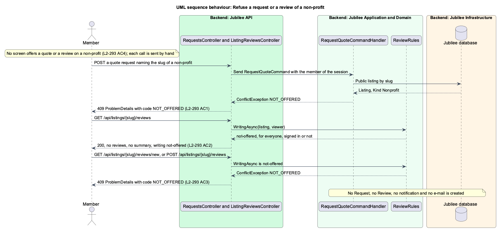

# View a non-profit

## Overview

Jubilee is Toronto's Christian marketplace: a directory of
Christian-owned businesses. A *non-profit* is a listing for a Christian
ministry, charity or other organisation at work in Toronto that sells nothing
to the people it serves, in the category "Non-profits"
(`onboarding/describe-nonprofit`). The copy calls the owner of a non-profit
its *leader*, whether they lead it or represent it; the role is the owner of
L1.

Every listing has one page at `/b/:slug` (`listings/view-business-page`). This
feature covers that page when the listing's kind is `nonprofit`: what it
shows, its main action, what it never offers, and what the server never does.

The main action is a *link out*: a plain link that leaves Jubilee for the
non-profit's own site. When the non-profit has a *page for giving* (its own
page where people give to it, on its own website or the giving service it
chose), the primary link is "Give on {host}" to that page, followed by "Visit
{host}" to the website; otherwise the primary link is "Visit {host}". The
*host* is the host name of the address without `www.`, for example
`hopehouse.example`. A gift is made there, between the giver and the
non-profit. Jubilee takes, holds, counts and receipts no gift, has no
redirect, counts no click and never requests either address (ADR 0074).

A non-profit takes no requests and no reviews. Its page has no "Book a
meeting", no "Ask for a quote", no "Request", no rating and no "Reviews"
section; the API refuses a quote request and a review of a non-profit with
HTTP 409 `NOT_OFFERED`. A member reaches the leader through "Message
leader", which is how a member offers to volunteer or partner, and may save,
share and report the listing as any other.

Nobody checks a non-profit first (ADR 0057). The page never calls a
non-profit verified, approved, registered, vetted or endorsed, says under the
links that Jubilee has not checked it, and places no verse of Scripture beside
a link to give.

## Description

The feature is a read slice from `BusinessPage` in `Jubilee Web` to the
`Jubilee database`, with the refusals of the request and review handlers. The
model is fixed by [ADR 0074](../../../adr/0074-non-profits.md) and copies the
platform page (`listings/view-platform`). There is no new page and no new
presentation component.

- **`BusinessPage`** (`pages/business/`): the existing page at `/b/:slug`.
  When `ListingPage.kind` is `nonprofit` it renders the non-profit layout
  instead of the business, space or platform layout; the route, the load
  states, the owner view, the preview and the not-found rule stay shared. The
  non-profit layout composes library components only, in this order
  (`L2-291` AC1):
  - "Back to browse" linking to `/`;
  - the cover (the photos of `L2-221`) or the "Non-profits" media tile;
  - "Non-profits" linking to `/c/non-profits`, the name, "Led by {owner
    name}" when an owner name is given, and the line;
  - the actions: the links out (below), "Message leader", save and share;
  - the note "Opens in a new tab. Gifts go straight to {name}. Jubilee takes
    no gift or payment and has not checked this non-profit." (`L2-291` AC3);
  - the highlight, when given;
  - "Its mission" and "Who it serves" as text;
  - "Details" as a `jb-description-list` with the rows "Works in" (where in
    Toronto it works), "Website" ({host}, a link out), "Page for giving"
    ({host of that page}, a link out, only when given), "On Jubilee since"
    and "Replies" (`L2-033` AC5);
  - "More in Non-profits" with up to two other live non-profits as
    `jb-business-card` items and "See all" (`L2-040`, `L2-290` AC6);
  - "Report this listing".
  The layout has no "Book a meeting", no "Ask for a quote", no "Request", no
  services, no products, no "Where", no "Hours", no "Languages", no rating and
  no "Reviews" section, and no verse beside a link out (`L2-291` AC4). A
  failed load shows "We couldn't load this non-profit" with `JB-BIZ-503` and
  "Try again" (`L2-291` AC9). Under 768 px the actions stack and the primary
  link out spans the width (`L2-298` AC1).
- **The links out** (`L2-291` AC2, `L2-292` AC1): each an `<a jb-button>`
  with the `arrow-up-right` icon. Given `nonprofit.giveUrl`, the primary
  button is "Give on {giveHost}" with `href` exactly `giveUrl`, and a
  secondary button "Visit {host}" with `href` exactly `website` follows it.
  Without a page for giving, the primary button is "Visit {host}". Each has
  `target="_blank"` and `rel="noopener noreferrer nofollow"`, and a
  `visually-hidden` span "(opens in a new tab)" so the accessible name ends
  with it. The icon says the link leaves Jubilee, so colour is not the only
  sign. The app adds nothing to either address: no id, no name, no e-mail, no
  session, no query parameter, no fragment; `noreferrer` sends no referrer
  (`L2-292` AC2). Each is a link in the reading order with the focus ring of
  `jb-button`, at least 44 px high, and opens with Enter (`L2-292` AC6). They
  need no session and no connection check: they work for a visitor and stay
  links offline (`L2-298` AC5). The "Website" and "Page for giving" rows repeat
  the same links with the host as text and the same arrow icon. While the page
  loads it says "Loading this non-profit…", as every listing page names what it
  opens (`L2-291` AC9).
- **No link without a valid address** (`L2-292` AC5): when `website` is null
  the page shows no "Visit" link and no "Website" row; when `giveUrl` is null
  it shows no "Give" link and no "Page for giving" row. With neither, the page
  shows no link out and no note.
- **Actions**: for a visitor, "Message leader", save and "Report this
  listing" open the sign-in prompt through `SignInPromptService` (`L2-012`,
  `L2-291` AC6); the links out and share work without signing in. For a
  member, "Message leader" starts the conversation of
  `messaging/start-conversation` with the non-profit, save follows
  `listings/save-listing`, share follows `listings/share-listing` and shows
  the listing's address on Jubilee (`L2-244`), never the non-profit's website,
  and "Report this listing" follows `listings/report-listing` (`L2-291` AC5).
  "Message leader" carries `jbRequiresConnection` and is disabled offline
  (`L2-298` AC5).
- **Owner view and preview** (`L2-291` AC7, AC8): the leader on their own
  live non-profit sees the banner of `L2-037` AC1 and "Edit listing" in place
  of "Message leader"; save and report are hidden, the links out stay, and no
  view is counted (`RecordListingViewCommand`, unchanged). A non-profit that
  is not public shows the preview of `L2-219` with its status to its leader
  and the Jubilee team; anyone else, and a deleted or taken-down non-profit,
  gets the not-found page with HTTP 404 (`L2-028` AC3).
- **`ListingsApi.get`**: `GET /api/listings/{slug}`, unchanged. The model
  `ListingKind` in `frontend/projects/api/src/lib/models/listing.ts` gains
  `'nonprofit'`, and `ListingPage` gains `nonprofit: NonprofitPage | null`
  (`NonprofitPage`: `website`, `host`, `giveUrl`, `giveHost`, `mission`,
  `serves`, `area`).
- **`GetListingPageQueryHandler`**: fills the new init property
  `ListingPageDto.Nonprofit` (`NonprofitPageDto?`) with
  `NonprofitPageDto.From(Listing)`; it is null for every other kind
  (`L2-291` AC10). `Kind` is `nonprofit`. `Services` and `Products` are empty,
  `Space` and `Platform` are null, and `Related` holds the two related
  non-profits, by the same query as for a business. The page comes from
  `IDirectoryReadCache` like every public listing page; `NonprofitPageDto`
  holds nothing personal.
- **`NonprofitPageDto`** (`Jubilee.Application/Listings/ListingPageDtos.cs`):
  `Website`, `Host`, `GiveUrl`, `GiveHost`, `Mission`, `Serves` and `Area`.
  `Website` is `Listing.Website` when `WebAddressRules.IsWebAddress` accepts
  it, and `Host` is `WebAddressRules.Host` of it; `GiveUrl` and `GiveHost`
  follow the same rule from `NonprofitDetails.GiveUrl`. When a stored address
  no longer passes the rule, that pair is null and the rest is answered
  (`L2-292` AC5).
- **`WebAddressRules`** (`Jubilee.Domain`): the web-address rule of ADR 0072,
  moved out of `PlatformRules` so that a platform and a non-profit share it
  (ADR 0074). `IsWebAddress(string)` accepts an absolute `https` address with
  a host name that has a dot, no user or password, and at most
  `MaxWebsiteLength` (200) characters. `Host(string)` answers the host name
  without a leading `www.`. Both are pure: neither resolves nor requests the
  address. `PlatformRules` forwards to it (`security/validate-input`).
- **No request to either address** (`L2-292` AC3, AC4): no handler, job or
  seed requests a non-profit's website or page for giving, or anything at
  them. Jubilee makes no preview, takes no screenshot and checks nothing
  there. There is no redirect endpoint and no click is recorded.
- **No requests** (`L2-293` AC1): `RequestQuoteCommandHandler` and
  `GetQuoteOptionsQueryHandler` refuse a listing whose kind is `Nonprofit`
  with `ConflictException`, HTTP 409 and code `NOT_OFFERED`, as for a
  platform, before anything is created (`requests/request-quote`). A booking
  and an order request name a service or a product, and a non-profit has
  none, so they answer HTTP 404 as today. `RequestSpaceCommandHandler`
  answers HTTP 404 because `Listing.Space` is null.
- **No reviews** (`L2-293` AC2, AC3): `ReviewRules.WritingAsync` answers
  `ReviewWriting.NotOffered` (`not-offered`) for a non-profit before any other
  check, so it is the answer for everyone, signed in or not, the leader
  included. `GET /api/listings/{slug}/reviews` lists none, with no summary.
  `GET /api/listings/{slug}/reviews/new` and `POST
  /api/listings/{slug}/reviews` refuse a non-profit with `ConflictException`,
  HTTP 409 and code `NOT_OFFERED` (`ReviewRules.NotOfferedCode`), and store
  nothing. In the app, `/b/{slug}/review` of a non-profit shows the not-found
  page (`reviews/write-a-review`). The non-profit layout never loads the
  reviews.
- **Text as text** (`L2-297` AC1): `Mission`, `Serves` and `Area` are stored
  as text and rendered by interpolation, never as markup. The website and the
  page for giving are the only fields rendered as links, and only by the
  rules above.
- **What the answer holds of the leader** (`L2-297` AC3): the owner name the
  page shows, and nothing else.
- **Copy** (`L2-297` AC4): no line on the page says or implies that giving
  brings prosperity or a return, flatters a giver, places a verse beside a
  link to give, or calls the non-profit verified, approved, registered,
  vetted or endorsed. No charity registration number, tax receipt or amount
  is shown (`L2-285` AC5).
- **Seed**: Hope House Toronto (`/b/hope-house-toronto`) is the non-profit
  the mocks and the tests open with a page for giving; Bread & Bridges has a
  website only. Their addresses are on `.example`.
- **Tests**: API integration tests on the InMemory provider (ADR 0009) in
  `backend/tests/Jubilee.Api.Tests/` (`NonprofitPageTests`, beside
  `PlatformPageTests`), named for their criterion (`L2_291_AC10_...`,
  `L2_292_AC5_...`, `L2_293_AC1_...`, `L2_293_AC3_...`). The Playwright
  behaviour spec `e2e/tests/nonprofit.spec.ts` reads the non-profit regions
  from the page object of the listing page (`e2e/pages/business.page.ts`);
  `e2e/fixtures/routes.ts` gains the states of `pages/nonprofit/` (default,
  website only, signed out, owner, preview, loading, error).

### Open questions

The choices below are recorded where the design reference and the rules
differ or leave a gap.

- **No drawing in the design reference**: the Magic Patterns reference draws
  no non-profit. The page is drawn in `docs/mocks/pages/nonprofit/` from the
  parts of the business and platform pages (ADR 0074).
- **One page component**: the non-profit layout lives in `BusinessPage` and
  is chosen by kind, as the platform layout is.
- **Quote options**: `L2-293` AC1 names the quote request. The design refuses
  the read of its options with the same code, as for a platform, so the quote
  dialog cannot open on a non-profit from a typed address.
- **`not-offered` first**: `L2-293` AC2 says `writing` is `not-offered` for
  everyone. The rule is checked before `sign-in` and `owner`, so neither a
  visitor nor the leader sees another word.
- **The review read for a non-profit**: the API still answers `GET
  /api/listings/{slug}/reviews` (an empty list, no summary,
  `not-offered`), and the page does not call it.
- **Secondary button style**: "Visit {host}" after "Give on {host}" is a
  `jb-button` of the default variant at size `lg` (`btn btn--lg` in the mock
  `pages/nonprofit/default.html`); with no page for giving it is the primary.
- **Deferred** (ADR 0074): taking, holding, counting or receipting donations;
  checking a registered charity; a charity registration number; reviews of
  non-profits; events, volunteer sign-ups and campaigns; and any link between
  a business and a non-profit.

## Requirements

The feature realizes the following level-2 (L2) requirements. Each L2
requirement refines a level-1 (L1) requirement, cited by identifier.

| L2 ID | Refines (L1) | Requirement |
|-------|--------------|-------------|
| `L2-291` | `L1-035` | `/b/:slug` for a non-profit shall show "Back to browse", the cover or the tile, "Non-profits", the name, "Led by {owner name}", the line, the links out, "Message leader", save and share, the highlight, "Its mission", "Who it serves", "Details" with Works in, Website, Page for giving, On Jubilee since and Replies, "More in Non-profits" and "Report this listing"; it shall say under the links that gifts go straight to the non-profit and Jubilee takes no gift or payment and has not checked it, offer no booking, quote, request, rating or reviews, prompt a visitor to sign in for the member actions, show the leader the owner view and the preview, and answer `kind` `nonprofit` with `nonprofit` holding `website`, `host`, `giveUrl`, `giveHost`, `mission`, `serves` and `area`. |
| `L2-292` | `L1-035` | Each link out shall be an `<a>` to exactly the address the leader gave with `target="_blank"` and `rel="noopener noreferrer nofollow"`, the text "Give on {host}" or "Visit {host}", an accessible name ending "(opens in a new tab)" and an icon; it shall carry nothing of the member, go straight to the address with no redirect and no recorded click, be left out when the stored address fails the rule, and be reachable by keyboard and touch at 44 px; the server shall never request either address. |
| `L2-293` | `L1-035` | A non-profit shall take no requests and no reviews: a quote request shall be refused with HTTP 409 `NOT_OFFERED`, a booking, an order request and a space request shall answer HTTP 404, its reviews shall list none with `writing` `not-offered` for everyone, and starting or sending a review shall be refused with HTTP 409 `NOT_OFFERED`. |
| `L2-297` | `L1-035` | Every field of a non-profit shall be stored and shown as text, the website and the page for giving alone rendered as links; the API answers shall carry nothing of the leader but the owner name the page shows; and no copy shall promise a return for giving, place a verse beside a link to give, flatter a giver or call a non-profit verified, approved, registered, vetted or endorsed. |
| `L2-298` | `L1-035` | The non-profit page shall fit from 360 px with the actions stacked and the primary link out spanning the width under 768 px, work by keyboard and touch with 44 px targets, show its loading and failed states, use the tokens in both themes, and keep the links out links offline while "Message leader" is disabled. |
| `L2-012` | `L1-001` | When a visitor tries an action that needs an account, the system shall prompt them to join or sign in and bring them straight back. |
| `L2-028` | `L1-003` | Browse, category, search, featured and related lists shall show only listings that are live and not paused, deleted or under a moderation hold. |
| `L2-037` | `L1-005` | An owner who opens their own live listing shall see an owner banner and "Edit listing" in place of the member actions. |
| `L2-118` | `L1-016` | Every load-error state shall show a reference that the user can quote to support. |
| `L2-136` | `L1-019` | Every input shall be validated on the server and text shall never be rendered as markup. |

## Diagrams

### System context

Visitors and members open a non-profit's page in Jubilee and leave for the
non-profit's own website or page for giving by a plain link. Jubilee itself
never calls either address and takes no part in a gift.

### Containers

`Jubilee Web` loads the page from `Jubilee API`, which reads the non-profit
from the `Cache` or the `Jubilee database`; the cover loads from `Media
storage`. The browser, not Jubilee, opens the non-profit's site.

### Components

`BusinessPage` chooses the non-profit layout by kind and composes library
components. `GetListingPageQueryHandler` builds `NonprofitPageDto` through
`WebAddressRules`; the quote handler and the review rules refuse a
non-profit.

### Class structure

`ListingPageDto` gains `Nonprofit`. `NonprofitPageDto` takes the website from
`Listing.Website` and the rest from `NonprofitDetails`; `WebAddressRules`
decides whether each address is answered.

### Behaviour: open a non-profit page and follow a link out

The page loads one response. "Give on {host}" leads when there is a page for
giving, each link is rendered only when the answer holds its address, and
following one sends nothing to Jubilee.

### Behaviour: refuse a request or a review of a non-profit

No screen offers a quote or a review on a non-profit; a request or a review
sent anyway is refused with HTTP 409 `NOT_OFFERED` before anything is
created.

