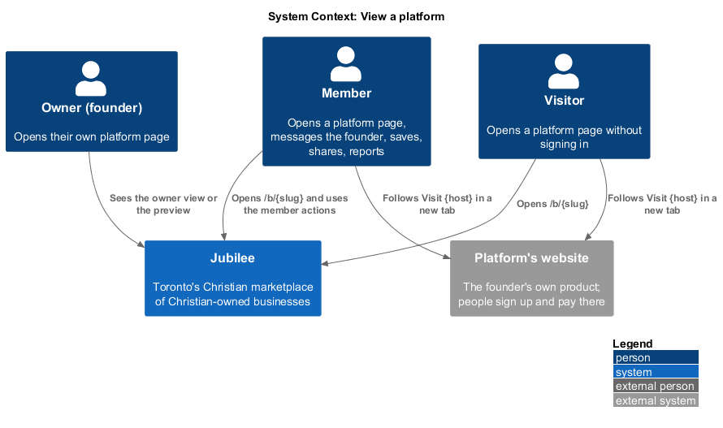
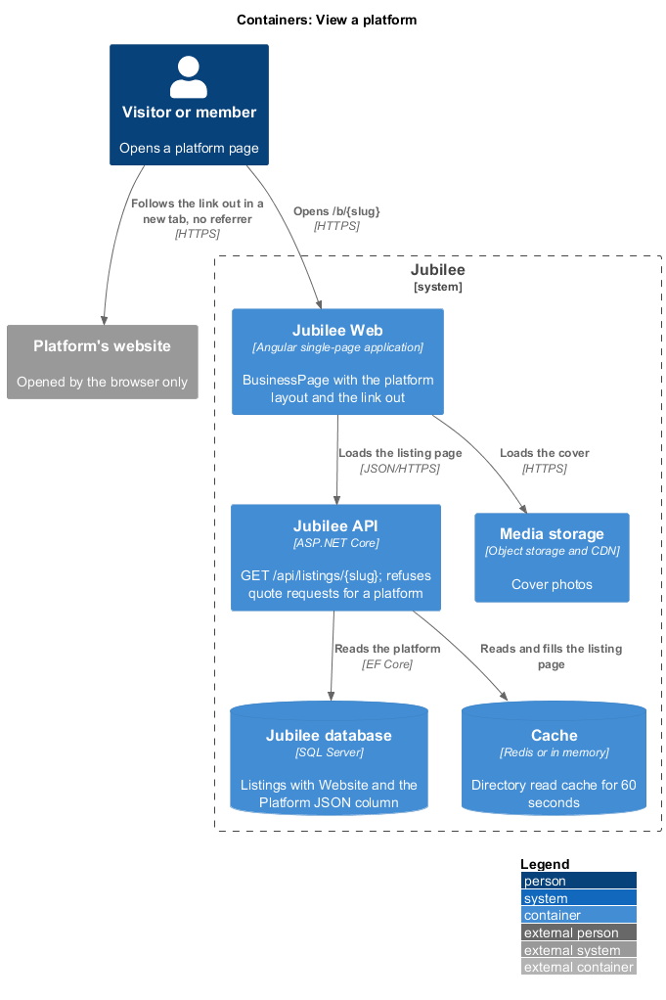
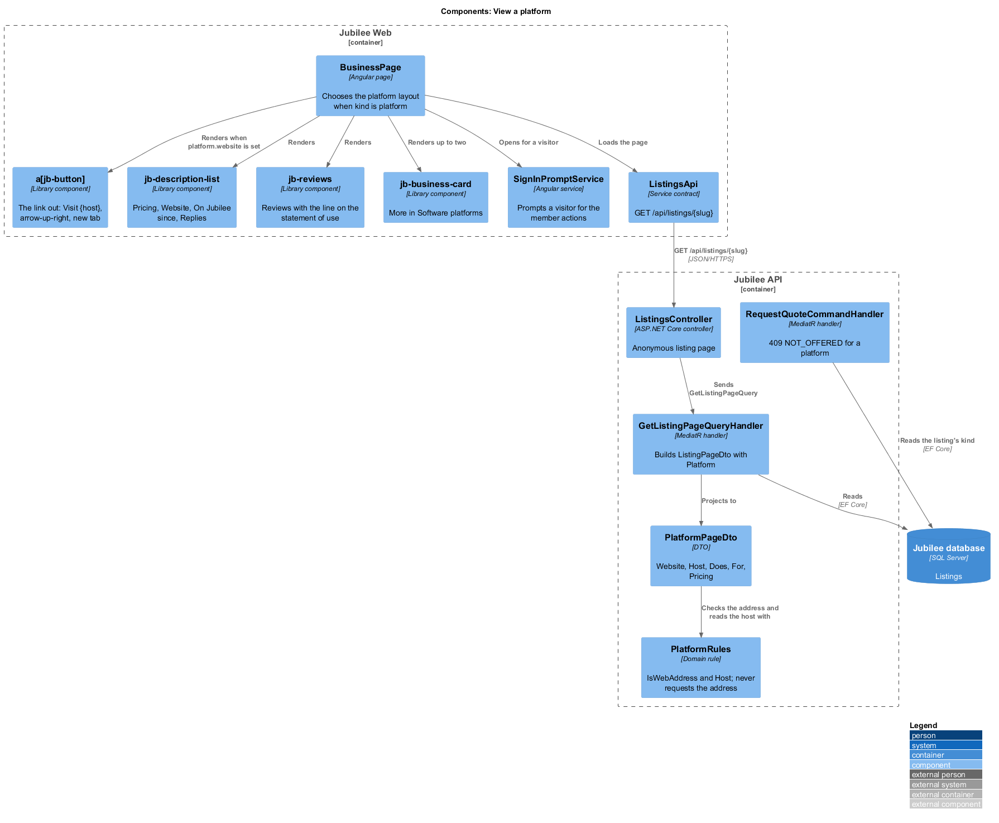
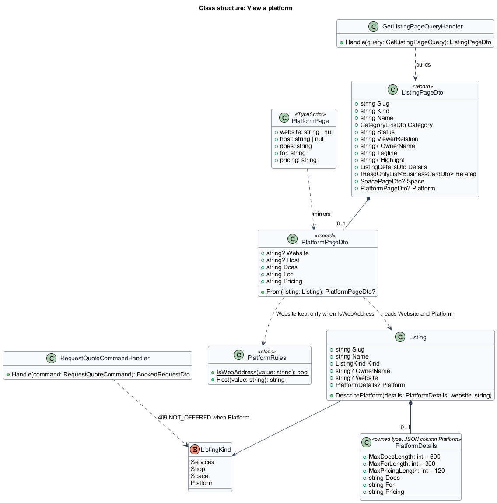
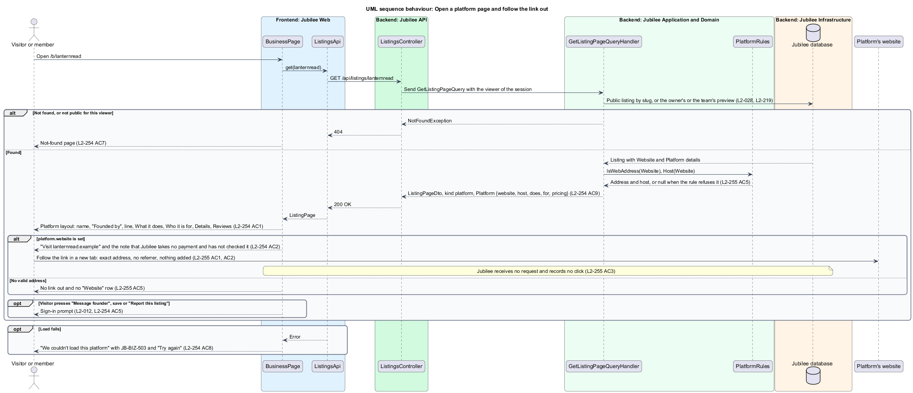
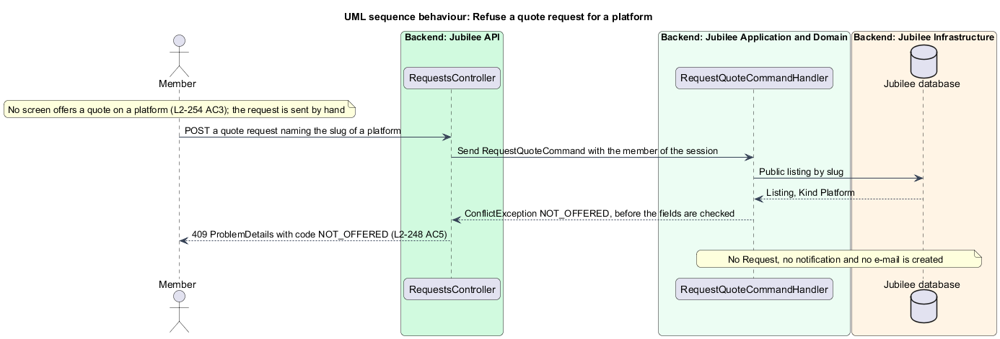

# View a platform

## Overview

Jubilee is Toronto's Christian marketplace: a directory of
Christian-owned businesses. A *software platform* (a *platform* for short) is
a listing for a product people use online, a web app or an online tool, in the
category "Software platforms" (`onboarding/describe-platform`). The copy calls
the owner of a platform its *founder*; the role is the owner of L1.

Every listing has one page at `/b/:slug` (`listings/view-business-page`). This
feature covers that page when the listing's kind is `platform`: what it shows,
its main action, what it never offers, and what the server never does.

The main action is the *link out*: a plain link that leaves Jubilee for the
platform's own website, worded "Visit {host}". The *host* is the host name of
the web address without `www.`, for example `lanternread.example`. A member
signs up and pays on that website. Jubilee takes no payment, counts no click
and never requests the address.

A platform takes no requests. Its page has no "Book a meeting", no "Ask for a
quote" and no "Request". A member reaches the founder through "Message
founder", and may save, share and report the listing as any other. Reviews of a
platform are covered by `reviews/review-a-platform`.

Nobody verifies a platform first (ADR 0057). The page never calls a platform
verified, approved or vetted, and says under the link out that Jubilee has not
checked it.

## Description

The feature is a read slice from `BusinessPage` in `Jubilee Web` to the
`Jubilee database`. The model is fixed by
[ADR 0071](../../../adr/0071-software-platforms.md). There is no new page and
no new presentation component.

- **`BusinessPage`** (`pages/business/`): the existing page at `/b/:slug`.
  When `ListingPage.kind` is `platform` it renders the platform layout instead
  of the business or the space layout; the route, the load states, the owner
  view, the preview and the not-found rule stay shared. The platform layout
  composes library components only, in this order:
  - "Back to browse" linking to `/`;
  - the cover (the photos of `L2-221`) or the "Software platforms" media
    tile;
  - "Software platforms" linking to `/c/software-platforms`, the name, the
    rating under the name (`L2-229` AC1), "Founded by {owner name}" and the
    line;
  - the actions: the link out, "Message founder", save and share;
  - the note "Opens {host} in a new tab. You sign up and pay there. Jubilee
    takes no payment and has not checked this platform.";
  - the highlight, when given;
  - "What it does" and "Who it is for" as text;
  - "Details" as a `jb-description-list` with the rows "Pricing", "Website"
    ({host}, the same link out), "On Jubilee since" and "Replies" (`L2-033`
    AC5);
  - the "Reviews" section (`reviews/review-a-platform`);
  - "More in Software platforms" with up to two other live platforms as
    `jb-business-card` items and "See all" (`L2-040`);
  - "Report this listing".
  The layout has no "Book a meeting", no "Ask for a quote", no "Request", no
  services, no products, no "Where", no "Hours" and no "Languages". A failed
  load shows "We couldn't load this platform" with `JB-BIZ-503` and "Try
  again". Under 768 px the actions stack and the link out spans the width
  (`L2-262` AC1).
- **The link out**: an `<a jb-button variant="primary">` with the
  `arrow-up-right` icon. Its `href` is exactly `platform.website`, with
  `target="_blank"` and `rel="noopener noreferrer nofollow"`. Its text is
  "Visit {host}", followed by "(opens in a new tab)" in a `visually-hidden`
  span, so the accessible name ends with it. The icon says the link leaves
  Jubilee, so colour is not the only sign. The app adds nothing to the address:
  no id, no query parameter, no fragment; `noreferrer` sends no referrer. It is
  a link in the reading order with the focus ring of `jb-button`, at least
  44 px high, and opens with Enter. It needs no session and no connection
  check: it works for a visitor and stays a link offline (`L2-262` AC5). The
  "Website" row repeats the same link with the text {host}.
- **No link without a valid address**: when `platform.website` is null the
  page shows no link out, no note and no "Website" row (`L2-255` AC5).
- **Actions**: for a visitor, "Message founder", save and "Report this
  listing" open the sign-in prompt through `SignInPromptService` (`L2-012`);
  the link out and share work without signing in. For a member, "Message
  founder" starts the conversation of `messaging/start-conversation` with the
  platform, save follows `listings/save-listing`, share follows
  `listings/share-listing` and shows the listing's address on Jubilee
  (`L2-244`), never the platform's website, and "Report this listing" follows
  `listings/report-listing`. "Message founder" carries `jbRequiresConnection`
  and is disabled offline.
- **Owner view and preview**: the founder on their own live platform sees the
  banner of `L2-037` AC1 and "Edit listing" in place of "Message founder";
  save and report are hidden, the link out stays, and no view is counted
  (`RecordListingViewCommand`, unchanged). A platform that is not public shows
  the preview of `L2-219` with its status to its founder and the Jubilee team;
  anyone else, and a deleted or taken-down platform, gets the not-found page
  with HTTP 404 (`L2-028` AC3).
- **`ListingsApi.get`**: `GET /api/listings/{slug}`, unchanged. The model
  `ListingKind` in `frontend/projects/api/src/lib/models/listing.ts` gains
  `'platform'`, and `ListingPage` gains `platform: PlatformPage | null`
  (`PlatformPage`: `website`, `host`, `does`, `for`, `pricing`).
- **`GetListingPageQueryHandler`**: fills the new field
  `ListingPageDto.Platform` (`PlatformPageDto?`) with
  `PlatformPageDto.From(Listing)`; it is null for every other kind. `Kind` is
  `platform`. `Services` and `Products` are empty, `Space` is null and
  `Related` holds the two related platforms, by the same query as for a
  business. The page comes from `IDirectoryReadCache` like every public
  listing page; `PlatformPageDto` holds nothing personal.
- **`PlatformPageDto`**: `Website`, `Host`, `Does`, `For` and `Pricing`.
  `Website` is `Listing.Website` when `PlatformRules.IsWebAddress` accepts it,
  and `Host` is `PlatformRules.Host` of it. When the stored address no longer
  passes the rule, `Website` and `Host` are null and the rest is answered.
- **`PlatformRules`** (`Jubilee.Domain`): `IsWebAddress(string)` accepts an
  absolute `https` address with a host name that has a dot, no user or
  password, and at most 200 characters. `Host(string)` answers the host name
  without a leading `www.`. Both are pure: neither resolves nor requests the
  address.
- **No request to the address**: no handler, job or seed requests a
  platform's web address or anything at it. Jubilee makes no preview, takes no
  screenshot and checks nothing there (`L2-255` AC4). There is no redirect
  endpoint and no click is recorded (`L2-255` AC3).
- **No requests** (`L2-248` AC5): `RequestQuoteCommandHandler` and
  `GetQuoteOptionsQueryHandler` refuse a listing whose kind is `Platform`
  with `ConflictException`, HTTP 409 and code `NOT_OFFERED`, before the fields
  are checked and before anything is created. A booking and an order request
  name a service or a product, and a platform has none, so they answer HTTP
  404 as today. `RequestSpaceCommandHandler` answers HTTP 404 because
  `Listing.Space` is null.
- **Text as text** (`L2-261` AC1): `Does`, `For` and `Pricing` are stored as
  text and rendered by interpolation, never as markup. The web address is the
  only field rendered as a link, and only by the rules above.
- **What the answer holds of the founder** (`L2-261` AC5): the owner name the
  page shows, and nothing else.
- **Seed**: Lanternread (`/b/lanternread`, by Abigail Thornton) is the
  platform the mocks and the tests open; its address is on `.example`.
- **Tests**: API integration tests on the InMemory provider (ADR 0009) in
  `backend/tests/Jubilee.Api.Tests/` (`PlatformPageTests`, beside
  `SpacePageTests`), named for their criterion (`L2_254_AC9_...`,
  `L2_255_AC5_...`, `L2_248_AC5_...`). The Playwright behaviour spec
  `e2e/tests/platform.spec.ts` reads the platform regions from the page object
  of the listing page (`e2e/pages/business.page.ts`); `e2e/fixtures/routes.ts`
  gains the platform states (default, signed out, owner, preview, error).

### Open questions

The choices below are recorded where the design reference and the rules
differ or leave a gap.

- **No drawing in the design reference**: the Magic Patterns reference draws
  no platform. The page is drawn in `docs/mocks/pages/platform/` from the
  parts of the business page (ADR 0071).
- **One page component**: the platform layout lives in `BusinessPage` and is
  chosen by kind, because every kind shares `/b/:slug`, its load states and
  its not-found rule.
- **A plain link, not a redirect**: a redirect endpoint would let Jubilee
  count clicks, and would carry the member through Jubilee to do it. The link
  goes straight to the website and Jubilee learns nothing of who followed it
  (ADR 0071).
- **`https` only**: a business's optional website keeps the rule of `L2-087`
  AC3 (`http` or `https`). A platform's address is `https` only, because it is
  the page's main action.
- **A stored address that fails the rule**: left out of the answer, not
  linked and not repaired. The founder corrects it on Edit listing
  (`owner-workspace/edit-listing`).
- **Quote options**: `L2-248` AC5 names the quote request. The design refuses
  the read of its options with the same code, so the quote dialog cannot open
  on a platform from a typed address.
- **Deferred** (ADR 0071): app store links, screenshot galleries, pricing
  tables, integrations, an API for platforms, and booking, quotes, product
  requests or payment for platforms.

## Requirements

The feature realizes the following level-2 (L2) requirements. Each L2
requirement refines a level-1 (L1) requirement, cited by identifier.

| L2 ID | Refines (L1) | Requirement |
|-------|--------------|-------------|
| `L2-254` | `L1-033` | `/b/:slug` for a platform shall show "Back to browse", the cover or the tile, "Software platforms", the name, "Founded by {owner name}", the line, the rating, the actions "Visit {host}", "Message founder", save and share, the highlight, "What it does", "Who it is for", "Details" with Pricing, Website, On Jubilee since and Replies, the reviews, "More in Software platforms" and "Report this listing"; it shall say under the link that Jubilee takes no payment and has not checked the platform, offer no booking, quote or request, prompt a visitor to sign in for the member actions, show the founder the owner view and the preview, and answer `kind` `platform` with `platform` holding `website`, `host`, `does`, `for` and `pricing`. |
| `L2-255` | `L1-033` | The link out shall be an `<a>` to exactly the founder's web address with `target="_blank"` and `rel="noopener noreferrer nofollow"`, the text "Visit {host}", an accessible name ending "(opens in a new tab)" and an icon; it shall carry nothing of the member, go straight to the website with no redirect and no recorded click, and be left out when the stored address fails the rule; the server shall never request the address. |
| `L2-248` | `L1-033` | A platform shall take no requests: a quote request shall be refused with HTTP 409 `NOT_OFFERED`, a booking, an order request and a space request shall answer HTTP 404, and no screen shall offer any of them or call a platform verified, approved or vetted. |
| `L2-261` | `L1-033` | Every field of a platform shall be stored and shown as text, the web address alone rendered as a link; the API answers of a platform shall carry nothing of the founder but the owner name the page shows. |
| `L2-262` | `L1-033` | The platform page shall fit from 360 px with the actions stacked and "Visit {host}" spanning the width under 768 px, work by keyboard and touch with 44 px targets, show its loading and failed states, use the tokens in both themes, and keep "Visit {host}" a link offline while "Message founder" is disabled. |
| `L2-012` | `L1-001` | When a visitor tries an action that needs an account, the system shall prompt them to join or sign in and bring them straight back. |
| `L2-028` | `L1-003` | Browse, category, search, featured and related lists shall show only listings that are live and not paused, deleted or under a moderation hold. |
| `L2-037` | `L1-005` | An owner who opens their own live listing shall see an owner banner and "Edit listing" in place of the member actions. |
| `L2-118` | `L1-016` | Every load-error state shall show a reference that the user can quote to support. |
| `L2-136` | `L1-019` | Every input shall be validated on the server and text shall never be rendered as markup. |

## Diagrams

### System context

Visitors and members open a platform's page in Jubilee and leave for the
platform's website by a plain link. Jubilee itself never calls that website.

### Containers

`Jubilee Web` loads the page from `Jubilee API`, which reads the platform from
the `Cache` or the `Jubilee database`; the cover loads from `Media storage`.
The browser, not Jubilee, opens the platform's website.

### Components

`BusinessPage` chooses the platform layout by kind and composes library
components. `GetListingPageQueryHandler` builds `PlatformPageDto` through
`PlatformRules`, and the quote handler refuses a platform.

### Class structure

`ListingPageDto` gains `Platform`. `PlatformPageDto` takes the web address
from `Listing.Website` and the words from `PlatformDetails`; `PlatformRules`
decides whether the address is answered.

### Behaviour: open a platform page and follow the link out

The page loads one response. The link out is rendered only when the answer
holds a web address, and following it sends nothing to Jubilee.

### Behaviour: refuse a quote request for a platform

No screen offers a quote on a platform; a request sent anyway is refused
before anything is created.

