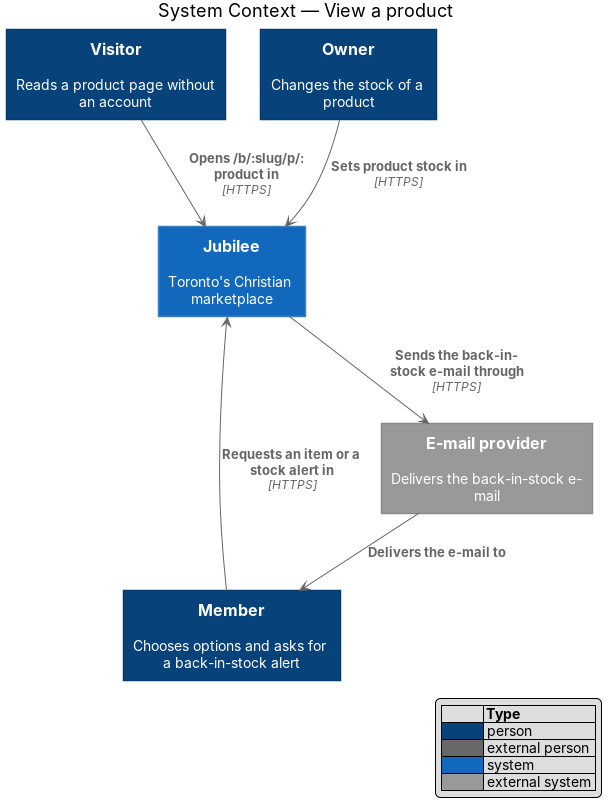
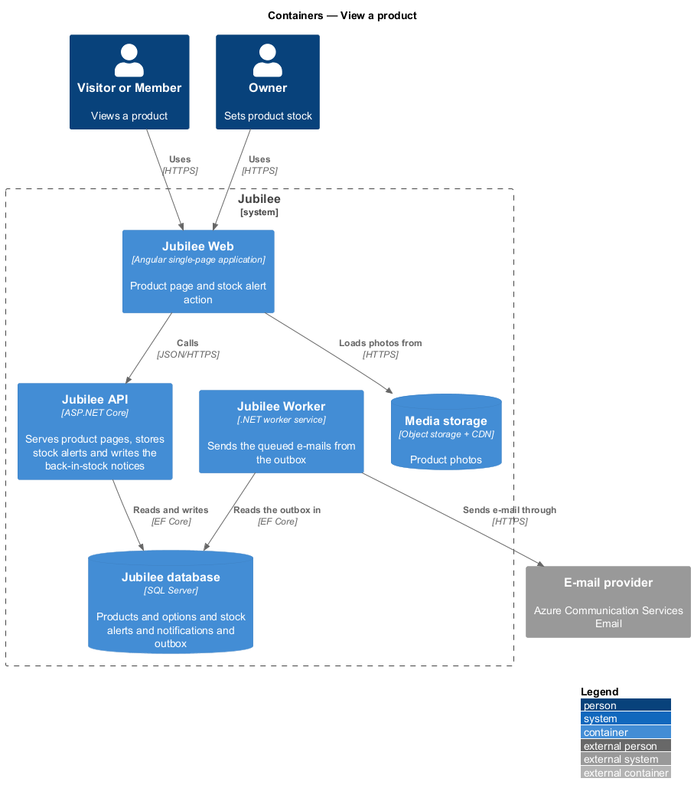
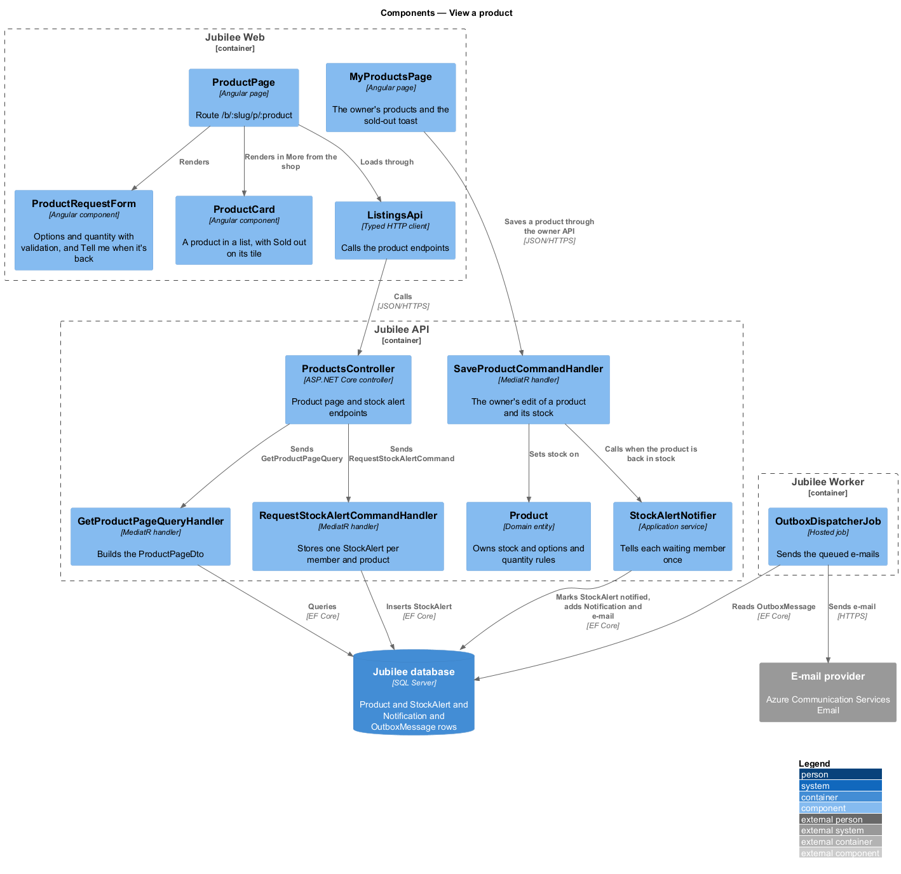
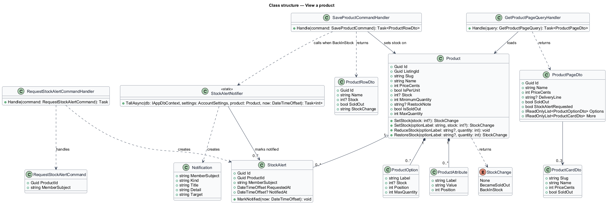
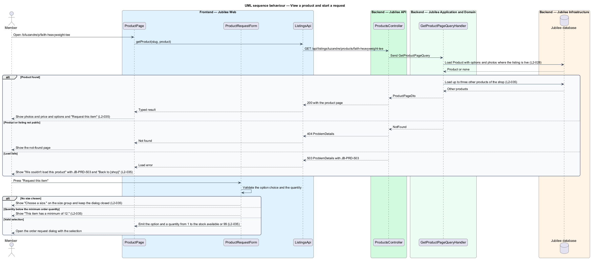
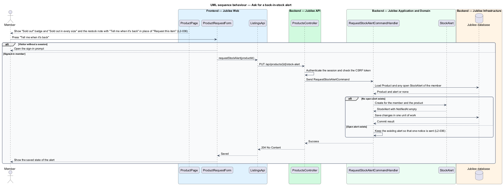
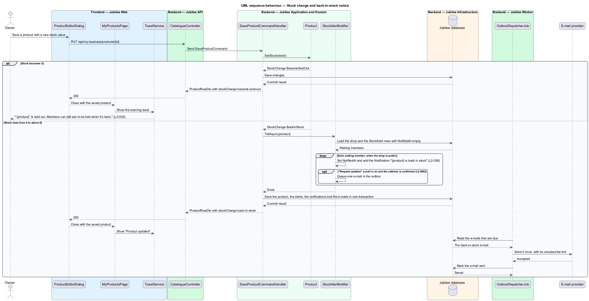

# View a product

## Overview

Jubilee is Toronto's Christian marketplace. A shop on Jubilee lists products,
and each product has its own page at `/b/:slug/p/:product`. This feature covers
that page: what it shows, how the option and quantity controls validate a
selection before a request starts, and what happens when a product is sold out.

Jubilee takes no payment. The primary action "Request this item" opens the
order request dialog, where the member asks the shop for the item; the page
states "No payment now. {shop} confirms stock and tells you how to pay." The
order request dialog and the request that it creates belong to a separate
feature. This feature ends when a valid selection is handed to that dialog.

The feature uses the following local terms.

- **product option** — selectable variant of a product, such as a size, with its own stock
- **tracked stock** — stock count that the owner maintains for a product or option; a product without one is untracked
- **minimum order quantity** — smallest quantity that the shop accepts for one request, shown as "min. 12"
- **sold out** — state of a product whose stock is 0 in every option
- **stock alert** — member's standing request to be told once when a sold-out product is available again

## Description

The feature is a vertical slice from the Angular page to the database, with a
background path for stock alerts.

- **`ProductPage`** — Angular page for `/b/:slug/p/:product`. It shows the
  breadcrumb, the product's tile (`jb-media-tile`), the name, the price ("$34",
  or "$22 ea" for per-unit pricing), the delivery line (for example "· plus $9
  shipping, or free pickup"), "Sold by {shop} · Verified", the "Details" list
  with the description and attributes such as Fit, Care, Ready in and Returns,
  and "More from {shop}" with up to three other products and "Visit shop". On
  failure it shows "We couldn't load this product" with the reference
  `JB-PRD-503` and "Back to {shop}".
- **`ProductRequestForm`** — component (`jb-product-request-form`) that holds
  the option group (sizes S, M, L, XL, 2XL in the mock), the "Quantity" input
  and the "Request this item" button. Pressing the button without a chosen size
  shows "Choose a size." on the size group and does not open the dialog.
  Quantity accepts whole numbers from 1 to the stock available for the chosen
  option, or to 99 when stock is not tracked; before an option is chosen, the
  largest stock of the options bounds it. Any other value shows "Choose a number
  from 1 to {max}." on the quantity (`pages/product/invalid.html`). A quantity
  under the minimum order quantity shows "This item has a minimum of 12." with
  the product's own minimum. The API gives each option's `maxQuantity`, never
  the stock itself.
- **Sold out** — the same form shows the button "Tell me when it's back" in
  place of "Request this item" when the product is sold out. In that state the
  page shows a "Sold out" badge on the tile, "Sold out in every size" ("Sold
  out" for a product without options) and the owner's optional restock note,
  drops the "No payment now" line, and disables the options and quantity. For a
  visitor the button opens the sign-in prompt (`dialogs/sign-in-required`)
  titled "Join to be told when it's back", whose "Sign in" and "Join free" carry
  the product page as `returnUrl`. For a member it asks for the alert, and the
  status "We'll tell you when it's back" takes its place
  (`pages/product/alert-requested.html`).
- **`ProductCard`** — component (`a[jb-product-card]`) for a product in a list:
  on the shop page, in "More from {shop}", on the browse home and on the saved
  page. A sold-out product carries the words "Sold out" on its tile
  (`ProductCardDto.SoldOut`, `pages/shop/sold-out.html`), the badge the product
  page itself shows (`L2-034` AC3).
- **`ListingsApi`** — contract (`LISTINGS_API`) and typed Angular HTTP client
  (`HttpListingsApi`) for `GET /api/listings/{slug}/products/{productSlug}` and
  `PUT /api/products/{id}/stock-alert`. "Request this item" with a valid
  selection navigates to `/b/:slug/p/:product/request?option=…&quantity=…`, the
  route the order request feature (journey 9) opens its dialog on.
- **`ProductsController`** — ASP.NET Core controller in `Jubilee.Api`. The
  `GET` endpoint is anonymous. The `PUT` endpoint requires a session. A load
  failure returns 503 `ProblemDetails` with `JB-PRD-503`.
- **`GetProductPageQuery`** and **`GetProductPageQueryHandler`** — MediatR
  query and handler. The handler loads the `Product` with its `ProductOption`
  and `ProductAttribute` rows, returns not found when the listing is not public
  for the viewer, and adds up to three other products of the same shop, newest
  first, the order of "From the shops" on the browse home. For a signed-in
  member it adds `StockAlertRequested`: whether the member has an open
  `StockAlert` for the product.
- **`Product`** — domain entity that owns stock and quantity rules.
  `MaxQuantity` returns the stock, or 99 when stock is untracked. `SetStock`
  returns a `StockChange`: `BecameSoldOut` when stock reaches 0 in every
  option, `BackInStock` when the product stops being sold out. `RestoreStock`,
  which takes back a confirmed order, returns the same. The same rules are
  applied again by the order request feature on the server.
- **`StockAlert`** — entity keyed by member (`MemberSubject`) and product, with
  `RequestedAt` and `NotifiedAt`. One open alert exists per member and product.
- **`RequestStockAlertCommand`** and **`RequestStockAlertCommandHandler`** —
  MediatR command and handler behind the `PUT` endpoint. The handler creates a
  `StockAlert` when the member has no open alert for the product and otherwise
  leaves the existing alert unchanged, so repeating the request has no further
  effect. A product that is in stock answers 409 `product_in_stock`.
- **`StockAlertNotifier`** — application service in
  `Jubilee.Application/Listings`. `SaveProductCommandHandler` (the owner's edit
  of a product, journey 16) and `UndoConfirmRequestCommandHandler` (a confirmed
  order taken back) call `TellAsync` when the stock change is `BackInStock`,
  before they save, so the notices commit with the stock change or not at all.
  When the shop is public, for each `StockAlert` of the product without
  `NotifiedAt` it sets `NotifiedAt`, creates the in-app `Notification` (kind
  `product`, "{product} is back in stock", "{shop} has it again. You asked to
  be told.", target the product page) and queues one e-mail with
  `EmailPolicy.Queue` in the "Request updates" category, which the member's
  preference, an unconfirmed address and a bounced address each stop
  (`L2-068`). An alert with `NotifiedAt` set is not notified again; a member
  who wants a later notice asks again. When the shop is not public nobody is
  told and the alerts stay open (ADR 0045).
- **Delivery** — nothing new is dispatched. The notification reaches an open
  app over the member's event stream, where `RealtimeService` shows it as a
  toast with "View in shop", and the e-mail is one more row of the e-mail
  outbox that `OutboxDispatcherJob` in `Jubilee.Worker` already sends, with its
  unsubscribe link (ADR 0025, ADR 0038). There is no `ProductBackInStock`
  message (ADR 0045).
- **Sold-out toast for the owner** — the answer of `POST` and
  `PUT /api/my-business/products` carries `stockChange` (`none`,
  `became-sold-out` or `back-in-stock`). When it is `became-sold-out`,
  `MyProductsPage` shows the warning toast "“{product}” is sold out" with
  "Members can still ask to be told when it's back." through `ToastService`,
  in place of the toast that confirms the save
  (`notifications/listing-toast/warning.html`). Stock that reaches 0 because
  the owner confirmed an order shows no toast: the owner did not set it
  (ADR 0045).

## Requirements

The feature realizes the following level-2 (L2) requirements. Each L2
requirement refines a level-1 (L1) requirement, cited by identifier.

| L2 ID | Refines (L1) | Requirement |
|-------|--------------|-------------|
| `L2-034` | `L1-005` | A sold-out product's card shall carry a "Sold out" badge. |
| `L2-035` | `L1-005` | The page `/b/:slug/p/:product` shall show one product with options, quantity and a request action. |
| `L2-036` | `L1-005` | A product with stock 0 in every option shall show as sold out with its request action disabled, and shall offer a back-in-stock alert. A member who asks for the alert shall be notified in-app and by e-mail once, the next time stock goes above 0. |
| `L2-028` | `L1-003` | Browse, category, search, featured and related lists shall show only listings that are verified and not paused, deleted or under a moderation hold. |
| `L2-064` | `L1-010` | A product back in stock shall create a notification for the member who asked. |
| `L2-068` | `L1-010` | An e-mail shall be sent only when the member has it turned on, with a one-click unsubscribe link. |
| `L2-118` | `L1-016` | Every load-error state shall show a reference that the user can quote to support. |

## Diagrams

### System context

Visitors and members view a product, an owner changes its stock, and the
`E-mail provider` delivers the back-in-stock e-mail.

### Containers

`Jubilee Web` calls `Jubilee API` for the product page and the stock alert.
`Jubilee API` writes the back-in-stock notification and queues its e-mail with
the stock change; `Jubilee Worker` sends the e-mail from the outbox in
`Jubilee database`.

### Components

The page delegates the selection and the alert to `ProductRequestForm`. In the
backend, the handler that changes stock calls `StockAlertNotifier` when the
`Product` reports `BackInStock`.

### Class structure

`Product` owns its options and attributes, and `SetStock` returns a
`StockChange`. A `StockAlert` links one member to one product and records when
the member was notified.

### Behaviour — view a product and start a request

The page loads the product, and the form validates the option and quantity
before it hands the selection to the order request dialog.

### Behaviour — ask for a back-in-stock alert

A member presses "Tell me when it's back" on a sold-out product. The handler
keeps one open `StockAlert` per member and product.

### Behaviour — stock change and back-in-stock notice

A stock change to 0 produces the owner's warning toast. A change from 0 to
above 0 makes `StockAlertNotifier` tell each waiting member once, in the app
and by e-mail, in the transaction of the stock change.

