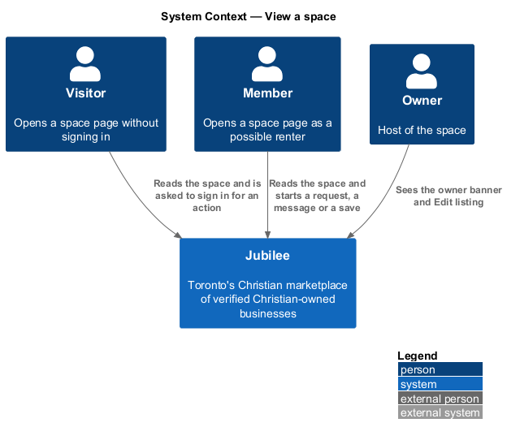
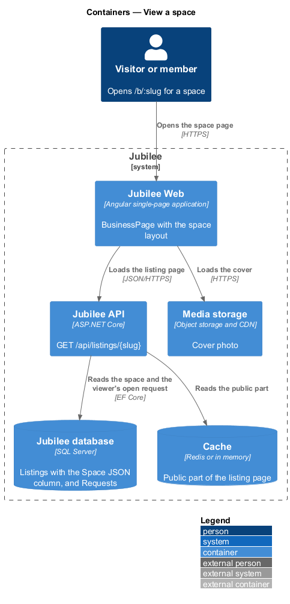
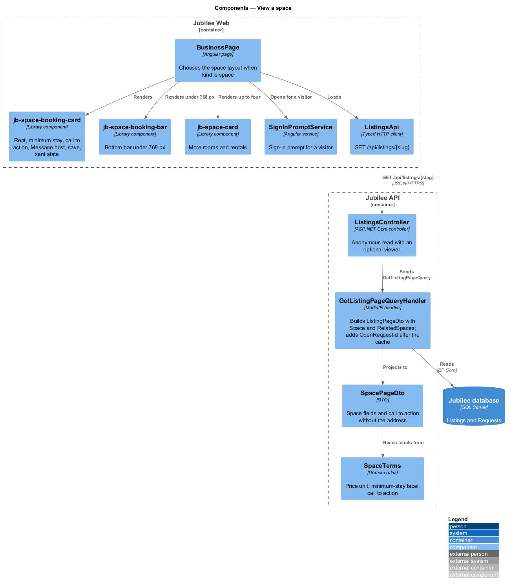
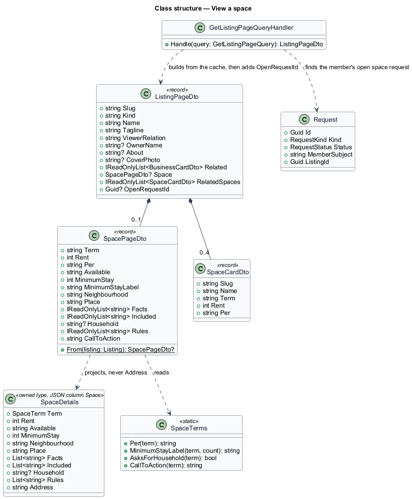
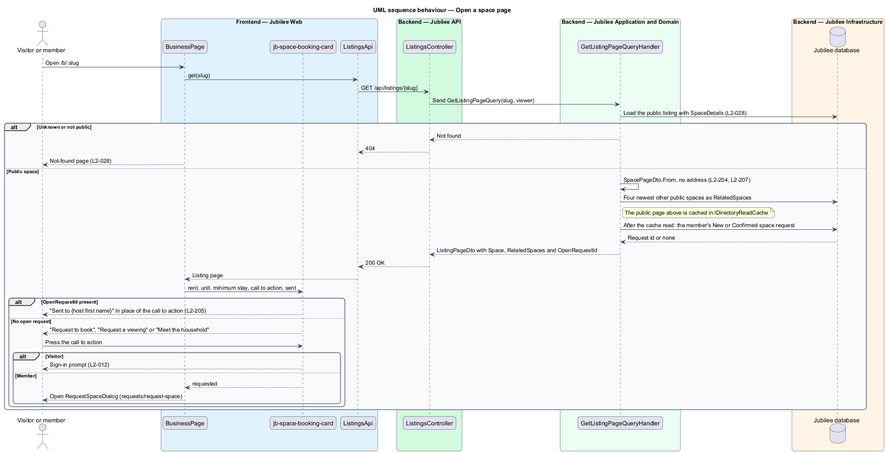

# View a space

## Overview

Jubilee is Toronto's Christian marketplace: a directory of verified
Christian-owned businesses. A *space* is a listing for a room, suite,
apartment, house or hall that an owner rents out, in the category "Rooms &
rentals" and under one *term* ("Short stay", "Long term", "Room" or
"Roommate"). The owner of a space is its *host*; a *renter* is a member who
asks to rent it.

Every listing has one page at `/b/:slug` (`listings/view-business-page`). This
feature covers that page when the listing's kind is `space`: what it shows, the
*booking card* that starts a request, the bar fixed to the bottom on a phone,
and what the response never holds. Sending the request itself is the feature
`requests/request-space`.

The *booking card* shows the rent ("/ night" or "/ month"), "{minimum stay}
min.", the term's call to action, "Message host", save and the line "You won’t
pay anything until the host accepts." The call to action is "Request to book"
for a Short stay, "Request a viewing" for a Long term or Room, and "Meet the
household" for a Roommate.

The page never carries the space's *exact address* to anyone but its owner
(`L2-196` AC6, `L2-199`).

## Description

The feature is a read slice from `BusinessPage` in `Jubilee Web` to the
`Jubilee database`. The model is fixed by ADR 0040.

- **`BusinessPage`** (`pages/business/`) — the existing page at `/b/:slug`.
  When `ListingPageDto.Kind` is `space` it renders the space layout instead of
  the business layout; the route, the load states and the not-found rule stay
  shared. The space layout composes library components only:
  - "Back to rentals" linking to `/c/rooms-rentals`;
  - the cover photo or the category media tile;
  - "Verified host · {neighbourhood}", the title and the line;
  - `jb-space-booking-card`;
  - the space (for example "Guest suite") with its key facts as a
    `jb-list`;
  - a `jb-description-list` with "Available", "Minimum stay", "Neighbourhood"
    and "Rent" ("$120 per night");
  - "What’s included" and "House rules" as lists;
  - "Who lives here" with the household text, for a Room or Roommate only;
  - the host card: "Your host", the owner's name, "Verified with a church
    reference" and the about text when given;
  - "More rooms & rentals" with up to four other live spaces as
    `jb-space-card` items (`directory/browse-spaces`).
  A part with nothing in it (no key facts, nothing included, no rules) is left
  out. A failed load shows "We couldn't load this space" with `JB-BIZ-503`; an
  unknown or non-public space follows `L2-028` AC3.
- **`jb-space-booking-card`** (`SpaceBookingCard`,
  `components/src/lib/space-booking-card/`) — presentation component. Inputs:
  rent, price unit, minimum-stay label, call-to-action label, host first name,
  saved state and `sent`. Outputs: `requested`, `message` and `saveToggled`.
  When `sent` is true it shows "Sent to {host first name}" and "You’ll hear back
  in Messages, usually within a day. The exact address is shared once they
  accept." in place of the call to action, and the call to action cannot be
  pressed (`L2-197` AC9).
- **`jb-space-booking-bar`** (`SpaceBookingBar`,
  `components/src/lib/space-booking-bar/`) — the bar fixed to the bottom under
  `768 px` with the rent and the call to action; hidden once a request is sent
  (`L2-196` AC4).
- **Actions** — for a visitor the call to action, "Message host" and save open
  the sign-in prompt through `SignInPromptService` (`L2-012`). For a member
  the call to action opens `RequestSpaceDialog` (`requests/request-space`),
  "Message host" starts a conversation (`messaging/start-conversation`) and save
  follows `listings/save-listing`. The owner sees the owner banner and "Edit
  listing" in place of the actions (`L2-037`).
- **`ListingsApi.get`** — `GET /api/listings/{slug}`, unchanged.
- **`GetListingPageQueryHandler`** — for a space fills three new fields of
  `ListingPageDto`:
  - `Space` (`SpacePageDto?`) — `Term`, `Rent`, `Per`, `Available`,
    `MinimumStay`, `MinimumStayLabel`, `Neighbourhood`, `Place`, `Facts`,
    `Included`, `Household`, `Rules` and `CallToAction`, built by
    `SpacePageDto.From(Listing)`. It has **no address field**, so no caller
    receives the address from this endpoint, the owner included; the owner
    reads it from the edit-listing endpoint (`L2-199` AC5).
  - `RelatedSpaces` — the four newest other public spaces as `SpaceCardDto`
    items; a business keeps `Related`, its two related businesses (`L2-040`).
  - `OpenRequestId` (`Guid?`) — the id of the signed-in member's `New` or
    `Confirmed` space request for this space, or `null`. The public page comes
    from `IDirectoryReadCache`, and the handler adds `OpenRequestId` after the
    cache read, so the cached page holds nothing personal.
- **`SpaceTerms`** — supplies the price unit, the minimum-stay label and the
  call to action, so a change of term (`L2-200` AC3) reaches the page with no
  other change.
- **`EditListingPage`** — the owner's editor at `/my-business/listing`. For a
  space (`ListingEditorDto.Space`, with its exact address) it shows "Listing
  title", "One line renters should know", "About" and the space fields of
  List a space in place of "Category", "Hours", "Website" and "Highlight",
  holds them in the shared `SpaceForm` (`onboarding/describe-space`), checks
  them as when the space was listed, sends them as `space` in the save
  (`SaveListingBody.Space`, the category staying `rooms-rentals`), and previews
  the space with `jb-space-card-preview` under "How renters see it" (`L2-200`).

### Open questions

The choices below are recorded where the design reference and the rules
differ or leave a gap.

- **Dates in a dialog** — the design draws the check-in, check-out or move-in
  fields inside the booking card. AGENTS.md forbids inline forms in pages, so
  the call to action opens `dialogs/request-space` and the card keeps the rent,
  minimum stay, call to action, "Message host", save and the pay line (ADR
  0040).
- **One page component** — the space layout lives in `BusinessPage` and is
  chosen by kind, because both kinds share `/b/:slug`, its load states and its
  not-found rule.
- **Address on the page** — even the owner's view of `/b/:slug` carries no
  address; the owner sees it on Edit listing only.
- **Hourly rent** — deferred; "Rent" reads per night or per month.
- **Availability** — shown as the owner wrote it in the "Available" row.

## Requirements

The feature realizes the following level-2 (L2) requirements. Each L2
requirement refines a level-1 (L1) requirement, cited by identifier.

| L2 ID | Refines (L1) | Requirement |
|-------|--------------|-------------|
| `L2-196` | `L1-027` | `/b/:slug` for a space shall show "Back to rentals", the cover, "Verified host · {neighbourhood}", the title, the line, the booking card, the space with its key facts, the rows Available, Minimum stay, Neighbourhood and Rent, what's included, house rules, the household for a Room or Roommate, the host card and "More rooms & rentals"; it shall leave out empty parts, show a bottom bar under 768 px, and never send the exact address to anyone but the owner. |
| `L2-197` | `L1-027` | The booking card shall show the rent, the minimum stay, the term's call to action, "Message host", save and "You won’t pay anything until the host accepts.", prompt a visitor to sign in, and show "Sent to {host first name}" in place of the call to action while the member has an open request. |
| `L2-199` | `L1-027` | No public endpoint shall return the exact address of a space to a visitor, a member or the verification team. |
| `L2-012` | `L1-001` | When a visitor tries an action that needs an account, the system shall prompt them to join or sign in and bring them straight back. |
| `L2-028` | `L1-003` | Browse, category, search, featured and related lists shall show only listings that are verified and not paused, deleted or under a moderation hold. |
| `L2-037` | `L1-005` | An owner who opens their own live listing shall see an owner banner and "Edit listing" in place of the member actions. |
| `L2-118` | `L1-016` | Every load-error state shall show a reference that the user can quote to support. |

## Diagrams

### System context

Visitors and members open a space's page in Jubilee; the host is the owner of
the space. The slice calls no external system.

### Containers

`Jubilee Web` loads the page from `Jubilee API`, which reads the space and the
viewer's open request from the `Jubilee database`; the cover loads from `Media
storage`.

### Components

`BusinessPage` chooses the space layout by kind and composes
`jb-space-booking-card`, `jb-space-booking-bar` and `jb-space-card`.
`GetListingPageQueryHandler` builds `SpacePageDto` without the address and
adds the viewer's open request after the cache read.

### Class structure

`ListingPageDto` gains `Space`, `RelatedSpaces` and `OpenRequestId`.
`SpacePageDto` mirrors `SpaceDetails` without `Address`.

### Behaviour — open a space page

The page loads one response; a member with an open request sees the sent state
in place of the call to action, and a visitor's action opens the sign-in prompt.

