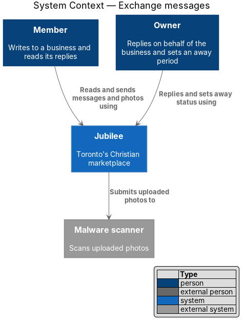
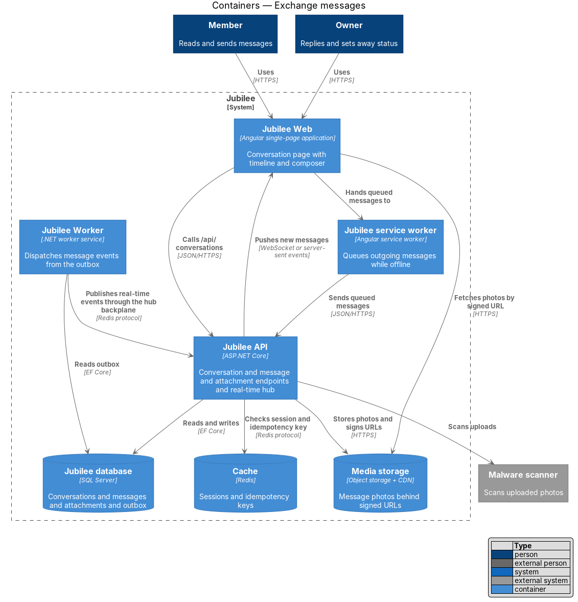
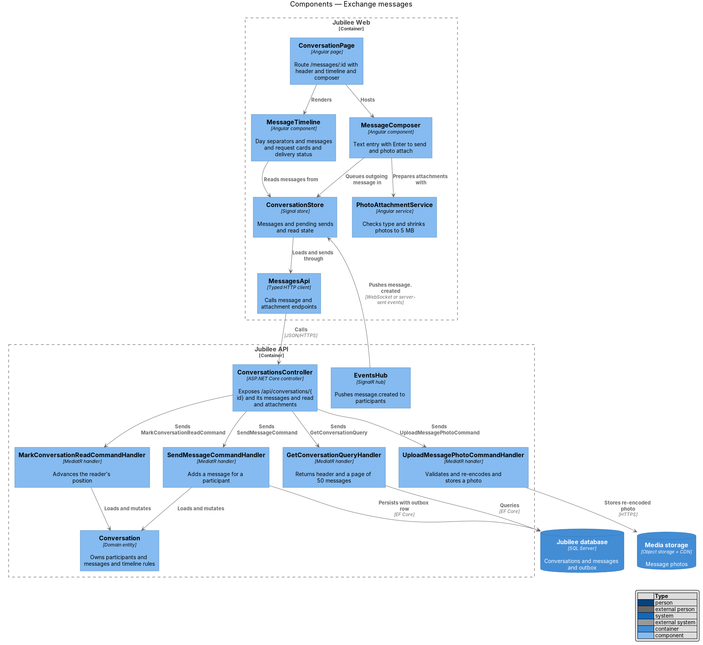
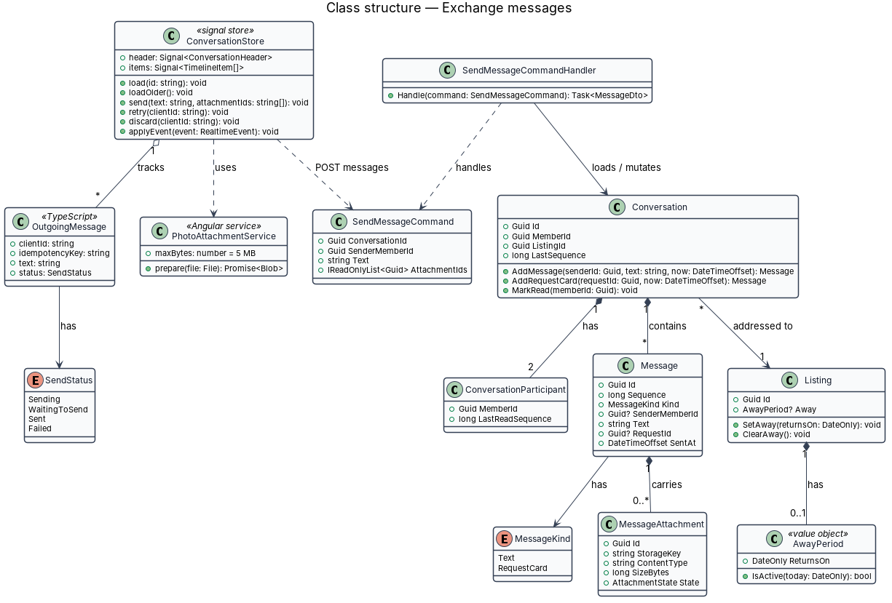
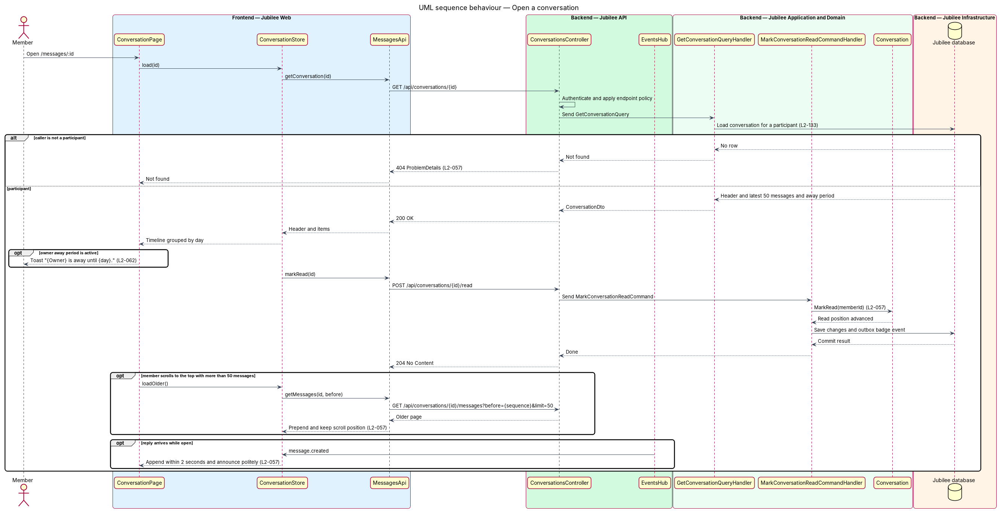
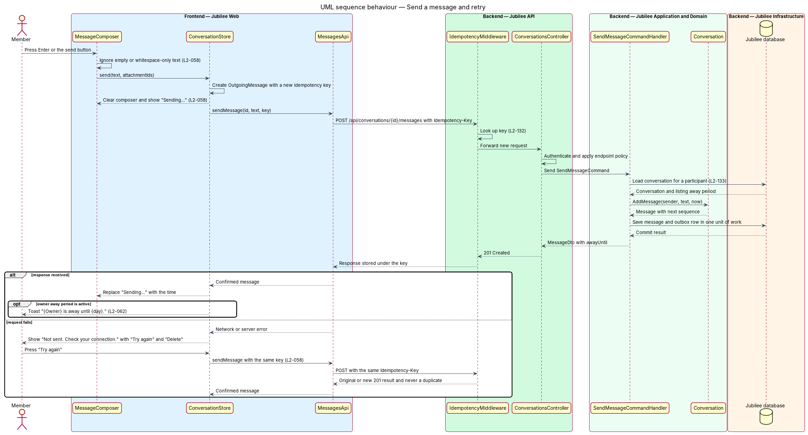
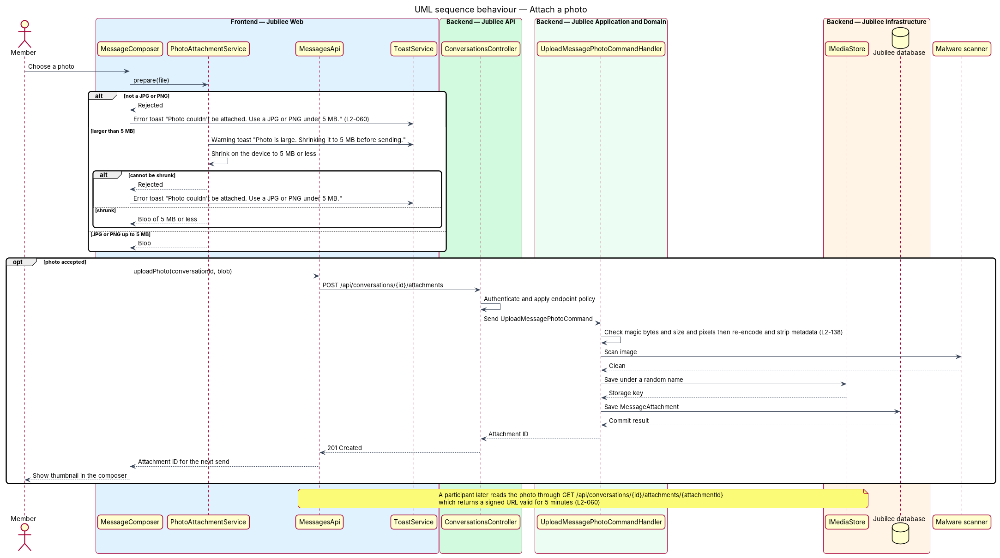

# Exchange messages

## Overview

Jubilee is Toronto's Christian marketplace, in which a member and a verified
business talk in a private conversation. This feature covers the conversation
page at `/messages/:id`: reading the timeline, sending text and photos, seeing
delivery status, retrying a failed send, and seeing that an owner is away.

The terms below are local to this feature.

- **timeline** — ordered list of the items in one conversation, grouped under day separators
- **request card** — timeline item that summarises a booking, quote or order request linked to the conversation
- **pending message** — message shown in the timeline before the server confirms it
- **away period** — interval, ending on a return date, during which an owner states they are not reading messages
- **signed URL** — time-limited address that grants read access to one stored photo

A sent message appears in the timeline at once, marked "Sending…". The server
confirmation replaces that mark with the time. A failed send keeps the text and
offers "Try again" and "Delete"; a retry reuses the idempotency key of the first
attempt, so one message is stored however many attempts are made. A reply from
the other side reaches an open page within `2 seconds` over the real-time
connection.

Only the two participants can open a conversation, its messages and its photos.
Starting a conversation is described in `start-conversation`, the inbox in
`read-inbox`, and blocking and reporting in `report-conversation`. Messages
written while offline are queued by `Jubilee service worker` (L2-120) and enter
this slice through the same send endpoint and idempotency key.

## Description

The feature is a vertical slice from the conversation page to the database and
`Media storage`.

- **`ConversationPage`** — Angular page at `/messages/:id`, guarded by
  `AuthGuard`. The header shows the business and, for example, "Trevor Chew ·
  usually replies within a day". The composer, labelled "Message Legacy
  Financial", sits at the bottom.
- **`MessageTimeline`** — Angular component. It groups items under day
  separators ("Today · Tue 10 Nov"), shows sender and time per message, and
  renders request cards such as "Booking request · Discovery meeting · Thu 12
  Nov, 10:00–10:30 a.m. · Video · Confirmed · View request". It loads the latest
  `50` messages and requests older pages as the member scrolls up, keeping the
  scroll position. New items are announced through a polite live region.
- **Empty conversation** — a conversation with no messages shows "Say hello to
  {first name}. Ask a question or tell him what you need." and up to three
  suggested openers that fill the composer when pressed. The opener texts are
  `<TO SUPPLY>`.
- **`MessageComposer`** — Angular component. On a device with a physical
  keyboard, Enter sends and Shift+Enter adds a new line. Empty or
  whitespace-only text sends nothing. The composer clears as soon as a send
  starts.
- **`ConversationStore`** — signal store holding the header, the timeline items
  and one `OutgoingMessage` per pending send with a `SendStatus` of `Sending`,
  `WaitingToSend`, `Sent` or `Failed`. A failed item shows "Not sent. Check your
  connection." with "Try again" and "Delete". `retry` resends with the stored
  `idempotencyKey`.
- **`PhotoAttachmentService`** — Angular service. It accepts JPG and PNG files.
  A photo larger than `5 MB` is shrunk on the device to `5 MB` or less, with the
  warning toast "Photo is large. Shrinking it to 5 MB before sending." A file of
  another type, or one that cannot be shrunk, raises the error toast "Photo
  couldn't be attached. Use a JPG or PNG under 5 MB." and nothing is sent.
- **`MessagesApi`** — typed HTTP client for `GET /api/conversations/{id}`,
  `GET /api/conversations/{id}/messages?before={sequence}&limit=50`,
  `POST /api/conversations/{id}/messages`, `POST /api/conversations/{id}/read`,
  `POST /api/conversations/{id}/attachments` and
  `GET /api/conversations/{id}/attachments/{attachmentId}`.
- **`ConversationsController`** — ASP.NET Core controller for those routes. Each
  handler loads the conversation for a participant; any other caller receives
  HTTP `404` (L2-133). Sending by a member whose e-mail is unconfirmed returns
  `403` with code `EMAIL_UNCONFIRMED`.
- **`GetConversationQueryHandler`** — returns the header, the listing's active
  away period and one page of `50` timeline items ordered by `Sequence`.
- **`SendMessageCommandHandler`** — calls `Conversation.AddMessage`, links
  uploaded attachments, and saves the message with a `MessageSent`
  `OutboxMessage` in one unit of work. `IdempotencyMiddleware` returns the
  original `201 Created` result for a repeated key within `24 hours` (L2-132).
  The response carries `awayUntil` when an away period is active.
- **`MarkConversationReadCommandHandler`** — calls `Conversation.MarkRead`,
  which advances the caller's `LastReadSequence`, and writes an outbox row so the
  unread badges update on every device of that member.
- **`UploadMessagePhotoCommandHandler`** — checks the content type by magic
  bytes, accepts JPEG and PNG up to `5 MB` and `8,000 × 8,000` pixels, re-encodes
  the image, strips metadata, submits it to the `Malware scanner`, and stores it
  through `IMediaStore` under a random name (L2-138). The thumbnail size is
  `<TO SUPPLY>`. The attachment route returns a signed URL valid for `5 minutes`
  to a participant only.
- **`Conversation`**, **`Message`**, **`MessageAttachment`** — domain entities.
  `Message.Kind` is `Text` or `RequestCard`; `Conversation.AddRequestCard` adds a
  card when a linked request is created or changes status.
- **`AwayPeriod`** — value object on `Listing` with a return date. While it is
  active, opening the conversation or sending a message shows the info toast
  "{Owner} is away until {day}. He'll see your message when he's back." After the
  return date no notice is shown. The owner route is
  `PUT /api/listings/{id}/away`; the screen on which an owner sets the period is
  `<TO SUPPLY>`.
- **`EventsHub`** — pushes `message.created` to both participants; the store
  appends the message without a reload.

## Requirements

The feature realizes the following level-2 (L2) requirements. Each L2
requirement refines a level-1 (L1) requirement, cited by identifier.

| L2 ID | Refines (L1) | Requirement |
|-------|--------------|-------------|
| `L2-057` | `L1-009` | The page `/messages/:id` shall show one conversation with a composer. |
| `L2-058` | `L1-009` | A sent message shall appear at once marked "Sending…" and show its time once the server confirms it. A failed message shall keep its text and offer "Try again" and "Delete", and a retry shall reuse the same idempotency key so the message is never duplicated. |
| `L2-060` | `L1-009` | A member may attach a JPG or PNG photo of up to 5 MB to a message; a larger photo shall be shrunk on the device before sending. A stored attachment shall be retrievable only by the conversation's participants through signed URLs valid for 5 minutes. |
| `L2-062` | `L1-009` | When an owner has set an away period with a return date, a member who opens the conversation or sends a message shall see an away notice. No notice shall be shown after the return date. |
| `L2-132` | `L1-018` | Each create request shall carry a client-generated idempotency key, and the server shall return the original result for a repeated key within 24 hours without creating a duplicate. |
| `L2-133` | `L1-019` | The server shall check the caller's role and ownership of the specific object on every API call, and shall return 404 for another member's conversation. |
| `L2-138` | `L1-019` | The server shall verify each upload by its magic bytes, accept only JPEG and PNG up to 5 MB and 8,000 × 8,000 pixels, re-encode the image, strip metadata, scan it for malware, and store it under a random name. |

## Diagrams

### System context

A member and an owner exchange messages and photos through Jubilee. Jubilee
submits uploaded photos to the external malware scanner.

### Containers

`Jubilee Web` calls `Jubilee API` and receives pushed messages from it.
`Jubilee service worker` sends messages queued while offline. The API persists
to `Jubilee database`, stores photos in `Media storage`, and `Jubilee Worker`
dispatches message events from the outbox.

### Components

`ConversationPage` hosts `MessageTimeline` and `MessageComposer` over
`ConversationStore`. `ConversationsController` dispatches to four handlers: get,
send, mark read and upload photo. The send and read handlers mutate
`Conversation`.

### Class structure

`ConversationStore` tracks `OutgoingMessage` items by `SendStatus`.
`Conversation` has two `ConversationParticipant` entities and many `Message`
entities; a `Message` has a `MessageKind` and may carry `MessageAttachment`
entities. `Listing` has an optional `AwayPeriod`.

### Behaviour — open a conversation

A non-participant receives `404`. A participant receives the latest `50`
messages, the conversation is marked read, older pages load on scroll, and a
reply that arrives while the page is open is appended and announced politely.

### Behaviour — send a message and retry

The store shows the pending message before the request completes. On failure
the member retries with the same idempotency key, and `IdempotencyMiddleware`
guarantees one stored message.

### Behaviour — attach a photo

`PhotoAttachmentService` rejects or shrinks the file on the device. The API
validates, re-encodes, scans and stores the photo, and returns an attachment ID
that the next send references.

