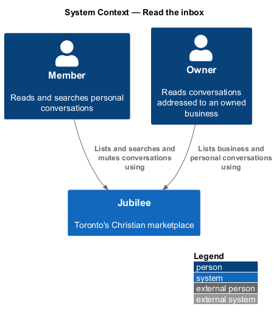
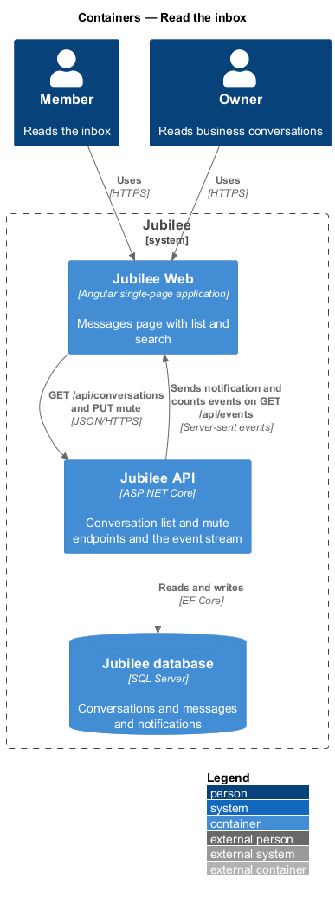
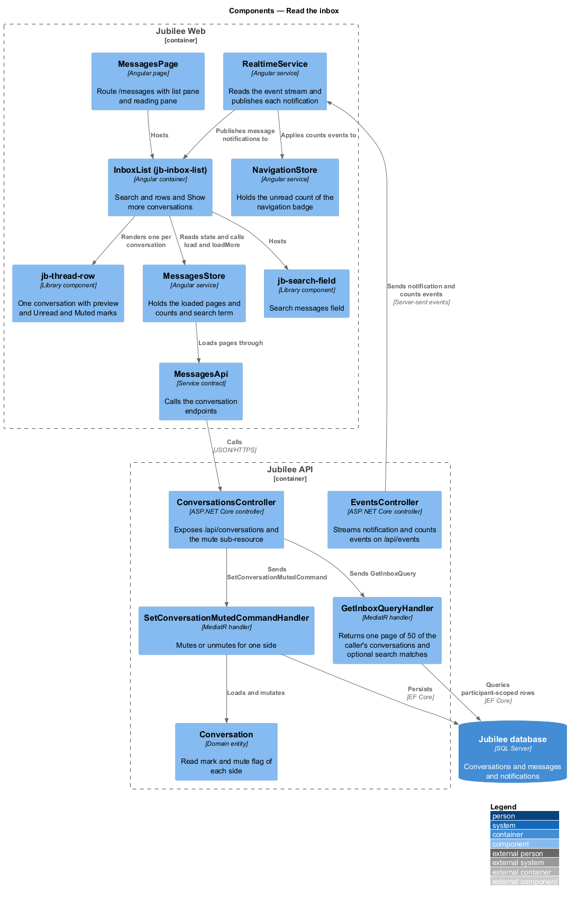
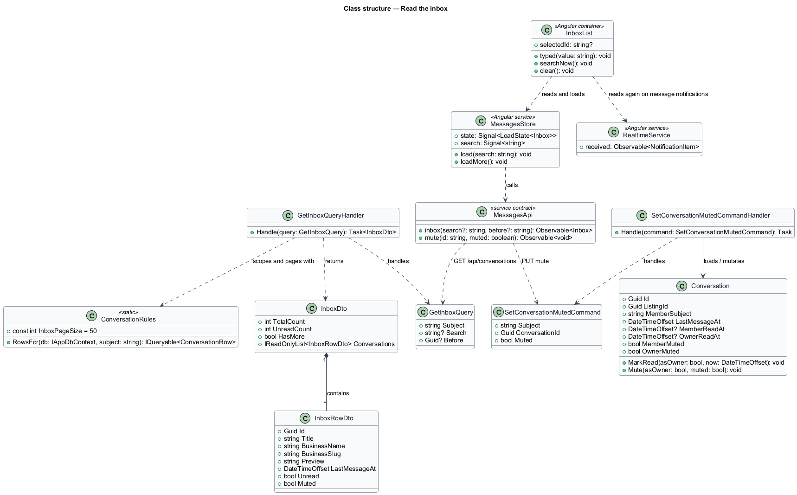
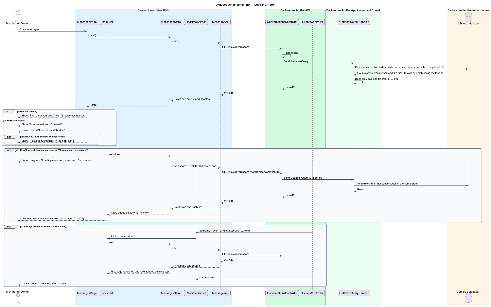
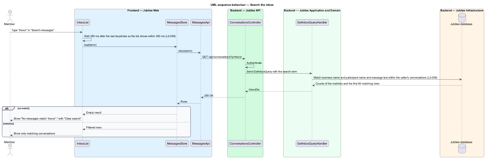
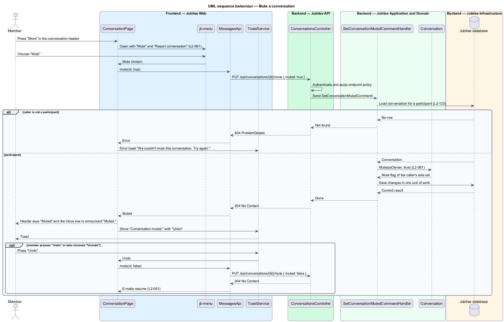

# Read the inbox

## Overview

Jubilee is Toronto's Christian marketplace, in which members message verified
Christian-owned businesses. Each exchange between one member and one business is
a conversation. This feature covers the inbox: the page at `/messages` that
lists a member's conversations, lets the member search them, and shows which
ones are unread or muted. It also covers the mute flag the list shows.

The terms below are local to this feature.

- **inbox** — list of every conversation in which the signed-in member participates
- **participant** — one of the two sides of a conversation: the member who started it, or the business, represented by the owner of the listing
- **unread conversation** — conversation in which the other side wrote after the participant's read mark
- **muted conversation** — conversation for which one participant has turned off e-mail about new replies
- **page** — the 50 conversations the inbox loads at a time, in order of most recent activity

An owner sees two kinds of conversation in one list: personal conversations the
owner started as a member, and conversations addressed to a business the owner
owns. Every row is labelled with the business name. Rows are ordered by most
recent activity. The inbox loads 50 conversations at a time, and "Show more
conversations" adds the next 50.

Muting affects e-mail only. A muted conversation still counts toward in-app
unread counts and still updates in real time. The e-mail decision itself is made
in `send-email-notifications`, which reads the mute flag this feature stores.
The member mutes from the menu of an open conversation, described in
`report-conversation`. Opening a conversation from the list is described in
`exchange-messages`.

## Description

The feature is a vertical slice from the Messages page to the database. The
decisions behind it are recorded in ADR 0014, ADR 0039 and ADR 0050.

- **`MessagesPage`** — Angular page at `/messages`
  (`frontend/projects/jubilee/src/app/pages/messages/`), guarded by
  `memberGuard`. It shows the summary line (for example "4 conversations ·
  2 unread") and composes `jb-inbox-layout` with the list on the left. At a
  viewport of `1024 px` or wider it adds a reading pane on the right; with no
  conversation open the pane shows "Pick a conversation. Choose one on the left
  to read and reply."
- **`InboxList`** — container of the app with the selector `jb-inbox-list`
  (`pages/messages/inbox-list`). It is the left column of the Messages page and
  of an open conversation: the search field, the rows and "Show more
  conversations". It composes `jb-search-field`, `jb-list`, `jb-thread-row`,
  `jb-thread-row-skeleton`, `jb-empty-state` and `jb-button` and has no
  stylesheet (ADR 0035).
- **`jb-thread-row`** — component of the `components` library for one row:
  initials, name, time of the last message, and a one-line preview prefixed
  "You:" or "{sender first name}:", cut at 120 characters. A message that is a
  photo with no text previews as "Photo". For a member the row is named with the
  business. For an owner, a row addressed to their business is named
  "{member} · {business}" (L2-056). An unread row is visually marked and carries
  the text "Unread." for assistive technology. A muted row carries the text
  "Muted." in the same way. `threadTime` of the `api` library writes the time.
- **Empty state** — with no conversations the page shows "Start a conversation.
  Open a business and tap Message to ask a question, get a quote or book a time.
  Replies land here." with the action "Browse businesses".
- **Search** — `jb-search-field`, labelled "Search messages". `InboxList` waits
  `250 ms` after the last keystroke before it asks, so the filtered list appears
  within `300 ms`; pressing Enter searches at once. With no match it shows "No
  messages match “roofing”. Check the spelling, or search by business name."
  with "Clear search"; the term is quoted in double quotation marks.
- **`MessagesStore`** — root service of the app holding the load state of the
  inbox as a signal, with the search term. `load(search)` reads the first page.
  `loadMore()` reads the page after the last row shown and adds it below without
  moving what is shown. It is shared by the Messages page and the list beside an
  open conversation. `InboxList` calls `load` again on each `notification` event
  of kind `message` that `RealtimeService` publishes from the event stream
  (`GET /api/events`, ADR 0025, ADR 0039), so rows reorder and unread marks
  change without a reload. A new message refreshes the first page and keeps the
  rows already loaded below it. No event type is added to the stream for
  messaging.
- **"Show more conversations"** — a button that follows the list while
  `hasMore` is true. A button is used, not endless scrolling, so the keyboard
  and a screen reader reach it. While the next page loads the button is busy and
  "Loading more conversations…" is announced, then "{n} more conversations
  shown." When every conversation is listed the button is gone. If the page
  cannot be loaded, the rows shown stay and an error toast says "We couldn’t
  load more conversations. Try again." (L2-056, ADR 0050).
- **Unread count** — the navigation badge follows the `counts` event of the same
  stream, which `RealtimeService` applies to `NavigationStore`. Reading an open
  conversation marks it read on the server, and the next `counts` event corrects
  the badge.
- **`MessagesApi`** — service contract with the injection token `MESSAGES_API`,
  implemented by `HttpMessagesApi`. `inbox(search?, before?)` calls
  `GET /api/conversations?q={term}&before={conversationId}` and `mute` calls
  `PUT /api/conversations/{id}/mute`.
- **`ConversationsController`** — ASP.NET Core controller. It authenticates the
  session cookie and dispatches the query or command through MediatR. `Inbox`
  takes `q` and `before` from the query string.
- **`GetInboxQueryHandler`** — MediatR handler for
  `GetInboxQuery(Subject, Search, Before)`. It selects conversations in which
  the caller is the member or owns the listing (`ConversationRules.RowsFor`),
  orders them by `LastMessageAt` descending and then by `Id`, so two
  conversations touched in the same instant keep a fixed order, and builds an
  `InboxRowDto` per row. It answers `ConversationRules.InboxPageSize`, `50`,
  rows. `Before` names a conversation: the answer is the 50 after it in the same
  order. An unknown `Before` answers the first page. With a search term it keeps
  only conversations whose business name, participant name or message text
  matches, and it applies the participant filter before the match so search
  never reaches another member's conversations. The match is a case-insensitive
  contains match over the business name, the owner's name, the member's name and
  the text of messages the person may see. A search is paged the same way.
- **`InboxDto`** and **`InboxRowDto`** — response types.
  `InboxDto(TotalCount, UnreadCount, HasMore, Conversations)`: `TotalCount` and
  `UnreadCount` count the whole inbox, or the whole search result, not the page,
  and `HasMore` says that rows follow the page. `InboxRowDto` carries one
  conversation with `Title`, `BusinessName`, `Preview`, `LastMessageAt`,
  `Unread` and `Muted`.
- **`SetConversationMutedCommandHandler`** — MediatR handler behind the mute
  route. `PUT /api/conversations/{id}/mute` takes `{ muted: true | false }`. The
  handler loads the conversation for a participant, calls `Conversation.Mute`
  for the caller's side, and saves. A caller who is not a participant receives
  HTTP `404` (L2-133). The route is idempotent and returns `204 No Content`.
- **`Conversation`** — domain entity. It holds one read mark per side,
  `MemberReadAt` and `OwnerReadAt`, from which `Unread` is derived, and one mute
  flag per side, `MemberMuted` and `OwnerMuted` (ADR 0014). A message hidden by
  the member's block is neither shown to the member nor counted as unread.
- **Mute toast** — after a successful mute, `ConversationPage` shows through
  `ToastService` "Conversation muted. You won't be e-mailed about new replies
  here." with "Undo". "Undo" sends the opposite value to the same route. When
  the mute cannot be saved, the conversation stays as it was and an error toast
  says "We couldn't mute this conversation. Try again."
- **Load error** — when the list fails to load, the page shows the standard
  load-error state with the reference `JB-MSG-503`, set on the route by
  `[ErrorReference]`, and "Try again" (L2-118).
- **Known limit** — a row loaded by "Show more conversations" is not refreshed
  by a new message until the member loads the inbox again; the conversation that
  received the message moves to the first page, which is refreshed (ADR 0050).
- **Tests** — `MessagingTests` (backend, `L2_056_…`, `L2_059_…`, `L2_061_…`)
  and "the inbox (L2-056)", "search messages (L2-059)" and "mute a conversation
  (L2-061)" in `e2e/tests/messages.spec.ts`.

## Requirements

The feature realizes the following level-2 (L2) requirements. Each L2
requirement refines a level-1 (L1) requirement, cited by identifier.

| L2 ID | Refines (L1) | Requirement |
|-------|--------------|-------------|
| `L2-056` | `L1-009` | The page `/messages` shall list the member's conversations, the most recent activity first. An owner's row for a conversation addressed to their business shall be named "{member} · {business}". With more than 50 conversations the 50 with the most recent activity shall be listed and "Show more conversations" shall add the next 50 below what is shown; the counts shall be of the whole inbox. |
| `L2-059` | `L1-009` | The inbox search shall show, within 300 ms of the last keystroke, only conversations whose business name, participant name or message text matches. The search shall cover only conversations in which the member participates. |
| `L2-061` | `L1-009` | A member may mute a conversation so that no e-mail is sent about new replies in it while in-app unread counts still update. Unmuting shall resume the e-mails. A muted conversation shall say "Muted" in words. |
| `L2-070` | `L1-010` | A notification, message or request event for a user shall reach that user's open signed-in page within 2 seconds at the 95th percentile over a persistent connection (WebSocket or server-sent events). After a reconnect, the events missed since the last received event ID shall be delivered and nothing shall be shown twice. A client shall receive only events addressed to its authenticated user. |
| `L2-118` | `L1-016` | Every load-error state shall show a reference the user can quote to support. |
| `L2-133` | `L1-019` | The server shall check the caller's role and ownership of the specific object on every API call, and shall return 404 for another member's conversation. |

## Diagrams

### System context

Members and owners read and search their conversations through Jubilee.
The feature involves no external system.

### Containers

`Jubilee Web` calls the conversation endpoints of `Jubilee API`, which reads and
writes `Jubilee database`. The API sends `notification` and `counts` events to
the open page on the event stream.

### Components

`MessagesPage` hosts `InboxList`, which renders `jb-search-field` and one
`jb-thread-row` per conversation from `MessagesStore`. The store calls
`MessagesApi`, and `ConversationsController` dispatches to
`GetInboxQueryHandler` or `SetConversationMutedCommandHandler`.
`EventsController` feeds `RealtimeService`; each `message` notification makes
`InboxList` ask the store to read the list again.

### Class structure

`MessagesStore` loads pages through `MessagesApi`. `GetInboxQueryHandler`
handles `GetInboxQuery` and returns an `InboxDto` of `InboxRowDto` rows with
`HasMore`. `SetConversationMutedCommandHandler` loads a `Conversation`, which
holds a read mark and a mute flag for each of its two sides.

### Behaviour — load the inbox

The handler selects the conversations the caller takes part in, including those
addressed to an owned business, orders them by latest activity and answers the
first 50 with the counts of the whole inbox. The page shows the list, the empty
state, or the reading-pane prompt on wide viewports. "Show more conversations"
asks for the 50 after the last row shown. A `message` notification on the event
stream makes the store read the first page again.

### Behaviour — search the inbox

`InboxList` waits for typing to stop and the store repeats the list query with
a search term. The handler matches only inside the caller's conversations and
the list shows either the matches or the no-results message.

### Behaviour — mute a conversation

"Mute" in the conversation menu sends `{ muted: true }` to the mute route, which
sets the mute flag of the caller's side, and the toast offers "Undo". "Undo" and
the later "Unmute" action both send `{ muted: false }` to the same route, after
which e-mails resume.

