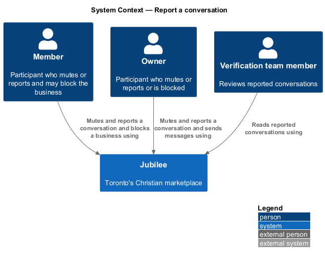
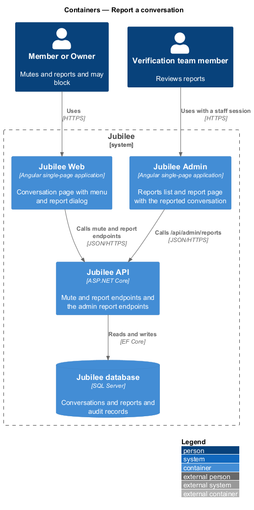
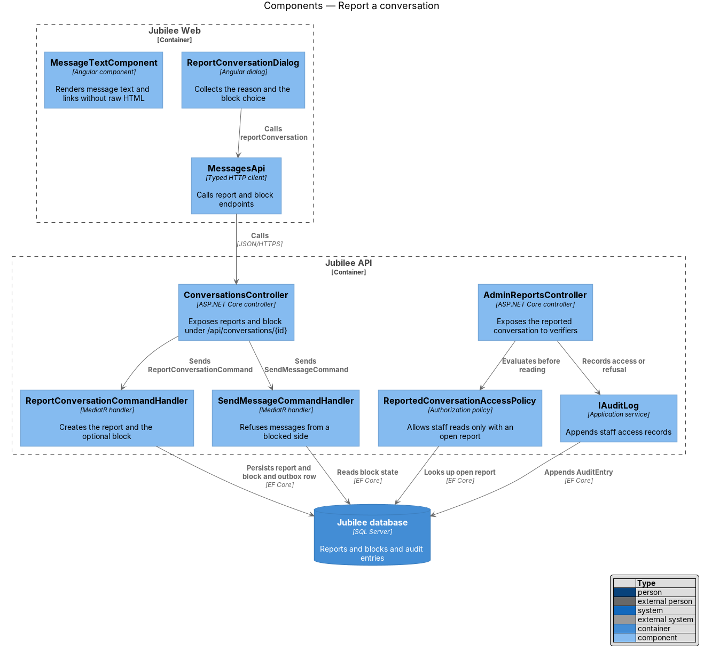
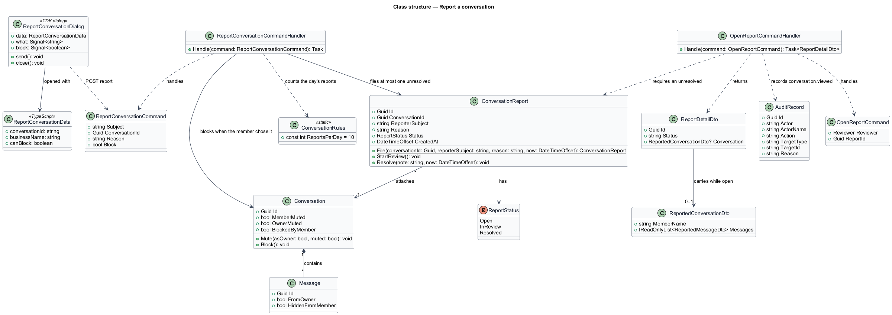
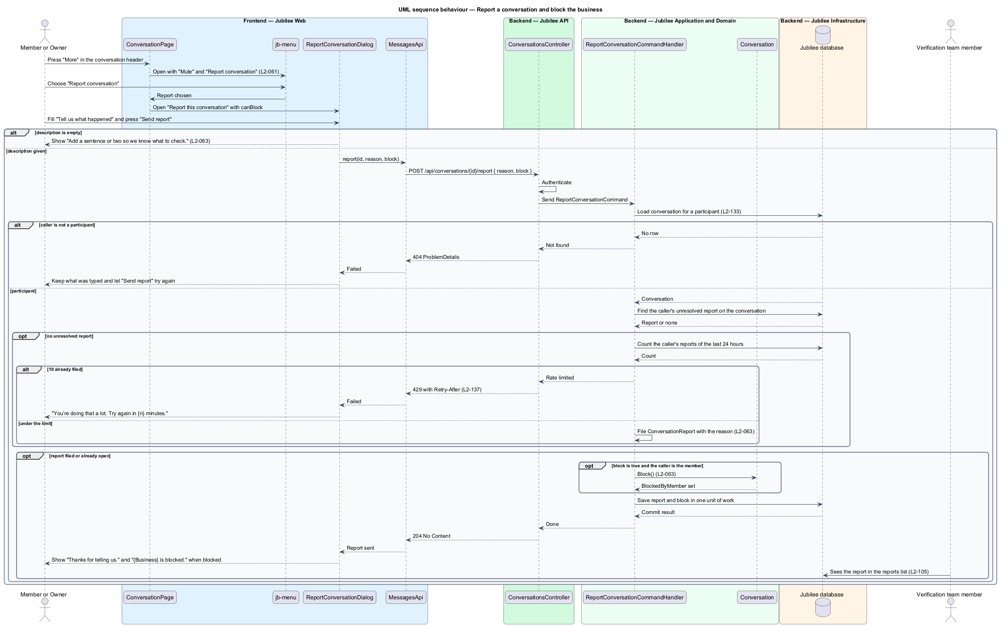
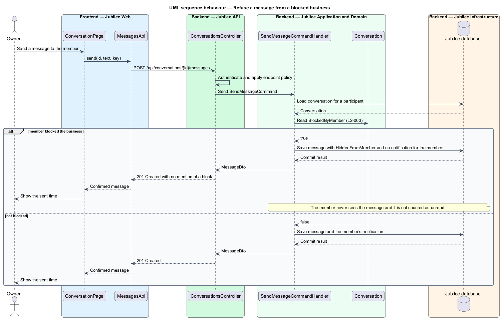
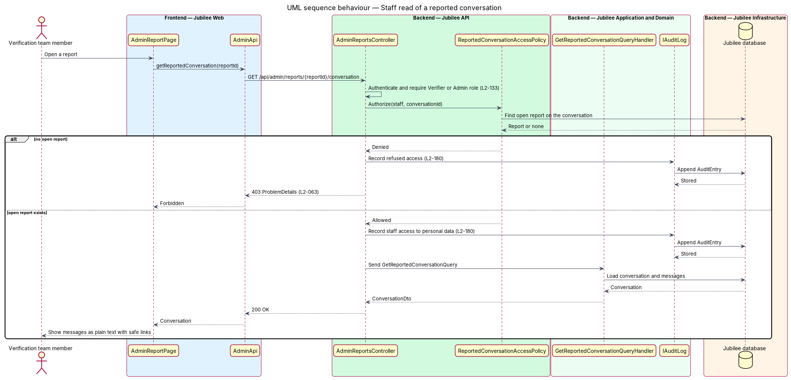

# Report a conversation

## Overview

Jubilee is Toronto's Christian marketplace, in which a member and a verified
business talk in a private conversation. Conversations are private by default:
only the two participants read them. This feature covers the safety controls
around that privacy: reporting a conversation to the verification team, blocking
the other side, limiting staff access to reported conversations, and rendering
message text safely.

The terms below are local to this feature.

- **report** — record in which one participant asks the verification team to review a conversation
- **open report** — report whose status is `Open` or `InReview`
- **block** — instruction from one participant that refuses further messages from the other side of the conversation
- **staff read** — access to conversation content by a verification team member

Either participant may report. The report attaches the conversation, and the
reporter may block the other side in the same step. A blocked side is not told
about the block: its next message is refused with a response that does not
mention blocking.

Staff access follows the statement on the help page: "Our team reads a
conversation only when one of you reports it." A verification team member can
read a conversation only while an open report exists on it, and each staff read
or refused attempt is recorded in the audit log. Review and resolution of
reports belong to the administration subsystem (L2-105).

## Description

The feature is a vertical slice from the conversation page to the database.

- **`ReportConversationDialog`** — Angular dialog opened by "Report
  conversation" in the conversation menu. It collects a reason, optional
  details, and the choice to block the other side. The reason is free text of 1 to 1,000
  characters (ADR 0014). The dialog needs a mock before it is built; the API exists.
- **`MessagesApi`** — typed HTTP client for
  `POST /api/conversations/{id}/reports`, `PUT /api/conversations/{id}/block`
  and `DELETE /api/conversations/{id}/block`. The report request carries an
  `Idempotency-Key` header (L2-132).
- **`ConversationsController`** — ASP.NET Core controller for those routes. It
  authenticates the session cookie and applies the endpoint policy. A caller who
  is not a participant receives HTTP `404` (L2-133).
- **`ReportConversationCommandHandler`** — MediatR handler. It creates a
  `Report` with `Target = Conversation`, calls `Conversation.Block` when
  `BlockOtherSide` is true, and saves the report, the block and a
  `ReportCreated` `OutboxMessage` in one unit of work. `Jubilee Worker`
  dispatches the row so verifiers are notified.
- **`Report`** — domain entity shared with listing reports (L2-039). It holds
  the reporter, the reason, the attached conversation and a `ReportStatus` of
  `Open`, `InReview` or `Resolved`.
- **`ConversationBlock`** — domain entity owned by `Conversation`. It records
  which participant blocked and which `ParticipantSide` is blocked.
  `Conversation.CanSend` returns false for a sender on a blocked side.
- **`SendMessageCommandHandler`** — the send handler from `exchange-messages`.
  It calls `Conversation.CanSend` before `AddMessage`. For a blocked sender it
  stores nothing, writes no outbox row, and the API returns HTTP `403` with code
  `MESSAGE_REFUSED`. The response and the composer copy do not state that a block
  exists; a blocked business is answered `201` as if delivered, and the message is stored
  but never shown to the member (ADR 0014).
- **`AdminReportsController`** — ASP.NET Core controller for
  `GET /api/admin/reports/{reportId}/conversation`, restricted to the `Verifier`
  and `Admin` roles.
- **`ReportedConversationAccessPolicy`** — authorization policy. It allows a
  staff read only when an open report exists on the conversation; otherwise the
  API returns HTTP `403`. No other route returns message content to staff.
- **`IAuditLog`** — application service. It appends an `AuditEntry` with actor,
  action, target, time and reason for each staff read and each refused staff
  read (L2-180). Entries are append-only.
- **`MessageTextComponent`** — Angular component used wherever message text is
  shown, including the staff view. It binds message text as text, never as
  HTML. It splits the text into text and link segments and renders each link as
  an anchor whose content is the link text and whose `rel` is
  `nofollow noopener noreferrer`. The server stores message text as plain text
  and returns it unchanged.

## Requirements

The feature realizes the following level-2 (L2) requirements. Each L2
requirement refines a level-1 (L1) requirement, cited by identifier.

| L2 ID | Refines (L1) | Requirement |
|-------|--------------|-------------|
| `L2-063` | `L1-009` | Either participant may report a conversation to the verification team with the conversation attached, and may block the other side. A message from a blocked business shall be refused without telling the business it was blocked. Staff shall not read conversation content without an open report on that conversation. Links in message text shall be rendered as text with `rel="nofollow noopener noreferrer"` and never as raw HTML. |
| `L2-132` | `L1-018` | Each create request shall carry a client-generated idempotency key, and the server shall return the original result for a repeated key within 24 hours without creating a duplicate. |
| `L2-133` | `L1-019` | The server shall check the caller's role and ownership of the specific object on every API call before doing anything else. |
| `L2-180` | `L1-025` | Each sensitive action, including staff access to personal data, shall produce an append-only audit record of actor, action, target, time, before and after values, and reason. |

## Diagrams

### System context

Members and owners report and block through Jubilee. Verification team members
read reported conversations through Jubilee. The feature involves no external
system.

### Containers

`Jubilee Web` calls the report, block and admin endpoints of `Jubilee API`,
which persists reports, blocks and audit entries in `Jubilee database`.
`Jubilee Worker` reads the outbox to notify verifiers.

### Components

`ReportConversationDialog` calls `MessagesApi`. `ConversationsController`
dispatches the report command and the send command; `AdminReportsController`
evaluates `ReportedConversationAccessPolicy` and records each access through
`IAuditLog`.

### Class structure

`ReportConversationCommandHandler` creates a `Report` that attaches a
`Conversation` and blocks through it when chosen. `Conversation` has up to two
`ConversationBlock` entities. `ReportedConversationAccessPolicy` requires an open
`Report` and records an `AuditEntry`.

### Behaviour — report a conversation and block the other side

The handler verifies the caller is a participant, creates the report with the
conversation attached, adds the block when chosen, and commits both with an
outbox row. `Jubilee Worker` then notifies the verification team.

### Behaviour — refuse a message from a blocked side

`SendMessageCommandHandler` asks `Conversation.CanSend` before adding a
message. A blocked sender receives `403 MESSAGE_REFUSED` with no mention of a
block, and nothing is stored or delivered.

### Behaviour — staff read of a reported conversation

The policy looks for an open report on the conversation. Without one the API
returns `403`; with one it returns the conversation. Both outcomes append an
`AuditEntry`.

