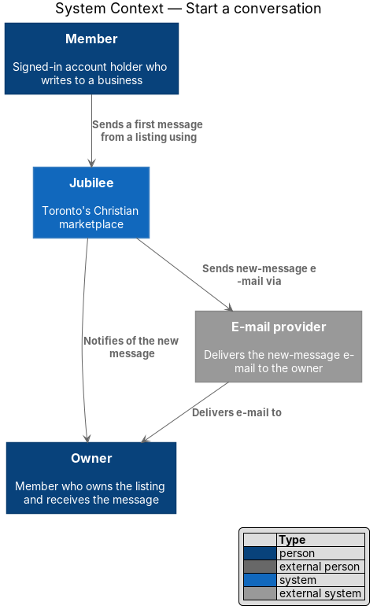
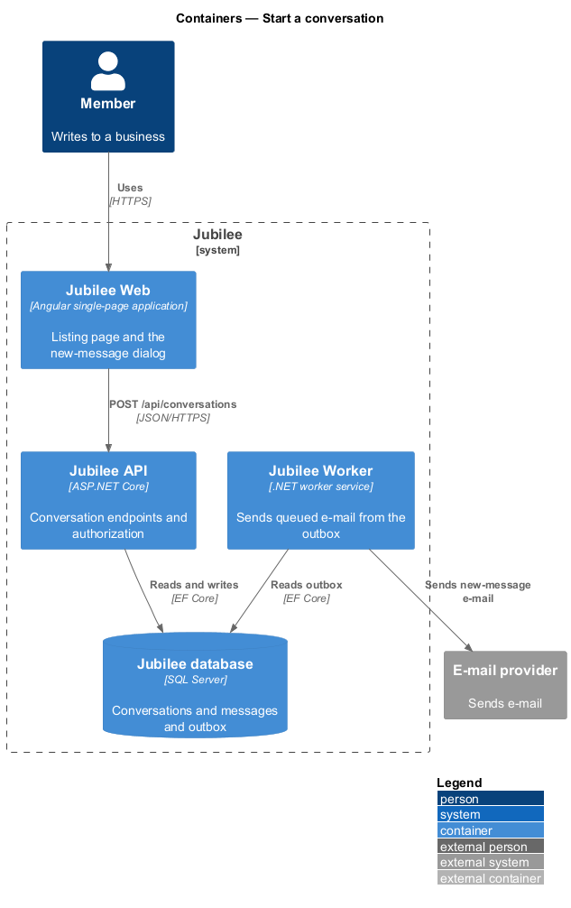
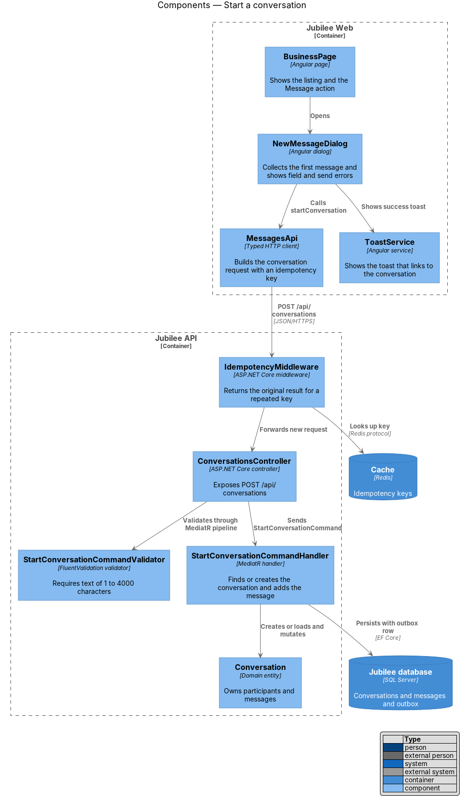
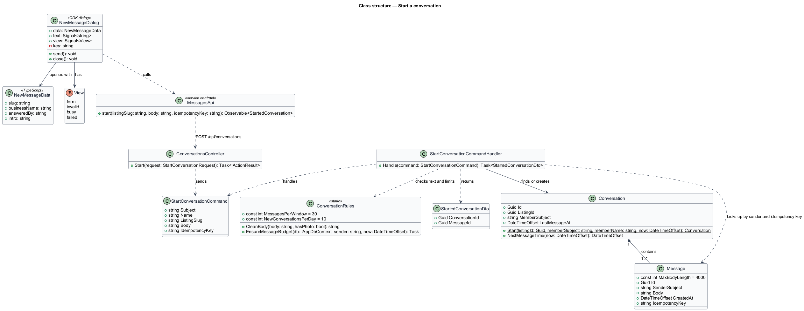
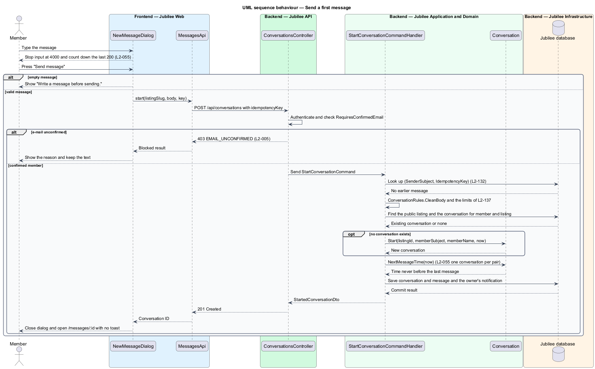
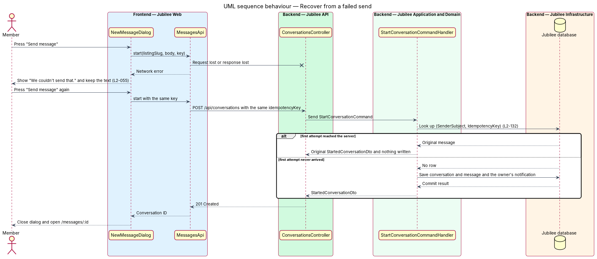

# Start a conversation

## Overview

Jubilee is Toronto's Christian marketplace: a directory of verified
Christian-owned businesses that members find, message and send requests to.
Messaging is the private channel between one member and one business. This
feature covers the first step of that channel: a member presses "Message" on a
listing, writes a first message in a dialog, and the exchange continues on the
Messages pages.

The terms below are used throughout the messaging subsystem.

- **conversation** — private one-to-one thread between one member and one business listing
- **first message** — message text entered in the new-message dialog that opens or continues a conversation
- **idempotency key** — client-generated identifier that lets the server recognise a repeated create request

Exactly one conversation exists for each pair of member and listing. When the
member has written to the business before, the first message is added to the
existing conversation; otherwise the feature creates the conversation and adds
the message in the same transaction. On success the dialog closes and the
conversation opens at `/messages/:id` (ADR 0014).

The feature sits between the listing pages (`/b/:slug`) and the conversation
page described in `exchange-messages`. A visitor who presses "Message" is first
routed through the sign-in-required dialog, which belongs to the accounts
subsystem; this slice starts once a signed-in member opens the dialog.

## Description

The feature is a vertical slice from the listing page to the database. The
decisions behind it are recorded in ADR 0014, ADR 0039 and ADR 0051.

- **`BusinessPage`** — Angular page at `/b/:slug`
  (`frontend/projects/jubilee/src/app/pages/business/`). "Message" goes to
  `/b/:slug/message`, which is the same route with the dialog open, so opening
  the dialog neither reloads the page nor counts another view (ADR 0014). The
  page opens `NewMessageDialog` with `NewMessageData`: the listing's `slug`, the
  `businessName`, `answeredBy` (the owner's first name, or the business when no
  owner is named) and the `intro`. The intro carries the
  reply-time hint ("Trevor Chew usually replies within a day."), taken from the
  listing's stored median first-reply band, the same value the listing page
  shows as "Replies". With too few replies the intro says who the message goes
  to and leaves the hint out.
- **`NewMessageDialog`** — CDK dialog of the app
  (`frontend/projects/jubilee/src/app/dialogs/new-message/`), composed of
  `jb-dialog`, `jb-field`, `jb-textarea`, `jb-alert` and `jb-button`. For Legacy
  Financial it is titled "Message Legacy Financial" and states "Trevor Chew
  usually replies within a day. The conversation continues in Messages." It holds
  one required field, "Your message", with the hint "Be specific and Trevor can
  answer in one reply.", which names the owner's first name, and the actions
  "Cancel" and "Send message". Its views are `form`, `invalid`, `busy` and
  `failed`. While it is busy it cannot be sent twice or closed.
- **Message length rule** — the field has `maxlength` `4,000`, so input stops
  there, and shows a counter during the last `200` characters ("{n} characters
  left", "1 character left"). An empty message shows "Write a message before
  sending." under the field and focus moves to the field (L2-126).
- **`newKey`** — function of the `api` library
  (`frontend/projects/api/src/lib/helpers/message-time.ts`). The dialog takes
  one idempotency key when it opens and reuses that key for every send attempt.
- **`MessagesApi`** — service contract with the injection token `MESSAGES_API`,
  implemented by `HttpMessagesApi`. `start` issues `POST /api/conversations`
  with the body `{ listingSlug, body, idempotencyKey }`.
- **Idempotency** — a unique index on `(SenderSubject, IdempotencyKey)` of
  `Messages`. A repeated key answers the original conversation and message and
  writes nothing (L2-132, ADR 0014). No middleware and no cache take part.
- **`ConversationsController`** — ASP.NET Core controller. `Start` carries
  `[RequiresConfirmedEmail]`, which refuses a member whose e-mail is unconfirmed
  with HTTP `403` and code `EMAIL_UNCONFIRMED` (L2-005), and sends
  `StartConversationCommand` through MediatR.
- **`ConversationRules.CleanBody`** — the rule both sends share. The text is
  required after trimming and is at most `Message.MaxBodyLength`, `4,000`
  characters. A failure returns HTTP `422` with the code `REQUIRED` or
  `TOO_LONG` on `body`, whatever sent the request (ADR 0014). There is no
  separate validator class.
- **`StartConversationCommandHandler`** — MediatR handler. It answers the
  original result for a repeated idempotency key. Otherwise it finds the public
  listing by its slug (`404` with code `listing_not_found` when there is none),
  looks up the conversation for the member and the listing, creates one through
  `Conversation.Start` when none exists, adds the message, and saves the
  conversation, the message and the owner's notification in one unit of work. A
  unique index on `(ListingId, MemberSubject)` guarantees one conversation per
  pair under concurrent requests. An owner who messages their own listing
  receives `409` with code `OWN_LISTING`. The handler refuses more than 30
  messages in 10 minutes and more than 10 new conversations in 24 hours per
  member with `429` and `Retry-After`, counted from the stored rows (L2-137,
  ADR 0014).
- **`Conversation`** and **`Message`** — domain entities. `Conversation` holds
  its `LastMessageAt` timestamp and one read mark per side; `Message` carries the
  sender, the body, the sent time and the idempotency key.
- **`StartedConversationDto`** — response body with `ConversationId` and
  `MessageId`. The controller returns `201 Created` whether the conversation is
  new or reused.
- **After success** — there is no toast for the message: the dialog closes and
  `/messages/:id` opens with the sent message in it (ADR 0014). When the owner
  is away, the conversation that opens shows the away toast described in
  `exchange-messages` (L2-062, ADR 0051).
- **Failed state** — when the request fails, the dialog stays open, keeps the
  typed text, and shows "We couldn't send that. Your connection dropped before it
  reached us. Nothing was sent and what you typed is still here. Try again." A
  further send reuses the same idempotency key. A `403 EMAIL_UNCONFIRMED`, a
  `429` and a `409 OWN_LISTING` each show their own heading and reason in the
  same alert.
- **Notifying the owner** — the handler writes the owner's `message`
  notification through `NotificationRules.Tell` and queues the new-message
  e-mail through `MessageMail.QueueAsync`. The event stream delivers the
  notification to the owner's open page (ADR 0025). The notification centre, the
  e-mail and the stream are designed in the notifications subsystem.
- **Tests** — `MessagingTests` (backend, `L2_055_…`, `L2_005_AC2_…`,
  `L2_132_…`, `L2_137_AC1_…`) and "message a business (L2-055)" in
  `e2e/tests/messages.spec.ts`.

## Requirements

The feature realizes the following level-2 (L2) requirements. Each L2
requirement refines a level-1 (L1) requirement, cited by identifier.

| L2 ID | Refines (L1) | Requirement |
|-------|--------------|-------------|
| `L2-055` | `L1-009` | The "Message" action on a listing shall open a dialog for a first message. The conversation shall continue in Messages: a valid message shall close the dialog and open the conversation, with no toast. Input shall stop at 4,000 characters with a counter in the last 200. |
| `L2-005` | `L1-001` | Until the e-mail is confirmed, a member may browse, search and save but shall not message, book, request or list a business. |
| `L2-126` | `L1-018` | A dialog form with errors shall show each message under its field, move focus to the first invalid field, keep the typed values, and apply the same rule and message code on the server. |
| `L2-132` | `L1-018` | Each create request shall carry a client-generated idempotency key, and the server shall return the original result for a repeated key within 24 hours without creating a duplicate. |
| `L2-137` | `L1-019` | The server shall answer 429 with `Retry-After` past 30 messages per member per 10 minutes and past 10 new conversations per member per day. |

## Diagrams

### System context

A member sends a first message through Jubilee. Jubilee notifies the owner of
the listing in the application and through the external e-mail provider.

### Containers

The request travels from `Jubilee Web` to `Jubilee API`, which checks the
idempotency key and persists state in `Jubilee database`. `Jubilee Worker`
reads the outbox and sends the new-message e-mail.

### Components

`BusinessPage` opens `NewMessageDialog`, which calls `MessagesApi`. In the API,
`ConversationsController` dispatches `StartConversationCommand` to its handler;
the handler checks the idempotency key, applies `ConversationRules`, mutates
`Conversation` and persists it with the owner's notification.

### Class structure

`NewMessageDialog` is opened with `NewMessageData`, holds a `View` and calls
`MessagesApi`. `StartConversationCommandHandler` handles
`StartConversationCommand`, applies `ConversationRules`, finds or creates a
`Conversation` that contains one or more `Message` entities, and returns
`StartedConversationDto`.

### Behaviour — send a first message

The dialog rejects an empty message locally. For a valid message the API checks
the confirmed e-mail and the idempotency key, reuses or creates the
conversation, and commits the message and the owner's notification together;
the dialog then closes and the conversation opens.

### Behaviour — recover from a failed send

When the request or its response is lost, the dialog keeps the text and shows
the failure message. The next attempt carries the same idempotency key, so the
handler returns the original result when the first attempt arrived and creates
the message once when it did not.

