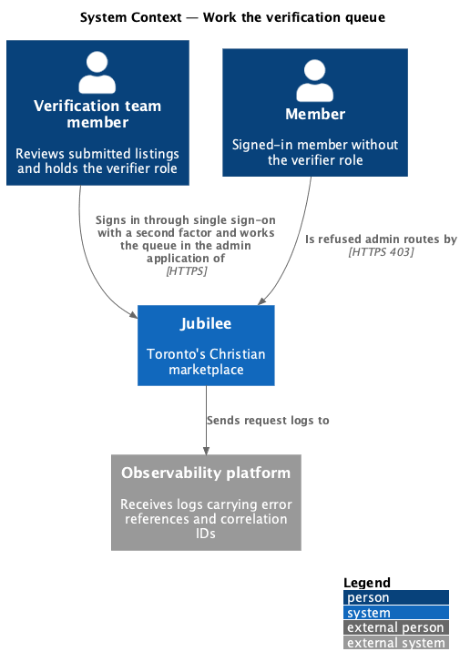
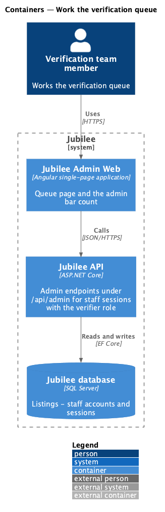
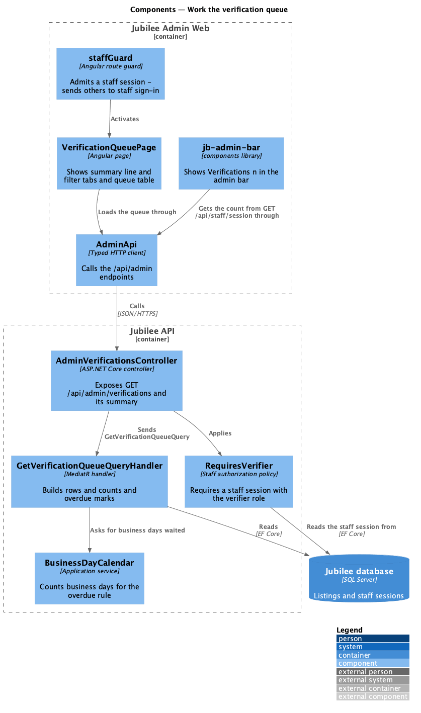
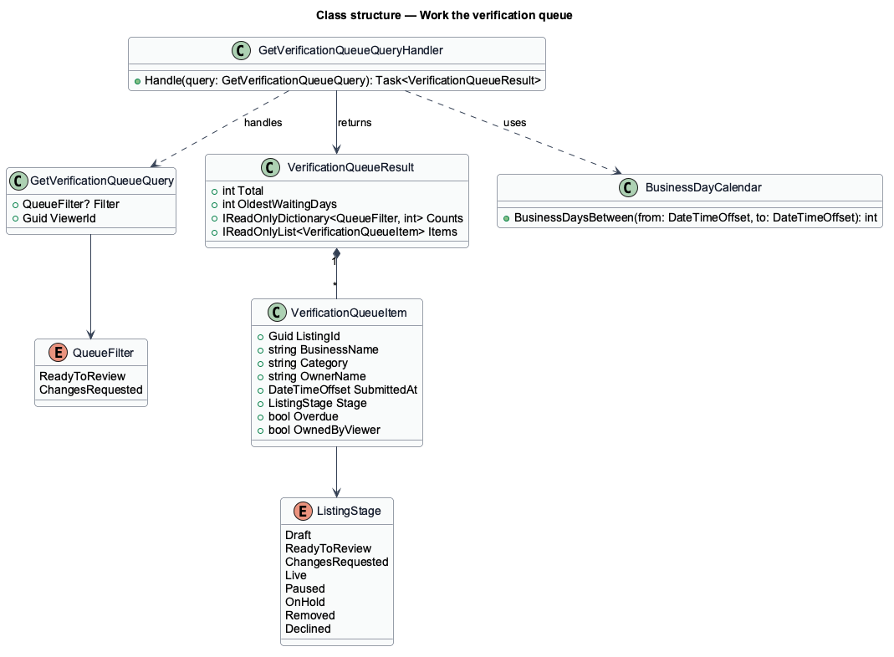
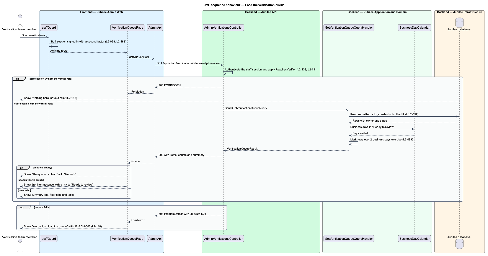

# Browse listings

## Overview

An owner publishes their own listing, and the listing is live at once: nobody
verifies it first (ADR 0057). The *Jubilee team* looks through what has been
published, behind the scenes, and acts where a listing misrepresents a
business. This feature covers the page the team starts from: the listings list
at `/listings` in the admin application (`admin/run-admin-application`), which
`/` also opens.

A *moderator* is a staff account that holds the `moderator` role; an *admin* is
a staff account that holds the `admin` role. Both work in the admin
application, signed in through single sign-on with a second factor
(`accounts/sign-in-as-staff`); the admin-only endpoints answer only a staff
session (`security/authorize-staff-requests`) on an allowed network
(`security/restrict-staff-network`).

The *listings list* holds every listing that has been published and has not
been taken down or deleted: listings members can find, listings their owner
paused, and listings the team placed on hold while it looks into a report
(`moderation/handle-reports`). A draft is never listed. Each row gives a
*status*: "Live", "Paused" or "On hold". A *flag* is a mark placed on a listing
when it was published; the only flag is contact details in the text, for
example a tagline that contains a phone number (`L2-072`). A flagged row
carries the tag "Flagged" so the team can look at it first.

The slice is read-only. Acting on one listing belongs to
`moderation/take-down-listing`; this slice supplies the access rules that
feature relies on.

## Description

The feature runs from the Angular admin shell to the Jubilee database.

- **`staffGuard`** — route guard of the admin application on every screen
  (`admin/run-admin-application`). It sends a caller without a staff session to
  staff sign-in; the second factor is proved there (ADR 0040).
- **Moderator screens** — the listings route carries `moderator: true` in its
  route data. When the signed-in staff member lacks the `moderator` role, the
  admin shell shows the page "Nothing here for your role" (`admin-only`, with
  "Sign out") in place of `AdminListingsPage`, so the listings are never asked
  for (`L2-188` AC4). The server refuses the endpoint in any case.
- **`AdminListingsPage`** — Angular page of the admin application at
  `/listings`. Its header subtitle is the summary line "{n} listings · {n}
  published in the last 7 days". It shows a search by business name
  (`jb-search-field`, "Search listings by name") and a table captioned
  "Published listings, newest first" with the columns Business, Category,
  Owner, Published and Status. A flagged row carries the tag "Flagged"
  (`jb-badge`, warning tone) after the name; the status is a `jb-badge` that
  carries its label in words, never colour alone. Each business name links to
  `/listings/:id`.
- **Listings states** — `AdminListingsPage` renders four states besides the
  table. While loading it shows `jb-row-list-skeleton` and the status "Loading
  the listings…". With no published listing (`Total` is 0) it shows "No
  listings yet" — "A listing appears here as soon as its owner publishes it." —
  with "Refresh". A search that matches nothing shows "No match" — "No listing
  matches “{text}”." — with "Clear search". A failed load shows "We couldn’t
  load the listings" with the reference `JB-ADM-503` and "Try again".
- **`jb-admin-bar`** — the admin application's top bar. Its first link is
  "Listings", marked `aria-current="page"` on this screen. It shows no count:
  `GET /api/staff/session` counts no queue (ADR 0057).
- **`AdminApi`** — typed Angular HTTP client for `/api/admin`, provided through
  the `ADMIN_API` token. `listings(search)` calls
  `GET /api/admin/listings?q={text}` and returns `AdminListings`.
- **`AdminListingsController`** — ASP.NET Core controller under
  `/api/admin/listings`. `GET /api/admin/listings?q={text}` sends
  `GetAdminListingsQuery(Search)` through MediatR and declares the error
  reference `JB-ADM-503` (`[ErrorReference]`), so any failure of the read
  answers 503 with that reference. The controller applies `RequiresModerator`.
- **`RequiresModerator`** — the staff authorization policy on every listings,
  moderation and featured endpoint: a staff session holding the `moderator`
  role (`security/authorize-staff-requests`). Any other caller receives 401 or
  403 as `ProblemDetails`; the check runs on the server and does not rely on
  the client.
- **`GetAdminListingsQueryHandler`** — MediatR handler. It reads listings whose
  stage is `Live`, whose `PublishedAt` is set and whose `DeletedAt` is empty (a
  takedown sets `DeletedAt`, so a taken-down listing leaves the list). It marks
  a row `Flagged` when the listing's `ListingSubmission` carries any flag. It
  orders the rows by `PublishedAt` descending, then by sort name, and keeps
  those whose name contains the search, ignoring case. `Total` counts every
  listed listing and `PublishedThisWeek` those published in the last 7 days,
  whatever the search. `AdminListings.StatusOf` derives each row's status:
  `on-hold` ("On hold") when `IsUnderModerationHold`, `paused` ("Paused") when
  `IsPaused`, otherwise `live` ("Live").
- **`AdminListingsDto`** — the answer: `Total`, `PublishedThisWeek` and `Rows`.
  Each **`AdminListingRow`** carries `Id`, `Name`, `CategoryName`,
  `OwnerName`, `PublishedAt`, `Status`, `StatusLabel` and `Flagged`. The
  row does not say whether the viewer owns the listing; the listing page does
  (`IsOwnListing`, `moderation/take-down-listing`), and the take-down endpoint
  refuses a moderator their own listing with HTTP 403.
- **Roles** — staff roles are granted and revoked with the CLI,
  `jubilee staff grant|revoke --role moderator|admin`
  (`accounts/sign-in-as-staff`, ADR 0040). No screen changes roles. The
  `moderator` role keeps the stored flag value (1) of the former `verifier`
  role, so earlier grants carry over (ADR 0057). `GrantStaffRoleCommand` and
  `RevokeStaffRoleCommand` carry the operator (`Environment.UserName` of the
  CLI) and, when the roles change, add an `AuditRecord`
  `staff.role-granted` or `staff.role-revoked` with the actor `cli|{user}`,
  the account's address as the target and the roles before and after; a
  command that changes nothing writes nothing (`L2-098` AC4, ADR 0059).

## Requirements

The feature realizes the following level-2 (L2) requirements. Each L2
requirement refines a level-1 (L1) requirement, cited by identifier.

| L2 ID | Refines (L1) | Requirement |
|-------|--------------|-------------|
| `L2-098` | `L1-014` | The system shall refuse every admin API to a caller without a staff session holding the `moderator` role as `L2-191` states, shall require a moderator to complete a second factor through single sign-on before any admin screen is available, and shall show "Listings", "Reports" and "Featured" in the admin application's top bar. Only an `admin` role holder shall grant or remove roles, each change shall be written to the audit log, and a moderator who owns a listing shall not take it down. |
| `L2-099` | `L1-014` | The system shall list at `/listings` in the admin application every listing that has been published and not taken down or deleted, newest published first, with the summary "{n} listings · {n} published in the last 7 days", the columns Business, Category, Owner, Published and Status ("Live", "Paused" or "On hold"), the tag "Flagged" for a listing with a flag of `L2-072`, and a search by business name. It shall show dedicated empty, no-match and load-error (`JB-ADM-503`) states. |
| `L2-133` | `L1-019` | The system shall check the caller's role and ownership of the specific object on every API endpoint before doing anything, without relying on the client hiding a control. |
| `L2-180` | `L1-025` | The system shall store an append-only audit record with actor, action, target, time, before and after values, and reason for each sensitive action, including role changes. |
| `L2-118` | `L1-016` | The system shall show a quotable error reference on every load-error state, with `503` when the service was unavailable. |

## Diagrams

### System context

The Jubilee team member reaches the listings through the admin application
after signing in with a second factor; a member session is refused. Request
logs carrying the error reference go to the observability platform.

### Containers

`Jubilee Admin Web` calls the admin endpoints of `Jubilee API`, which reads
listings and staff sessions from the `Jubilee database`.

### Components

`staffGuard` activates `AdminListingsPage`, which loads data through
`AdminApi`. In `Jubilee API`, the controller applies `RequiresModerator` before
`GetAdminListingsQueryHandler` runs.

### Class structure

`GetAdminListingsQueryHandler` returns an `AdminListingsDto` that composes
`AdminListingRow` rows; `AdminListings.StatusOf` gives each row's status.

### Behaviour — load the listings

The admin shell shows "Nothing here for your role" to a staff member without
the `moderator` role and never asks for the listings. Otherwise the controller
applies `RequiresModerator` before the handler reads the listings, and the page
renders the populated, empty, no-match or load-error state.

