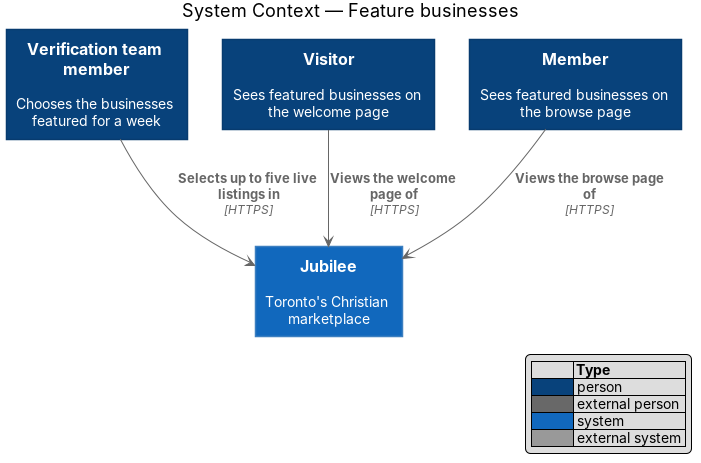
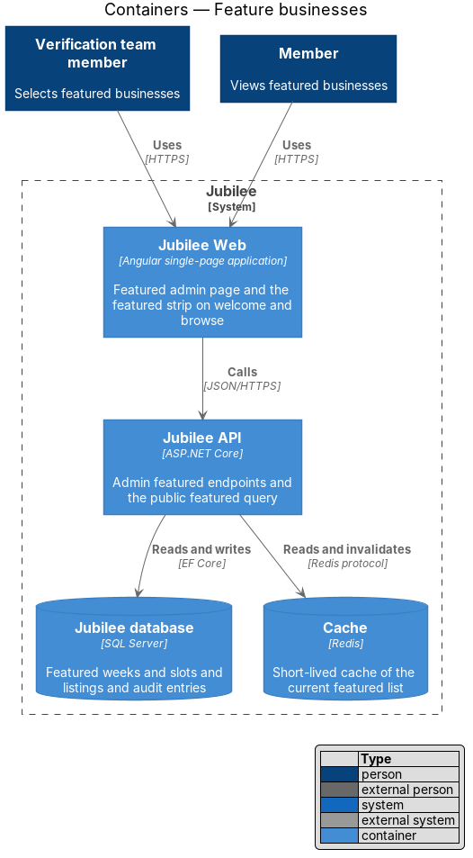
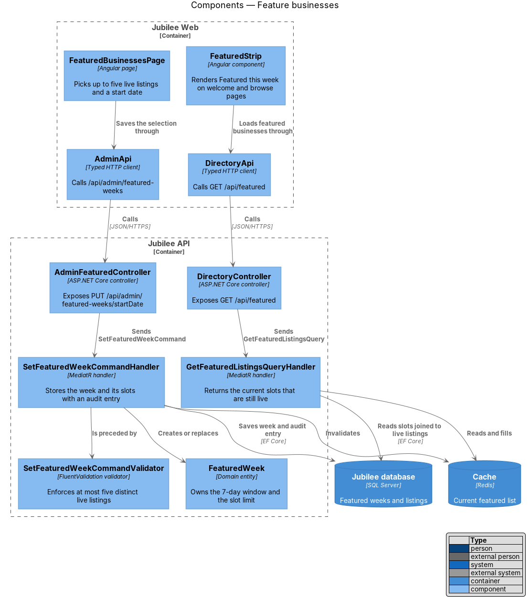
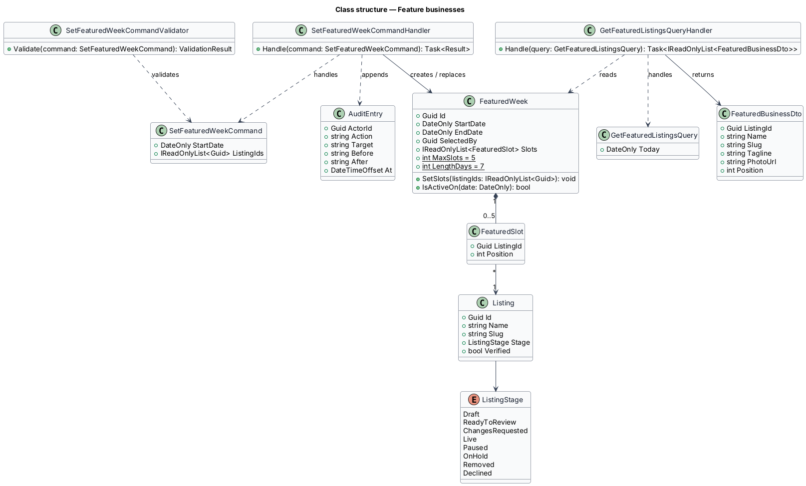
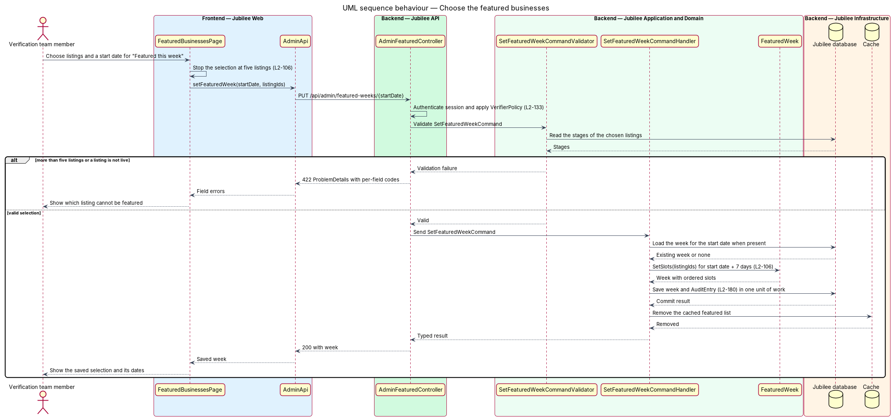
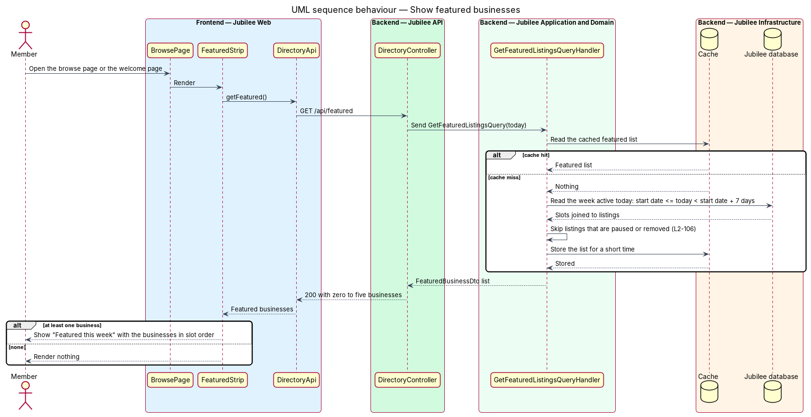

# Feature businesses

## Overview

Jubilee highlights a small set of businesses on its two entry pages. A moderator
chooses up to five live listings as "Featured this week" and gives the selection
a start date. From that date the chosen listings show on the welcome page and
the browse page for 7 days.

*Featured week* — selection of up to five listings with a start date and a fixed
length of 7 days. *Featured slot* — one position in a featured week, holding one
listing. A slot does not copy the listing; it refers to it, so the pages always
show the listing's current name, tagline and photo.

The public pages apply one rule at read time: a featured listing that is paused
or removed is skipped. The selection itself is not altered, so a listing that
becomes live again within the week reappears. Featured selections are sensitive
actions and are written to the audit log (`L2-180`).

## Description

The slice has an admin write path and a public read path.

- **`FeaturedBusinessesPage`** — Angular page of the admin application (`admin/run-admin-application`). It lets a moderator search
  live listings, order up to five of them, and pick the start date. It stops the
  selection at five. No mock exists; its route is `/featured` in the admin application; the mock
  is `pages/admin-featured` and the copy is in it (ADR 0033).
- **`FeaturedStrip`** — Angular component used by `WelcomePage` and
  `BrowsePage`. It renders "Featured this week" with one `BusinessCard` per
  returned business, in slot order, and renders nothing when the list is empty.
- **`AdminApi`** and **`DirectoryApi`** — typed HTTP clients for the admin
  write and the public read.
- **`AdminFeaturedController`** — exposes
  `PUT /api/admin/featured-weeks/{startDate}` under `RequiresModerator`, the staff policy (`security/authorize-staff-requests`). The PUT
  replaces the whole selection for that start date, so a repeated request has
  no further effect.
- **`SetFeaturedWeekCommand`** and **`SetFeaturedWeekCommandValidator`** — carry
  `StartDate` and `ListingIds`. The validator returns HTTP 422 when the list
  holds more than five entries, holds a duplicate, or names a listing whose
  stage is not `Live`. A start date before today (Toronto) is refused (`START_IN_PAST`), and a week that starts within six days of
  another week is refused (`WEEK_OVERLAPS`); saving the same start date replaces that week (ADR 0033).
- **`SetFeaturedWeekCommandHandler`** — creates or replaces the `FeaturedWeek`,
  appends an `AuditEntry` with the before and after selection, saves both in
  one unit of work, and removes the cached featured list from the `Cache`.
- **`FeaturedWeek`** — domain entity. `EndDate` is `StartDate` plus 7 days;
  `SetSlots` enforces `MaxSlots = 5` and assigns positions; `IsActiveOn(date)`
  is true from the start date for 7 days. The day boundary is midnight in Toronto (ADR 0033).
- **`FeaturedSlot`** — value object with `ListingId` and `Position`.
- **`DirectoryController`** — exposes the public `GET /api/featured`.
- **`GetFeaturedListingsQueryHandler`** — reads the week active on the current
  date, joins its slots to listings, and returns only listings whose stage is
  `Live`. It caches the result in the `Cache`; the cache lifetime is not needed yet: the list is read on each request (ADR 0033). Pausing or removing a listing invalidates the cached list.
- **`FeaturedBusinessDto`** — public read model with the fields `BusinessCard`
  renders: name, slug, tagline, photo URL and position.

## Requirements

The feature realizes the following level-2 (L2) requirements. Each L2
requirement refines a level-1 (L1) requirement, cited by identifier.

| L2 ID | Refines (L1) | Requirement |
|-------|--------------|-------------|
| `L2-106` | `L1-014` | The system shall let a moderator choose up to five live listings as "Featured this week" with a start date, and shall show those listings on the welcome and browse pages from that date for 7 days. The pages shall skip a featured listing that is paused or removed. |
| `L2-133` | `L1-019` | The system shall check the caller's role and ownership of the specific object on every API endpoint before doing anything. |
| `L2-180` | `L1-025` | The system shall store an append-only audit record with actor, action, target, time, before and after values, and reason for each featured selection. |

## Diagrams

### System context

The Jubilee team member selects featured businesses in Jubilee. Visitors
and members see them on the welcome and browse pages.

### Containers

`Jubilee Web` writes the selection and reads the featured list through
`Jubilee API`, which stores weeks in the `Jubilee database` and caches the
current list in the `Cache`.

### Components

`FeaturedBusinessesPage` saves through `AdminFeaturedController`;
`FeaturedStrip` reads through `DirectoryController`. The write handler replaces
the `FeaturedWeek` and invalidates the cache that the read handler fills.

### Class structure

`FeaturedWeek` composes up to five `FeaturedSlot` values, each referring to one
`Listing`. The read handler returns `FeaturedBusinessDto` items.

### Behaviour — choose the featured businesses

The validator rejects more than five listings or a listing that is not live. The
handler stores the week with an audit entry and invalidates the cache.

### Behaviour — show featured businesses

The read handler returns the week active on the current date and skips listings
that are paused or removed.

