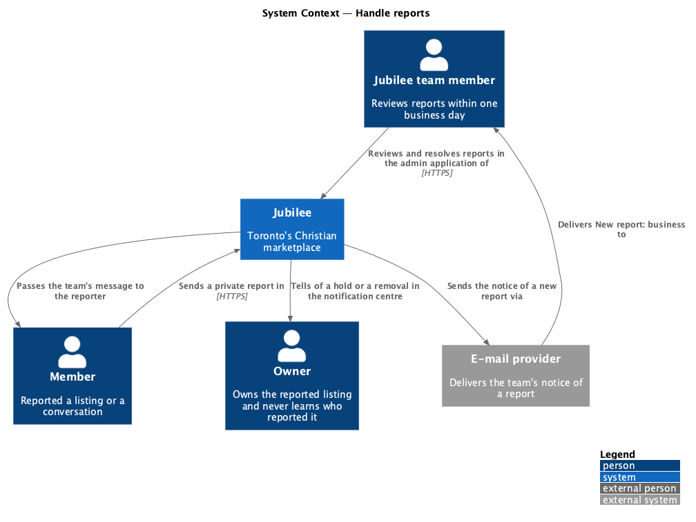
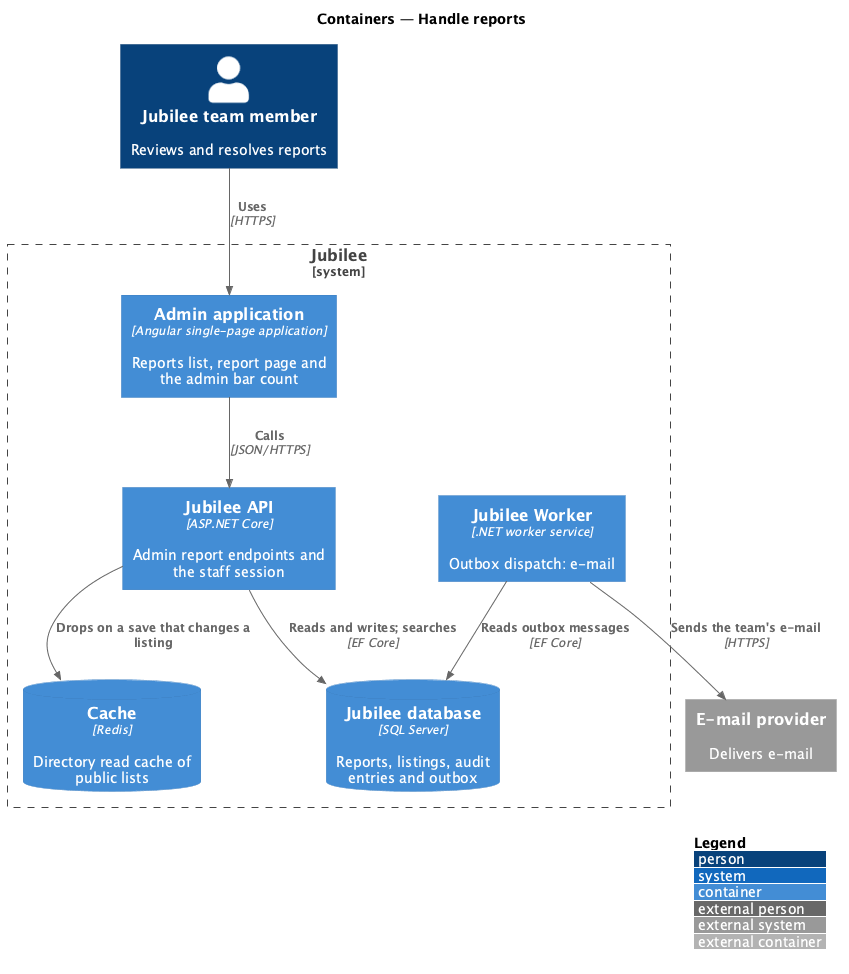
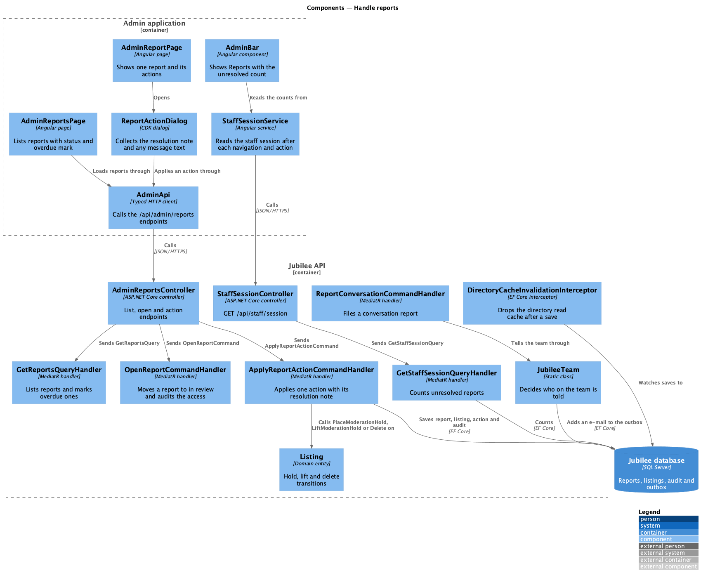
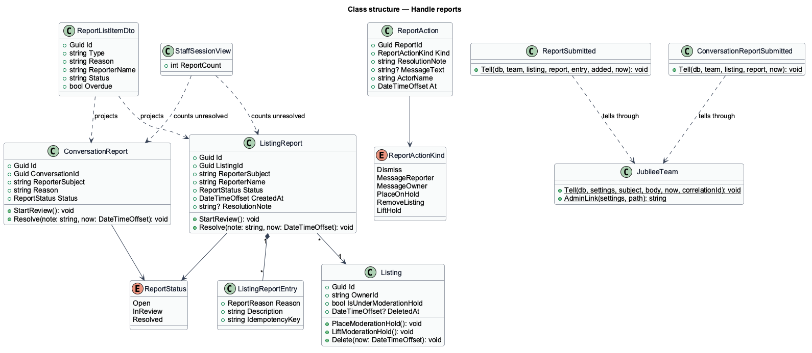
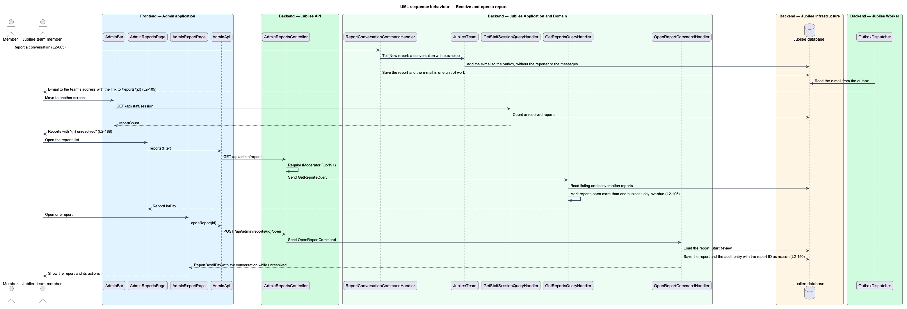
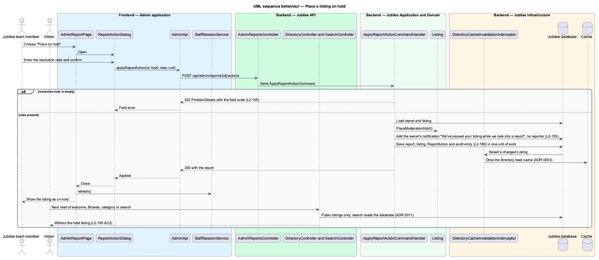

# Handle reports

## Overview

Members can report a listing (`L2-039`) or a conversation (`L2-063`) privately
to the Jubilee team. This feature is the moderation side: the admin
reports list, the page for one report, and the actions a moderator can take. The
Jubilee team reviews each report within one business day.

*Report* — private complaint from a member about a listing or a conversation,
with a reason and a description. A report holds one of three statuses: open, in
review, or resolved. A report is *overdue* when it has been open for more than
one business day. *Hold* — state in which a listing is hidden from the public
while a report about it is under review; the terms of use allow it.

Two confidentiality rules shape the slice. The reporter's identity is visible to
moderators only, and the owner of a reported listing never sees who reported it.
A moderator may read a reported conversation only because an open report attaches
it, and each such access is written to the audit log.

Reports are one way the Jubilee team learns that a listing misrepresents a
business: nobody verifies a listing before it goes live (ADR 0057). Taking a
listing down from its page in the admin application, outside a report, belongs
to `moderation/take-down-listing`.

## Description

The slice has two admin pages and one dialog in the admin application
(`admin/run-admin-application`), one controller, three handlers, and the notice
to the team when a report arrives. The routes are `/reports` and `/reports/:id`;
the mocks are `pages/admin-reports`, `pages/admin-report`, `dialogs/report-action`
and, for the count in the bar, `pages/admin-shell`; the copy is in them (ADR 0033,
ADR 0058).

- **`ReportListingCommandHandler`** and **`ReportConversationCommandHandler`** —
  file a report of a listing (`L2-039`) or of a conversation (`L2-063`). In the
  same save each tells the team: `ReportSubmitted.Tell` writes "New report:
  {business}" or "More on a report: {business}", and
  `ConversationReportSubmitted.Tell` writes "New report: a conversation with
  {business}". Both go through **`JubileeTeam.Tell`**, the one place that
  decides who on the team is told: an `OutboxMessage` e-mail to
  `TeamSettings.TeamEmail`, or nobody when no address is set. The e-mail
  carries the link to `/reports/{id}` in the admin application and never the
  reporter's name or address; a conversation's messages are never e-mailed
  (ADR 0055, ADR 0058). There is no real-time event for staff.
- **`GetStaffSessionQueryHandler`** — answers `GET /api/staff/session` with
  `ReportCount`, the listing and conversation reports that are not resolved;
  it is 0 without the `moderator` role.
- **`AdminBar`** — the `jb-admin-bar` component shows the count on "Reports" as a
  count badge named "{n} unresolved", hidden at 0. **`StaffSessionService.refresh()`**
  reads the staff session again after each navigation between screens and after
  each action on a report, so the count is current without polling (ADR 0058).
- **`AdminReportsPage`** — lists reports with listing, reason, description,
  reporter, time and status, oldest first, and marks overdue reports. A filter
  shows unresolved, open, in review, resolved or all reports.
- **`AdminReportPage`** — one report: the report and its entries, the attached
  conversation for a conversation report, the history of actions, and the
  actions dismiss, message the reporter, message the owner, place the listing on
  hold, remove the listing and lift the hold.
- **`ReportActionDialog`** — CDK dialog that collects the required resolution
  note and, for the two message actions, the message text.
- **`AdminApi`** (`ADMIN_API`) — `reports`, `openReport` and `applyReportAction`.
- **`AdminReportsController`** — exposes `GET /api/admin/reports?status=`,
  `POST /api/admin/reports/{id}/open` and `POST /api/admin/reports/{id}/actions`
  under `RequiresModerator`, the staff policy (`security/authorize-staff-requests`).
  A staff session without the `moderator` role receives HTTP 403.
- **`GetReportsQueryHandler`** — returns `ReportListDto` with
  `ReportListItemDto` rows, `UnresolvedCount` and `OverdueCount`. A report is
  overdue when it is `Open` more than one business day after `CreatedAt`
  (`BusinessDays`).
- **`OpenReportCommandHandler`** — calls `StartReview`, which moves an open report
  to `InReview`, and records `report.opened`, or `conversation.viewed` for a
  conversation report still unresolved, in the audit log with the report ID as
  the reason. A reported conversation's messages are returned only while its
  report is unresolved.
- **`ApplyReportActionCommandHandler`** — refuses an empty `ResolutionNote`
  (1000 characters at most) and an empty `MessageText` (2000 at most) on the two
  message actions with HTTP 422, and an action on a resolved report with 409
  `REPORT_RESOLVED`. It applies the action, records a `ReportAction`, appends the
  audit entry and tells the owner or the reporter through `NotificationRules.Tell`,
  all in one save. `Dismiss` and `RemoveListing` resolve the report; `PlaceOnHold`
  and the two messages leave it `InReview`; `LiftHold` lifts a hold and resolves
  the report (ADR 0033).
- **`Listing.PlaceModerationHold`**, **`Listing.LiftModerationHold`** and
  **`Listing.Delete`** — a held or deleted listing fails `WherePublic`, so every
  public query leaves it out.
- **Holds and removals on public pages** — the save that holds or removes a
  listing changes the `Listing`, so `DirectoryCacheInvalidationInterceptor` drops
  the directory read cache when it commits (ADR 0003), and search reads the
  database (ADR 0011). The listing leaves the welcome page, Browse, its category,
  search and the related businesses of other listings on the next request, inside
  the 60 seconds of `L2-105` AC3 (ADR 0058).
- **Reporter confidentiality** — `ReportListItemDto.ReporterName` and the
  reporter fields of `ReportDetailDto` exist only on admin endpoints.
  Owner-facing notifications, e-mail and listing responses carry no reporter
  field, and messages to the owner are sent in the name of the Jubilee team.

## Requirements

The feature realizes the following level-2 (L2) requirements. Each L2
requirement refines a level-1 (L1) requirement, cited by identifier.

| L2 ID | Refines (L1) | Requirement |
|-------|--------------|-------------|
| `L2-105` | `L1-014` | The Jubilee team shall review reports from `L2-039` and `L2-063` within one business day. The system shall list each new report for moderators, e-mail the team of it and count the unresolved reports in the admin bar, shall let a moderator dismiss it, message the reporter, message the owner, place the listing on hold or remove the listing with a resolution note, shall remove a held or removed listing from public lists within 60 seconds and tell the owner of a hold, shall mark a report overdue after more than one business day open, and shall never show the owner who reported the listing. |
| `L2-063` | `L1-009` | The system shall send a reported conversation to the Jubilee team with the conversation attached, and staff shall not read a conversation's content without an open report on it. |
| `L2-188` | `L1-027` | The admin bar shall show "Reports" with the number of unresolved reports, named "{n} unresolved" to assistive technology. |
| `L2-133` | `L1-019` | The system shall check the caller's role and ownership of the specific object on every API endpoint before doing anything. |
| `L2-150` | `L1-020` | The system shall record in the audit log each staff view of a member's personal data or a reported conversation, with the reason (report ID or listing ID). |
| `L2-180` | `L1-025` | The system shall store an append-only audit record with actor, action, target, time, before and after values, and reason for report resolutions, holds and removals. |

## Diagrams

### System context

A member reports privately and Jubilee e-mails the Jubilee team of it.
The Jubilee team member resolves the report, and Jubilee tells the owner
of a hold or removal in the notification centre.

### Containers

`Jubilee API` stores reports, decisions and the team's e-mail in the
`Jubilee database` and drops the `Cache` of public lists when a listing changes.
`Jubilee Worker` sends the e-mail in the outbox.

### Components

`AdminReportsPage` and `AdminReportPage` call `AdminReportsController` through
`AdminApi`; `AdminBar` shows the count `GET /api/staff/session` answers.
`ApplyReportActionCommandHandler` records the action and calls the hold or
remove transition on `Listing`.

### Class structure

`ListingReport` composes its entries; `ConversationReport` refers to one
conversation. `ReportAction` rows are the history of either. `ReportListItemDto`
derives `Overdue` from `BusinessDays`.

### Behaviour — receive and open a report

Filing a report e-mails the team through the outbox in the same save. Opening
the report moves it to in review and audits the access.

### Behaviour — place a listing on hold

The handler requires the resolution note, holds the listing, tells the owner
without naming the reporter and commits the audit entry. The interceptor drops
the cached public lists when the save commits, so the listing is gone on the
next request.

