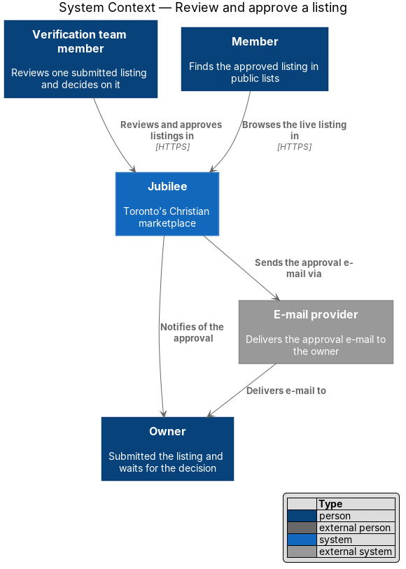
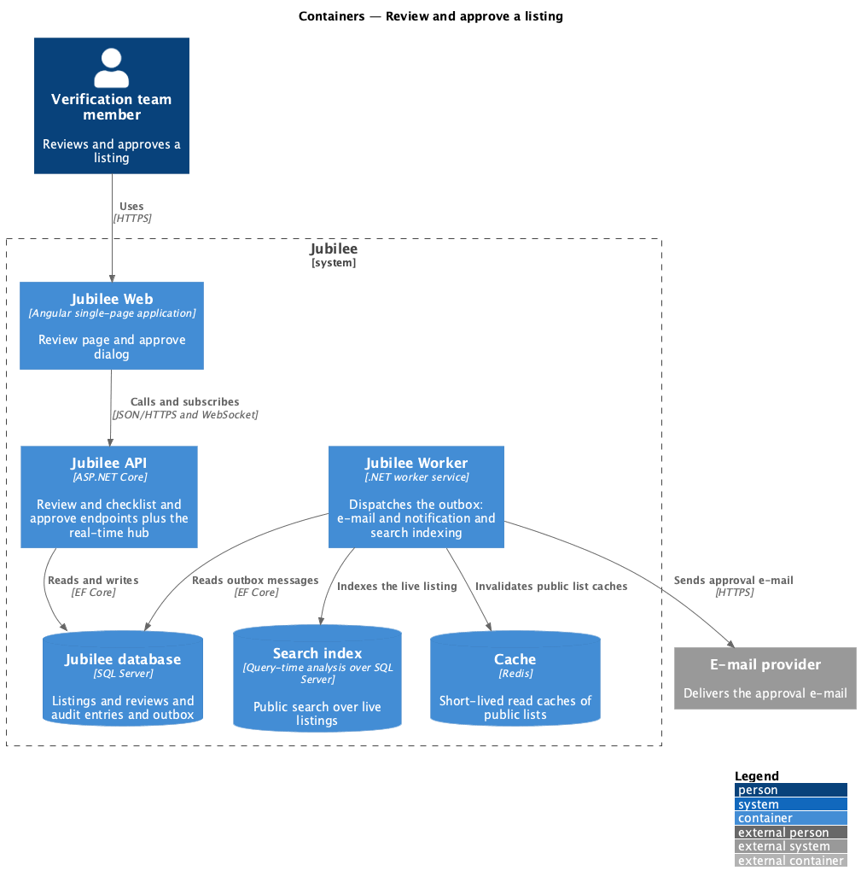
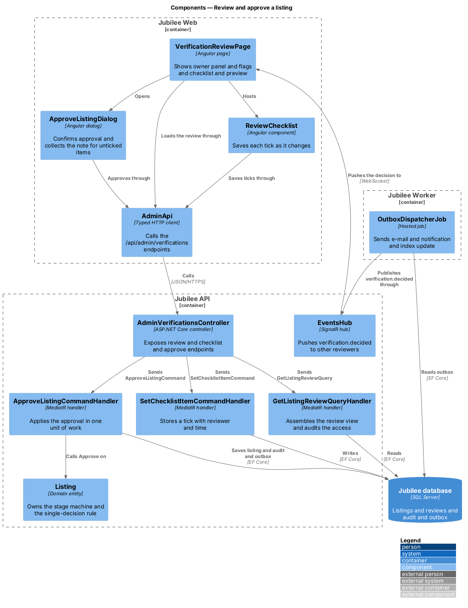
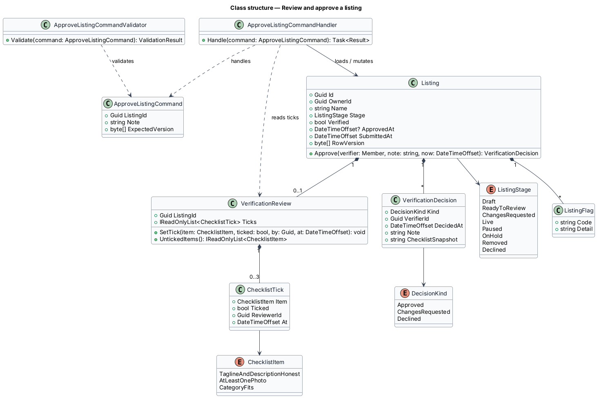
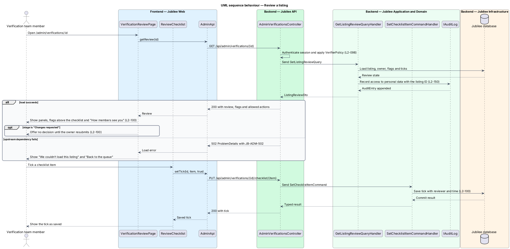
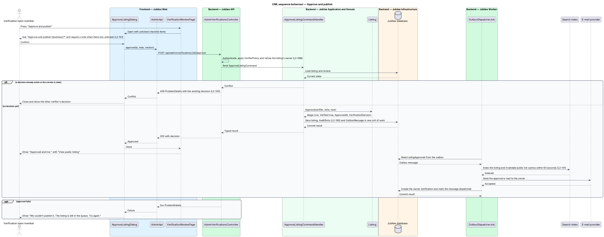

# Take down a listing

## Overview

A listing is live as soon as its owner publishes it; nobody verifies it first
(ADR 0057). Every owner agrees to the statement of faith and to deal honestly
with every customer when they list (`L2-075`), and the Jubilee team looks
through what was published (`moderation/browse-listings`). When a listing
misrepresents a business, a member of the team takes it down. This feature
covers the page for one listing at `/listings/:id` in the admin application
(`admin/run-admin-application`) and its one action, "Take down listing".

The listing page gathers what a moderator reads before acting: the listing's
name, its category, when it was published and its status, the Owner panel, any
flags raised when it was published, and the preview "How members see it". The
page names no church, pastor or other third party: the team acts from the
listing and the Owner panel alone. A *flag* is a mark placed on a listing when
it was published; the only flag is contact details in the text (`L2-072`).

A *takedown* removes a listing from Jubilee straight away. The owner is told
why, and the action is written to the audit log as `listing.taken-down`. A
taken-down listing never comes back; its owner may list again, starting from
the empty state of My business (`L2-086`). A moderator cannot take down their
own listing (HTTP 403 `OWN_LISTING`), and a listing is taken down once: a
second takedown is refused with HTTP 409 `ALREADY_TAKEN_DOWN`.

## Description

The feature is a vertical slice from the listing page to the database. The
takedown handler writes the listing, the owner's notification, the e-mail and
the audit record in one save; `Jubilee Worker` sends the e-mail from the
outbox as it sends every other e-mail.

- **`AdminListingPage`** — Angular page of the admin application at
  `/listings/:id`, under the breadcrumb "Listings › {name}". Its header shows
  the name, the subtitle "{category} · published {when} · {status}" (the status
  a `jb-badge`), and the action "Take down listing". The Owner card gives
  Name, E-mail with "confirmed" or "not confirmed", Member since ({Month
  yyyy}) and Other listings (their number, or "None"). A space adds the card
  "The space" with its terms and details and never its exact address
  (`L2-200` AC3). Each flag is a warning alert "Flagged" with the text of
  `FLAG_TEXT`, above the preview "How members see it" ("How renters see it"
  for a space). There is no checklist and no approve, request-changes or
  decline action. A failed load shows "We couldn’t load this listing" with
  `JB-ADM-502`, "Try again" and "Back to listings". A listing already taken
  down shows the alert "Taken down" — "Taken down {date} by {name}." and
  "Reason: “{reason}”" — and no action. When `IsOwnListing` is true the page
  shows "This is your own listing. Another member of the team has to act on
  it." and does not offer the action; the server refuses it in any case.
- **`TakeDownListingDialog`** — CDK dialog titled "Take down {business}?" with
  the text "It leaves Jubilee straight away and {owner} is e-mailed your
  reason. Use this when a listing misrepresents a business.", the field
  "Reason for {owner}" (required, 1,000 characters at most), "Keep it" and
  "Take down listing". An empty reason shows "Tell the owner why it was taken
  down." and sends nothing. On failure the dialog stays open, keeps the
  reason, and shows "We couldn’t take it down. The listing is still live. Try
  again." On success it closes with the updated `AdminListing`, and the page
  shows the alert "Taken down" — "You took down {business} today at {time}
  {Owner} has been e-mailed your reason." — with the reason.
- **`AdminApi`** — `listing(id)` calls `GET /api/admin/listings/{id}` and
  `takeDown(id, reason)` calls `POST /api/admin/listings/{id}/take-down` with
  `{ reason }`; both return `AdminListing`.
- **`AdminListingsController`** — exposes `GET /api/admin/listings/{id}`
  (error reference `JB-ADM-502`) and `POST /api/admin/listings/{id}/take-down`
  under `RequiresModerator`, the staff policy
  (`security/authorize-staff-requests`). The acting moderator is a `Reviewer`
  built from the session subject and the `name` claim.
- **`AdminListings.Load`** — finds a listing that is `Live`, has `PublishedAt`
  set, and is either not deleted or taken down by the team; a draft, an
  unknown ID or a listing its owner deleted answers 404 `listing_not_found`.
- **`GetAdminListingQueryHandler`** — returns `AdminListings.Detail`: the
  `AdminListingDto` assembled from the listing, its owner, the number of the
  owner's other listings, the flags of its `ListingSubmission`, and the
  takedown when there is one. It writes no audit record.
- **`AdminListingDto`** — `Id`, `Slug`, `Name`, `Tagline`, `About`, `Kind`,
  `CategorySlug`, `CategoryName`, `PublishedAt`, `Status` and `StatusLabel`
  (`live`, `paused`, `on-hold` or `taken-down`, from `AdminListings.StatusOf`),
  `Owner` (`AdminListingOwner`: `Name`, `Email`, `EmailConfirmed`,
  `MemberSince`, `OtherListings`), `Flags` (codes, such as
  `CONTACT_IN_TEXT`), `IsOwnListing`, `TakenDown` (`AdminTakedownDto(At,
  ByName, Reason)` or null) and `Space` (`AdminListingSpace` or null).
- **`TakeDownListingCommand(Reviewer, ListingId, Reason)`** and
  **`TakeDownListingCommandHandler`** — the handler trims the reason and
  refuses an empty one or one longer than 1,000 characters with HTTP 422
  (`ValidationFailedException`; `code` `validation_failed` with the field
  error `reason` set to `REQUIRED` or `TOO_LONG`). It loads the listing,
  refuses the moderator's own listing with HTTP 403 `OWN_LISTING` and a
  listing already taken down with HTTP 409 `ALREADY_TAKEN_DOWN`, nothing
  changed. Otherwise it calls `Listing.TakeDown`; tells the owner through
  `NotificationRules.Tell` (kind `listing-removed`, title "We’ve taken down
  {Business}", detail "The Jubilee team took your listing off Jubilee. We’ve
  e-mailed you why.", target `/my-business`); adds an
  `OutboxMessage.Email` to the owner with that title as subject and the reason
  in the body; and records `listing.taken-down` with `AuditLog.Record`
  (actor, before status, after `taken-down`, reason). One `SaveChanges`
  commits all of it, and the handler answers 200 with the updated
  `AdminListingDto`.
- **`Listing.TakeDown(byName, reason, now)`** — domain method. It sets
  `TakenDownAt`, `TakenDownByName` and `TakedownReason` and calls `Delete`,
  which sets `DeletedAt`. `PublicListingFilter` (`DeletedAt == null`, among
  its other conditions) then excludes the listing from every public list and
  count, and its public page answers 404, as for any deleted listing
  (`L2-028`). Called twice, it throws; the handler checks first and answers
  409.
- **Leaving public within 60 seconds** — there is no takedown-specific outbox
  message or cache job. `DirectoryCacheInvalidationInterceptor`, an EF Core
  save interceptor, drops the server-side directory read cache
  (`IDirectoryReadCache`, Redis in production) after any save that changes a
  `Listing`, so the next public read applies `PublicListingFilter` afresh.
  Public directory responses carry `Cache-Control: public, max-age=60`
  (`PublicDirectoryCache`), so a browser or the edge may keep an earlier
  answer for at most 60 seconds.
- **`OutboxDispatcherJob`** — the hosted job in `Jubilee Worker` that sends
  every outbox e-mail through the e-mail provider (`operations/deliver-email`);
  it sends the takedown e-mail like any other.
- **Listing again** — the owner's workspace does not count a deleted listing,
  so My business shows the empty state of `L2-086` and the owner may list
  again (`L2-101` AC7).
- **Not built yet** — the Owner card gives the number of the owner's other
  listings, not their names and stages (`L2-079` AC3), and opening a listing
  writes no audit record of the access to the owner's personal data
  (`L2-150` AC1).

## Requirements

The feature realizes the following level-2 (L2) requirements. Each L2
requirement refines a level-1 (L1) requirement, cited by identifier.

| L2 ID | Refines (L1) | Requirement |
|-------|--------------|-------------|
| `L2-100` | `L1-014` | The system shall show one published listing at `/listings/:id` in the admin application with the name, "{category} · published {when} · {status}", "Take down listing", the Owner panel (name, e-mail with confirmation status, member since, other listings), the flags of `L2-072` above the preview "How members see it", and no church, pastor or other third party. A failed load shall show "We couldn't load this listing" with `JB-ADM-502` and "Back to listings"; a listing taken down shall show "Taken down {date} by {name}." with the reason and no action. |
| `L2-101` | `L1-014` | The system shall confirm a takedown in a dialog that requires a reason for the owner, and on confirmation shall remove the listing from every public list and its page within 60 seconds, notify the owner "We’ve taken down {Business}", e-mail the reason, and write `listing.taken-down` to the audit log with the moderator, time and reason. A second takedown shall answer HTTP 409 `ALREADY_TAKEN_DOWN`, the moderator's own listing shall answer 403, and the owner may list again. |
| `L2-098` | `L1-014` | A moderator who owns a listing shall not take it down, and every admin API shall refuse a caller without a staff session holding the `moderator` role. |
| `L2-079` | `L1-011` | When the Jubilee team opens a listing in the admin application, the system shall show the owner's other listings with their stages. |
| `L2-150` | `L1-020` | The system shall record in the audit log each staff view of a member's personal data, with the reason (report ID or listing ID). |
| `L2-180` | `L1-025` | The system shall store an append-only audit record with actor, action, target, time, before and after values, and reason for each sensitive action, including a takedown. |

## Diagrams

### System context

The Jubilee team member takes a listing down in Jubilee. Jubilee tells the
owner in the product and through the e-mail provider, and members no longer
find the listing.

### Containers

`Jubilee API` commits the takedown, notification, outbox e-mail and audit
record to the `Jubilee database` and drops the directory read cache in the
`Cache`. `Jubilee Worker` reads the outbox and sends the e-mail.

### Components

`AdminListingPage` opens `TakeDownListingDialog`. The controller sends one
query and one command; the takedown handler mutates `Listing` and writes the
notification, outbox e-mail and audit record, the save interceptor drops the
directory cache, and `OutboxDispatcherJob` sends the e-mail.

### Class structure

`Listing` records its takedown; its flags live on its `ListingSubmission`.
`TakeDownListingCommandHandler` loads the listing and writes the
notification, the outbox e-mail and the audit record, and returns
`AdminListingDto` with its `AdminTakedownDto`.

### Behaviour — open a listing

The query handler assembles `AdminListingDto`; the page shows the Owner card,
the flags and the preview, or the takedown when there is one.

### Behaviour — take down a listing

The handler refuses an empty or over-long reason with HTTP 422, the
moderator's own listing with HTTP 403 and a second takedown with HTTP 409;
otherwise it commits the takedown, the owner's notification, the outbox
e-mail and the audit record together. The save drops the directory cache, and
`OutboxDispatcherJob` later sends the e-mail.

