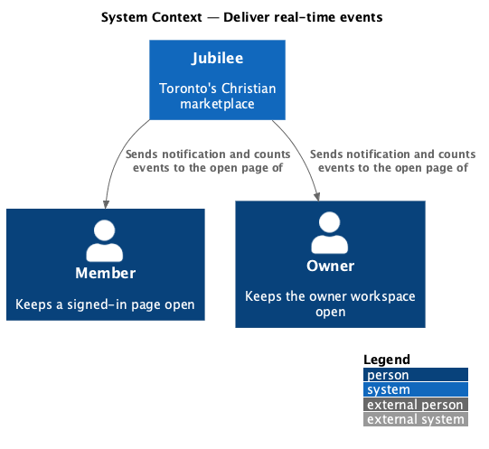
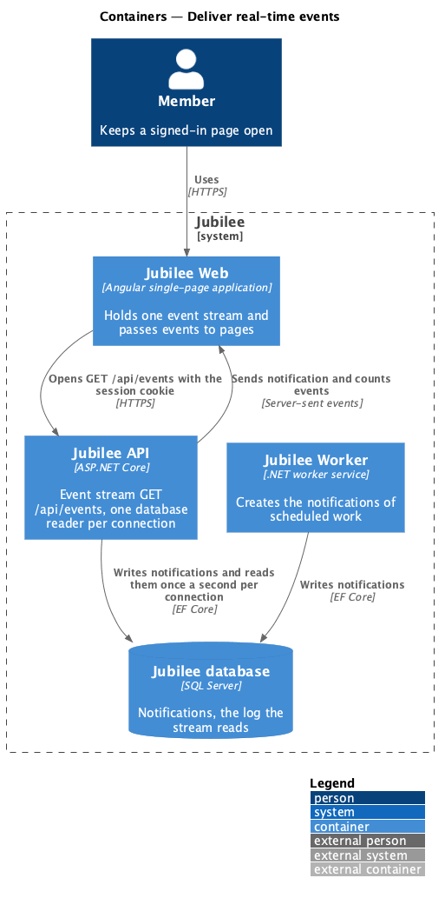
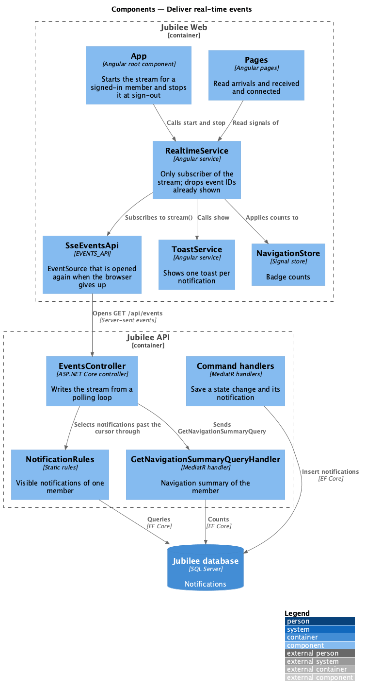
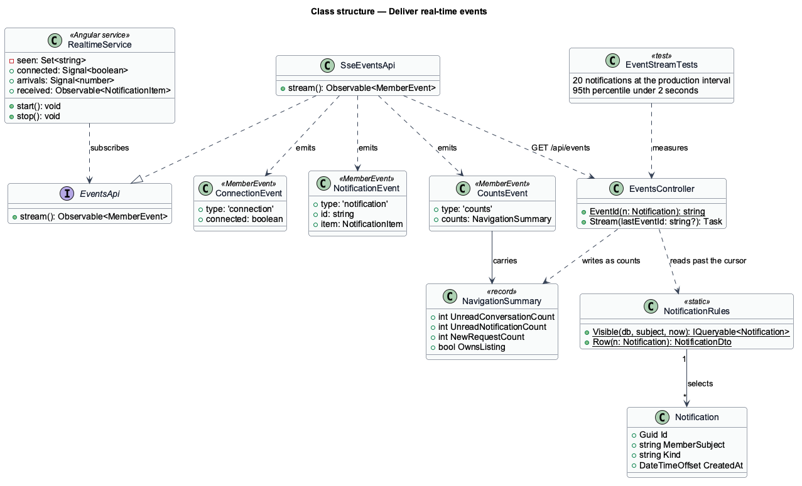
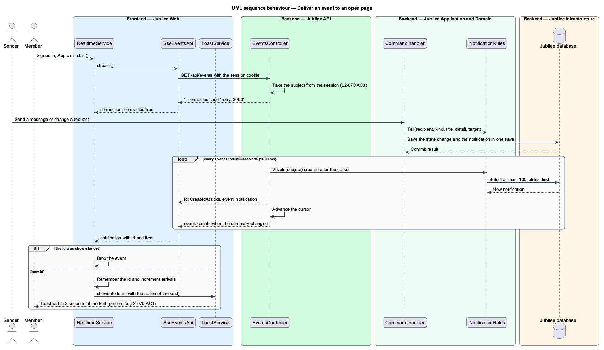
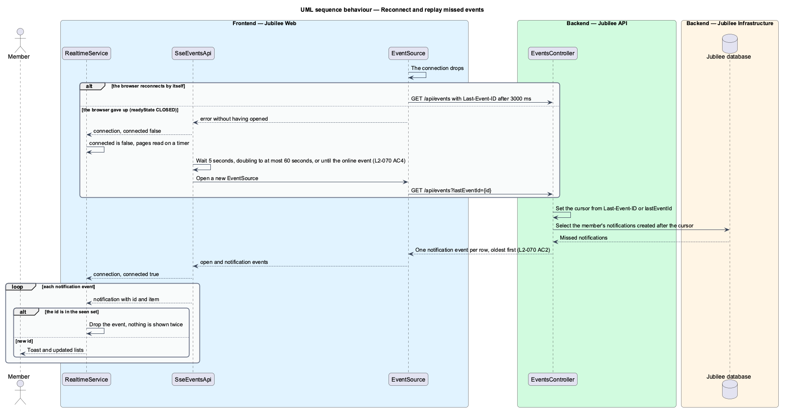

# Deliver real-time events

## Overview

Jubilee is Toronto's Christian marketplace, in which members message verified
businesses and send them requests. Several pages change while they are open: a
reply arrives in a conversation, a request is confirmed, a badge count rises.
This feature covers the transport that carries those changes from the server to
an open, signed-in page without a reload.

The terms below are local to this feature.

- **event stream** — long-lived response of `GET /api/events`, in the server-sent events format, that carries one member's events to one open page
- **notification event** — event named `notification` whose data is one notification of the member
- **counts event** — event named `counts` whose data is the member's navigation summary, the same shape as `GET /api/me/navigation`
- **event ID** — `CreatedAt` of a notification in ticks, which orders the notification events of one member
- **cursor** — instant up to which a connection has sent the member's notifications
- **replay** — delivery, after a reconnect, of the notifications created after the last event ID the page received

The stream carries two events, `notification` and `counts`, and no other. A
message or a request event reaches the page as the notification it creates
(ADR 0025, ADR 0039). A notification reaches the page within `2 seconds` at the
95th percentile. A client receives only events addressed to its authenticated
member. After a dropped connection the page receives what it missed, and no
event is shown twice.

The feature is infrastructure for other slices. `exchange-messages`,
`read-inbox`, `view-notification-centre` and `show-toasts-and-banners` consume
its events; none of them opens a connection of its own. A `message` or
`request` notification makes the open conversation and the inbox list read
again, and the `counts` event corrects the unread count.

## Description

The feature spans `Jubilee Web`, `Jubilee API` and `Jubilee database`. It uses
no WebSocket, no hub, no cache and no backplane: each connection reads the
member's notifications from the database (ADR 0025, ADR 0053).

- **`EventsApi`** and **`SseEventsApi`** — contract behind the token
  `EVENTS_API` and its implementation over the browser's `EventSource`.
  `stream()` returns an observable of `MemberEvent`; unsubscribing closes the
  connection. The browser sends the session cookie, reconnects by itself after
  a stream ends and echoes `Last-Event-ID`.
- **`MemberEvent`** — union of `{ type: 'connection', connected }`,
  `{ type: 'notification', id, item }` and `{ type: 'counts', counts }`.
  `SseEventsApi` emits `connected: true` when the `EventSource` opens and
  `connected: false` when an attempt to connect fails without having opened. A
  stream that ends and is opened again by the browser never counted as down
  (ADR 0050).
- **Opening the stream again** — the browser gives up when the server refuses
  a connection or the device is offline; `EventSource.readyState` is then
  `CLOSED`. `SseEventsApi` opens a new `EventSource` after `5 seconds`,
  doubling the wait to at most `60 seconds`, and at once on the browser's
  `online` event. It passes the last event ID as `?lastEventId=`, because a
  new `EventSource` sends no `Last-Event-ID` header (L2-070 AC4, ADR 0053).
- **`RealtimeService`** — Angular service and the only subscriber of the
  stream. `App` calls `start()` when a member is signed in and `stop()` at
  sign-out. It keeps a set of the event IDs it has shown and drops an event
  whose ID is in the set. For each new notification it increments `arrivals`,
  emits the item on `received` and raises a toast; it passes each `counts`
  event to `NavigationStore.apply`.
- **`RealtimeService.connected`** — signal that is `false` from the moment an
  attempt to connect fails until one opens. A page that shall not miss an
  event reads on a timer while it is `false` (ADR 0050).
- **`EventsController`** — ASP.NET Core controller for `GET /api/events`. The
  endpoint requires authentication under the fallback policy, so a request
  without a valid session receives HTTP `401`. The controller answers
  `text/event-stream` with `Cache-Control: no-cache` and
  `X-Accel-Buffering: no`, and first writes `retry: 3000`, the wait the browser
  uses between its own reconnects.
- **Subject** — the controller takes the member's subject from the session and
  reads only that member's notifications. The request offers no parameter that
  names another member, so a client cannot subscribe to another member's
  events (L2-070 AC3).
- **Cursor and event ID** — the cursor starts at the `Last-Event-ID` header,
  or at the query parameter `lastEventId`, or at the current time when neither
  is present. `EventsController.EventId` is the notification's `CreatedAt` in
  UTC ticks, so IDs only grow.
- **Polling loop** — each pass opens a scope, selects through
  `NotificationRules.Visible` at most `100` notifications created after the
  cursor, oldest first, writes each as a `notification` event with its `id`,
  and advances the cursor. It then sends `GetNavigationSummaryQuery` and
  writes a `counts` event when the summary differs from the last one sent. The
  wait between passes is `Events:PollMilliseconds`, `1000 ms` by default.
- **Heartbeat** — the comment line `: ping` after `Events:HeartbeatSeconds`,
  `15 seconds` by default, without another write, which keeps proxies from
  closing an idle connection.
- **No event log** — the notifications table is the log. Replay reads it from
  the cursor, and the `90 days` window of `NotificationRules` bounds how far
  back a replay reaches.
- **More than one instance** — a notification is a row in the database
  whichever process created it, `Jubilee API` or `Jubilee Worker`, and each
  connection reads the database. An event therefore reaches the page whichever
  instance holds the connection (L2-070 AC5).
- **Measured latency** — `EventStreamTests` times, at the production polling
  interval, how long each of `20` notifications takes from its save to its
  frame on an open stream, and asserts that the 95th percentile is under
  `2 seconds`. The test measures the API; the network between the host and a
  phone is measured in production.

## Requirements

The feature realizes the following level-2 (L2) requirement. It refines a
level-1 (L1) requirement, cited by identifier. The connection banner and its
back-off (L2-121) belong to connectivity resilience and read `ConnectionService`,
not this stream.

| L2 ID | Refines (L1) | Requirement |
|-------|--------------|-------------|
| `L2-070` | `L1-010` | A notification, message or request event for a user shall reach that user's open signed-in page within 2 seconds at the 95th percentile over a persistent connection (WebSocket or server-sent events). After a reconnect, the events missed since the last received event ID shall be delivered and nothing shall be shown twice. A client shall receive only events addressed to its authenticated user. When the browser has given up on the connection, the page shall open the stream again by itself from the last received event ID, waiting 5 seconds at first and at most 60 seconds between attempts. With more than one instance of the API, an event shall reach the page whichever instance holds its connection, without a backplane between instances. |

## Diagrams

### System context

Jubilee sends events to members and owners who keep a signed-in page open. The
feature involves no external system.

### Containers

`Jubilee Web` holds one event stream to `Jubilee API`. `Jubilee API` and
`Jubilee Worker` write notifications to `Jubilee database`, and the stream
reads them from there once a second.

### Components

`App` starts `RealtimeService`, which subscribes to `SseEventsApi` and passes
events to `ToastService`, `NavigationStore` and the pages that read `arrivals`
or `received`. In the API, `EventsController` reads through `NotificationRules`
and `GetNavigationSummaryQueryHandler`.

### Class structure

`RealtimeService` subscribes to `EventsApi`, implemented by `SseEventsApi`, and
receives `MemberEvent` values. `EventsController` writes them from
`Notification` rows and the `NavigationSummary`.

### Behaviour — deliver an event to an open page

A command handler saves a state change with its notification. At its next pass
`EventsController` finds the row past the cursor and writes it to the
addressed member's stream; `RealtimeService` drops a duplicate before raising
the toast.

### Behaviour — reconnect and replay missed events

When a stream ends, the browser reconnects with `Last-Event-ID`. When the
browser has given up, `SseEventsApi` opens a new `EventSource` with
`?lastEventId=` after a wait of `5` to `60 seconds`, or at once when the
browser is online again. In both cases the server sends the notifications
created after that ID and the client discards IDs already shown.

