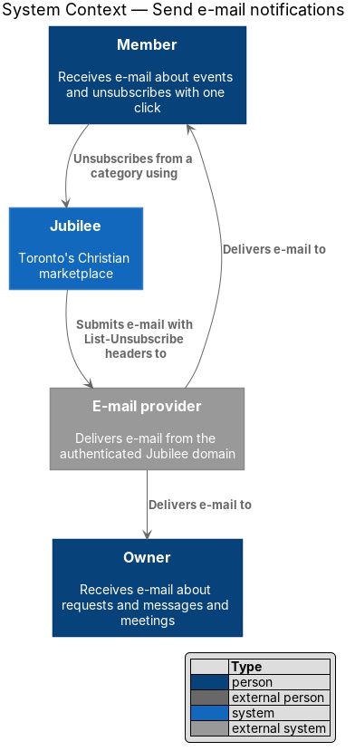
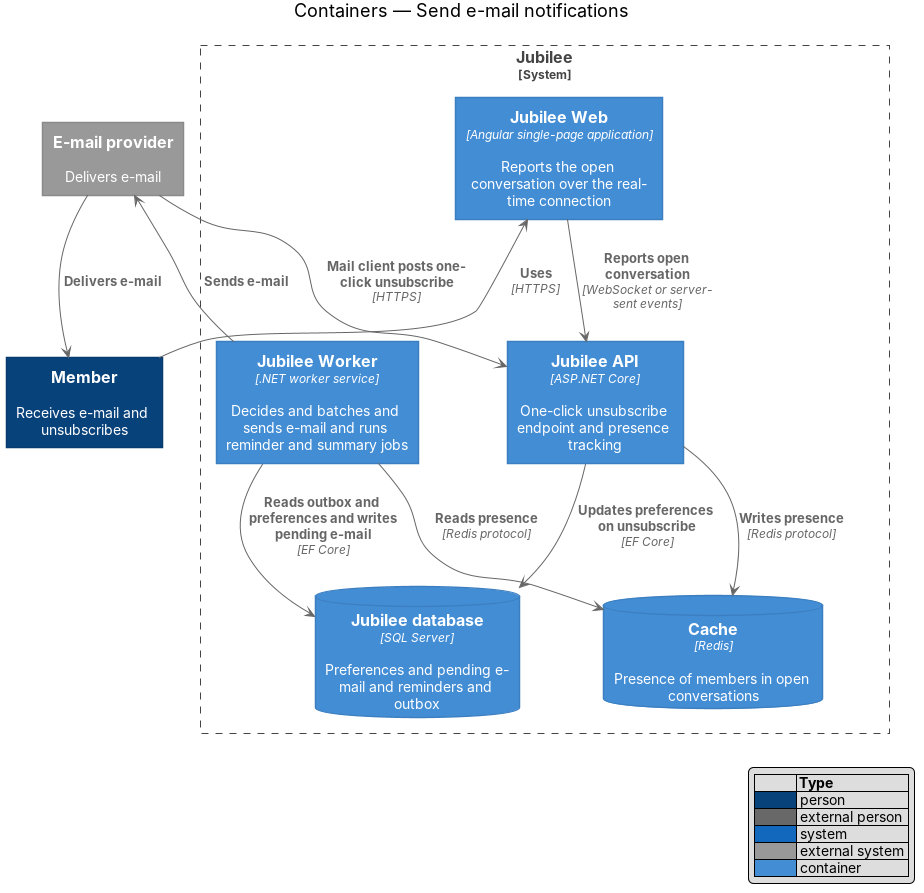
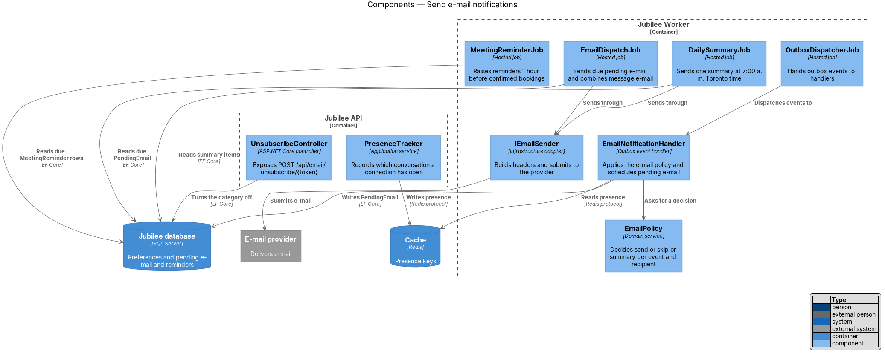
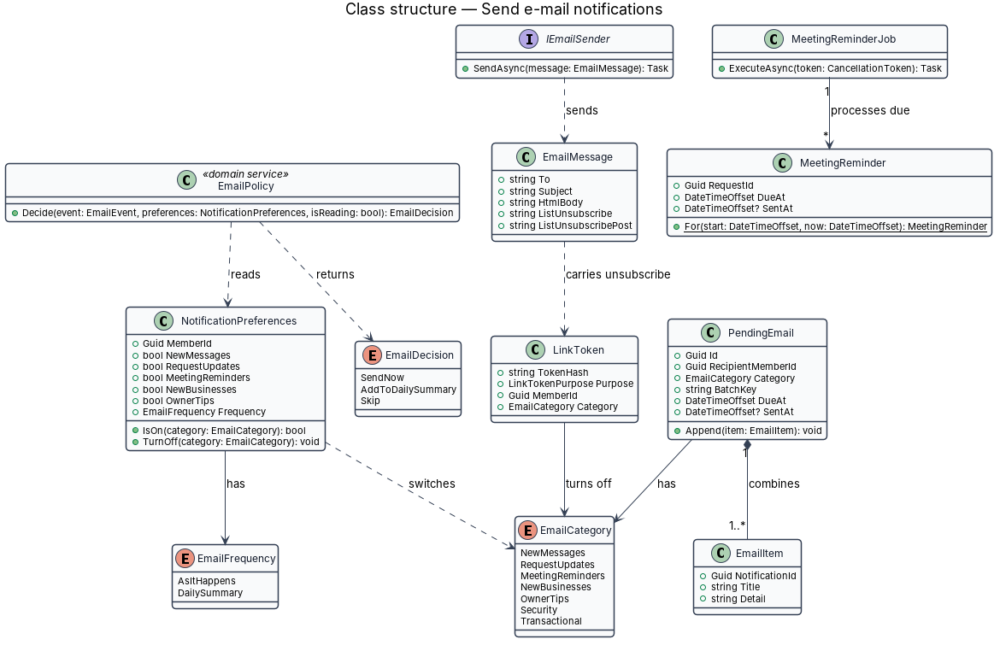
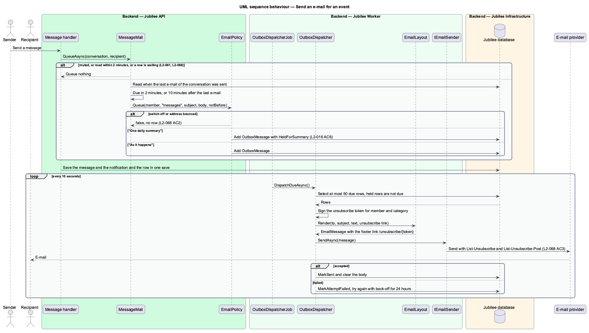
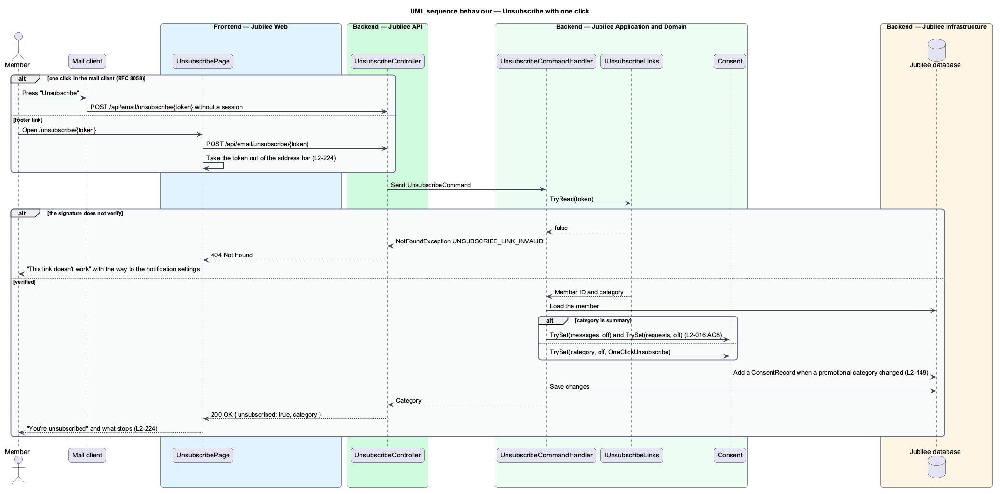
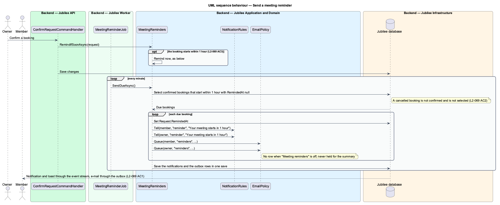

# Send e-mail notifications

## Overview

Jubilee is Toronto's Christian marketplace, in which members message verified
businesses and send them booking, quote and order requests. The notifications
subsystem tells members and owners about events that concern them. This feature
covers the e-mail channel: deciding whether an event produces an e-mail,
combining and sending it, honouring one-click unsubscribe, and sending meeting
reminders.

The terms below are local to this feature.

- **category** — group of e-mails a member can turn on or off: "New messages", "Request updates", "Meeting reminders", "New businesses", "Tips for business owners"
- **transactional e-mail** — e-mail sent regardless of preferences: confirmation, reset, verification decisions
- **daily summary** — single e-mail that collects a day's events for a member who chose "One daily summary"
- **presence** — short-lived record that a member has a given conversation open right now
- **meeting reminder** — notice sent 1 hour before a confirmed booking starts

Every event still creates its in-app notification (`view-notification-centre`).
E-mail is an additional channel that depends on the member's settings at
`/account/notifications` (L2-016). An e-mail for an enabled category leaves
within `2 minutes` of the event. No e-mail is sent for a new message in a
conversation the recipient is reading at that moment, or in a conversation the
recipient muted (L2-061).

The feature runs in `Jubilee Worker`. It has no page of its own; its only
inbound route is the unsubscribe endpoint that mail clients call.

## Description

The building blocks are background handlers and jobs, one domain service and one
API controller.

- **`EmailNotificationHandler`** — outbox event handler in `Jubilee Worker`. For
  each event and recipient it loads `NotificationPreferences`, reads presence
  and the mute flag for message events, asks `EmailPolicy` for a decision, and
  writes a `PendingEmail` when the decision is to send.
- **`EmailPolicy`** — domain service. It returns `SendNow` for transactional and
  security e-mail whatever the preferences; `Skip` when the category is off, the
  conversation is muted, or the recipient is reading the conversation;
  `AddToDailySummary` when the frequency is `DailySummary`; otherwise `SendNow`.
  Meeting reminders are sent immediately even with a daily summary (L2-016).
- **`NotificationPreferences`** — domain entity with one switch per category and
  an `EmailFrequency` of `AsItHappens` or `DailySummary`.
- **`PresenceTracker`** — application service in `Jubilee API`. `EventsHub`
  records in `Cache` which conversation each connection has open and clears the
  record when the page closes or the connection drops. The expiry of a presence
  record is `<TO SUPPLY>`.
- **`PendingEmail`** — row holding one e-mail to send, with `Category`,
  `BatchKey`, `DueAt` and its `EmailItem` entries. For new messages the batch key
  is the recipient and the conversation. Messages that arrive before the row is
  sent join it. After an e-mail for a conversation is sent, further messages in
  that conversation within `10 minutes` collect in one follow-up row, so they
  produce one e-mail.
- **`EmailDispatchJob`** — hosted job. It reads due `PendingEmail` rows, renders
  one e-mail per row and sends it through `IEmailSender`. The polling interval is
  `<TO SUPPLY>` and shall keep the time from event to send within `2 minutes`.
- **`DailySummaryJob`** — hosted job. At `7:00 a.m.` Toronto time it sends each
  member with summary items one e-mail covering the previous day (L2-016).
- **`IEmailSender`** — infrastructure adapter for the `E-mail provider` (vendor
  `<TO SUPPLY>`). It sends from a domain with aligned SPF, DKIM and DMARC; the
  sending domain is `<TO SUPPLY>`. On every non-security e-mail it sets the
  RFC 8058 headers `List-Unsubscribe` and
  `List-Unsubscribe-Post: List-Unsubscribe=One-Click`.
- **`LinkToken`** — the unsubscribe link carries a token with
  `LinkTokenPurpose.Unsubscribe`, bound to one member and one category. The
  database stores only the token hash. The token lifetime is `<TO SUPPLY>`.
- **`UnsubscribeController`** — ASP.NET Core controller for
  `POST /api/email/unsubscribe/{token}`. The route accepts the request without a
  session and is exempt from `CsrfMiddleware`; the token is the credential.
  `UnsubscribeCommandHandler` calls `NotificationPreferences.TurnOff` for the
  token's category. An unknown token returns HTTP `404`. The page shown to a
  person who opens the link in a browser is `<TO SUPPLY>`.
- **`MeetingReminder`** — row created when a booking is confirmed, due
  `1 hour` before the start. When the booking is confirmed less than `1 hour`
  before it starts, the row is due at once. Cancelling the booking deletes an
  unsent row.
- **`MeetingReminderJob`** — hosted job. It reads due, unsent reminders for
  bookings that are still confirmed, sets `SentAt`, and writes a
  `MeetingReminderDue` `OutboxMessage` in the same transaction.
  `NotificationProjector` then creates the notification "Your meeting starts in
  1 hour" for the member and the owner and publishes the real-time event that
  raises a toast for those online. `EmailNotificationHandler` sends the e-mail to
  each recipient whose "Meeting reminders" switch is on.

## Requirements

The feature realizes the following level-2 (L2) requirements. Each L2
requirement refines a level-1 (L1) requirement, cited by identifier.

| L2 ID | Refines (L1) | Requirement |
|-------|--------------|-------------|
| `L2-068` | `L1-010` | An e-mail shall be sent within 2 minutes of an event for which the member has e-mail turned on, or included in the next daily summary if chosen; no e-mail shall be sent for an event the member turned off or for a message in a conversation being read. Every non-security e-mail shall carry a one-click unsubscribe link, and every transactional e-mail shall be sent regardless of preferences from an authenticated domain. |
| `L2-069` | `L1-010` | One hour before a confirmed booking starts, the member and the owner shall get an in-app notification, a toast if online, and an e-mail if "Meeting reminders" is on. No reminder shall be sent for a booking cancelled before that time, and a booking confirmed less than 1 hour before its start shall produce a reminder immediately. |
| `L2-016` | `L1-002` | At `/account/notifications` a member shall choose which e-mails they get and how often. Each switch shall save on its own as soon as it changes. |
| `L2-061` | `L1-009` | A member may mute a conversation so that no e-mail is sent about new replies in it while in-app unread counts still update. Unmuting shall resume the e-mails. |

## Diagrams

### System context

Jubilee submits e-mail to the external e-mail provider, which delivers it to
members and owners. A member unsubscribes from a category through Jubilee.

### Containers

`Jubilee Worker` reads the outbox and preferences from `Jubilee database`,
reads presence from `Cache`, and sends through the `E-mail provider`.
`Jubilee API` records presence reported by `Jubilee Web` and receives one-click
unsubscribe requests.

### Components

`OutboxDispatcherJob` hands events to `EmailNotificationHandler`, which consults
`EmailPolicy` and writes `PendingEmail` rows. `EmailDispatchJob` and
`DailySummaryJob` send through `IEmailSender`; `MeetingReminderJob` raises
reminders. In the API, `UnsubscribeController` updates preferences and
`PresenceTracker` writes presence.

### Class structure

`EmailPolicy` reads `NotificationPreferences` and returns an `EmailDecision`.
`PendingEmail` combines one or more `EmailItem` entries under an `EmailCategory`.
`IEmailSender` sends an `EmailMessage` that carries an unsubscribe `LinkToken`.
`MeetingReminderJob` processes due `MeetingReminder` rows.

### Behaviour — send an e-mail for an event

The handler gathers preferences, presence and the mute flag, and the policy
decides. A `SendNow` decision joins or creates a `PendingEmail`;
`EmailDispatchJob` sends each due row with the unsubscribe headers.

### Behaviour — unsubscribe with one click

The mail client posts to the unsubscribe route without a session. The handler
resolves the token to a member and a category and turns that category off.

### Behaviour — send a meeting reminder

Confirming a booking stores a `MeetingReminder`; cancelling deletes it.
`MeetingReminderJob` turns a due reminder into an outbox event, from which the
notification, the toast and the e-mail follow.

