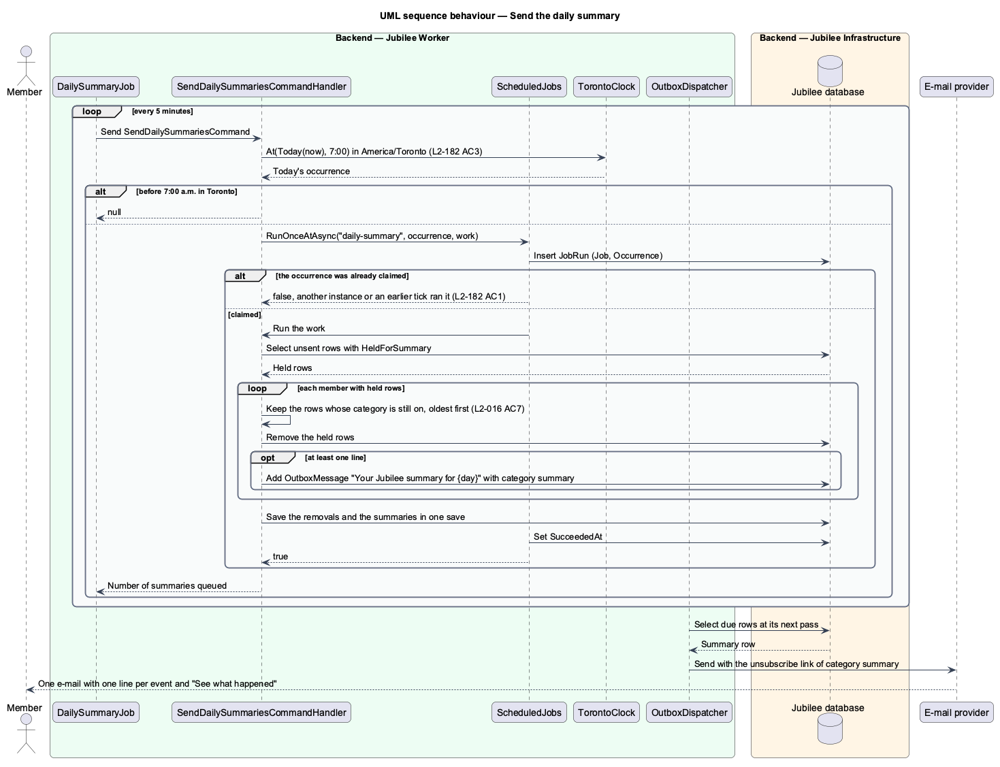

# Send e-mail notifications

## Overview

Jubilee is Toronto's Christian marketplace, in which members message
businesses and send them booking, quote and order requests. The notifications
subsystem tells members and owners about events that concern them. This feature
covers the e-mail channel: deciding whether an event produces an e-mail,
holding it for the daily summary or sending it, combining a burst of messages,
honouring one-click unsubscribe, and the scheduled e-mails: meeting reminders,
the daily summary, the weekly note about new businesses and the tips for
business owners.

The terms below are local to this feature.

- **category** — group of e-mails a member can turn on or off: "New messages" (`messages`), "Request updates" (`requests`), "Meeting reminders" (`reminders`), "New businesses" (`new-businesses`), "Tips for business owners" (`tips`)
- **transactional e-mail** — e-mail without a category, sent regardless of preferences: confirmation, reset, a listing taken down by the Jubilee team
- **promotional e-mail** — e-mail of the categories "New businesses" and "Tips for business owners", sent only with consent (L2-149)
- **outbox** — table of `OutboxMessage` rows, each one e-mail waiting to be sent by `Jubilee Worker`
- **held row** — outbox row marked `HeldForSummary`, which waits for the daily summary and is never sent itself
- **daily summary** — single e-mail that says, one line each, the held rows of a member who chose "One daily summary"
- **meeting reminder** — notice sent 1 hour before a confirmed booking starts
- **occurrence** — instant a run of a scheduled job is for, such as today's 7:00 a.m. in Toronto

Every event still creates its in-app notification (`view-notification-centre`).
E-mail is an additional channel that depends on the member's settings at
`/account/notifications` (L2-016). No e-mail is sent for a new message in a
conversation the recipient is reading at that moment, or in a conversation the
recipient muted (L2-061).

The handler of an event queues its e-mail in the outbox in the same save as
the event. `Jubilee Worker` sends the outbox and runs the scheduled e-mails.
The feature has one page of its own, the unsubscribe page at
`/unsubscribe/{token}` (L2-224).

## Description

The building blocks are one policy, the outbox, six hosted jobs, one API
controller and one page. No event handler, presence record or cache takes part
(ADR 0025, ADR 0053).

- **`EmailPolicy`** — static policy in `Jubilee.Application`. `Queue` adds no
  row and returns `false` when `Member.WantsEmail(category)` is false: the
  category is off or the address bounced. Otherwise it adds an
  `OutboxMessage` marked with its category. The row is marked
  `HeldForSummary` when `Member.EmailDailySummary` is on and
  `EmailCategories.IsHeldForSummary` holds, which is the case for `messages`
  and `requests` only (L2-016 AC6).
- **`Member`** — holds the five switches `EmailMessages`, `EmailRequests`,
  `EmailReminders`, `EmailNewBusinesses` and `EmailTips`, the frequency
  `EmailDailySummary`, the flag `EmailBounced` and the count `TipsSent`.
- **`EmailCategories`** — the constants `messages`, `requests`, `reminders`,
  `new-businesses` and `tips`, and `summary`, which is the category of the
  daily summary and not a switch.
- **`OutboxMessage`** — one e-mail: `ToAddress`, `Subject`, `TextBody`,
  `MemberId`, `Category`, `CorrelationId`, `NextAttemptAt` and
  `HeldForSummary`. `IsDue` is false for a held row. A failed attempt sets
  `NextAttemptAt` with a back-off of `2^n minutes`, at most `240 minutes`, and
  the row is given up `24 hours` after it was created. A row without a
  category is transactional and carries no unsubscribe link.
- **`MessageMail`** — rule for the e-mail about a new message. It queues
  nothing when the recipient muted the conversation (L2-061), when the
  recipient read the conversation less than `2 minutes` ago (`Reading`), or
  when a row for the same conversation and recipient is still waiting. A new
  row is due `2 minutes` after the message (`Wait`); when an e-mail for the
  conversation was sent less than `10 minutes` ago (`Combine`), the row is due
  `10 minutes` after that e-mail. A burst therefore produces one e-mail
  (L2-068 AC5).
- **Request updates** — the request handlers call `EmailPolicy.Queue` with the
  category `requests` and the request ID as `CorrelationId`. An unsent row,
  held or not, is withdrawn with its request.
- **`OutboxDispatcher`** — application service. `DispatchDueAsync` takes at
  most `50` due rows, oldest first, renders each through `EmailLayout.Render`,
  sends it through `IEmailSender` and marks it sent. A held row is not due and
  is skipped.
- **`OutboxDispatcherJob`** — hosted job that runs `OutboxDispatcher` every
  `Worker:OutboxIntervalSeconds`, `10 seconds` by default.
- **`EmailLayout`** — renders the HTML part from the text a handler wrote and
  adds the footer. For a row with a category the footer says "You get this
  e-mail because of your notification settings." with the link "Unsubscribe
  from e-mails like this" to `{PublicBaseUrl}/unsubscribe/{token}`. The footer
  of a promotional e-mail also prints the mailing address.
- **`IEmailSender`** — adapter for the e-mail provider.
  `AzureCommunicationEmailSender` sends through Azure Communication Services
  Email from `no-reply@notify.jubilee.to`, a domain with aligned SPF, DKIM and
  DMARC (ADR 0038). When `EmailMessage.UnsubscribeUrl` is set it adds the
  RFC 8058 headers `List-Unsubscribe`, which names the API address
  `{PublicBaseUrl}/api/email/unsubscribe/{token}`, and
  `List-Unsubscribe-Post: List-Unsubscribe=One-Click`. `LoggingEmailSender`
  stands in when no provider is configured.
- **`IUnsubscribeLinks`** and **`HmacUnsubscribeLinks`** — the token of an
  unsubscribe link is the member ID and the category, signed with
  HMAC-SHA256 under the key `Email:UnsubscribeKey`. No token is stored and a
  token does not expire; `TryRead` compares the signature in constant time.
- **`UnsubscribeController`** — ASP.NET Core controller for
  `POST /api/email/unsubscribe/{token}`, marked `[AllowAnonymous]`. The token
  is the credential. `CsrfMiddleware` passes a request that carries no session
  cookie, which is how a mail client calls it. The answer is
  `{ unsubscribed: true, category }`.
- **`UnsubscribeCommandHandler`** — reads the token and turns the category off
  through `Consent.TrySet` with `ConsentMethod.OneClickUnsubscribe`. For the
  category `summary` it turns off `messages` and `requests` (L2-016 AC8). A
  token that does not verify, an unknown member or an unknown category returns
  HTTP `404` with the code `UNSUBSCRIBE_LINK_INVALID`. Repeating the call
  changes nothing more.
- **`UnsubscribePage`** — Angular page at `/unsubscribe/:token` in the `bare`
  shell, without sign-in. It posts the token, removes it from the address bar
  and says "You're unsubscribed" with what stops, "Notification settings" and
  "Browse businesses". An invalid link shows "This link doesn't work"; a
  failed request shows the reference `JB-PREF-503` with "Try again". A mail
  scanner that fetches the link receives the application shell and changes
  nothing, because only the script posts.
- **`MeetingReminders`** — application service. `SendDueAsync` selects each
  confirmed booking that starts within `1 hour` (`Lead`) and whose
  `Request.RemindedAt` is null, sets `RemindedAt`, tells the member and the
  owner "Your meeting starts in 1 hour" through `NotificationRules.Tell`, and
  queues the e-mail for each through `EmailPolicy.Queue` with the category
  `reminders`. A cancelled booking is not confirmed and is not selected.
  `ConfirmRequestCommandHandler` calls `RemindIfSoonAsync`, which reminds at
  once a booking confirmed less than `1 hour` before it starts. A reminder is
  never held for the summary.
- **`MeetingReminderJob`** — hosted job that runs `MeetingReminders.SendDueAsync`
  every `1 minute`.
- **`ScheduledJobs`** and **`JobRun`** — `RunOnceAtAsync(job, occurrence, work)`
  inserts a `JobRun` with the key (`Job`, `Occurrence`) before the work, so of
  the instances that reach an occurrence one does the work, and records
  `SucceededAt` after it (L2-182 AC1, ADR 0050). The three scheduled e-mails
  compute their occurrence with `TorontoClock.At`, which is correct on either
  side of a clock change (L2-182 AC3).
- **`SendDailySummariesCommandHandler`** — returns without work before today's
  7:00 a.m. in Toronto. After it, under the job name `daily-summary`, it
  groups the held rows by member, deletes them, and queues one e-mail per
  member: subject "Your Jubilee summary for {day}", one line per held row (its
  subject) in the order the rows were created, and the button "See what
  happened" to `/notifications`. A row whose category the member has turned
  off since is left out, and a member with no line gets no e-mail. The summary
  row has the category `summary` and is sent by `OutboxDispatcher`.
- **`DailySummaryJob`** — hosted job that sends `SendDailySummariesCommand`
  every `5 minutes`. An instance that was down at 7:00 still sends that day's
  summary when it starts.
- **`SendNewBusinessNotesCommandHandler`** and **`NewBusinessNoteJob`** — job
  `new-business-note`, Monday 7:00 a.m. in Toronto. Each member with
  `EmailNewBusinesses` on and a confirmed address gets one e-mail "New on
  Jubilee this week" ("These businesses joined Jubilee this week in categories
  you’ve browsed.") that lists the public listings published (`PublishedAt`) in
  the last `7 days` (`Covers`) in the categories `BrowsedCategories` returns for the
  member, each with its name, category and link. A member with none, and the
  owner of a listing for that listing, gets no e-mail (L2-222).
- **`OwnerTips`**, **`SendOwnerTipsCommandHandler`** and **`OwnerTipJob`** —
  job `owner-tips`, the first day of the month, 7:00 a.m. in Toronto.
  `OwnerTips.Series` holds the tips in code. Each owner of a public listing
  with `EmailTips` on and a confirmed address gets the tip at index
  `Member.TipsSent`, with the subject "A tip for your Jubilee listing:
  {title}", and `Member.MarkTipSent` raises the count by one; an owner who has
  had each tip gets none (L2-223).
- **`EmailSettings`** — `MailingAddress`, read from `Email:MailingAddress`.
  While it is empty `CanSendPromotional` is false and the weekly note and the
  tips are not sent: the jobs run,
  record their success and queue nothing (L2-149 AC1). Both are sent whatever
  the member chose under "How often".

## Requirements

The feature realizes the following level-2 (L2) requirements. Each L2
requirement refines a level-1 (L1) requirement, cited by identifier.

| L2 ID | Refines (L1) | Requirement |
|-------|--------------|-------------|
| `L2-068` | `L1-010` | An e-mail shall be sent within 2 minutes of an event for which the member has e-mail turned on, or included in the next daily summary if chosen; no e-mail shall be sent for an event the member turned off or for a message in a conversation being read. Every non-security e-mail shall carry a one-click unsubscribe link, and every transactional e-mail shall be sent regardless of preferences from an authenticated domain. |
| `L2-069` | `L1-010` | One hour before a confirmed booking starts, the member and the owner shall get an in-app notification, a toast if online, and an e-mail if "Meeting reminders" is on. No reminder shall be sent for a booking cancelled before that time, and a booking confirmed less than 1 hour before its start shall produce a reminder immediately. |
| `L2-016` | `L1-002` | At `/account/notifications` a member shall choose which e-mails they get and how often. With "One daily summary" the member shall get at most one summary e-mail a day, sent at 7:00 a.m. Toronto time, that says each held event of "New messages" and "Request updates" in one line; its unsubscribe shall turn both categories off (AC6 to AC8). |
| `L2-061` | `L1-009` | A member may mute a conversation so that no e-mail is sent about new replies in it while in-app unread counts still update. Unmuting shall resume the e-mails. |
| `L2-149` | `L1-020` | Promotional e-mails ("New businesses", "Tips for business owners") shall go only to members who opted in, shall identify Jubilee with a mailing address and shall include an unsubscribe. While no mailing address is configured, no promotional e-mail shall be sent. |
| `L2-182` | `L1-025` | Each scheduled job shall be idempotent, shall run at most once per schedule across instances, shall record its last success, and shall compute reminder and summary times in America/Toronto. |
| `L2-222` | `L1-010` | A member who turned on "New businesses" shall hear of newly published businesses in the categories they have browsed: in the app as each one is published, and by e-mail in one weekly note on Monday at 7:00 a.m. in Toronto. |
| `L2-223` | `L1-010` | An owner who turned on "Tips for business owners" shall get a short series of tips, one a month, each sent once, at 7:00 a.m. in Toronto on the first day of a month. |
| `L2-224` | `L1-010` | The link in the footer of a notification e-mail shall open `/unsubscribe/{token}`, which turns the e-mail's category off and says so without sign-in. |

## Diagrams

### System context

Jubilee submits e-mail to the external e-mail provider, which delivers it to
members and owners. A member unsubscribes from a category through Jubilee, from
the mail client or from the unsubscribe page.

### Containers

`Jubilee API` queues e-mail in the outbox in `Jubilee database` and receives
unsubscribe requests. `Jubilee Worker` reads the outbox, runs the scheduled
e-mails and sends through the `E-mail provider`. `Jubilee Web` serves the
unsubscribe page.

### Components

Command handlers and `MessageMail` queue through `EmailPolicy`.
`OutboxDispatcherJob` sends due rows through `OutboxDispatcher`, `EmailLayout`
and `IEmailSender`. `MeetingReminderJob`, `DailySummaryJob`,
`NewBusinessNoteJob` and `OwnerTipJob` queue the scheduled e-mails, the last
three once per occurrence through `ScheduledJobs`. In the API,
`UnsubscribeController` turns a category off.

### Class structure

`EmailPolicy` reads the switches of `Member` and adds `OutboxMessage` rows.
`OutboxDispatcher` renders each due row into an `EmailMessage` whose
unsubscribe link `IUnsubscribeLinks` signs. `ScheduledJobs` claims a `JobRun`
per occurrence for the summary, the weekly note and the tips.

### Behaviour — send an e-mail for an event

`MessageMail` checks the mute flag, the reading time and a waiting row, and
`EmailPolicy` checks the switch and the frequency. A row that is not held is
sent by `OutboxDispatcher` once it is due, with the unsubscribe headers and
the footer link.

### Behaviour — send the daily summary

`DailySummaryJob` ticks every `5 minutes`. After 7:00 a.m. in Toronto the
handler claims the day's occurrence, turns each member's held rows into one
e-mail and deletes them in the same save. `OutboxDispatcher` sends the summary
at its next pass.

### Behaviour — unsubscribe with one click

The mail client posts to the API address of the `List-Unsubscribe` header; a
person who presses the footer link opens `UnsubscribePage`, which posts the
same token. The handler verifies the signature and turns the category off.

### Behaviour — send a meeting reminder

`MeetingReminderJob` selects each confirmed booking that starts within the
hour and has no `RemindedAt`. `MeetingReminders` marks it, tells both sides in
the app and queues the e-mail for each side whose "Meeting reminders" switch
is on. A booking confirmed inside the hour is reminded when it is confirmed.

