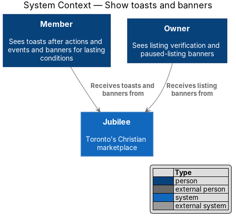
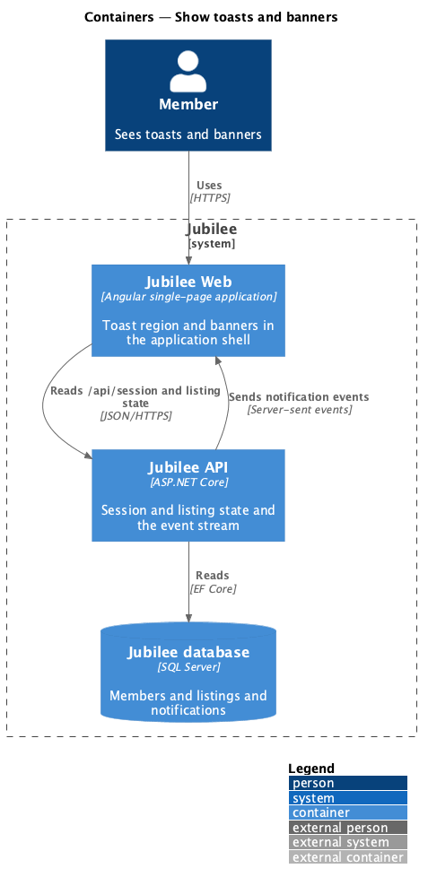
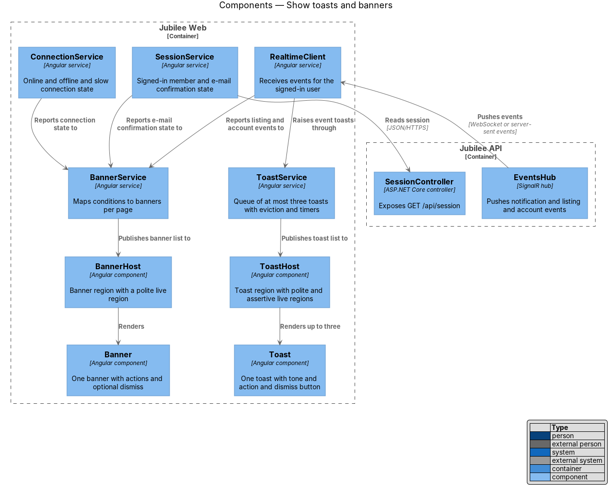
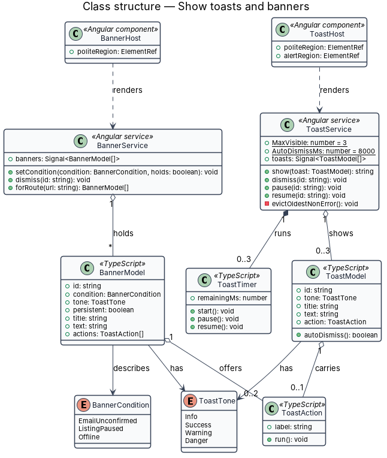
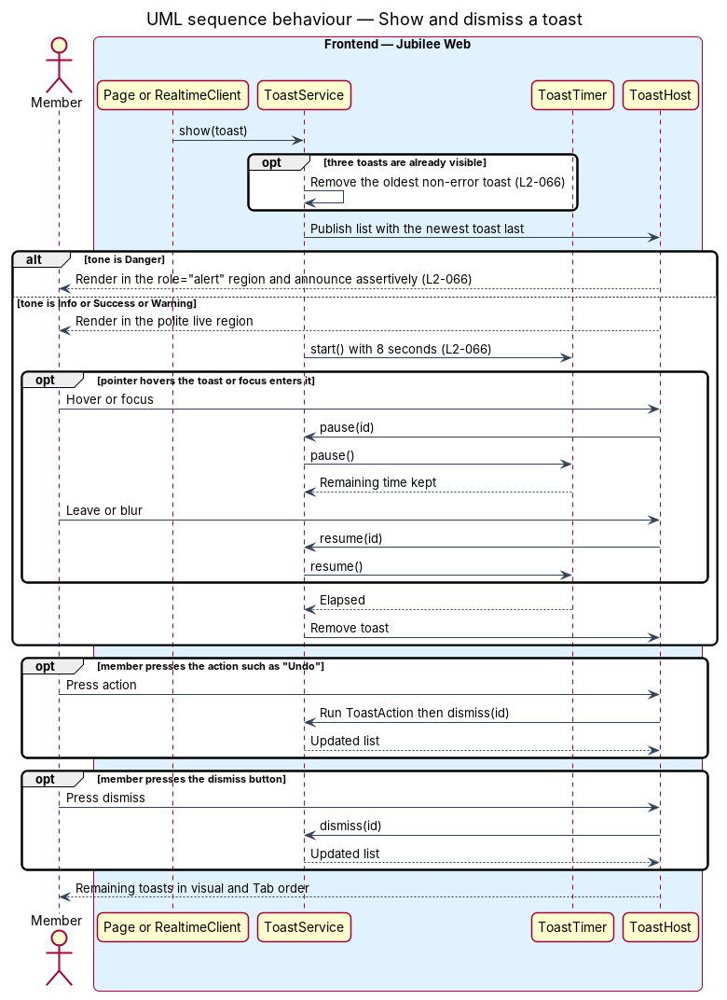
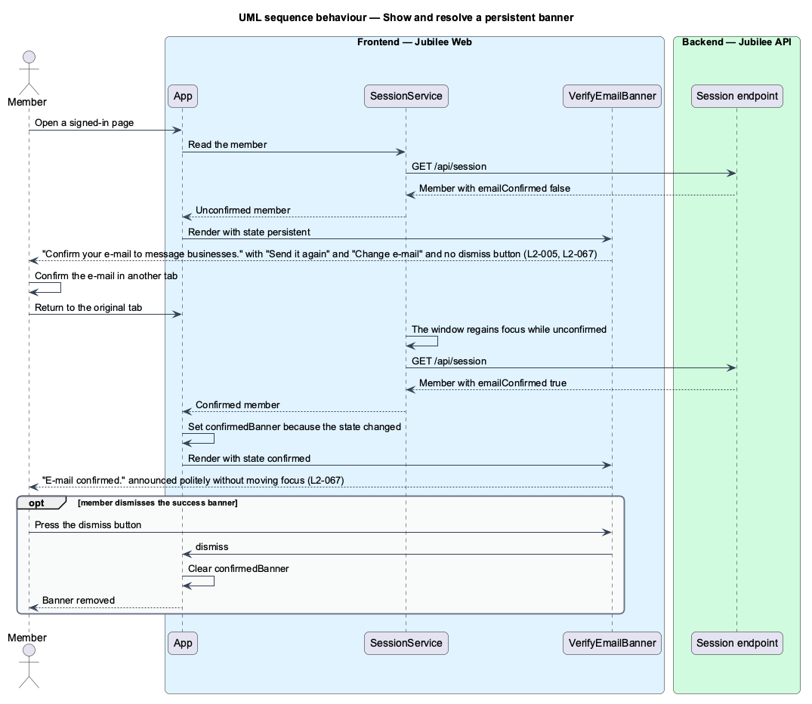

# Show toasts and banners

## Overview

Jubilee is Toronto's Christian marketplace, in which members message
businesses and send them requests. The notifications subsystem tells members
and owners about events that concern them. This feature covers the two transient
surfaces inside the page: toasts and banners. Both are components of the
`components` library that every other feature uses.

The terms below are local to this feature.

- **toast** — short message that confirms an action or surfaces an event without blocking the page
- **tone** — one of `info`, `success`, `warning` or `danger`, which sets a toast's or banner's colour, icon, timing and announcement
- **banner** — message across the top of a page that describes a condition lasting until it clears
- **persistent banner** — banner with no dismiss button, shown while a condition calls for the user's action
- **live region** — page area whose changes assistive technology announces without moving focus

A toast is short-lived. Info, success and warning toasts leave after
`8 seconds`; a danger toast stays until dismissed. At most three toasts show at
once. A banner follows a condition: it appears when the condition starts to
hold, stays on the relevant pages, and is replaced once by a dismissible success
banner when the condition resolves.

The feature is client-side. The server takes part only as the source of the
state and events that raise toasts and change banners: the session state, the
listing state and the event stream described in `deliver-real-time-events`. The
connection banners and their exact copy are specified with connectivity
resilience (L2-121).

## Description

The presentation components live in the `components` library; the root
component `App` of `Jubilee Web` composes them. Sizes, colours and durations
come from design-system tokens.

- **`ToastService`** — Angular service and the single entry point for raising a
  toast. `show(spec)` appends a `ShownToast` and returns its ID; when more than
  three are listed it first removes the oldest toast whose tone is not `danger`.
  `dismiss`, `pause` and `resume` act on one toast by ID. `act` removes the
  toast and then runs its action.
- **`ToastSpec`** — `tone`, `title`, optional `text`, at most one `ToastAction`
  (`label` and `run`) and an optional `durationMs`. The default duration is
  `8000 ms`, and `0` for a `danger` toast, which keeps it until dismissed. A
  success toast for a reversible action carries "Undo".
- **Toast timer** — `ToastService` holds one timer per auto-dismissing toast.
  `pause` stops it and keeps the remaining time; `resume` starts it again with
  that remainder.
- **`ToastRegion`** — component `jb-toast-region`, rendered once by `App`. Its
  host is a polite live region (`role="status"`, `aria-live="polite"`). It
  renders one `Toast` per entry of `ToastService.toasts`, the newest last, so
  Tab order equals visual order.
- **`Toast`** — component `div[jb-toast]` for one toast: an icon that states
  the tone, the title, the text, the action and a dismiss button with the
  accessible name "Dismiss". A `danger` toast has `role="alert"` and is
  announced assertively. The toast emits `hold` while the pointer hovers it or
  focus is inside it and `release` when they leave; `ToastRegion` maps these
  to `pause` and `resume`. A duration above zero draws the bar that counts it
  down.
- **Toast placement** — on a phone layout with the tab bar, the toast region
  sits above the tab bar. From `640 px` it is anchored at the bottom right and is
  `24rem` wide.
- **`RealtimeService`** — source of event toasts. Each notification that
  arrives on the event stream becomes an `info` toast, once, with one action
  whose label follows the kind: "Open conversation", "View request", "View
  details", "Open My business", "View account", "View business" or "View in
  shop". The action marks the notification read and opens its target. A
  message in the conversation that is open, and a new request on the owner's
  requests page, raise no toast.
- **`VerifyEmailBanner`** — component `div[jb-verify-email-banner]` with the
  states `persistent`, `sent`, `limited`, `bounced`, `expired` and `confirmed`.
  `App` shows it on every page of the `app` shell while the member's e-mail is
  unconfirmed: "Confirm your e-mail to message businesses." with "Send it
  again" and "Change e-mail" and no dismiss button (L2-005). Only the
  `confirmed` state, "E-mail confirmed.", can be dismissed.
- **`SessionService`** — source of the e-mail confirmation state, read from
  `GET /api/session`. It reads the session again when the window regains
  focus while the member is unconfirmed, and `RealtimeService` makes it read
  again when a notification of kind `account` arrives. `App` shows the
  `confirmed` banner once when the state changes from unconfirmed to
  confirmed.
- **`ConnectionBanner`** — component `div[jb-connection-banner]` with the kinds
  `offline`, `unreachable`, `slow` and `back-online`. `App` reads the kind
  from `ConnectionService`. Each kind but `back-online` has no dismiss button;
  `back-online` ("You're back online.") is shown once and can be dismissed.
- **`ConnectionService`** — source of the online, offline, unreachable and
  slow-connection state (L2-121).
- **`Alert`** — component `jb-alert` that both banner components are built on.
  With the attribute `banner` it is also used directly by a page for a
  condition that page owns: `MyBusinessPage` shows "Your listing is paused."
  with "Resume listing", and the warning "The statement of faith has been
  updated." with "Read and agree" (L2-075). The feature that owns such a
  condition decides whether its banner can be dismissed.
- **Announcement** — each banner is a polite live region: a banner that appears
  or changes is announced and focus does not move.

## Requirements

The feature realizes the following level-2 (L2) requirements. Each L2
requirement refines a level-1 (L1) requirement, cited by identifier.

| L2 ID | Refines (L1) | Requirement |
|-------|--------------|-------------|
| `L2-066` | `L1-010` | Toasts shall confirm actions and surface events without blocking the page. |
| `L2-067` | `L1-010` | Banners shall describe a condition that lasts until it clears. Persistent banners shall have no dismiss button. |
| `L2-005` | `L1-001` | Until the e-mail is confirmed, a member may browse, search and save but shall not message, book, request or list a business. |

## Diagrams

### System context

Members and owners receive toasts and banners from Jubilee. The feature involves
no external system.

### Containers

`Jubilee Web` renders the toast region and the banners. `Jubilee API` supplies
the session and listing state and sends notification events over the event
stream.

### Components

`ToastService` feeds `ToastRegion`, which renders up to three `Toast`
components. `App` composes `VerifyEmailBanner` from `SessionService` and
`ConnectionBanner` from `ConnectionService`. `RealtimeService` raises event
toasts and is fed by `EventsController`.

### Class structure

`ToastService` lists up to three `ShownToast` items, each a `ToastSpec` with a
`ToastTone` and an optional `ToastAction`. `Toast`, `VerifyEmailBanner` and
`ConnectionBanner` are presentation components whose inputs carry the state.

### Behaviour — show and dismiss a toast

`ToastService` removes the oldest toast that is not `danger` when a fourth
arrives. A `danger` toast is announced assertively and stays; other tones start
an `8 s` timer that pauses on hover and focus. The action and the dismiss button
both remove the toast.

### Behaviour — show and resolve a persistent banner

`SessionService` reports that the e-mail is unconfirmed and `App` shows the
persistent `VerifyEmailBanner`. When the member confirms in another tab, the
session is read again and `App` replaces the banner with the dismissible
`confirmed` state, announced politely.

