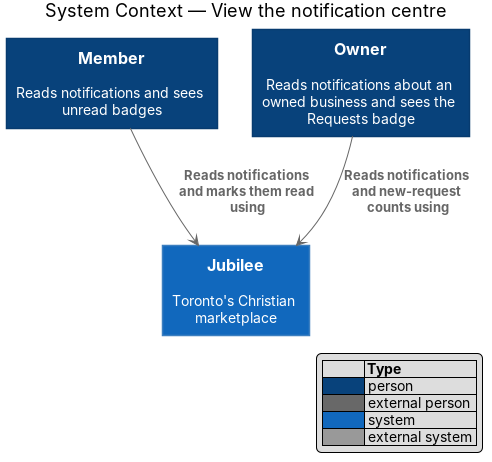
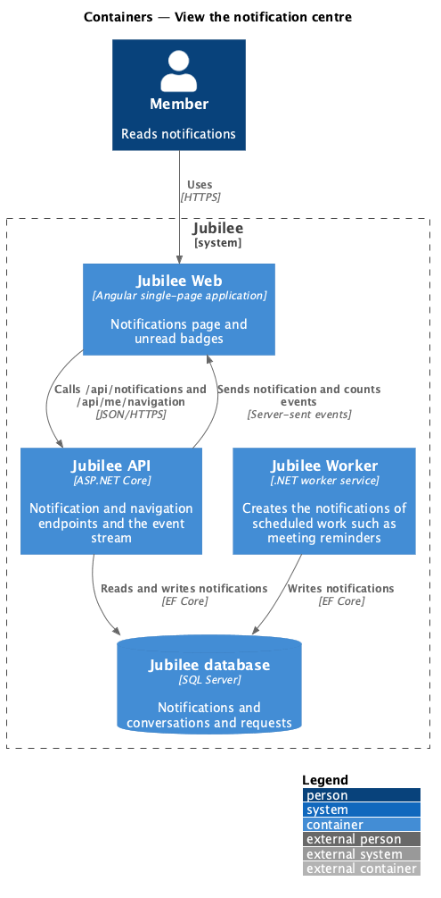
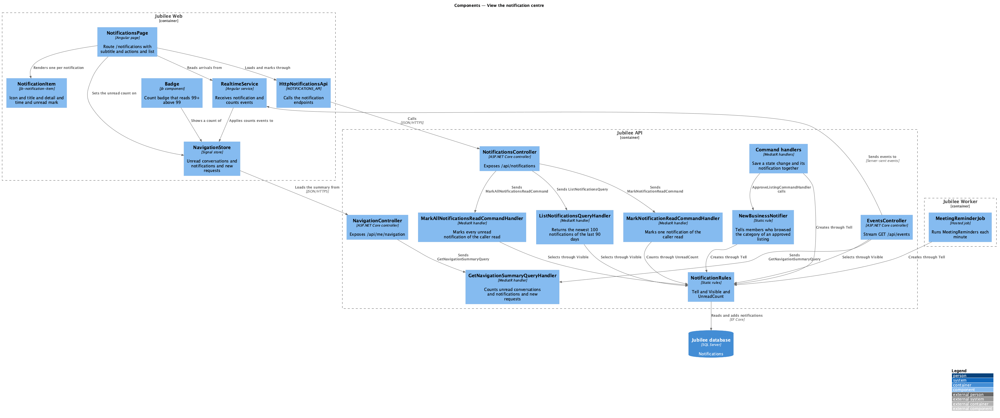
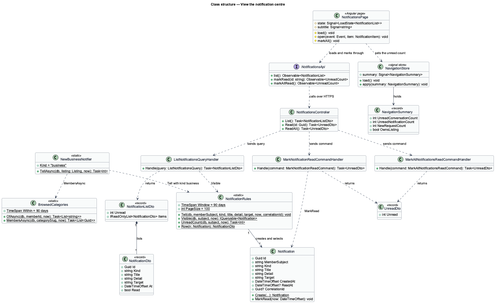
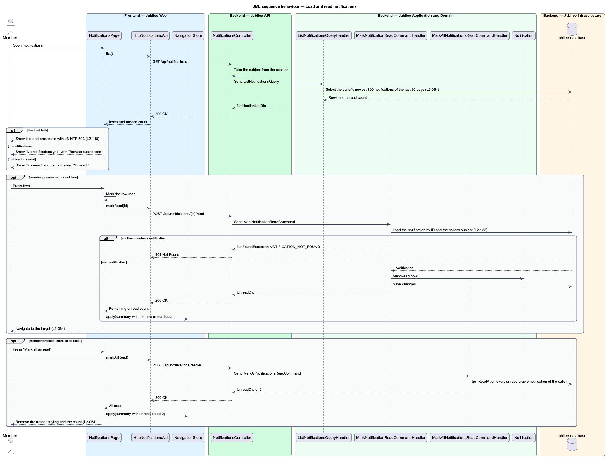
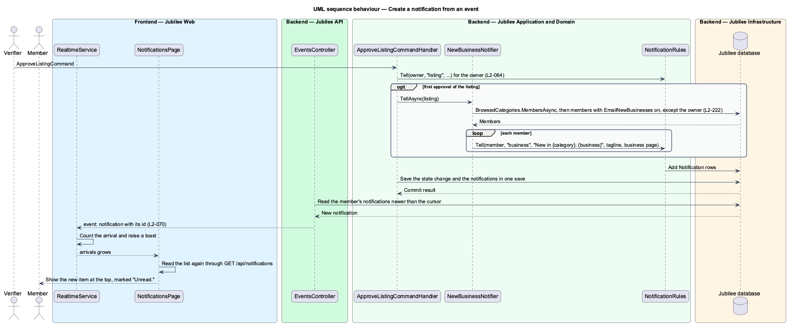
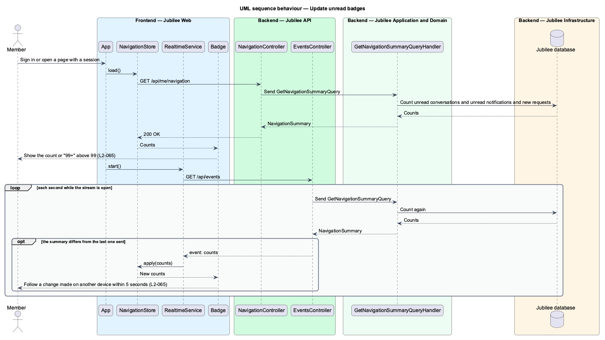

# View the notification centre

## Overview

Jubilee is Toronto's Christian marketplace, in which members message verified
businesses and send them booking, quote and order requests. The notifications
subsystem tells members and owners about events that concern them. This feature
covers the in-app part that a member reads on demand: the notification centre at
`/notifications` and the unread badges in the navigation.

The terms below are local to this feature.

- **notification** — stored record, addressed to one member, of one event with a kind, a title, a detail line, a time and a target
- **kind** — one of `request`, `message`, `listing`, `account`, `reminder`, `business` or `product`, from which the page picks the icon and the toast its action
- **target** — path in the application that a notification opens when pressed
- **unread badge** — count shown on a navigation item, read aloud as "{n} unread"
- **new request** — request sent to an owner's business whose status is `new`
- **browsed category** — category in which the member, signed in, opened the page of a business in the last `90 days`

Notifications are created by the system, never by the member. The handler that
saves a state change adds the notification in the same save, so a notification
exists exactly when its event was saved. The centre lists the notifications of
the last `90 days`, newest first, and lets the member mark one or all of them
read.

Two badges are in scope. "Messages" carries the number of unread conversations
on every page that shows the top bar or tab bar. The "Requests" tab of the owner
workspace carries the number of new requests. Toasts for the same events are
described in `show-toasts-and-banners`, e-mail in `send-email-notifications`, and
the transport in `deliver-real-time-events`.

## Description

The feature is a vertical slice from the notifications page to the database.
It has no background component and no outbox event: the outbox carries e-mail
only (ADR 0025).

- **`NotificationsPage`** — Angular page at `/notifications`, behind
  `memberGuard`. Its subtitle reads "{n} unread" while items are unread and
  "{n} notifications · all read" otherwise. With unread items it offers "Mark
  all as read"; "Settings" links to `/account/notifications`. The page reads
  the list again each time `RealtimeService.arrivals` grows.
- **`NotificationItem`** — component `a[jb-notification-item]` of the
  `components` library for one row: icon, title, detail line and time. An
  unread row carries the class `notif--unread` and the text "Unread."
  `NotificationItemSkeleton` stands in for a row while the list loads.
- **Empty state** — with no notifications the page shows "No notifications yet.
  We'll tell you here when a business replies, confirms a booking or answers a
  quote." with the action "Browse businesses".
- **Opening an item** — `NotificationsPage.open` marks the row read in the page
  at once, posts the read, and navigates to `target`. A failed post leaves the
  navigation unaffected.
- **`NotificationsApi`** and **`HttpNotificationsApi`** — contract behind the
  token `NOTIFICATIONS_API` and its HTTP implementation: `list()` calls
  `GET /api/notifications`, `markRead(id)` calls
  `POST /api/notifications/{id}/read`, and `markAllRead()` calls
  `POST /api/notifications/read-all`.
- **`NavigationStore`** — signal store of the `NavigationSummary`:
  `unreadConversationCount`, `unreadNotificationCount`, `newRequestCount` and
  `ownsListing`. `load()` reads `GET /api/me/navigation` when a member signs
  in. `apply()` takes the summary of each `counts` event of the stream
  `GET /api/events`, so a badge follows a change made on another device within
  `5 seconds` (L2-065).
- **`Badge`** — component of the `components` library that renders a count and
  shows "99+" above `99`.
- **`NotificationsController`** — ASP.NET Core controller at
  `/api/notifications`. Each action takes the member's subject from the
  session and dispatches through MediatR.
- **`NotificationRules`** — static rules in `Jubilee.Application`. `Window` is
  `90 days` and `PageSize` is `100`. `Visible` selects the caller's
  notifications inside the window; `UnreadCount` counts the unread ones;
  `Tell` adds a `Notification` to the unit of work of the calling handler.
- **`ListNotificationsQueryHandler`** — returns a `NotificationListDto`: the
  unread count and the newest `100` visible notifications, newest first. The
  list has no further pages.
- **`MarkNotificationReadCommandHandler`** — loads the notification by its ID
  and the caller's subject and calls `Notification.MarkRead`. Another member's
  notification returns HTTP `404` with the code `NOTIFICATION_NOT_FOUND`
  (L2-133). The answer is an `UnreadDto` with the remaining unread count.
- **`MarkAllNotificationsReadCommandHandler`** — sets `ReadAt` on each unread
  visible notification of the caller and answers an `UnreadDto` of `0`.
- **`GetNavigationSummaryQueryHandler`** — returns the `NavigationSummary` of
  the caller: unread conversations, unread notifications inside the window,
  and, for an owner, requests with status `new` on owned listings.
- **`Notification`** — domain entity with `MemberSubject`, `Kind`, `Title`
  (at most `200` characters), `Detail` (at most `300`), `Target`, `CreatedAt`,
  `ReadAt` and a `CorrelationId` that ties it to the request that caused it, so
  an unread notification is withdrawn with that request.
- **Events that create a notification** — a request created (owner); a request
  confirmed, declined or cancelled (other party); a new message (other
  participant); a listing verified or changes requested (owner); the e-mail
  confirmed (member); a product back in stock (subscribed member, through
  `StockAlertNotifier`); a meeting reminder (member and owner, through
  `MeetingReminders`, L2-069); a new business in a browsed category.
- **`NewBusinessNotifier`** — static rule called by
  `ApproveListingCommandHandler` the first time a listing is approved
  (L2-222, ADR 0053). `TellAsync` tells each member whose
  `EmailNewBusinesses` switch is on and who browsed the listing's category,
  except the owner. The notification has kind `business`, the title
  "New in {category}: {business}", the business's tagline as its detail, and
  the business page `/b/{slug}` as its target. The approving handler saves,
  so the notifications exist exactly when the approval does.
- **`BrowsedCategories`** — static rule that reads what a member browsed from
  the `ListingView` rows kept for the owner's statistics: a view within
  `90 days` (`Within`) whose `VisitorKey` is the member's key. No other record
  of what a member looks at is kept.
- **Load error** — when the list fails to load, the page shows the standard
  load-error state with the reference `JB-NTF-503` (L2-118).

## Requirements

The feature realizes the following level-2 (L2) requirements. Each L2
requirement refines a level-1 (L1) requirement, cited by identifier.

| L2 ID | Refines (L1) | Requirement |
|-------|--------------|-------------|
| `L2-064` | `L1-010` | The page `/notifications` shall list events for the member, newest first. |
| `L2-065` | `L1-010` | "Messages" shall carry a badge with the number of unread conversations and the owner's "Requests" tab shall carry the number of new requests. A count above 99 shall read "99+", and a badge shall follow a change made on another device within 5 seconds while the page is open. |
| `L2-222` | `L1-010` | A member who turned on "New businesses" shall hear of newly verified businesses in the categories they have browsed: in the app as each one is approved, and by e-mail in one weekly note. |
| `L2-118` | `L1-016` | Every load-error state shall show a reference the user can quote to support. |
| `L2-133` | `L1-019` | The server shall check the caller's role and ownership of the specific object on every API call, and shall return 404 for another member's notification. |

## Diagrams

### System context

Members and owners read notifications and see unread badges in Jubilee. The
feature involves no external system.

### Containers

`Jubilee Web` calls the notification and navigation endpoints of `Jubilee API`
and holds the event stream `GET /api/events`. `Jubilee API` and `Jubilee Worker`
both write notifications to `Jubilee database`; the stream reads them from
there, so no cache or broker stands between the two processes.

### Components

`NotificationsPage` loads and marks through `NotificationsApi` and reads again
when `RealtimeService` reports an arrival. `NavigationStore` feeds the badges.
`NotificationsController` dispatches to the list and the two mark-read handlers,
which read through `NotificationRules`. Command handlers, `MeetingReminders` and
`NewBusinessNotifier` create notifications through `NotificationRules.Tell`.

### Class structure

`NotificationRules` creates and selects `Notification` entities.
`ListNotificationsQueryHandler` returns a `NotificationListDto` of
`NotificationDto` rows; both mark-read handlers return an `UnreadDto`.
`NavigationStore` holds the `NavigationSummary` the badges read.

### Behaviour — load and read notifications

The list query returns the caller's notifications from the last `90 days`.
Pressing an item marks it read and opens its target; "Mark all as read" clears
every unread mark, the count in the subtitle and the badge.

### Behaviour — create a notification from an event

A command handler adds the notification through `NotificationRules.Tell` and
saves it with its state change. `EventsController` finds the new row at its
next read and sends it to the recipient's open page. An approved listing is
told to the members who browsed its category by `NewBusinessNotifier`.

### Behaviour — update unread badges

`NavigationStore` loads the summary at sign-in and applies each `counts` event.
`EventsController` sends a `counts` event whenever the summary differs from the
last one it sent, which covers a change made on another device.

