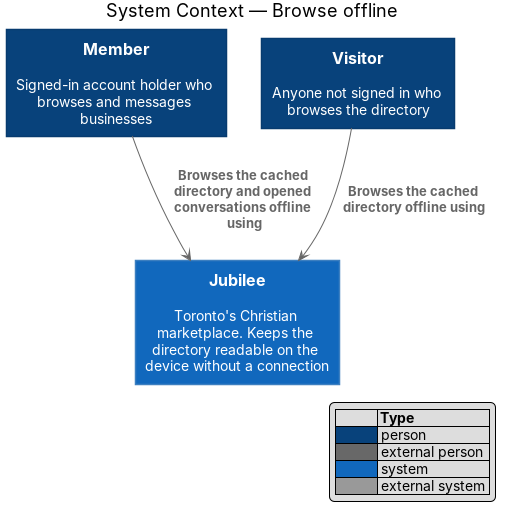
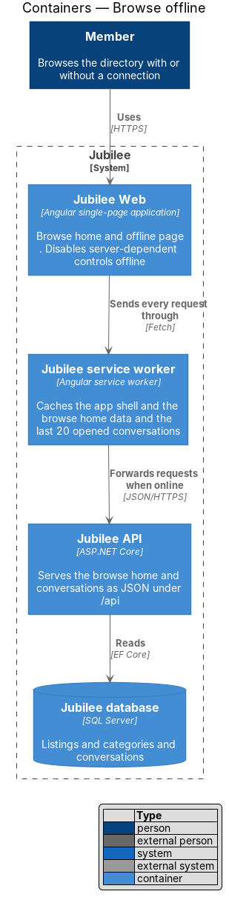
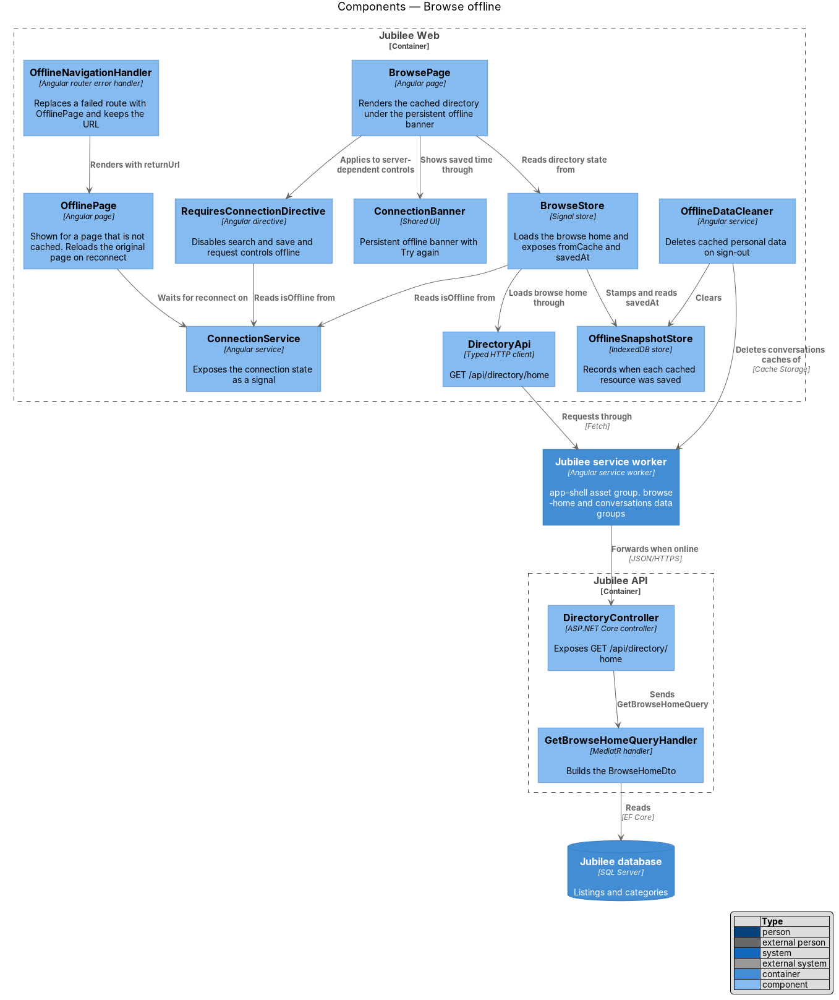
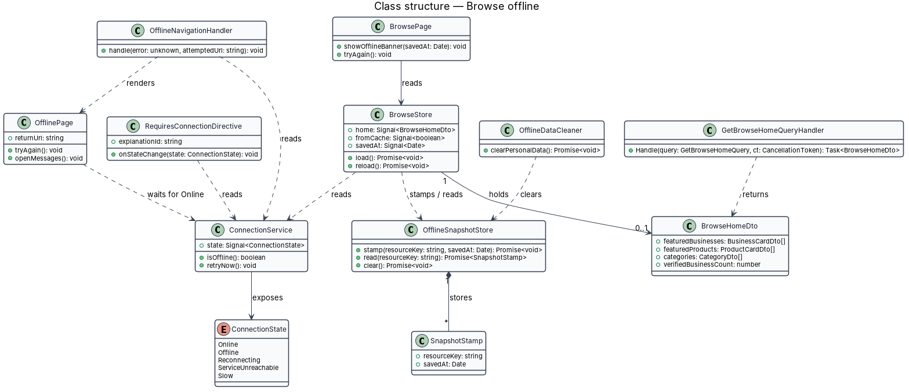
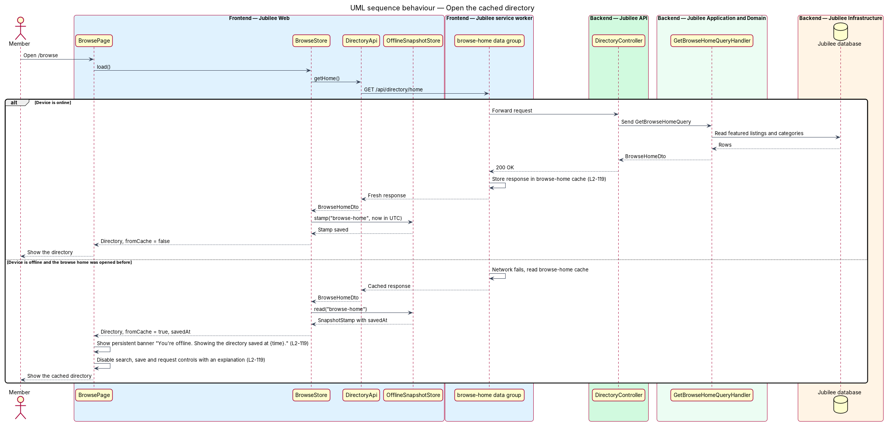
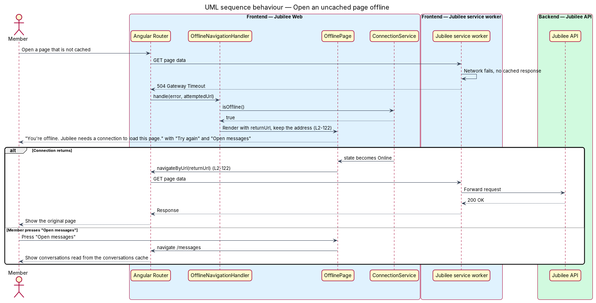
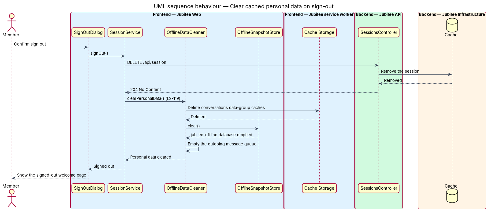

# Browse offline

## Overview

Jubilee is Toronto's Christian marketplace: a directory of verified
Christian-owned businesses that members browse, message and send requests to.
Members open it on phones and mobile networks, where the connection drops
without warning. This feature keeps the directory readable when there is no
connection at all.

The feature rests on the `Jubilee service worker`, a script the browser installs
alongside `Jubilee Web` and runs between the application and the network. Three
terms are used throughout:

- **app shell** — static files (HTML, scripts, styles, fonts, icons) that start `Jubilee Web` without a network request
- **cached directory** — last browse home response the device stored, together with the time it was saved
- **offline page** — full-page state shown in place of a page whose data is not on the device

When a member who has opened the browse home before opens it offline, the
service worker answers from its cache. `BrowsePage` renders the cached directory
under a persistent banner that names the time it was saved (L2-119). Controls
that depend on the server (search, save, request and send actions) are disabled
with an explanation. Sending a message is the one exception: the message is
queued on the device (L2-120).

When the member opens a page that is not on the device, the offline page appears
at the same address. It reloads the original page automatically when the
connection returns (L2-122). Cached personal data leaves the device when the
member signs out.

## Description

The slice runs from the browser cache to the two read endpoints whose responses
the service worker stores.

- **`ngsw-config.json`** — build-time configuration of the `Jubilee service
  worker`. It declares the asset group `app-shell` (install mode `prefetch`), the
  data group `browse-home` for `GET /api/directory/home`, and the data group
  `conversations` for `GET /api/conversations/{conversationId}` with
  `maxSize: 20`. Both data groups use the `freshness` strategy: network first,
  cache when the network fails. The network timeout before the cache answers is
  `<TO SUPPLY>`.
- **`conversations` data group** — least-recently-used cache holding the last
  `20` opened conversations. Opening a twenty-first conversation evicts the
  conversation opened longest ago.
- **`ConnectionService`** — Angular service that exposes the connection state as
  a signal. `BrowsePage`, `OfflinePage` and `RequiresConnectionDirective` read
  `isOffline()` from it. The detection rules belong to the connection banner
  feature (L2-121).
- **`OfflineSnapshotStore`** — IndexedDB store `jubilee-offline` that records a
  `SnapshotStamp` (resource key and `savedAt` in UTC) each time `BrowseStore`
  receives a browse home response from the network.
- **`BrowseStore`** — signal store behind `BrowsePage`. It loads the browse home
  through `DirectoryApi`, marks the result as `fromCache` when the device is
  offline, and exposes `savedAt` from `OfflineSnapshotStore`.
- **`BrowsePage`** — page at `/browse`. Offline, it renders the cached directory
  and asks `ConnectionBanner` for the persistent banner "You're offline. Showing
  the directory saved at {time}. Search and messages will work again when you're
  connected." with the action "Try again". The time is shown in
  `America/Toronto` (L2-131).
- **`ConnectionBanner`** — shared banner from the mock
  `notifications/offline-banner`. The persistent variant has no dismiss button.
  "Try again" calls `BrowseStore.reload()`.
- **`RequiresConnectionDirective`** — attribute directive `jbRequiresConnection`
  placed on search, save, request and send controls. Offline, it sets
  `aria-disabled="true"`, blocks activation, and links an explanation through
  `aria-describedby`. The explanation copy is `<TO SUPPLY>`. The message composer
  does not carry the directive.
- **`OfflineNavigationHandler`** — router error handler. A route whose data
  request fails while `ConnectionService.isOffline()` is true is replaced by
  `OfflinePage` with `skipLocationChange`, so the address bar keeps the original
  URL. The handler passes that URL as `returnUrl`.
- **`OfflinePage`** — page from the mock `pages/offline`. It shows "You're
  offline. Jubilee needs a connection to load this page. Messages you already
  opened are still readable, and anything you send is kept and delivered when
  you're back." with "Try again" and "Open messages" (`/messages`). An effect on
  `ConnectionService` navigates to `returnUrl` when the connection returns.
- **`OfflineDataCleaner`** — service called by `SessionService.signOut()`. It
  deletes the `conversations` data-group caches from Cache Storage, the
  `jubilee-offline` database and the outgoing message queue. The app shell and
  the public browse home stay cached.
- **`DirectoryController`** and **`GetBrowseHomeQueryHandler`** — `Jubilee API`
  endpoint `GET /api/directory/home` and its MediatR handler. The handler returns
  a `BrowseHomeDto` with featured businesses, featured products and categories.
- **`ConversationsController`** and **`GetConversationQueryHandler`** — endpoint
  `GET /api/conversations/{conversationId}`. The response for a signed-in member
  carries `Cache-Control: private`; only the service worker's `conversations`
  group stores it.

## Requirements

The feature realizes the following level-2 (L2) requirements. Each L2
requirement refines a level-1 (L1) requirement, cited by identifier.

| L2 ID | Refines (L1) | Requirement |
|-------|--------------|-------------|
| `L2-119` | `L1-017` | The system shall show the last cached directory with the persistent offline banner and "Try again" when a member who has opened the browse home before opens it offline. While offline, search, save, request and send controls shall be disabled with an explanation, except sending messages; the service worker shall cache the app shell, the browse home data and the last 20 opened conversations, and cached personal data shall be cleared on sign-out. |
| `L2-122` | `L1-017` | The system shall show the offline page with "Try again" and "Open messages" when a member opens a page that is not cached while offline. The original page shall load automatically when the connection returns. |
| `L2-120` | `L1-017` | A message written while offline shall be stored on the device marked "Waiting to send" and sent automatically, in order, when the connection returns. |
| `L2-121` | `L1-017` | The persistent offline banner shall show within 2 seconds of the browser going offline. |

## Diagrams

### System context

A `Member` or `Visitor` browses Jubilee on a device that has lost its
connection. The feature involves no external system.

### Containers

`Jubilee Web` sends every request through the `Jubilee service worker`, which
answers from its cache when `Jubilee API` is out of reach. `Jubilee API` reads
the directory and conversations from the `Jubilee database`.

### Components

`BrowsePage` and `OfflinePage` read the connection state from
`ConnectionService`. `BrowseStore` loads the browse home through `DirectoryApi`
and stamps each fresh response in `OfflineSnapshotStore`; `OfflineDataCleaner`
empties the personal caches at sign-out.

### Class structure

`BrowseStore` holds a `BrowseHomeDto` and a `SnapshotStamp`. `OfflinePage` and
`RequiresConnectionDirective` depend on `ConnectionService`, and
`OfflineDataCleaner` clears what `OfflineSnapshotStore` and the service worker
caches hold.

### Behaviour — open the cached directory

Online, the service worker stores the browse home response and `BrowseStore`
records the time. Offline, the service worker answers from the `browse-home`
cache and `BrowsePage` shows the persistent banner with the saved time.

### Behaviour — open an uncached page offline

The service worker has no cached response, so `OfflineNavigationHandler` shows
`OfflinePage` at the original address. When `ConnectionService` reports the
connection again, `OfflinePage` loads the original page.

### Behaviour — clear cached personal data on sign-out

`SessionService` ends the session on the server and then calls
`OfflineDataCleaner`, which removes cached conversations, snapshot stamps and
queued messages from the device.

