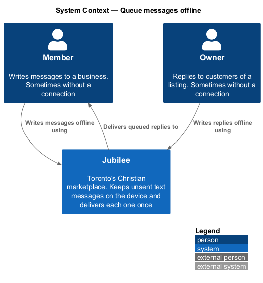
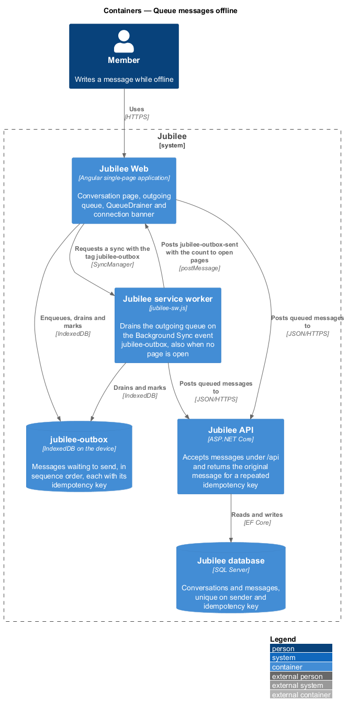
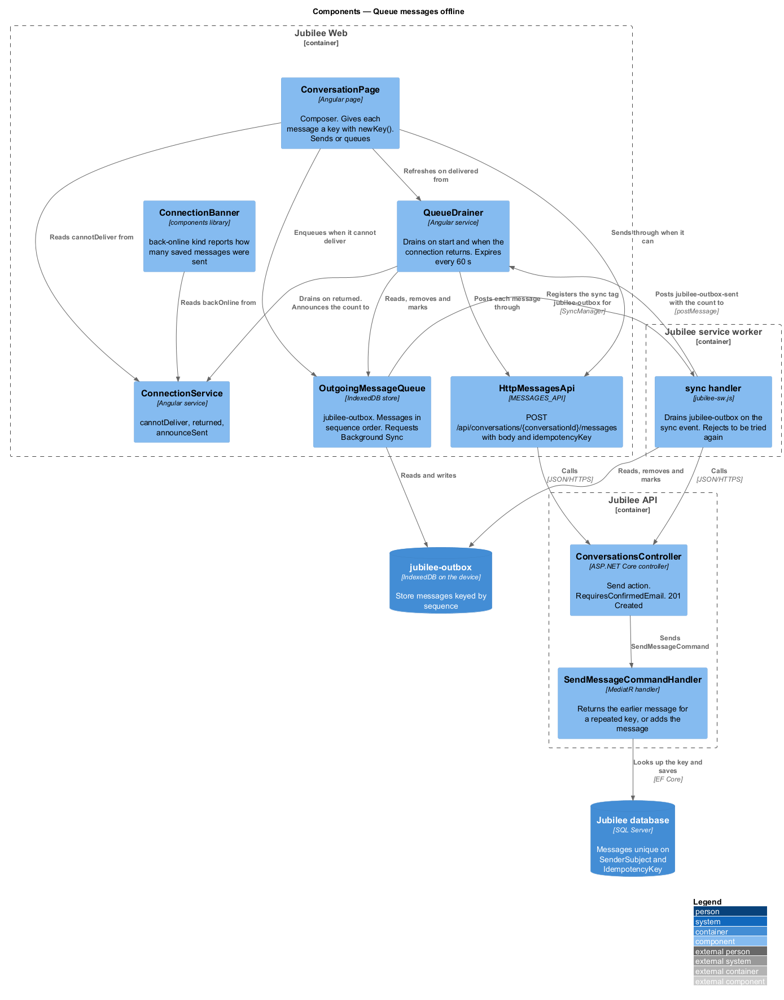
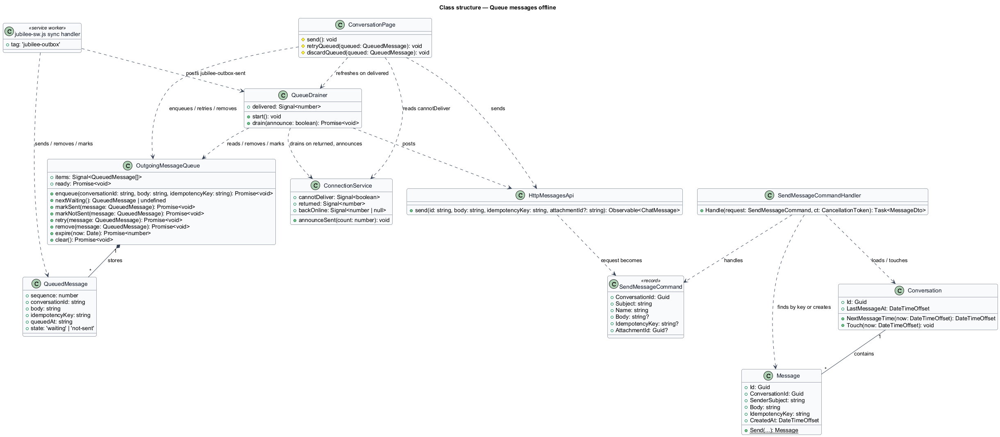
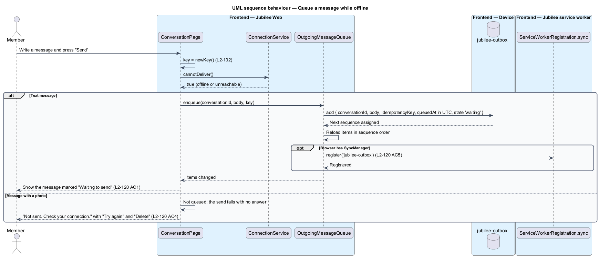
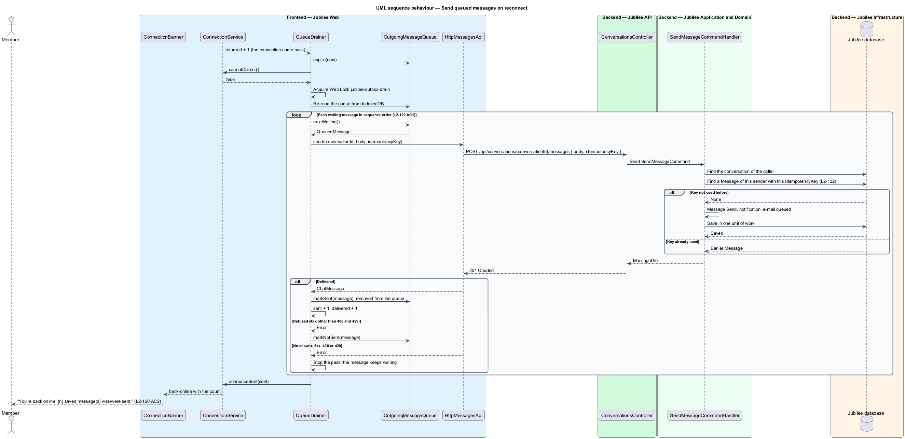
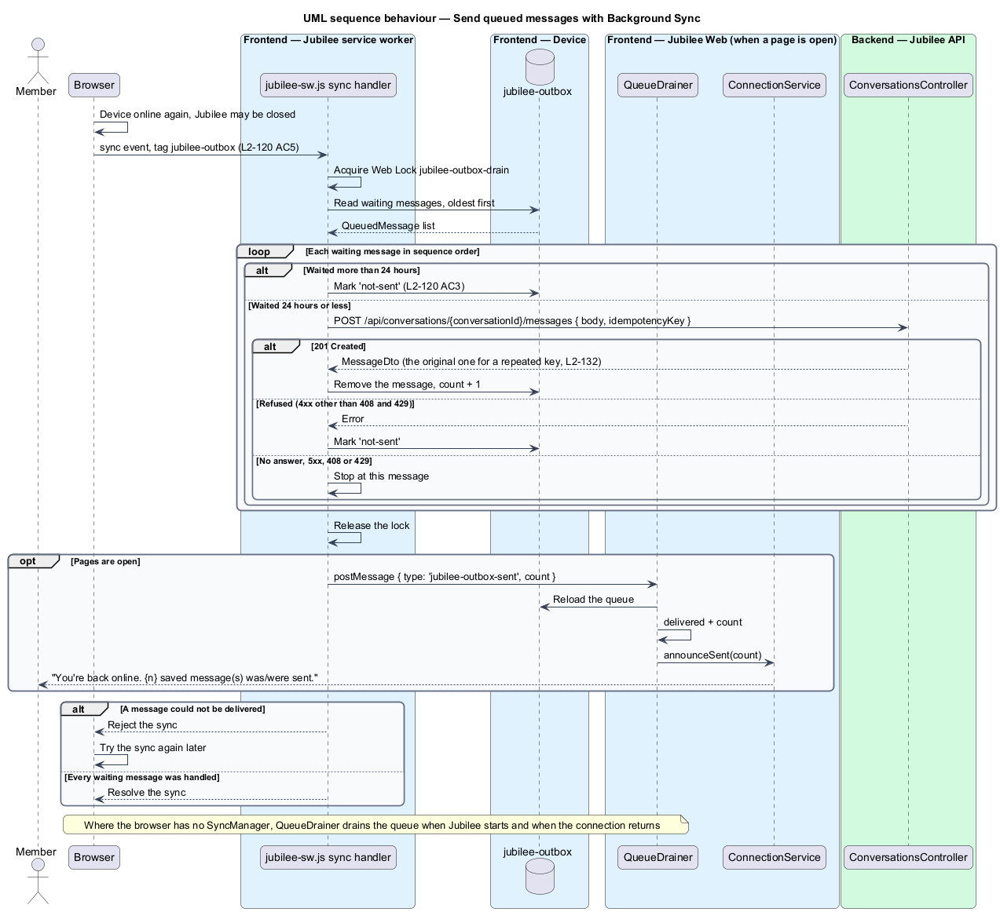
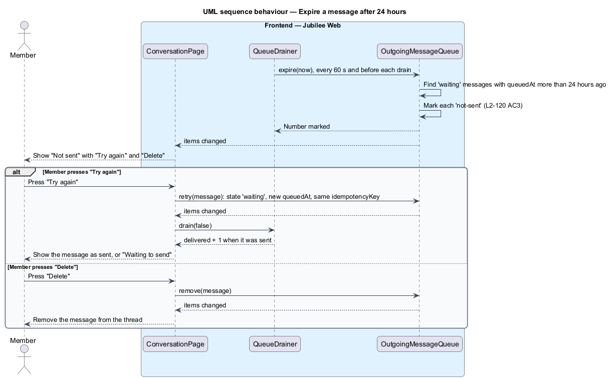

# Queue messages offline

## Overview

Jubilee is Toronto's Christian marketplace, where a member and a business talk
in a private one-to-one conversation. A member often writes a reply on a phone
at a moment when the connection is gone. This feature keeps that reply on the
device and delivers it when the connection returns, so that no message is lost
and none is delivered twice.

Four terms are used throughout:

- **outgoing queue** — ordered list of messages stored on the device that the server has not yet accepted
- **drain** — pass over the outgoing queue that sends each waiting message in the order it was written
- **idempotency key** — client-generated identifier sent with a create request so that a repeated request returns the original result instead of creating a duplicate (L2-132)
- **Background Sync** — browser feature that wakes the service worker with a `sync` event once the device is online again, even when no Jubilee page is open

A text message sent while the device is offline, or while Jubilee cannot be
reached, appears in the conversation at once, marked "Waiting to send". When the
connection returns, the queue drains automatically: each message is posted in
order with the idempotency key it was given when it was written. Where the
browser has Background Sync, the `Jubilee service worker` drains the queue even
when Jubilee is closed; elsewhere the queue drains the next time Jubilee is
open. After a drain that sent messages the connection banner reads "You're back
online. {n} saved message(s) was/were sent." with the count and the verb in the
correct singular or plural form.

A message that is still unsent 24 hours after it was written stops waiting. It
is marked "Not sent" and offers "Try again" and "Delete". A message with a photo
is never queued: the queue holds text only (L2-120 AC4).

## Description

The slice runs from the message composer through the outgoing queue on the
device to the message endpoint of `Jubilee API` (ADR 0032, ADR 0068).

- **`ConversationPage`** — page at `/messages/:conversationId`, which holds the
  composer. The composer stays enabled offline; the `jbRequiresConnection`
  directive that disables other controls is not applied to it (L2-119 AC2).
  `send()` gives each message a key from `newKey()` (the `api` helpers:
  `crypto.randomUUID()`). A text message is handed to
  `OutgoingMessageQueue.enqueue(conversationId, body, key)` when
  `ConnectionService.cannotDeliver()` is true (offline or unreachable);
  otherwise it is posted through `MESSAGES_API.send`, and a send that gets no
  answer while the connection is down is queued with the same key. A message
  with a photo is never queued: its bubble says "Not sent. Check your
  connection." with "Try again" and "Delete" (L2-120 AC4, ADR 0039,
  ADR 0051). The thread merges the queued messages of the conversation from
  `OutgoingMessageQueue.items` as "Waiting to send" or "Not sent" entries, and
  refreshes when `QueueDrainer.delivered` rises.
- **`OutgoingMessageQueue`** — IndexedDB database `jubilee-outbox`, object store
  `messages` keyed by an auto-incremented `sequence`, readable by both
  `Jubilee Web` and the `Jubilee service worker`. `items` is a signal of every
  queued message in `sequence` order, read once at start (`ready`) and after
  each change. It offers `enqueue`, `nextWaiting`, `markSent` (which removes
  the message), `markNotSent`, `retry`, `remove`, `expire` and `clear`. After
  `enqueue` stores a message it asks for a Background Sync with the tag
  `jubilee-outbox` where the browser has `SyncManager`. `SessionService.signOut()`
  calls `clear()` (see the browse offline design).
- **`QueuedMessage`** — queue record: `sequence`, `conversationId`, `body`,
  `idempotencyKey`, `queuedAt` (ISO time in UTC, reset by "Try again") and
  `state`, which is `'waiting'` ("Waiting to send") or `'not-sent'` ("Not
  sent"). A delivered message leaves the queue, so there is no sent state.
- **`QueueDrainer`** — Angular service that drains the queue in the page. The
  application shell calls `start()` once: it drains what was left from last
  time and runs `expire()` every 60 seconds (`timings().expiryEvery`). An effect
  on `ConnectionService.returned` drains again each time the connection comes
  back. `drain(announce)` first expires messages older than 24 hours, stops if
  `cannotDeliver()` is true, and then, under the Web Lock `jubilee-outbox-drain`,
  re-reads the queue from IndexedDB and sends each waiting message oldest first
  through `MESSAGES_API.send(conversationId, body, idempotencyKey)`. A
  delivered message is removed and counted in `delivered`. A refused message (a
  `4xx` other than `408` and `429`) is marked `'not-sent'`. Any other failure
  stops the pass and leaves the message waiting, which preserves order. The
  count is passed to `ConnectionService.announceSent`. `QueueDrainer` also
  listens for the service worker's `{ type: 'jubilee-outbox-sent', count }`
  message: it reloads the queue, counts the delivered messages and announces
  them.
- **`HttpMessagesApi.send`** — `POST /api/conversations/{conversationId}/messages`
  with the JSON body `{ body, idempotencyKey }`. The request is marked
  `OWN_RETRY`, so `connectionInterceptor` does not retry it for a minute: the
  queue is its way of trying again.
- **`jubilee-sw.js` `sync` handler** — the service worker's listener for the
  tag `jubilee-outbox`. Under the same Web Lock `jubilee-outbox-drain` it reads
  the waiting messages of `jubilee-outbox` oldest first and posts each one to
  `POST /api/conversations/{conversationId}/messages` with
  `{ body, idempotencyKey }`. It removes each sent message, marks a refused one
  (`4xx` other than `408` and `429`) `'not-sent'`, and marks one older than
  24 hours `'not-sent'`. It stops at the first message that cannot be
  delivered and rejects, so the browser tries the sync again later. It then
  posts `{ type: 'jubilee-outbox-sent', count }` to the open pages. Where the
  browser has no Background Sync, the in-page `QueueDrainer` is the fallback.
- **`ConnectionService`** and **`ConnectionBanner`** — `announceSent(n)` sets
  `backOnline` to `n`, and the application shell shows the `back-online` kind
  of the banner: "You're back online. 1 saved message was sent." for `n = 1`,
  and "You're back online. {n} saved messages were sent." otherwise. The banner
  is dismissible and shown once (L2-067 AC2).
- **`ConversationsController.Send`** — `Jubilee API` action for
  `POST /api/conversations/{conversationId}/messages`. It requires a signed-in
  member with a confirmed e-mail (`[RequiresConfirmedEmail]`), sends
  `SendMessageCommand` (`ConversationId`, `Subject`, `Name`, `Body`,
  `IdempotencyKey`, `AttachmentId`) and answers `201 Created` with a
  `MessageDto`.
- **`SendMessageCommandHandler`** — finds the conversation among those the caller
  takes part in (`404` otherwise). It looks for a `Message` the same sender
  already sent with the same `IdempotencyKey`; when one exists it returns that
  message's `MessageDto` and creates nothing (L2-132). Otherwise it checks the
  body and the sending budget, adds the `Message` (`Message.Send`), records the
  recipient's notification (`NotificationRules.Tell`) and queues the e-mail
  (`MessageMail.QueueAsync`), and saves in one unit of work. A unique index on
  `Messages (SenderSubject, IdempotencyKey)` backs the check, and the key is
  kept with the message, so a repeat returns the original result at any time,
  not only within 24 hours.

## Requirements

The feature realizes the following level-2 (L2) requirements. Each L2
requirement refines a level-1 (L1) requirement, cited by identifier.

| L2 ID | Refines (L1) | Requirement |
|-------|--------------|-------------|
| `L2-120` | `L1-017` | AC1. Given the member writes a message while offline, when they send it, then it is stored on the device marked "Waiting to send" and sent automatically when the connection returns, in order, each with its idempotency key. AC2. Given the connection returns and queued messages are sent, when they succeed, then the banner shows "You're back online. {n} saved message(s) was/were sent." with correct pluralisation. AC3. Given a queued message cannot be sent after 24 hours, when that time passes, then it is marked "Not sent" with "Try again" and "Delete". AC4. Given a message with a photo, when it is sent with no connection, then it is not put in the queue: the queue holds text, and a photo is not kept on the device (ADR 0032, ADR 0039). Its bubble says "Not sent. Check your connection." with "Try again" and "Delete" (L2-060 AC7), the photo and the text stay in the bubble, and "Try again" sends the message once when the connection is back. AC5. Given messages waiting to send and a browser with Background Sync, when the connection returns while Jubilee is closed, then the service worker sends them in order with their idempotency keys; where the browser has no Background Sync they are sent the next time Jubilee is open. |
| `L2-132` | `L1-018` | AC1. Given any create request (message, booking, quote, order, report, listing submission), when sent, then it carries a client-generated idempotency key, and the server returns the original result for a repeated key within 24 hours without creating a duplicate. A report of a conversation carries no key: a participant has at most one report open on a conversation, so a repeat files nothing new (L2-063 AC8, ADR 0039). AC2. Given a double-click or network retry, when it happens, then exactly one resource is created. |
| `L2-119` | `L1-017` | AC2. Given offline, when the member uses search, save, request or send actions, then those controls are disabled with an explanation, except sending messages, which are queued (L2-120). |
| `L2-067` | `L1-010` | AC2. Given a resolved condition (e-mail confirmed, listing resumed, back online), when it resolves, then a success banner is shown once and can be dismissed. |

## Diagrams

### System context

A `Member` or an `Owner` writes messages to the other party of a conversation
through Jubilee. No external system takes part.

### Containers

`Jubilee Web` and the `Jubilee service worker` share the outgoing queue in the
`jubilee-outbox` database on the device. Either one posts queued messages to
`Jubilee API`, which finds a repeated idempotency key among the stored messages
in the `Jubilee database`.

### Components

`ConversationPage` sends through `HttpMessagesApi` or queues in
`OutgoingMessageQueue` according to `ConnectionService`. `QueueDrainer` in the
page and the `sync` handler of `jubilee-sw.js` drain the queue under one Web
Lock; `SendMessageCommandHandler` returns the original message for a repeated
key.

### Class structure

`OutgoingMessageQueue` owns `QueuedMessage` records. On the server,
`SendMessageCommandHandler` adds a `Message` to a `Conversation`, and the
`IdempotencyKey` of each `Message` ties a repeated request to the message it
created.

### Behaviour — queue a message while offline

`ConversationPage` assigns the idempotency key before it checks the connection.
When the message cannot be delivered, it goes to `OutgoingMessageQueue`, shows
as "Waiting to send", and a Background Sync is requested where the browser
supports it.

### Behaviour — send queued messages on reconnect

`QueueDrainer` posts each waiting message in order under the Web Lock.
`SendMessageCommandHandler` returns the original message when one already
reached the server, and the banner reports the count.

### Behaviour — send queued messages with Jubilee closed

The browser wakes the service worker with the `sync` event for
`jubilee-outbox`. The handler sends the waiting messages in order, rejects at
the first one that cannot be delivered so the browser tries again later, and
tells any open page how many were sent.

### Behaviour — expire a message after 24 hours

`OutgoingMessageQueue.expire` marks a message "Not sent" once it has waited
24 hours. The member then retries or deletes it.

