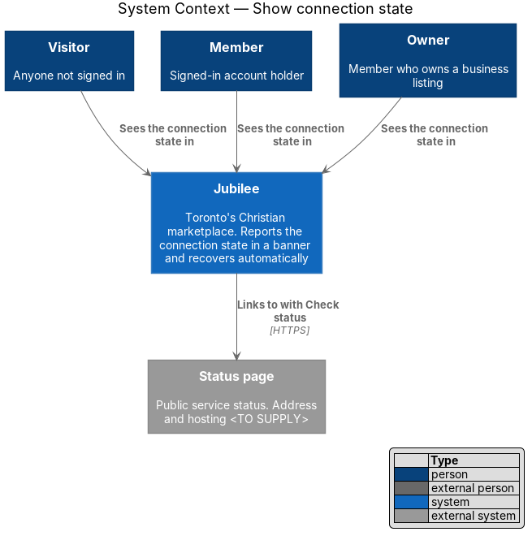
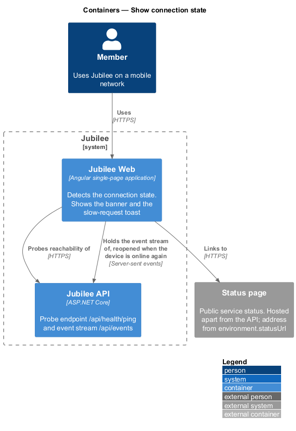
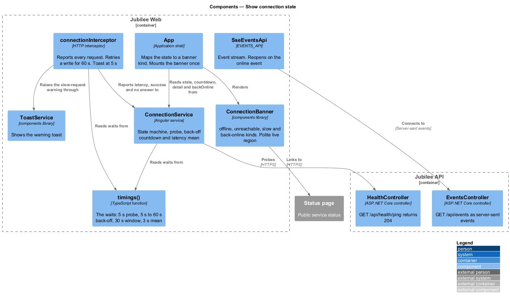
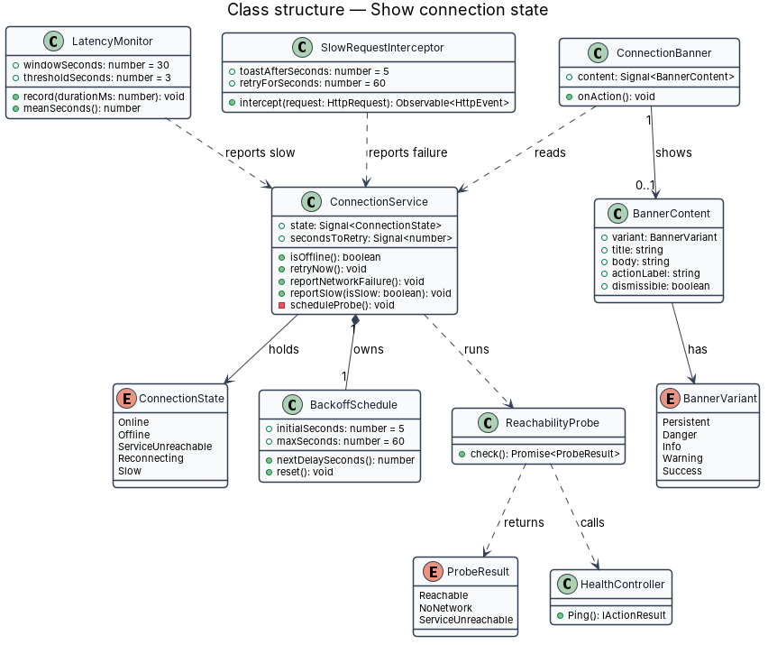
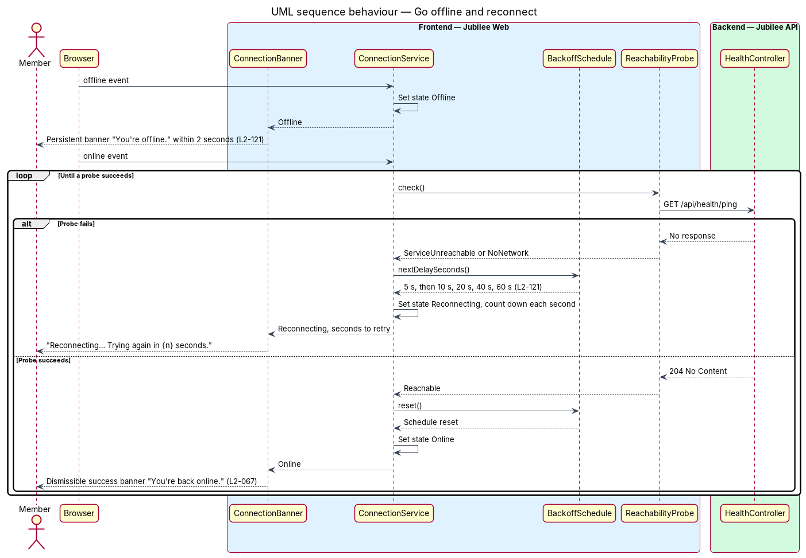
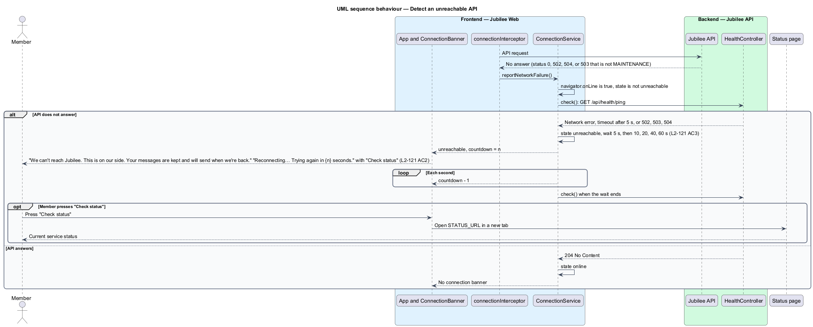
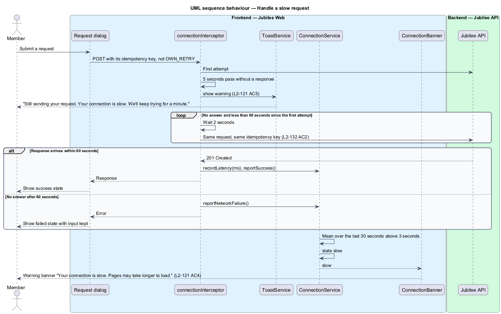

# Show connection state

## Overview

Jubilee is Toronto's Christian marketplace, used mostly on phones and mobile
networks. A page that stops responding without explanation leaves a member
unsure whether a message or a request went through. This feature tells the
member what state the connection is in, in one banner at the top of every page,
and recovers without any action from the member.

Three terms are used throughout:

- **connection state** — one of five conditions the application distinguishes: online, offline, service unreachable, reconnecting, slow
- **reachability probe** — small request to `Jubilee API` whose only purpose is to learn whether the service answers
- **back-off** — waiting time between reconnection attempts that doubles after each failed attempt

The feature separates two failures that look alike to a member. When the
browser has no network, the banner says the device is offline. When the network
is up but `Jubilee API` does not answer, the banner says the fault is on
Jubilee's side and links to the status page. While the application waits to
retry, the banner counts down the seconds to the next attempt. Attempts start
5 seconds apart and back off exponentially to at most 60 seconds.

The feature also covers slow connections. An average request time above
3 seconds over a 30-second window raises a warning banner. A single request
still in flight after 5 seconds raises a warning toast, and the request is
retried for up to 60 seconds before it fails.

## Description

The slice lives almost entirely in `Jubilee Web`. `Jubilee API` contributes one
probe endpoint.

- **`ConnectionService`** — Angular service that owns the connection state
  machine and exposes `state` as a signal. Its inputs are the browser `online`
  and `offline` events, `ReachabilityProbe` results, `RealtimeClient` connection
  drops and `LatencyMonitor` readings.
- **`ConnectionState`** — `Online`, `Offline`, `ServiceUnreachable`,
  `Reconnecting`, `Slow`.
- **`ConnectionBanner`** — shared banner mounted once in the application shell,
  from the mock `notifications/offline-banner`. It renders one variant per
  state and announces each change in a polite live region without moving focus.
  The `Offline` variant appears within 2 seconds of the browser `offline` event;
  it is persistent and has no dismiss button.
- **Banner copy** — `Offline`: "You're offline." with "Try again".
  `ServiceUnreachable`: "We can't reach Jubilee. This is on our side. Your
  messages are kept and will send when we're back." with "Check status".
  `Reconnecting`: "Reconnecting… Trying again in {n} seconds." `Slow`: "Your
  connection is slow. Pages may take longer to load." On the browse home the
  `Offline` variant carries the saved-directory sentence of L2-119.
- **`ReachabilityProbe`** — sends `GET /api/health/ping` with a timeout of
  5 seconds (ADR 0032). A response of any status below `500` proves the service is
  reachable. A network error while `navigator.onLine` is true, or a `502`,
  `503` or `504` response, yields `ServiceUnreachable`.
- **`BackoffSchedule`** — produces the waiting times `5 s`, `10 s`, `20 s`,
  `40 s`, `60 s`, then `60 s` for each later attempt. A successful probe resets
  it. `ConnectionService` publishes the remaining seconds each second for the
  countdown.
- **`LatencyMonitor`** — HTTP interceptor that records the duration of each
  completed API request in a rolling 30-second window. When the mean exceeds
  3 seconds, it reports `Slow`; when the mean falls back to 3 seconds or less,
  it clears the report.
- **`SlowRequestInterceptor`** — HTTP interceptor for write requests. After
  5 seconds without a response it asks `ToastService` for the warning toast
  "Still sending your request. Your connection is slow. We'll keep trying for a
  minute." It retries the request on network failure until 60 seconds have
  passed since the first attempt, then fails the request to its caller.
  Each retry carries the same `Idempotency-Key`, so that a retried create does
  not produce a duplicate (L2-132).
- **`RealtimeClient`** — client of `EventsHub`. It reports a dropped persistent
  connection to `ConnectionService` and reconnects on the same `BackoffSchedule`.
- **`StatusLink`** — "Check status" opens the status page in a new tab. The
  status page address is a configured constant, `https://status.jubilee.example` until the page is hosted (ADR 0032); the page is hosted
  apart from `Jubilee API` so that it stays available during an outage.
- **`HealthController`** — `Jubilee API` controller. `GET /api/health/ping`
  returns `204 No Content`, needs no session and reads no data. It has no rate
  limit of its own: the probe is made at most once at a time per tab, backing off to a minute (ADR 0032).

## Requirements

The feature realizes the following level-2 (L2) requirements. Each L2
requirement refines a level-1 (L1) requirement, cited by identifier.

| L2 ID | Refines (L1) | Requirement |
|-------|--------------|-------------|
| `L2-121` | `L1-017` | The system shall show the persistent offline banner within 2 seconds of the browser going offline, and a distinct banner with "Check status" when the API is unreachable while the network is up. While waiting to retry, the banner shall count down with exponential back-off from 5 seconds to at most 60 seconds; a mean request time above 3 seconds over 30 seconds shall raise a slow-connection warning banner; a request still sending after 5 seconds shall raise a warning toast and be retried for up to 60 seconds before failing. |
| `L2-067` | `L1-010` | Banners shall describe a condition that lasts until it clears, and persistent banners shall have no dismiss button. A resolved condition shall show a dismissible success banner once, and each banner change shall be announced in a polite live region without moving focus. |
| `L2-132` | `L1-018` | Each create request shall carry a client-generated idempotency key, so that a network retry creates exactly one resource. |

## Diagrams

### System context

Every person who uses Jubilee sees the connection banner. The `Status page` is
an external site that the banner links to when Jubilee is unreachable.

### Containers

`Jubilee Web` detects the state from browser events, from the probe endpoint of
`Jubilee API` and from the persistent real-time connection.

### Components

`ConnectionService` gathers signals from `ReachabilityProbe`, `LatencyMonitor`
and `RealtimeClient`, and `ConnectionBanner` renders the resulting state.
`SlowRequestInterceptor` handles the single slow request and raises its toast
through `ToastService`.

### Class structure

`ConnectionService` holds one `ConnectionState` and owns a `BackoffSchedule`.
`BannerContent` maps each state to its variant, copy and action.

### Behaviour — go offline and reconnect

The browser `offline` event produces the persistent banner within 2 seconds.
`ConnectionService` then probes on the back-off schedule and shows the
countdown until a probe succeeds.

### Behaviour — detect an unreachable API

A failed request while the network is up triggers a probe. A failed probe
yields the "We can't reach Jubilee." banner with "Check status".

### Behaviour — handle a slow request

`SlowRequestInterceptor` raises the warning toast after 5 seconds and retries
for up to 60 seconds. `LatencyMonitor` raises the slow-connection banner from
the rolling mean.

