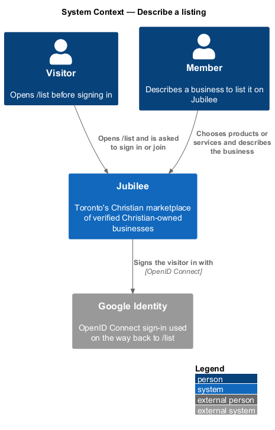
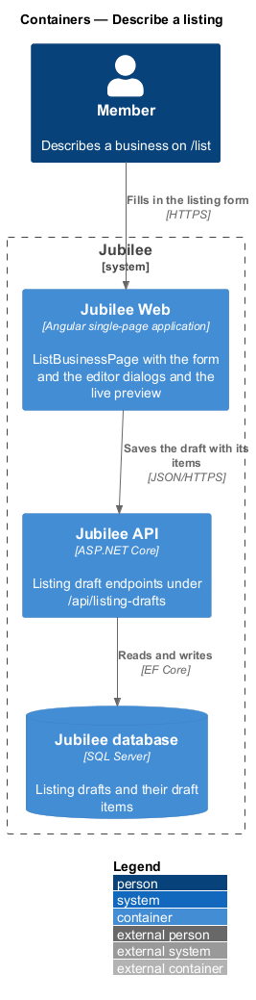
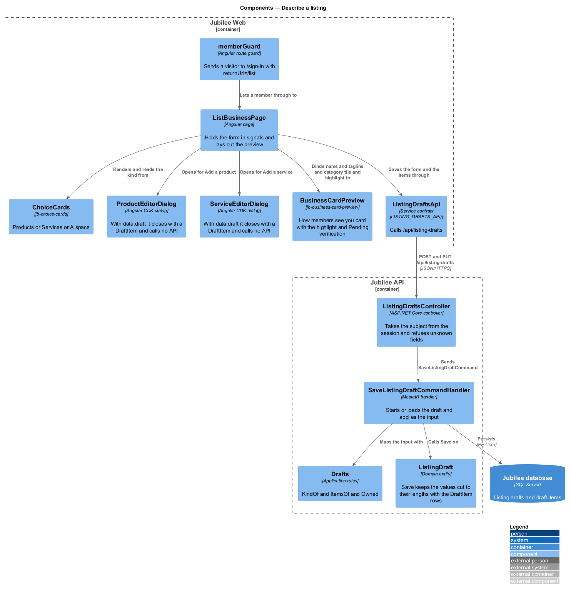
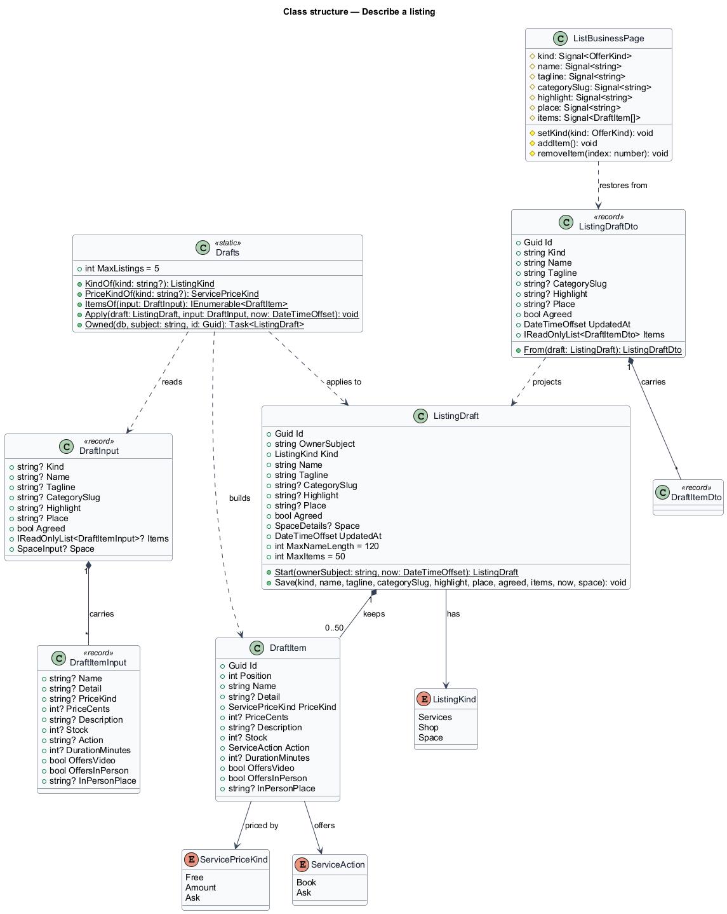
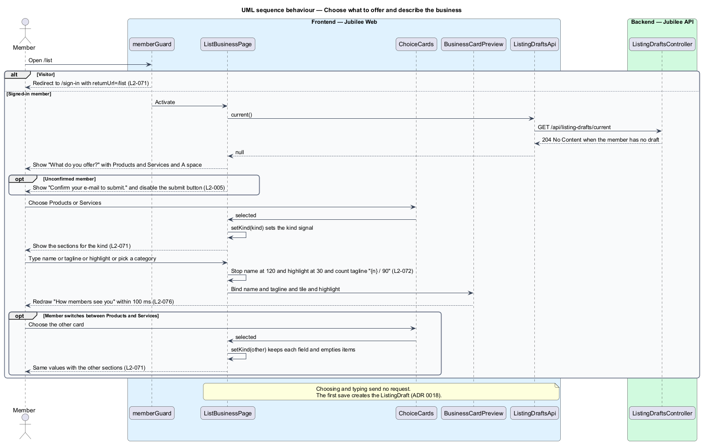
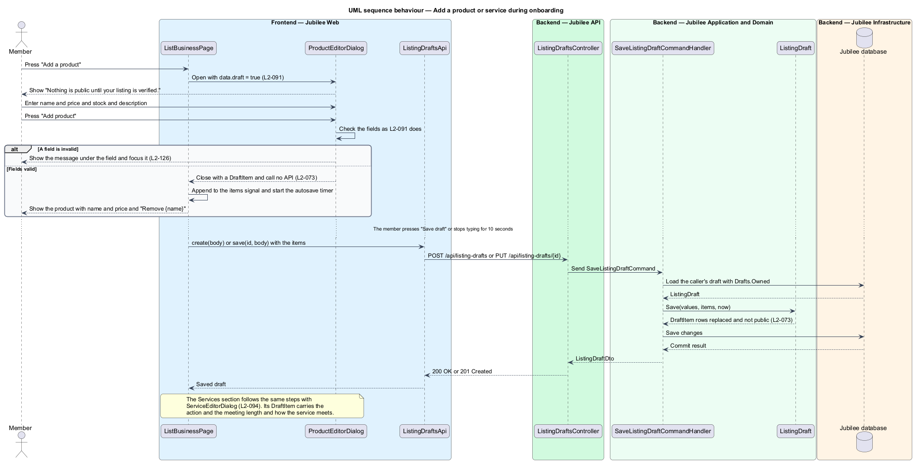

# Describe a listing

## Overview

Jubilee is Toronto's Christian marketplace: a directory of verified
Christian-owned businesses. A *listing* is the record of one business on Jubilee.
Before a listing is public it passes through onboarding, the form at `/list`
where a member describes the business and submits it for verification. This
feature covers the first part of that form: the choice between products and
services, the listing details, the first products or services, and the live
preview.

The slice uses five local terms.

- **listing draft** — form at `/list` as the server keeps it, a `ListingDraft` that only its owner reads
- **listing kind** — main offer of a business: `Shop` (products), `Services` or `Space`
- **tagline** — one line on what the business does, 90 characters at most, shown under the business name everywhere on Jubilee
- **highlight** — optional green line of 30 characters at most on the business card, such as "Free first meeting"
- **draft item** — product or service added on `/list`, kept with the listing draft until submission

Nothing entered here is public. A listing draft is not a `Listing`: the listing
is created when the draft is submitted, and it is public only after the
verification team approves it. Saving the draft and submitting it are separate
features of the `onboarding` subsystem,
[Save a draft](../save-draft/README.md) and
[Submit for verification](../submit-for-verification/README.md).

## Description

The feature is a vertical slice from the `/list` page to the `Jubilee database`.
The names below are the names in the code; the decisions are in ADR 0018, as
amended by ADR 0041 and ADR 0042.

- **`ListBusinessPage`** — Angular page at `/list`
  (`frontend/projects/jubilee/src/app/pages/list-business`), a container of
  `jb-*` components. It holds the form in signals (`kind`, `name`, `tagline`,
  `categorySlug`, `highlight`, `place`, `agreed`, `items`) and has no store or
  form service. It shows "List your business", the line "Free for
  Christian-owned businesses in Toronto. Every listing is verified before it
  goes live.", and "What do you offer?". The layout utility `split` places the
  preview to the right of the form from `1024 px` and below it under `1024 px`
  (`L2-076` AC2).
- **`memberGuard`** — route guard on `/list` (`app.routes.ts`). A visitor is
  sent to `/sign-in` with `returnUrl=/list` and returns to `/list` afterwards
  (`L2-071` AC4). An unconfirmed member passes the guard and may fill in and
  save the form. The page then shows the alert "Confirm your e-mail to submit.
  You can write and save your draft meanwhile." and disables "Submit for
  verification" from `SessionService.unconfirmed` (`L2-071` AC5, `L2-005`).
- **`ChoiceCards` and `ChoiceCard`** (`jb-choice-cards`, `jb-choice-card`) —
  the cards "Products", "Services" and "A space" under "What do you offer?",
  with the note "Offer both? Pick the main one now and add the other after
  you’re verified." `ListBusinessPage.setKind` sets the `kind` signal.
  "Products" shows "Store address" and the "Products" section. "Services" shows
  "Area you serve" and the "Services" section in their place. A change of kind
  keeps the value of each field and empties `items`, because a product is not a
  service (`L2-071` AC2 and AC3).
- **Listing details** — `jb-field` with `jb-input` and `jb-select`: "Business
  name" (required, `maxlength="120"`), "One line on what you do" (required,
  with the hint "Shown under your name everywhere on Jubilee. 90 characters at
  most." and the live counter "{n} / 90"), "Category" (one of the ten in
  `CATEGORIES` of the `api` library) and "Highlight" (optional,
  `maxlength="30"`, with the hint "A short green line on your card, like “Free
  first meeting”. 30 characters at most."). The tagline input does not stop at
  90, so that the counter and the message of `L2-072` AC3 can show.
- **Items section** — `jb-item-list` under "Products" ("Add a few to start. You
  can add the rest later.") or "Services" ("Add a few to start. A price is
  optional; “Ask” is fine."). Each `DraftItem` of the `items` signal shows its
  name, a service's detail, its price ("Free" or "Ask" for a service without an
  amount) and the button "Remove {name}". "Add a product" opens
  `ProductEditorDialog` and "Add a service" opens `ServiceEditorDialog`.
- **`ProductEditorDialog` and `ServiceEditorDialog`** — the CDK dialogs of the
  owner workspace (`L2-091`, `L2-094`), opened with `data.draft = true`. In that
  mode a dialog says "Nothing is public until your listing is verified." in
  place of "Changes show on your public listing as soon as you save.", checks
  its fields as it does in the workspace, calls no API and closes with a
  `DraftItem`. The page appends the item to `items` and starts the autosave
  timer. `ListingItemDialog`, the reduced dialog that ADR 0018 introduced, is
  removed.
- **`DraftItem`** — model of the `api` library and entity of the domain with
  the same fields: `Name`, `Detail`, `PriceKind` (`free`, `amount`, `ask`) and
  `PriceCents`; for a product `Description` and `Stock`; for a service `Action`
  (`Book` or `Ask`), `DurationMinutes`, `OffersVideo`, `OffersInPerson` and
  `InPersonPlace`. `DraftItemRequest`, `DraftItemInput` and `DraftItemDto`
  carry the same fields through the API.
- **`BusinessCardPreview`** (`jb-business-card-preview`) — the card under "How
  members see you". The page binds `name`, `tagline`, `tint` and `icon` (from
  `categoryTile` of the chosen category), `tag` ("Shop" or "Business") and
  `highlight`. The component draws the highlight as the green `jb-perk` before
  the mark "Pending verification" and draws no perk while the highlight is
  empty. The bindings are signals of the page, so the card redraws in the same
  change detection as the keystroke, within `100 ms` and without a server call
  (`L2-076` AC1).
- **`ListingDraftsApi`** — service contract of the `api` library behind the
  token `LISTING_DRAFTS_API`, implemented by `HttpListingDraftsApi`. `create`
  sends `POST /api/listing-drafts` and `save` sends
  `PUT /api/listing-drafts/{id}` with a `ListingDraftBody`: the form values and
  the items.
- **`ListingDraftsController`** — ASP.NET Core controller at
  `/api/listing-drafts`. Each action takes the caller's subject from the
  session. `ListingDraftRequest` and `DraftItemRequest` refuse an unknown field
  with HTTP 400, so that a caller cannot set a stage or an owner (`L2-133`
  AC4).
- **`Drafts`** — static rules of the application layer. `KindOf` maps
  `products`, `services` and `space` to `ListingKind`. `ItemsOf` turns the
  items of a `DraftInput` into `DraftItem` and drops one with no name. `Owned`
  loads a draft by its id and the caller's subject and answers HTTP 404 with
  `draft_not_found` for the draft of another member (`L2-133` AC2).
- **`ListingDraft`** — domain entity. `Save` keeps what the member typed
  without validating it and cuts each value to its length: the name to 120
  characters, the highlight to 30 (`L2-072` AC7), the place to 200 and at most
  50 items. The tagline is kept up to 200 characters so that a tagline over 90
  survives to the message at submission.

The rules that run only at submission are part of
[Submit for verification](../submit-for-verification/README.md):
`SubmitListingCommandHandler` checks the required fields, builds the slug with
`Slugs.From`, records the flag `CONTACT_IN_TEXT` on the `ListingSubmission`
for a name or tagline that contains a URL, an e-mail address, a phone number or
a discount code, and turns each `DraftItem` into a `Product` or a `Service`
(`L2-072` AC5 and AC6, `L2-073` AC5). The page applies the same required-field
checks first in `ListBusinessPage.check` and words each code with `messageFor`:
`REQUIRED` on `name` reads "Enter your business name as customers know it."
and `TOO_LONG:{n}` on `tagline` reads "Shorten this to 90 characters. It has
{n}." (`L2-126` AC5).

A draft with zero items may be submitted. The review screen of the admin
application then shows "No products or services yet" above the checklist
(`L2-073` AC3), from `VerificationReviewDto.ItemCount`.

### Spaces

"What do you offer?" has a third card, "A space" ("A room, suite, apartment
or hall to rent."), and `/list?kind=space` opens with it chosen. `ListingKind`
has `Space`, derived from the category "Rooms & rentals" (`rooms-rentals`),
which is the second of eleven categories. For a space the form hides
"Category", "Highlight", the items and the store address and shows the space fields; `ListingDraft` and `Listing` own an optional `SpaceDetails` in a JSON
column `Space`, and the body of the draft endpoints has a nested `space`
object. The space form, preview and agreement line are the feature
[Describe a space](../describe-space/README.md) (ADR 0042).

## Requirements

The feature realizes the following level-2 (L2) requirements. Each L2
requirement refines a level-1 (L1) requirement, cited by identifier.

| L2 ID | Refines (L1) | Requirement |
|-------|--------------|-------------|
| `L2-071` | `L1-011` | `/list` shall start with "What do you offer?" and the cards "Products", "Services" and "A space". The form shall show the sections of the chosen kind and keep the value of each other field when the kind changes. A visitor shall be asked to sign in or join and returned to `/list`; an unconfirmed member may fill in and save a draft but shall not submit. |
| `L2-072` | `L1-011` | The form shall collect a required business name of at most 120 characters, a required tagline of at most 90 characters with the counter "{n} / 90", one of the ten categories and an optional highlight of at most 30 characters. Input in the highlight shall stop at 30 and the API shall cut a longer one to 30. At submission the system shall generate a unique URL slug from the name and shall flag a name or tagline that contains a URL, e-mail address, phone number or discount code. |
| `L2-073` | `L1-011` | "Add a product" shall open the product editor (L2-091) and "Add a service" the service editor (L2-094), each saying "Nothing is public until your listing is verified." Each shall check its fields as in the owner workspace and keep the item with the draft; "Remove {name}" shall take it out again. Submission shall be allowed with zero items, and the review screen shall then show "No products or services yet". Items shall not be public while the listing is not live. At submission each product shall become a product of the listing with its name, price, stock and description and each service a service with its name, detail, price and action. |
| `L2-076` | `L1-011` | "How members see you" shall update within 100 ms as the owner types the name, tagline, category or highlight and shall show the card marked "Pending verification", with the highlight as the green line before the mark and absent while the field is empty. The preview shall sit to the right of the form from 1024 px and below it under 1024 px. |
| `L2-091` | `L1-013` | The product editor shall collect "Product name" (required), "Price (CAD)" (required, 0.01 to 100,000.00 with at most two decimals, stored as cents), "In stock" (a whole number from 0 to 9,999, or empty for not tracked) and "Description" (optional), and shall show "Enter a name for the product." and "Enter a price in dollars, like 24.00." for an empty name and an invalid price. |
| `L2-094` | `L1-013` | The service editor shall collect "Service name" (required), "Short detail" (optional, 60 characters at most), "Pricing" (Free, Fixed price, Ask for a quote), "Price (CAD)" and "Members can" (Book a time, Ask for a quote). "Book a time" shall take a duration of 15 to 480 minutes and the modes offered (video, in person with place). |
| `L2-005` | `L1-001` | Until the e-mail is confirmed, a member shall be able to browse, search and save but shall not message, book, request or list a business. |
| `L2-126` | `L1-018` | A dialog form with errors shall show each message under its field and move focus to the first invalid field. Each rule enforced in the browser shall be enforced on the server with the same message code. |
| `L2-133` | `L1-019` | Each API endpoint shall check the caller's role and ownership of the specific object before doing anything. A request for another member's object shall return 404, and an update that includes a field the caller may not set shall be rejected with 400. |
| `L2-198` | `L1-028` | `/list` shall offer "A space" beside "Products" and "Services", relabel the form for a space, preview the space card under "How renters see it", and restore a space saved as a draft. |

## Diagrams

### System context

A visitor who opens `/list` is asked to sign in or join, optionally through
`Google Identity`. A member describes the business in Jubilee.

### Containers

`Jubilee Web` renders the form and the preview and holds the form until a save.
`Jubilee API` keeps the listing draft and its items in the `Jubilee database`.
The category list is a constant of the `api` library and of the domain, so no
request reads it.

### Components

`ListBusinessPage` composes the choice cards, the fields, the two editor dialogs
and `BusinessCardPreview`, and saves through `ListingDraftsApi`.
`ListingDraftsController` sends `SaveListingDraftCommand`, whose handler applies
the input to `ListingDraft` through `Drafts`.

### Class structure

`ListingDraft` holds a `ListingKind`, the details and its `DraftItem` rows. A
`DraftItem` carries the product fields and the service fields; `DraftInput` and
`ListingDraftDto` are its shapes on the way in and out.

### Behaviour — choose what to offer and describe the business

`memberGuard` returns a visitor to `/list` after sign-in. Choosing a kind and
typing change signals of the page only: the preview redraws from them within
`100 ms`, and no request is sent until a save.

### Behaviour — add a product or service during onboarding

The editor dialog checks its fields and closes with a `DraftItem` without
calling the API. The page keeps the item in `items`, and the next save stores it
with the draft, where it is not public.

