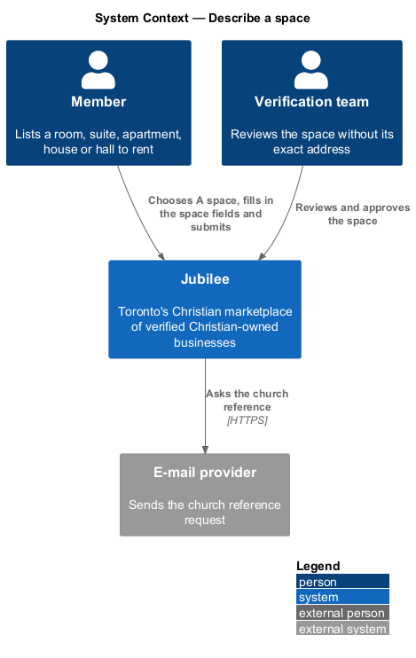
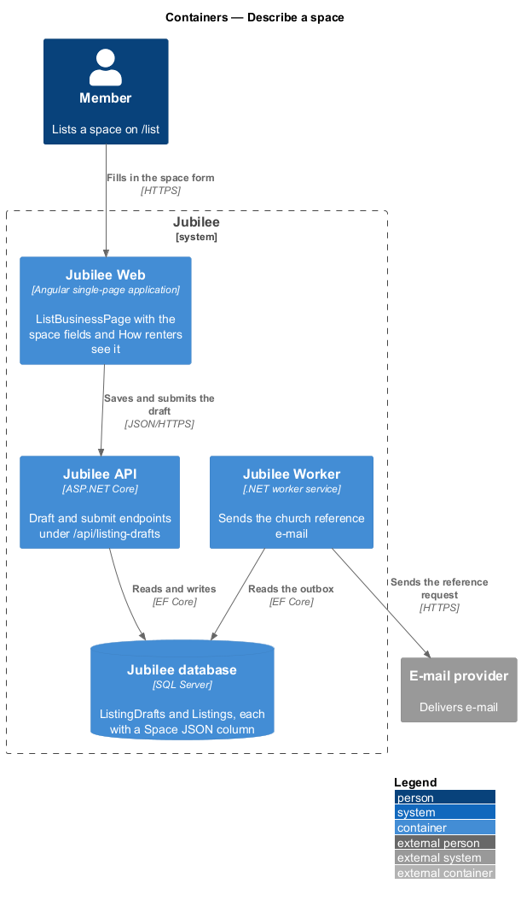
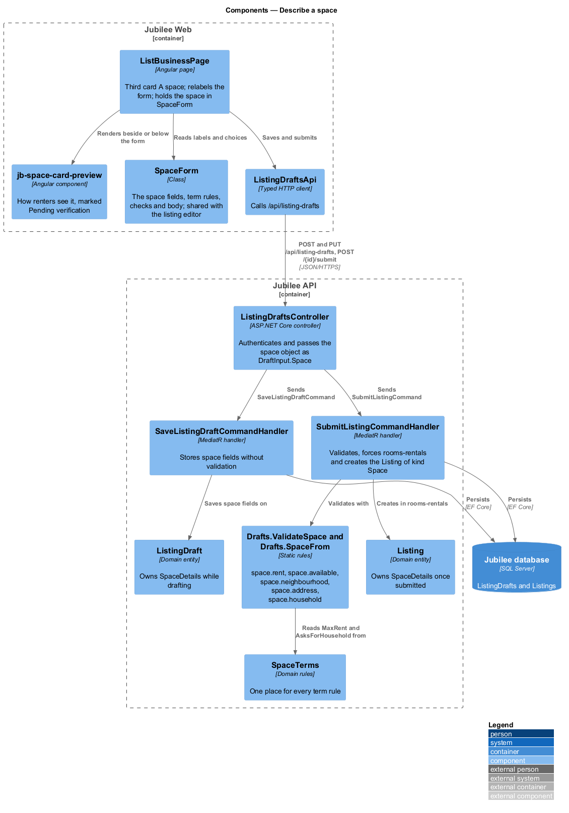
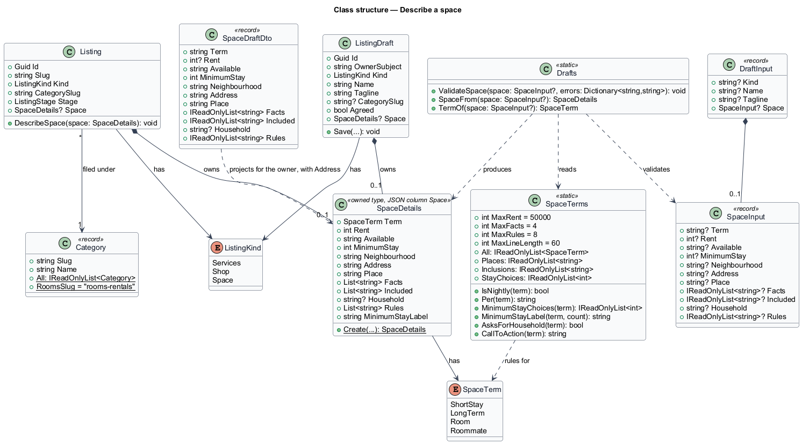
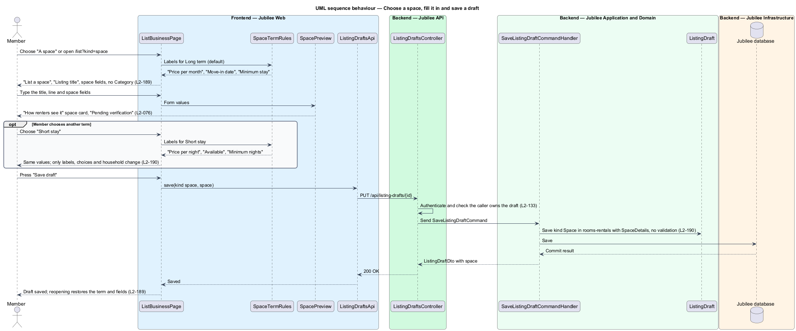
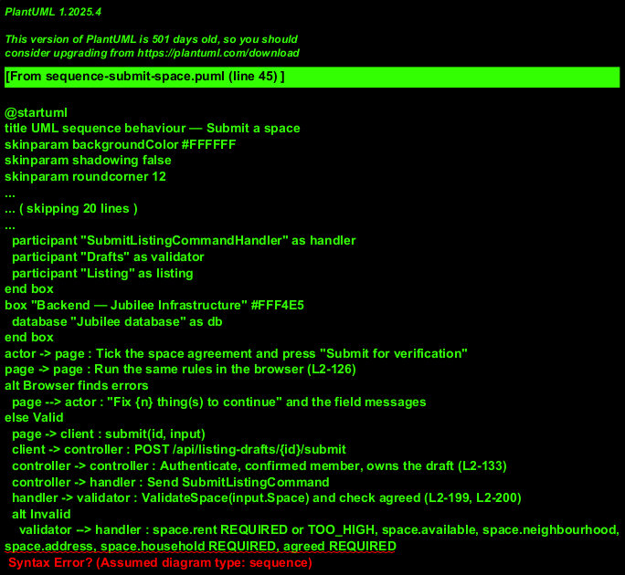

# Describe a space

## Overview

Jubilee is Toronto's Christian marketplace: a directory of
Christian-owned businesses. A *listing* is the record of one business on
Jubilee, and onboarding at `/list` is the form where a member describes a
listing and publishes it (`onboarding/describe-listing`,
`onboarding/publish-listing`).

This feature adds a third answer to "What do you offer?": "A space". A *space*
is a listing for a room, suite, apartment, house or hall that an owner rents
out. Every space sits in the category "Rooms & rentals" (`rooms-rentals`) and is
rented under exactly one *term*. The slice covers choosing "A space", the space
fields and their validation, the "How renters see it" preview, saving the space
as a draft, and the space's agreement line when it is published.

The slice uses the following local terms.

- **term** — how the space is rented: "Short stay", "Long term", "Room" or
  "Roommate", in that order, with the wire values `short-stay`, `long-term`,
  `room` and `roommate`
- **rent** — the price in whole Canadian dollars, per night for a Short stay and
  per month for every other term
- **minimum stay** — the shortest stay the owner accepts: 1, 2, 3 or 7 nights
  for a Short stay; 1 ("Month to month"), 4, 6 or 12 months otherwise
- **availability** — free text for when a renter can move in, such as "Now" or
  "Mar 1"
- **household** — free text on who already lives in a Room or Roommate space
- **key facts** — up to four short lines such as "1 bedroom" or "Separate
  entrance", shown on the space card
- **exact address** — the street address of the space; personal information
  that reaches only the renter whose request the owner accepts
  (`requests/request-space`)

A space keeps every other onboarding rule: when its owner publishes it, it is
live at once and public within 60 seconds (`L2-078`); nobody verifies it first
(ADR 0057).

## Description

The feature extends the onboarding slice from `ListBusinessPage` to the
`Jubilee database`. The model is fixed by ADR 0042.

- **`ListBusinessPage`** — Angular page at `/list`
  (`pages/list-business/`). "What do you offer?" gains a third
  `jb-choice-card` "A space" ("A room, suite, apartment or hall to rent.")
  beside "Products" and "Services". Choosing it, or opening
  `/list?kind=space`, sets the heading to "List a space", relabels "Business
  name" as "Listing title" (hint "Say what it is and where: “Furnished room in
  Leslieville”.") and "One line on what you do" as "One line renters should
  know", hides "Category", the products, the services and the store address,
  and shows the space fields. The space fields are signals held by one
  **`SpaceForm`** (`jubilee/src/app/services/space-form.ts`) beside the page's
  own, so switching between the three cards keeps each typed value
  (`L2-071`). `SpaceForm` also holds the term rules, the checks, the body
  sent to the API and the preview's view model, and the listing editor uses
  the same class for a space (`L2-209`).
- **Space fields** — composed from library components, no new presentation in
  the page:
  - "How are you renting it?" — a fieldset of four `jb-choice-card` radio
    cards in `jb-choice-cards`, in term order; Long term is chosen by default.
    "What do you offer?" lays its three cards out with `columns="3"`.
  - "Price per month" or "Price per night" — `jb-input-group` with a "$"
    prefix, whole dollars.
  - "Move-in date" or "Available" — `jb-input`, free text.
  - "Minimum stay" or "Minimum nights" — `jb-select` with the choices of the
    term ("1 night", "2 nights", "3 nights", "1 week" or "Month to month",
    "4 months", "6 months", "12-month lease").
  - "Neighbourhood" — `jb-input` with the hint "Your exact address is only
    shared once you accept a request."
  - "Exact address" — `jb-input` with the hint "Only the renter whose request
    you accept sees it."
  - "The space" — `jb-select` with "Private room", "Basement apartment",
    "Guest suite", "Entire house", "Condo" and "Event hall".
  - "Key facts" and "House rules" — `jb-textarea`, one item per line.
  - "What’s included" — `jb-chip` toggle buttons "Utilities", "Wi-Fi",
    "Laundry", "Furnished", "Parking", "Private bath", "Kitchen use" and "Pets
    OK", each pressed state carried by `aria-pressed`.
  - "Who lives in the home" (Room) or "Who you are, and who you’re looking for"
    (Roommate) — `jb-textarea` with the hint "Renters choose people as much as
    rooms. A few honest lines go a long way."; not rendered for a Short stay or
    Long term, but its value stays in the form.
  - The note "Add photos from My business once you submit. The first photo is
    your cover." (`L2-199` AC11).
- **Preview** — the region headed "How renters see it". It renders
  `jb-space-card-preview` (`directory/browse-spaces`) from `SpaceForm`'s values
  with the mark "Not published yet" and redraws without a server call
  (`L2-076`).
- **Term rules** — `SpaceForm` mirrors `SpaceTerms`: the price unit, the
  minimum-stay choices and whether the household is asked, so the form
  relabels without a request; the term badges and tiles come from
  `space-terms.ts` in the components library.
- **`ListingDraftsApi`** — typed HTTP client for the existing endpoints: `POST
  /api/listing-drafts` and `PUT /api/listing-drafts/{id}` save, `GET
  /api/listing-drafts/current` resumes and `POST
  /api/listing-drafts/{id}/publish` publishes. For a space the body carries `kind`
  `space` and a nested `space` object with `term`, `rent`, `available`,
  `minimumStay`, `neighbourhood`, `address`, `place`, `facts`, `included`,
  `household` and `rules`. No `categorySlug` is needed for a space.
- **`ListingDraftsController`** — unchanged routes; it passes the `space`
  object through as `DraftInput.Space` (`SpaceInput`).
- **`SaveListingDraftCommandHandler`** — stores the space fields on
  `ListingDraft.Space` without validation (`L2-199` AC10, `L2-077`).
- **`GetCurrentDraftQueryHandler`** — returns `ListingDraftDto` with `kind`
  `space` and `space` (`SpaceDraftDto`, address included, since only the
  draft's owner reads it), so the page restores "A space", the term and every
  field (`L2-198` AC4).
- **`PublishListingCommandHandler`** — for a space, validates the fields with
  `Drafts.ValidateSpace`, checks the agreement (`agreed` `REQUIRED`), builds
  the `SpaceDetails` with `Drafts.SpaceFrom`, and creates the `Listing` with
  `Kind` `Space`. The category is forced to `rooms-rentals` whatever the body
  says. It then follows `L2-078`: `Listing.Publish` makes the listing live. The
  success page reads "{Listing title} is live. Renters can find it in Rooms &
  rentals now." with "View public listing" and "Go to My business". An
  unticked agreement shows "Agree to the statement of faith and the rental
  terms to publish your space." (`L2-200` AC1).
- **`Drafts.ValidateSpace`** — static rules in
  `Jubilee.Application/Onboarding/Onboarding.cs`. They write field errors
  with the keys and codes below, returned as HTTP 422 with `errors`, and the page
  applies the same rules with the same messages (`L2-126`).
  - `space.rent` `REQUIRED` (empty or zero; "Enter the rent in whole dollars,
    like 950.") or `TOO_HIGH` (over `SpaceTerms.MaxRent`, 50,000; "Enter a rent
    of $50,000 or less.").
  - `space.available` `REQUIRED` ("Say when renters can move in, like Mar 1 or
    Now.").
  - `space.neighbourhood` `REQUIRED` and `space.address` `REQUIRED`.
  - `space.household` `REQUIRED` for a Room or Roommate ("Tell renters who
    lives there in a line or two.").
- **`SpaceDetails.Create`** — trims rather than refuses: the first
  `SpaceTerms.MaxFacts` (4) key facts and `SpaceTerms.MaxRules` (8) house rules
  are kept, and each line is cut to `SpaceTerms.MaxLineLength` (60) characters.
- **Space agreement** — for a space the checkbox reads "I agree to Jubilee’s
  statement of faith, and confirm I’m allowed to rent this space and will
  follow Ontario’s tenancy rules."; unticked, publishing shows "Agree to the
  statement of faith and the rental terms to publish your space." (code
  `REQUIRED` on `agreed`).
- **`SpaceTerm`** — enum in `Jubilee.Domain`: `ShortStay`, `LongTerm`, `Room`,
  `Roommate`, written as the wire values `short-stay`, `long-term`, `room` and
  `roommate` with `WireValues`.
- **`SpaceTerms`** — static domain type in `Jubilee.Domain/Space.cs` holding
  every term rule: `All` (term order), `Places`, `Inclusions`, `IsNightly`,
  `Per` (`night` or `month`), `MinimumStayChoices`, `MinimumStayLabel`,
  `AsksForHousehold`, `CallToAction` and `StayChoices`.
- **`SpaceDetails`** — owned type on `ListingDraft` and `Listing` with `Term`,
  `Rent`, `Available`, `MinimumStay`, `Neighbourhood`, `Address`, `Place`,
  `Facts`, `Included`, `Household` and `Rules`. EF maps it with `OwnsOne` into
  one JSON column `Space` on each table (migration `AddSpaceDrafts` for the
  drafts). A services listing or shop has none.
- **`ListingKind.Space`** — the third listing kind. A listing is a space
  exactly when its category is `rooms-rentals` (`Category.RoomsSlug`)
  (`L2-197` AC3).
- **`Category.All`** — "Rooms & rentals" (`rooms-rentals`) becomes the second
  of eleven, after Shops (`L2-197` AC4).

The Jubilee team's listing screen (`L2-100`, `GET /api/admin/listings/{id}`,
`moderation/take-down-listing`) has the kind `space` and a `space` object
(`AdminListingSpace`) with the term, rent and its period
(`Per`), when it is available, minimum stay, neighbourhood, the space
(`Place`), key facts, what's included, the household and the house rules, and no exact address (`L2-200` AC3).
`AdminListingPage` shows them in a card "The space" after the owner, with
the caption "The exact address is never shown here; only the renter the owner
accepts receives it.", and previews the space with `jb-space-card-preview`
under "How renters see it". Publishing makes the space live in "Rooms &
rentals" and the rooms shelf within 60 seconds (`L2-200` AC4).

### Open questions

The choices below are recorded where the design reference and the rules
differ or leave a gap.

- **Hourly rent** — the design reference prices a hall "/ hour". Deferred: a
  Short stay is priced per night (ADR 0042).
- **Household** — free text, not a structured list of people.
- **Key facts** — the design's sell frame has no "Key facts" field, but the
  space card shows two facts, so the form adds the optional field.
- **Availability** — free text. The card reads "Available now" for "Now",
  "From {text}" for a monthly term, and the text as given for a Short stay;
  the server does not parse it as a date.
- **Photos** — onboarding has no photo upload; photos are added from Edit
  listing after publishing (`L2-088`).
- **Sign-up intents** — the design's "Find a place" and "Rent out a space"
  sign-up intents are deferred; sign-up has no intent step.
- **Editing a space** — happens in the existing edit-listing screen
  (`owner-workspace/edit-listing`), a screen and so allowed by the rule against
  inline forms.

## Requirements

The feature realizes the following level-2 (L2) requirements. Each L2
requirement refines a level-1 (L1) requirement, cited by identifier.

| L2 ID | Refines (L1) | Requirement |
|-------|--------------|-------------|
| `L2-197` | `L1-028` | A space shall be in the category "Rooms & rentals", the second of eleven, under exactly one of the terms Short stay, Long term, Room and Roommate, priced per night for a Short stay and per month otherwise, and shall never move to another category. |
| `L2-198` | `L1-028` | `/list` shall offer "A space" beside "Products" and "Services", relabel the form for a space, preview the space card under "How renters see it", and restore a space saved as a draft. |
| `L2-199` | `L1-028` | The space form shall ask the term, rent, availability, minimum stay, neighbourhood, exact address, the space, key facts, what's included, house rules and, for a Room or Roommate, the household, keep values across terms, and validate them on the browser and the server. |
| `L2-200` | `L1-028` | A space shall be published with its own agreement line, follow `L2-078` so that it is live at once, show its details but never its exact address to the Jubilee team in the admin application, and appear in "Rooms & rentals" and the rooms shelf within 60 seconds. |
| `L2-076` | `L1-011` | The preview shall update within 100 ms as the owner types and shall show the card marked "Not published yet". |
| `L2-077` | `L1-011` | The owner shall be able to save the form as a draft without validation and resume it later. |
| `L2-126` | `L1-018` | A page form submitted with errors shall show the summary "Fix {n} thing(s) to continue", mark each invalid field, keep typed values, and apply the same rules and message codes on the server. |
| `L2-133` | `L1-019` | Each API endpoint shall check the caller's role and ownership of the specific object before doing anything. |

## Diagrams

### System context

A member lists a space in Jubilee; the Jubilee team takes it from there
as for any listing.

### Containers

`Jubilee Web` renders the space form and preview. `Jubilee API` stores the draft
and the published listing, each with its `Space` JSON column, in the `Jubilee
database`.

### Components

`ListBusinessPage` composes the space fields and the preview, and holds them
in `SpaceForm`. `ListingDraftsController` sends the save and
publish commands, which use `Drafts.ValidateSpace`, `Drafts.SpaceFrom` and
`SpaceTerms`.

### Class structure

`ListingDraft` and `Listing` each own an optional `SpaceDetails` whose
`SpaceTerm` selects the rules in `SpaceTerms`.

### Behaviour — choose a space, fill it in and save a draft

Choosing "A space" relabels the form; changing the term changes only labels,
choices and the household field. "Save draft" stores every space field without
validation.

### Behaviour — publish a space

Publishing validates the space fields and the space agreement on the server,
answers HTTP 422 with field codes when they fail, and otherwise creates the
listing in "Rooms & rentals" with kind `Space`, live at once.

