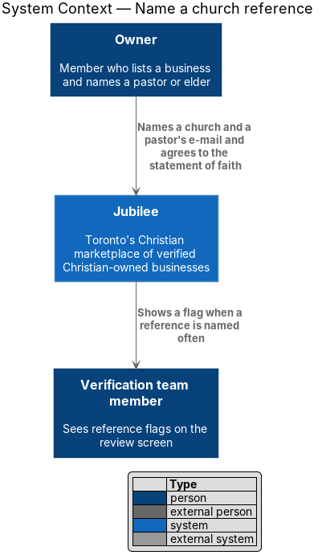
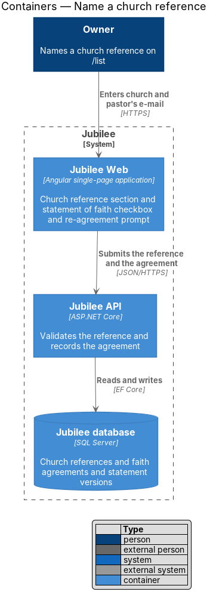
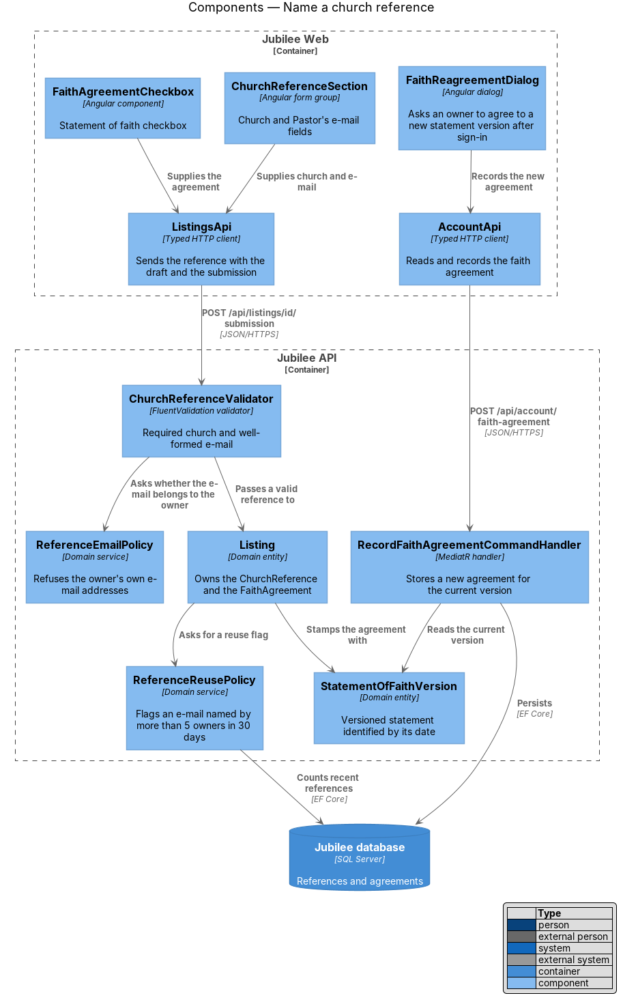
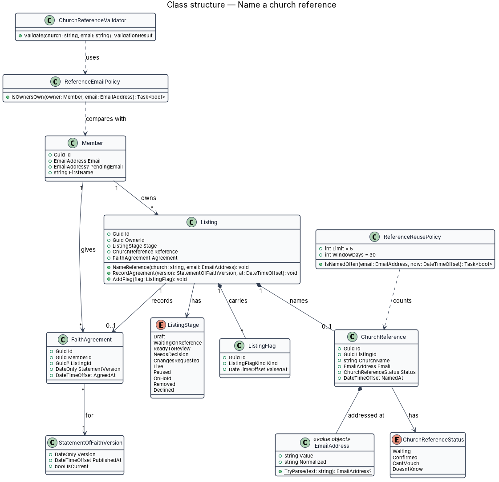
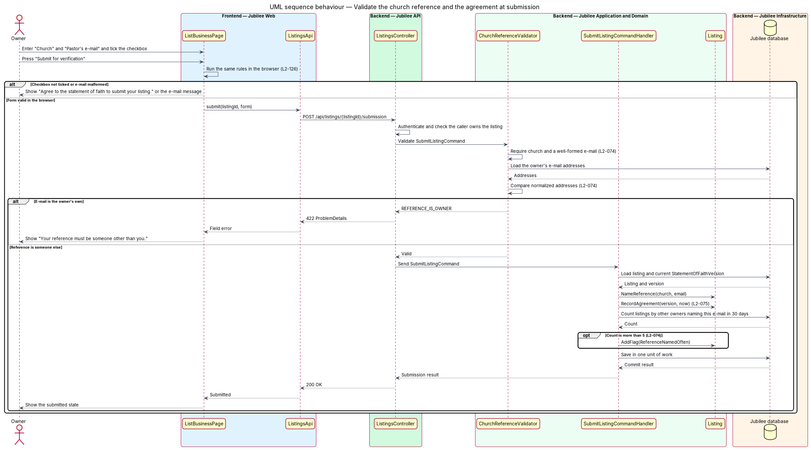
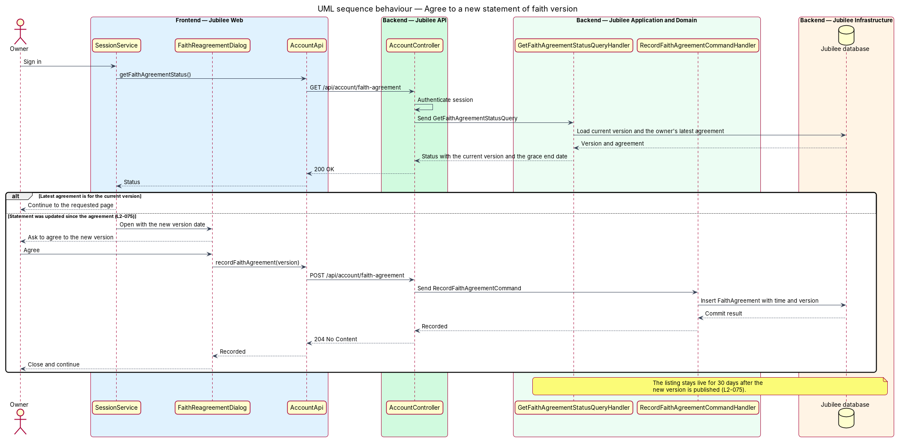

# Name a church reference

## Overview

Each business on Jubilee is verified through a church reference before it goes
live. During onboarding at `/list`, the owner names the church and the e-mail
address of a pastor or elder, and agrees to Jubilee's statement of faith. This
feature covers those two parts of the form and the rules the server applies to
them. Sending the request to the reference and collecting the answer belong to
the `church-reference` subsystem.

The slice uses three local terms.

- **church reference** — pastor or elder named by an owner, who confirms the owner privately and holds no Jubilee account
- **statement of faith version** — dated edition of Jubilee's statement of faith, identified by its date
- **faith agreement** — record that a member agreed to one statement of faith version at a given time

The reference details are private. The form states: "A pastor or elder who can
confirm you. We contact them privately; they never see your listing details."
The reference e-mail address is used only to send that listing's request and
reminders (L2-146).

The reference and the agreement are stored on a `Listing`. `ListingStage` has
the values `Draft`, `WaitingOnReference`, `ReadyToReview`, `NeedsDecision`,
`ChangesRequested`, `Live`, `Paused` and `Declined`; this feature runs while
the listing is in `Draft`.

## Description

The feature is a vertical slice from two sections of the `/list` form to the
`Jubilee database`.

- **`ChurchReferenceSection`** — Angular form group inside `ListBusinessPage`
  with the fields "Church" (required) and "Pastor's e-mail" (required,
  placeholder "name@church.ca").
- **`FaithAgreementCheckbox`** — the checkbox "I agree to Jubilee's statement
  of faith and to deal honestly with every customer." with a link to
  `/statement-of-faith`. While it is not ticked, "Submit for verification"
  shows "Agree to the statement of faith to submit your listing." and nothing
  is submitted.
- **`ChurchReferenceValidator`** — FluentValidation rules that run in the
  browser form and on the server with the same codes (L2-126). An empty or
  malformed e-mail returns `REFERENCE_EMAIL_INVALID`, shown as "Enter your
  pastor's e-mail address, like name@church.ca." An unticked agreement returns
  `FAITH_AGREEMENT_REQUIRED`. Failures return HTTP 422 with per-field codes.
- **`ReferenceEmailPolicy`** — domain service that refuses a reference e-mail
  equal to the owner's own e-mail or to the e-mail of any account the owner
  holds. It compares normalized addresses. The refusal code is
  `REFERENCE_IS_OWNER`, shown as "Your reference must be someone other than
  you." The rule that links two accounts to one owner is `<TO SUPPLY>`.
- **`ReferenceReusePolicy`** — domain service that counts the listings by
  different owners that named the same reference e-mail in the last `30 days`.
  When more than 5 exist, the sixth submission is accepted and a `ListingFlag`
  of kind `ReferenceNamedOften` is stored for the review screen.
- **`ChurchReference`** — domain entity owned by the `Listing`. It holds
  `ChurchName`, `Email` and a `ChurchReferenceStatus` of `Waiting`,
  `Confirmed`, `CantVouch` or `DoesntKnow`.
- **`EmailAddress`** — value object that parses an address and exposes a
  normalized form for comparison. The normalization rules are `<TO SUPPLY>`.
- **`FaithAgreement`** — record of the agreement with `AgreedAt` and
  `StatementVersion`, the date of the statement of faith the owner agreed to.
  `Listing.RecordAgreement` writes it in the same unit of work as the
  submission.
- **`StatementOfFaithVersion`** — versioned content entity (L2-107). Exactly
  one version is current.
- **`FaithReagreementDialog`** — dialog opened by `SessionService` after
  sign-in when the owner's latest `FaithAgreement` is older than the current
  version. The owner's listing stays live for `30 days` after the new version
  is published. The effect on the listing after `30 days` without agreement is
  `<TO SUPPLY>`.
- **`AccountApi`** — typed HTTP client. `GET /api/account/faith-agreement`
  returns the current version and whether the owner agreed to it.
  `POST /api/account/faith-agreement` records a new agreement.
- **`RecordFaithAgreementCommandHandler`** — MediatR handler that inserts a
  `FaithAgreement` for the current version with the time from `IClock`.

## Requirements

The feature realizes the following level-2 (L2) requirements. Each L2
requirement refines a level-1 (L1) requirement, cited by identifier.

| L2 ID | Refines (L1) | Requirement |
|-------|--------------|-------------|
| `L2-074` | `L1-011` | The "Church reference" section shall collect a required church and a required, well-formed pastor's e-mail. The system shall refuse an e-mail that belongs to the owner and shall flag a reference e-mail named on more than 5 listings by different owners in 30 days. |
| `L2-075` | `L1-011` | The system shall submit a listing only when the owner agrees to the statement of faith and shall record the agreement with the time and the version (date) of the statement. When the statement is updated, the owner shall be asked at next sign-in to agree to the new version, and the listing shall stay live meanwhile for 30 days. |
| `L2-126` | `L1-018` | A page form submitted with errors shall show the summary "Fix {n} thing(s) to continue", mark each invalid field, keep typed values, and apply the same rules and message codes on the server. |
| `L2-146` | `L1-020` | A reference's e-mail shall be used only to send that listing's reference request and reminders and shall never be added to a mailing list. |

## Diagrams

### System context

The owner names a reference and agrees to the statement of faith. A
verification team member later sees the flag raised for a reference that is
named often.

### Containers

`Jubilee Web` collects the reference and the agreement. `Jubilee API` validates
them and stores them in the `Jubilee database`.

### Components

`ChurchReferenceValidator` asks `ReferenceEmailPolicy` whether the e-mail
belongs to the owner. `Listing` asks `ReferenceReusePolicy` for a flag and
stamps the agreement with the current `StatementOfFaithVersion`.

### Class structure

`Listing` names one `ChurchReference` and records one `FaithAgreement`, which
points at a `StatementOfFaithVersion`. The two policies depend on `Member` and
`ChurchReference`.

### Behaviour — validate the church reference and the agreement at submission

The browser and the server apply the same rules. The server refuses the owner's
own e-mail with HTTP 422, records the agreement with time and version, and
adds a flag when the reference is named often.

### Behaviour — agree to a new statement of faith version

After sign-in, `SessionService` compares the owner's latest agreement with the
current version and opens `FaithReagreementDialog` when they differ.

