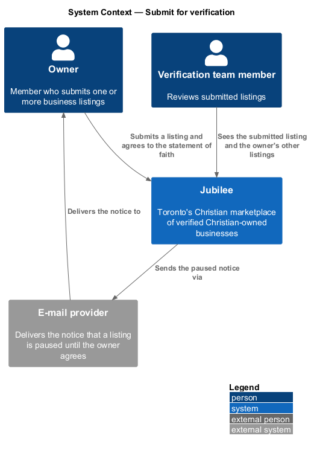
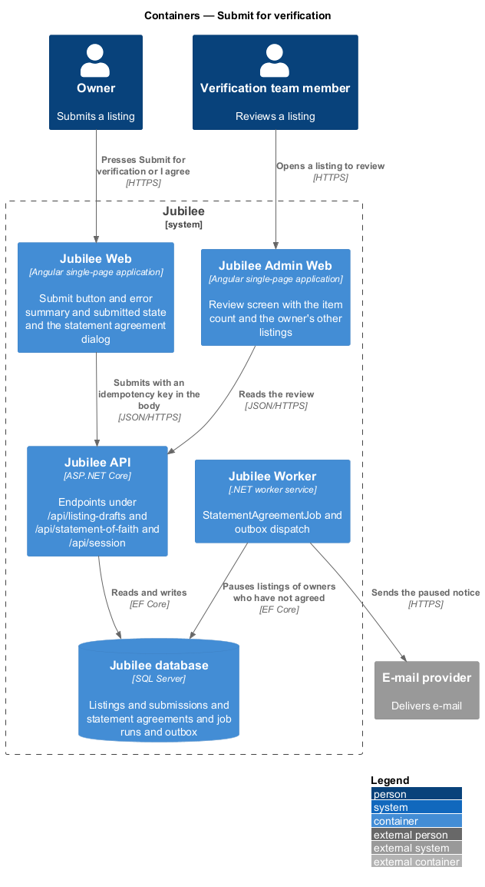
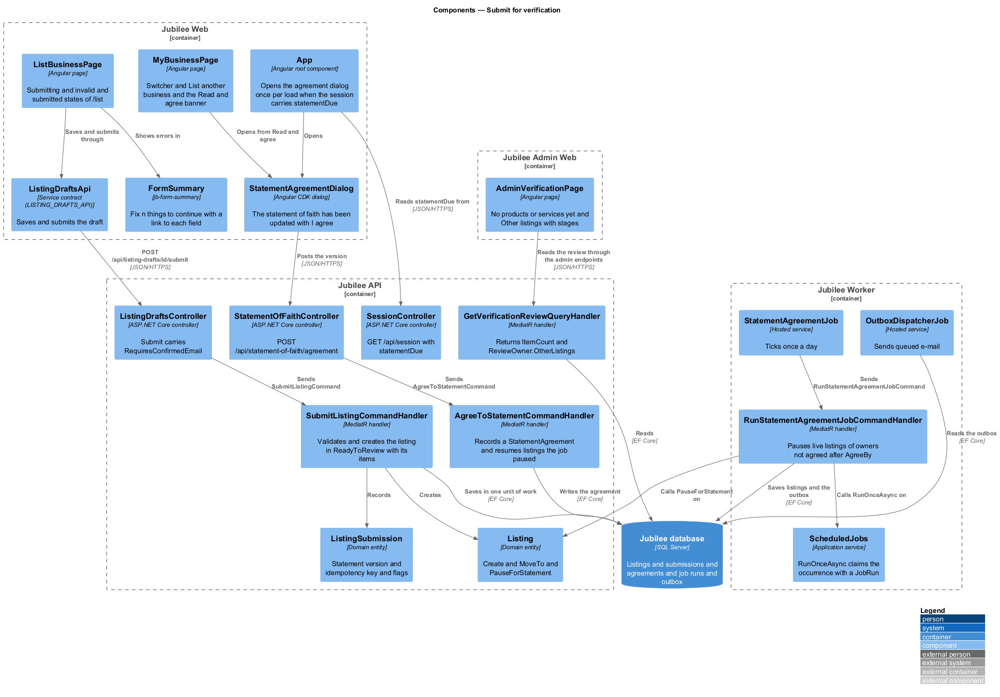
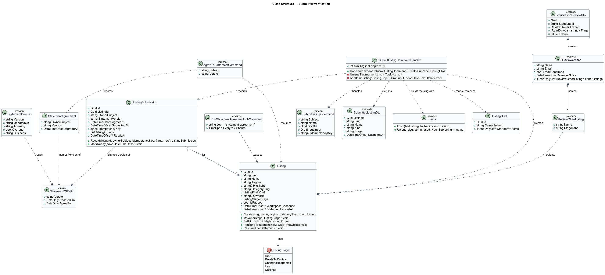
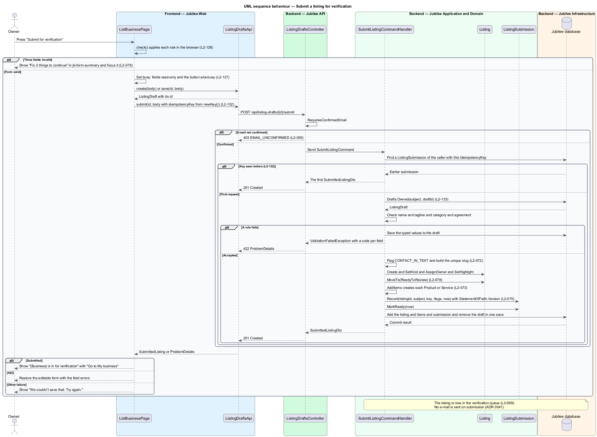
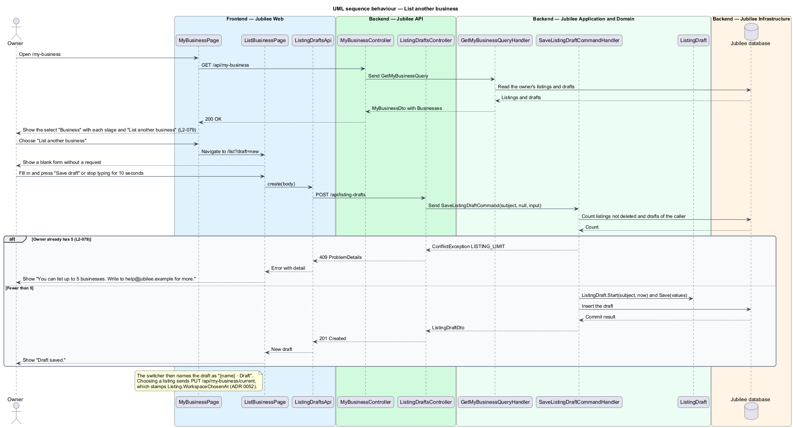
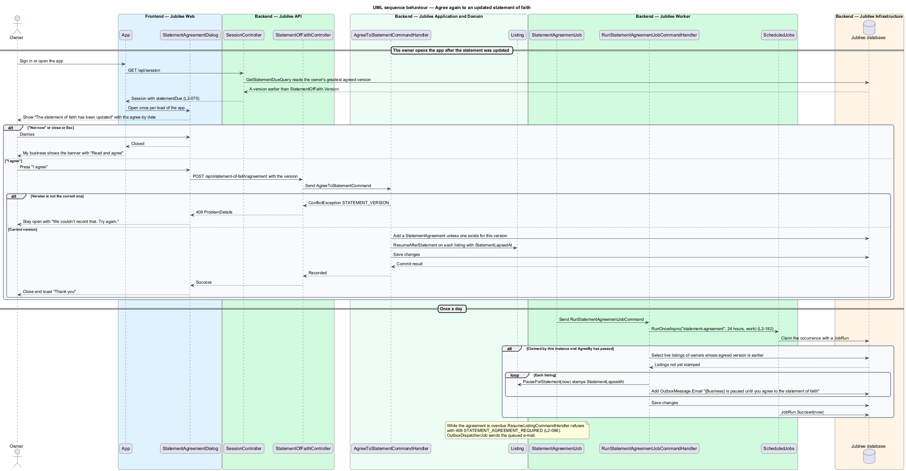

# Publish a listing

## Overview

An owner lists a business on Jubilee by describing it at `/list`, agreeing to
the statement of faith and publishing it. Publishing is the step at which a
finished draft becomes public: the form is validated in full, the draft
becomes a `Listing` at the stage `Live`, and members can find it within 60
seconds. Nobody verifies a listing before it goes live (ADR 0057); the Jubilee
team looks through published listings afterwards and takes down one that
misrepresents a business (`moderation/take-down-listing`). With publishing the owner agrees to
Jubilee's statement of faith. This feature covers publishing, the agreement and
its renewal when the statement changes, and the rule that lets one owner hold
more than one listing.

The slice uses five local terms.

- **publishing** — turning the owner's `ListingDraft` into a `Listing` at the stage `Live`, requested by its owner and recorded as a `ListingSubmission`
- **listing stage** — position of a listing in its lifecycle, one value of `ListingStage`
- **statement version** — date on which the statement of faith was last updated, `StatementOfFaith.Version`
- **re-agreement** — agreement of an owner to a statement version newer than the one the owner last agreed to
- **listing switcher** — select labelled "Business" at the top of My business that names each listing and each draft of the owner

`ListingStage` has two values: `Draft` (0) and `Live` (5). Paused, on hold and deleted
are flags on the listing (`IsPaused`, `IsUnderModerationHold`, `DeletedAt`),
not stages. Before publishing, the live preview on `/list` marks the card "Not
published yet".

Publishing is a create request and carries an idempotency key, so a double
press or a network retry publishes the listing once. An unconfirmed member may
fill in the form but may not publish it. A space follows the same rule with its
title and the category "Rooms & rentals" (`onboarding/describe-space`).

## Description

The feature is a vertical slice from the `/list` page to the `Jubilee database`,
with one scheduled job in `Jubilee Worker` for the re-agreement. Publishing
sends no e-mail and involves no third party (ADR 0041); members who asked to
hear of new businesses are told in the app. The names below are the names in
the code; the decisions are in ADR 0018, ADR 0041, ADR 0050, ADR 0052 and
ADR 0057.

### Publishing

- **`ListBusinessPage`** — Angular page at `/list`. On "Publish listing" it
  validates the form, makes the fields read-only and shows the button busy
  with `aria-busy="true"`. On success it shows "{Business} is live. Members can
  find you in {category} now." with "View public listing", "Go to My business"
  and "Add more products" (or "Add more services"). A publish that fails or
  takes longer than 10 seconds (`SUBMIT_TIMEOUT_MS`) makes the fields editable
  again with nothing lost and shows "We couldn't publish your listing. Your
  draft is saved. Try again." (`L2-127` AC2). An HTTP 422 answer restores the
  editable form with the field errors.
- **`FormSummary`** (`jb-form-summary`) — shared component. For three invalid fields it shows "Fix
  3 things to continue" with `role="alert"`, lists each error as a link to its
  field, and receives focus (`L2-078` AC2, `L2-126` AC1).
- **`ListingDraftsApi`** — typed HTTP client.
  `publish(id, body)` posts the form with its `idempotencyKey` to
  `POST /api/listing-drafts/{id}/publish` and returns `PublishedListing`;
  `POST /api/listing-drafts` starts a further draft. The page creates the key
  once with `newKey` and sends the same key with every publish it makes
  (`L2-132`). The API has no idempotency middleware and reads no header.
- **`ListingDraftsController`** — ASP.NET Core controller. Its publish action
  carries `RequiresConfirmedEmail`: an unconfirmed member receives HTTP 403
  with code `EMAIL_UNCONFIRMED`, and the page keeps the button disabled with
  "Confirm your e-mail to publish." It sends `PublishListingCommand(Subject,
  Name, DraftId, Input, IdempotencyKey)` and answers HTTP 201 with
  `PublishedListingDto`.
- **`PublishListingCommandHandler`** — MediatR handler; there is no separate
  validator. A key the owner already used returns the listing it published,
  so a double press or a retry publishes once. It loads the caller's draft (an
  unknown draft, or one of another member, answers 404 `draft_not_found`), then checks every publishing rule on
  the server: name required, tagline required and at most 90 characters, a
  category (or, for a space, its fields), and the statement of faith agreement
  (`L2-075`). A failure saves what was typed to the draft and returns HTTP 422
  with per-field codes (`REQUIRED`, `TOO_LONG:{n}`) that match the browser
  messages. It raises the flag `CONTACT_IN_TEXT` when the name or tagline
  holds a web address, e-mail address, phone number or discount code
  (`L2-072`). It creates the `Listing` with a unique slug (`Slugs.From`, then "-2",
  "-3" and so on, `L2-072` AC5), sets its kind, owner, place and highlight,
  calls `Listing.Publish`, and adds the products, services or space. A
  service whose booking details are not acceptable (a length outside 15 to
  480 minutes, no way to meet, or in person with no place) is kept as
  `ServiceAction.Ask` (`L2-073` AC5). It records a `ListingSubmission` with
  `ListingSubmission.Record`, which stores `StatementOfFaith.Version` as
  `StatementVersion`, the time as `AgreedAt` and `SubmittedAt`, the key and the
  flags (`L2-075` AC2). It tells the members who asked to hear of new
  businesses in the listing's category through `NewBusinessNotifier`
  (`L2-222` AC1, `notifications/view-notification-centre`), removes the draft,
  and saves once. It returns `PublishedListingDto(ListingId, Slug,
  Name, Kind, Stage, SubmittedAt)`, with `Stage` `live`.
- **`Listing`** — domain entity. `Publish` sets `PublishedAt` to the time and
  `Stage` to `Live`, and refreshes the recommended score; it is the only code
  that sets `PublishedAt`. `MoveTo` refuses `Live`, so nothing else makes a
  listing live. `PublishedAt` orders the "Newest" sort of the directory and
  the Jubilee team's listings list (`L2-099`).
- **Public within 60 seconds** — `PublicListingFilter` admits a listing whose
  stage is `Live`, with `PublishedAt` set, not paused, not deleted and not
  under a moderation hold (`L2-028`). `DirectoryCacheInvalidationInterceptor`
  drops the server-side directory read cache after the save, and public
  directory responses carry `Cache-Control: public, max-age=60`, so the listing
  appears in browse, category and search results within that time.

### More than one listing

- **`ListingSwitcher`** — the switcher at the top of `MyBusinessPage`
  (`owner-workspace/view-business-overview`, ADR 0052). It names each listing
  of the owner from `MyBusinessDto.Businesses` (`BusinessOptionDto`) with its
  stage ("{Business} · Live", "{Business} · Paused" or "{Business} · Draft")
  and offers "List another business", a link to `/list?draft=new`. Choosing a
  listing sends `PUT /api/my-business/current`, which stamps
  `Listing.WorkspaceChosenAt`; choosing a draft opens `/list?draft={id}`
  (`L2-079` AC1, AC4 and AC5). After publishing, My business shows the live
  overview (`L2-085`).
- **`SaveListingDraftCommandHandler`** — `POST /api/listing-drafts` sends
  `SaveListingDraftCommand` with no ID, which starts a new draft. It counts the
  owner's listings that are not deleted and their drafts, and at 5
  (`Drafts.MaxListings`) refuses with HTTP 409 and code `LISTING_LIMIT`, shown
  as "You can list up to 5 businesses. Write to help@jubilee.example for
  more."
- **Other listings for the Jubilee team** — `GetAdminListingQuery` returns
  `AdminListingOwner.OtherListings`, a list of `AdminOtherListing(Name,
  StageLabel)`: each other listing of the owner that is not deleted, with its
  stage worded by `Workspace.StageLabel` as the switcher words it, and each
  listing draft of the owner as "Draft". `AdminListingPage` at `/listings/{id}`
  shows them under "Other listings" as "Laurent Photography · Live", or "None"
  (`L2-079` AC3, `moderation/take-down-listing`).

### Re-agreement to a new statement of faith

- **`StatementOfFaith`** — static class of the domain. `Version` is the date
  the statement was last updated, `UpdatedOn` is that date and `AgreeBy` is 30
  days later.
- **`StatementAgreement`** — domain entity: the owner's subject, the version
  and the time of the agreement. An owner's latest agreed version is the
  greatest of the owner's `ListingSubmission.StatementVersion` and
  `StatementAgreement.Version`. A member with neither is not an owner and is
  not asked.
- **`StatementDueDto`** — part of the answer of `GET /api/session` as
  `statementDue`: `version`, `updatedOn`, `agreeBy`, `overdue` and `business`.
  It is present only for an owner whose latest agreed version is earlier than
  `StatementOfFaith.Version`. `SessionController` asks `GetStatementDueQuery`,
  which reads the latest agreed version with
  `StatementAgreements.LatestAgreedAsync` and names the listing
  `Workspace.Find` returns; `overdue` is true once the Toronto date is after
  `StatementOfFaith.AgreeBy`.
- **`StatementAgreementDialog`** — CDK dialog in `dialogs/statement-agreement`.
  The root component `App` opens it once per load of the app when the session
  carries `statementDue`. It is titled "The statement of faith has been
  updated" and says "We updated Jubilee’s statement of faith on {date}. Read it
  and agree by {date} to keep your listing on Jubilee.", with the link "Read
  the statement of faith" (a new tab), "Not now" and "I agree". When `overdue`
  is true it says "{Business} is paused until you agree to the updated
  statement of faith." "I agree" shows the button busy and posts the version.
  On success the dialog closes and a toast says "Thank you" with "Your
  agreement to the statement of faith is recorded." On failure the dialog
  stays open with "We couldn’t record that. Try again." (`L2-075` AC3 and
  AC4). It posts through `StatementOfFaithApi`, the contract behind
  `STATEMENT_OF_FAITH_API`, and on success tells `SessionService`
  (`statementAgreed`), so the banner of My business goes at once. Escape and a
  click outside are "Not now", except while the agreement is being recorded.
- **`MyBusinessPage`** — while the session carries `statementDue` it shows the
  banner "The statement of faith has been updated. Read it and agree by {date}
  to keep {Business} live." with "Read and agree", which opens the dialog
  (`L2-075` AC5). When the agreement is overdue the banner says the listing is
  paused and offers "Read and agree" in place of "Resume listing" (`L2-096`
  AC6).
- **`StatementOfFaithController`** —
  `POST /api/statement-of-faith/agreement` sends `AgreeToStatementCommand`.
  The handler refuses a version other than the current one with HTTP 409 and
  code `STATEMENT_VERSION`, records one `StatementAgreement` per owner and
  version however often it is called, and resumes each listing the job paused,
  the listings that carry `Listing.StatementLapsedAt`, with
  `Listing.ResumeAfterStatement`. Such a listing is live again at once
  (`L2-075` AC6); a listing the owner paused themselves stays paused.
  `MyBusinessPage` loads the overview again when the session no longer carries
  `statementDue`.
- **`StatementAgreementJob`** — hosted service in `Jubilee Worker`. Once a day
  it sends `RunStatementAgreementJobCommand`, whose handler works through
  `ScheduledJobs.RunOnceAsync` with the job name `statement-agreement` and the
  interval of 24 hours, so that one instance does the work of the day and its
  last success is recorded in `JobRun` (`L2-182` AC1). After `AgreeBy` the work
  takes each owner who has still not agreed, pauses each of the owner's live
  listings with `Listing.PauseForStatement`, which stamps
  `Listing.StatementLapsedAt`, and queues one e-mail per listing in the outbox
  with the subject "{Business} is paused until you agree to the statement of
  faith". A listing already stamped is skipped, so a repeat sends nothing.
- **`ResumeListingCommandHandler`** — handler of the owner workspace
  ([Pause and resume a listing](../../owner-workspace/pause-listing/README.md)).
  While the owner's agreement is overdue it refuses with HTTP 409 and code
  `STATEMENT_AGREEMENT_REQUIRED` and the listing stays paused (`L2-096` AC6).

## Requirements

The feature realizes the following level-2 (L2) requirements. Each L2
requirement refines a level-1 (L1) requirement, cited by identifier.

| L2 ID | Refines (L1) | Requirement |
|-------|--------------|-------------|
| `L2-078` | `L1-011` | When a valid form is published, the system shall make the fields read-only and the button busy, make the listing live and public within 60 seconds, and show "{Business} is live. Members can find you in {category} now." with "View public listing", "Go to My business" and "Add more products" (or "Add more services"). An invalid form shall show the summary "Fix {n} things to continue" with a link to each field, and a failed publish shall keep the draft and say "We couldn't publish your listing. Your draft is saved. Try again." |
| `L2-075` | `L1-011` | Publishing shall require the statement of faith checkbox and shall record the agreement with the time and the version of the statement. When the statement is updated, an owner whose latest agreement is to an earlier version shall be asked to agree in the dialog "The statement of faith has been updated" on the next opening of the app, and My business shall offer "Read and agree" meanwhile. An agreement to another version than the current one shall be refused with HTTP 409 and code `STATEMENT_VERSION`. When 30 days pass without the agreement, the daily job shall pause each live listing of the owner and e-mail the owner once per listing; when the owner agrees, each such listing shall be live again at once. |
| `L2-079` | `L1-011` | An owner may hold up to 5 listings, shown in a switcher at the top of My business with their stages and "List another business", and the system shall refuse a sixth. The Jubilee team shall see each other listing of the owner with its stage and each draft under "Other listings" when it opens one in the admin application, or "None". |
| `L2-072` | `L1-011` | When the listing is published the system shall generate a unique URL slug from the business name, with a numeric suffix if taken, and shall accept, publish and flag a name or tagline that contains a URL, e-mail address, phone number or discount code. The published listing shall carry the highlight. |
| `L2-073` | `L1-011` | Publishing shall be allowed with zero items. When the listing is published each product shall become a product of the listing with its name, price, stock and description and each service a service with its name, detail, price and action; a service whose booking details the API would not accept shall be kept as "Ask for a quote". |
| `L2-096` | `L1-013` | When the owner has not agreed to the current statement of faith 30 days after it was updated, "Resume listing" shall be refused with HTTP 409 and code `STATEMENT_AGREEMENT_REQUIRED`, the listing shall stay paused, and My business shall offer "Read and agree" in place of "Resume listing". |
| `L2-222` | `L1-010` | A member who turned on "New businesses" shall hear of a newly published business in a category they have browsed, in the app, as it is published. |
| `L2-028` | `L1-003` | When an owner publishes a listing, the system shall return it in public lists within 60 seconds, and shall not return a listing in draft. |
| `L2-005` | `L1-001` | Until the e-mail is confirmed, a member shall be able to browse, search and save but shall not message, book, request or publish a listing; the API shall respond 403 with code `EMAIL_UNCONFIRMED`. |
| `L2-126` | `L1-018` | A page form submitted with errors shall show the summary "Fix {n} thing(s) to continue", mark each invalid field, keep typed values, and apply the same rules and message codes on the server. |
| `L2-127` | `L1-018` | While a form is submitting, the fields shall be read-only, the primary button shall show a spinner with `aria-busy="true"`, and a second press shall send nothing; a submission not answered within 10 seconds shall fail and keep the input. |
| `L2-132` | `L1-018` | Each create request shall carry a client-generated idempotency key, and the server shall return the original result for a repeated key within 24 hours without creating a duplicate. |
| `L2-133` | `L1-019` | Each API endpoint shall check the caller's role and ownership of the specific object before doing anything; a request for another member's object shall return 404. |
| `L2-182` | `L1-025` | Each scheduled job shall be idempotent, shall run at most once per schedule across instances, and shall record its last success. |

## Diagrams

### System context

The owner publishes a listing and agrees to the statement of faith, and
members find it in public lists. Jubilee e-mails the owner through the `E-mail
provider` when a listing is paused for a missing agreement.

### Containers

`Jubilee Web` publishes with an idempotency key in the body. `Jubilee API`
stores the listing and its `ListingSubmission`, which keeps the key, in the
`Jubilee database`, and drops the directory read cache in the `Cache`.
`Jubilee Admin Web` shows the owner's other listings to the Jubilee team, and
`Jubilee Worker` runs the daily agreement job.

### Components

`ListingDraftsController` sends `PublishListingCommand` or, to start a draft,
`SaveListingDraftCommand`. `PublishListingCommandHandler` answers a repeated
key from its `ListingSubmission`, validates, and creates the live listing.
`StatementOfFaithController` sends `AgreeToStatementCommand`.
`StatementAgreementJob` reaches the pausing work through `ScheduledJobs`.

### Class structure

`PublishListingCommandHandler` creates a `Listing`, records a
`ListingSubmission` and returns a `PublishedListingDto`. An owner holds at
most 5 listings (`Drafts.MaxListings`), and `BusinessOptionDto` projects a
listing for the switcher. `StatementAgreement` and `ListingSubmission` both
record a statement version, and `AdminListingOwner` carries an
`AdminOtherListing` per other listing and draft.

### Behaviour — publish a listing

The browser validates first. The server checks e-mail confirmation, the
idempotency key, ownership of the draft and the rules, then creates the listing
at `Live`, where public lists show it within 60 seconds.

### Behaviour — list another business

The switcher lists the owner's listings from the overview. Starting a further
draft succeeds below 5 listings and drafts and returns HTTP 409 at 5.

### Behaviour — agree again to an updated statement of faith

The session names the agreement that is due and the app opens the dialog. An
agreement in time changes nothing else. After 30 days the daily job pauses the
owner's live listings and e-mails the owner; the agreement then makes them live
again.

