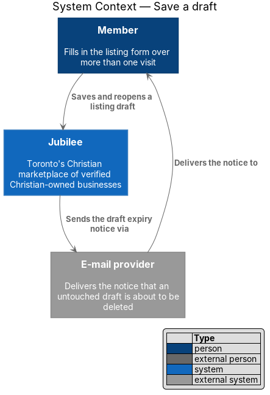
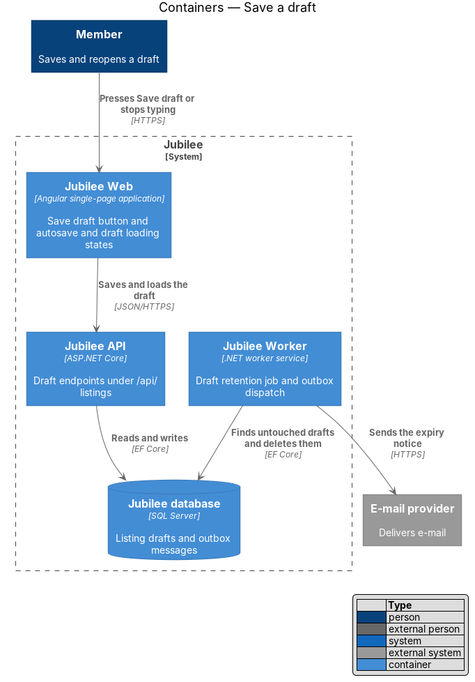
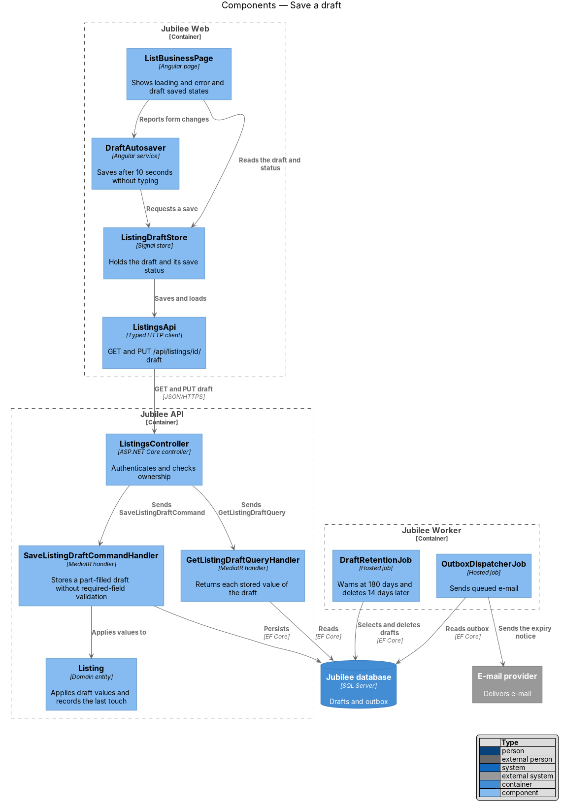
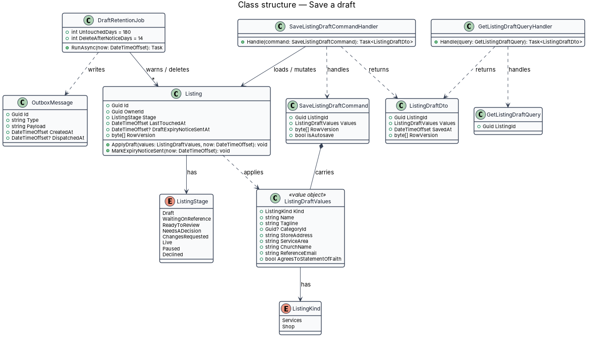
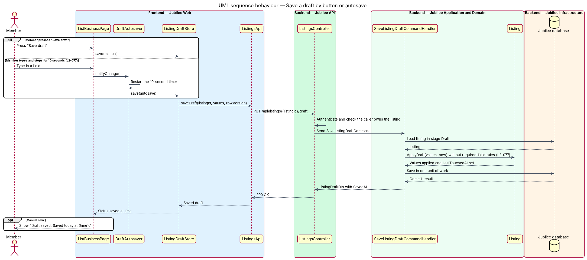
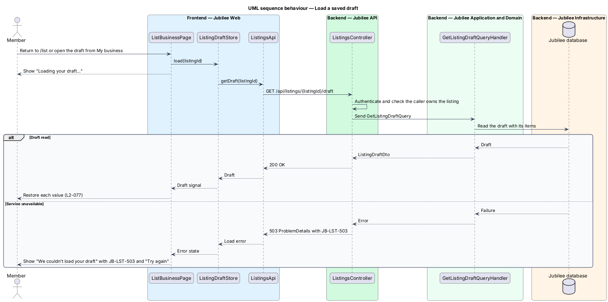
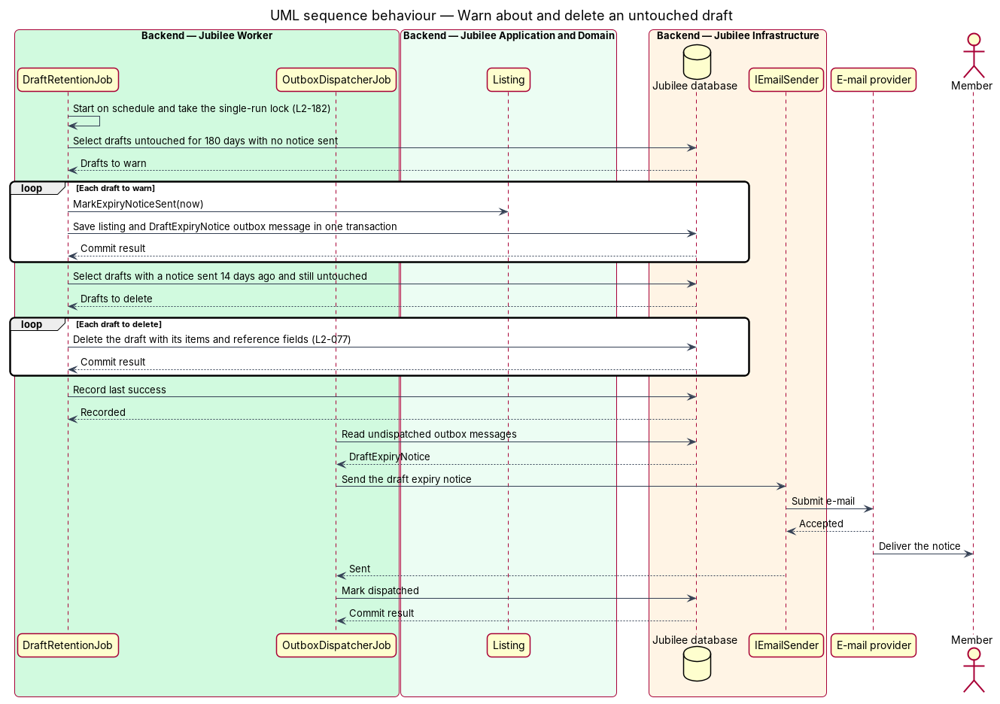

# Save a draft

## Overview

Listing a business on Jubilee takes one form at `/list`: what the business
offers, its details, its first products or services and the statement of faith
agreement. An owner may not have each answer to hand, so the form can be saved
part-filled and finished later. This feature covers saving, autosaving,
reloading and expiring that saved form.

The slice uses three local terms.

- **listing draft** — form at `/list` as the server keeps it, a `ListingDraft` that only its owner reads
- **idle draft** — listing draft with no save for 180 days
- **occurrence** — one period of a scheduled job, the UTC day for a job that runs every 24 hours

A listing draft is not a `Listing`. It has no stage and no slug, each of its
fields may be empty, and nothing in it is public. Publishing turns it into a
listing in the stage `Live` and deletes it
([Publish a listing](../publish-listing/README.md), ADR 0057). An unconfirmed
member may save a draft; only publishing is blocked (`L2-005`).

## Description

The feature is a vertical slice from the `/list` page to the `Jubilee database`,
with one scheduled job in `Jubilee Worker`. The names below are the names in the
code; the decisions are in ADR 0018 and, for scheduled work, ADR 0050.

- **`ListBusinessPage`** — Angular page at `/list`. It offers "Save draft"
  beside "Publish listing". `saveDraft` sends the form through
  `ListingDraftsApi`: `create` while the page has no draft id, `save`
  afterwards. A successful save sets the `savedAt` signal, and the page shows
  the success alert "Draft saved. Saved today at {time}. Come back any time
  from My business; nothing is public until you publish." The next edit clears
  the alert. A failed save by the button shows "We couldn’t save that. Try
  again.", or the detail of an HTTP 409 answer.
- **Autosave** — a timer of the page, with no service of its own. Each edit
  calls `touched`, which restarts a timer of `AUTOSAVE_MS` (`10 s`). When the
  timer ends, the page calls `saveDraft(true)`. A failed autosave shows nothing
  and the next edit starts the timer again. The page clears the timer when it
  is destroyed and while publishing is in flight.
- **Loading** — `ListBusinessPage.load` reads the query parameter `draft`.
  `/list` loads the draft the member touched last through `current`,
  `/list?draft={id}` loads that draft through `get`, and `/list?draft=new`
  starts a blank form without a request. While the request is in flight the
  page announces "Loading your draft…" over `jb-skeleton` fields. `apply`
  restores each value, the items and, for a space, the space fields. My
  business opens a draft with `/list?draft={id}` from its switcher (ADR 0052).
- **Load error state** — when the request fails, the page shows the
  `jb-empty-state` "We couldn’t load your draft" with "Nothing is lost. Check
  your connection and try again. If it keeps happening, tell us and quote
  `JB-LST-503`.", "Try again" and "Back to browse" (`L2-118`).
- **`ListingDraftsApi`** — service contract of the `api` library behind the
  token `LISTING_DRAFTS_API`, implemented by `HttpListingDraftsApi`. `current`
  sends `GET /api/listing-drafts/current`, `get` sends
  `GET /api/listing-drafts/{id}`, `create` sends `POST /api/listing-drafts` and
  `save` sends `PUT /api/listing-drafts/{id}`.
- **`ListingDraftsController`** — ASP.NET Core controller at
  `/api/listing-drafts`. Each action requires a session and passes the caller's
  subject to its command or query. `Current` answers HTTP 204 when the member
  has no draft. `Create` answers HTTP 201 with the new draft. The request
  records refuse an unknown field with HTTP 400 (`L2-133` AC4).
- **`SaveListingDraftCommandHandler`** — MediatR handler. With an id it loads
  the draft through `Drafts.Owned`. Without an id it counts the caller's
  listings that are not deleted and the caller's drafts, refuses a sixth with
  HTTP 409 and code `LISTING_LIMIT`, and otherwise calls `ListingDraft.Start`.
  It then applies the input with `Drafts.Apply` and saves in one unit of work.
  It applies no required-field rule (`L2-077` AC1).
- **`GetCurrentDraftQueryHandler` and `GetDraftQueryHandler`** — MediatR
  handlers. The first returns the caller's draft with the newest `UpdatedAt`,
  or null. The second returns one draft by id. Both return a `ListingDraftDto`
  with the items in their order.
- **`Drafts.Owned`** — loads a draft by its id and the caller's subject. The
  draft of another member is answered as HTTP 404 with `draft_not_found`, the
  same answer as a draft that does not exist (`L2-133` AC2).
- **`ListingDraft`** — domain entity with its `DraftItem` rows. `Save` keeps
  the values cut to their lengths, replaces the items, sets `UpdatedAt` and
  clears `NoticeSentAt`, which cancels a pending deletion. The entity has no
  row version: the last save wins, and the page sends one form at a time.
- **`ListingDraftExpiryJob`** — hosted service in `Jubilee Worker` on a
  `PeriodicTimer` of 24 hours. On each tick it sends
  `RunListingDraftExpiryJobCommand`.
- **`RunListingDraftExpiryJobCommand`** — command whose handler runs
  `ExpireListingDraftsCommand` through `ScheduledJobs.RunOnceAsync` with the
  job name `listing-draft-expiry` and the interval of 24 hours.
- **`ScheduledJobs`** — application service of ADR 0050. `RunOnceAsync` claims
  the occurrence by inserting a `JobRun` keyed by job and occurrence. An
  instance that finds the row, or whose insert the key refuses, does nothing.
  After the work the run records `SucceededAt`, the last success of the job.
  The job therefore runs at most once a day across instances (`L2-077` AC5,
  `L2-182` AC1).
- **`ExpireListingDraftsCommandHandler`** — MediatR handler that does the
  work. It deletes each draft whose `NoticeSentAt` is 14 days old or older
  (`ListingDraft.GraceAfterNotice`). It then takes each draft with no notice
  and an `UpdatedAt` 180 days old or older (`ListingDraft.IdleBeforeNotice`),
  calls `NoticeSent` and adds an e-mail to the outbox with
  `OutboxMessage.Email`. The subject is "Your draft of {title} will be deleted
  in 14 days" and the text tells the owner to continue at `/list`. A draft
  with no name is called "your listing". The work is idempotent: a repeat
  finds the notice already sent.
- **`OutboxDispatcherJob`** — hosted service in `Jubilee Worker` that sends
  each queued e-mail to the `E-mail provider`.

## Requirements

The feature realizes the following level-2 (L2) requirements. Each L2
requirement refines a level-1 (L1) requirement, cited by identifier.

| L2 ID | Refines (L1) | Requirement |
|-------|--------------|-------------|
| `L2-077` | `L1-011` | The system shall save a part-filled listing form as a draft without validation of required fields, on "Save draft" and after 10 seconds without typing, and shall show "Draft saved. Saved today at {time}." It shall restore each value when the owner returns to `/list` or opens the draft from My business, showing "Loading your draft…" meanwhile. The system shall e-mail the owner about a draft untouched for 180 days and shall delete it 14 days later; the job that does both shall run at most once a day however many instances of the worker run and shall record its last success. |
| `L2-005` | `L1-001` | Until the e-mail is confirmed, a member shall be able to browse, search and save but shall not message, book, request or list a business. |
| `L2-079` | `L1-011` | An owner may hold up to 5 listings, and the system shall refuse a sixth with "You can list up to 5 businesses. Write to help@jubilee.example for more." |
| `L2-118` | `L1-016` | Each load-error state shall show a reference the user can quote to support; a draft that fails to load shall show `JB-LST-503`. |
| `L2-133` | `L1-019` | Each API endpoint shall check the caller's role and ownership of the specific object before doing anything. A request for another member's object shall return 404, and an update that includes a field the caller may not set shall be rejected with 400. |
| `L2-182` | `L1-025` | Each scheduled job shall be idempotent, shall run at most once per schedule across instances, and shall record its last success. |

## Diagrams

### System context

The member saves and reopens a draft in Jubilee. Jubilee sends the expiry
notice for an idle draft through the `E-mail provider`.

### Containers

`Jubilee Web` saves and loads the draft through `Jubilee API`. `Jubilee Worker`
finds idle drafts in the `Jubilee database` and sends the notice.

### Components

`ListBusinessPage` saves and loads through `ListingDraftsApi`, by the button
and by its autosave timer. The controller sends a command or a query.
`ListingDraftExpiryJob` reaches `ExpireListingDraftsCommandHandler` through
`ScheduledJobs`, and `OutboxDispatcherJob` sends what it queued.

### Class structure

`SaveListingDraftCommand` carries a `DraftInput`, which `Drafts.Apply` hands to
`ListingDraft.Save`. `RunListingDraftExpiryJobCommand` runs
`ExpireListingDraftsCommand` under a `JobRun`, and the work writes an
`OutboxMessage`.

### Behaviour — save a draft by button or autosave

Both triggers call `saveDraft`. The first save creates the draft and each later
save replaces its values; the handler applies no required-field rule.

### Behaviour — load a saved draft

The page shows "Loading your draft…" and then restores each value. A failed
load shows the error state with `JB-LST-503`.

### Behaviour — warn about and delete an idle draft

`ListingDraftExpiryJob` ticks every 24 hours and `ScheduledJobs` lets one
instance do the work of the day. The work deletes each draft whose notice is
14 days old and queues the notice for each draft idle for 180 days.
`OutboxDispatcherJob` sends the notice.

