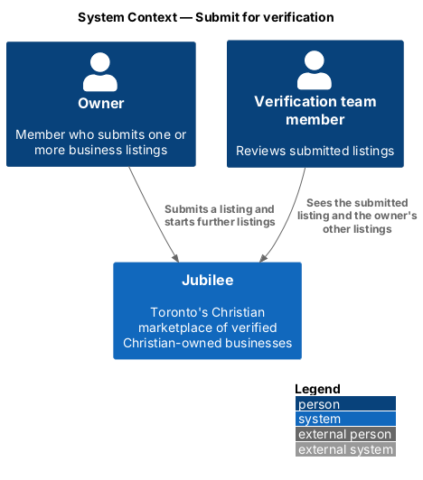
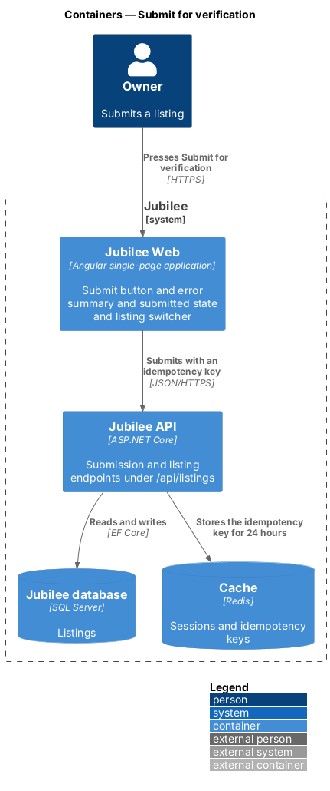
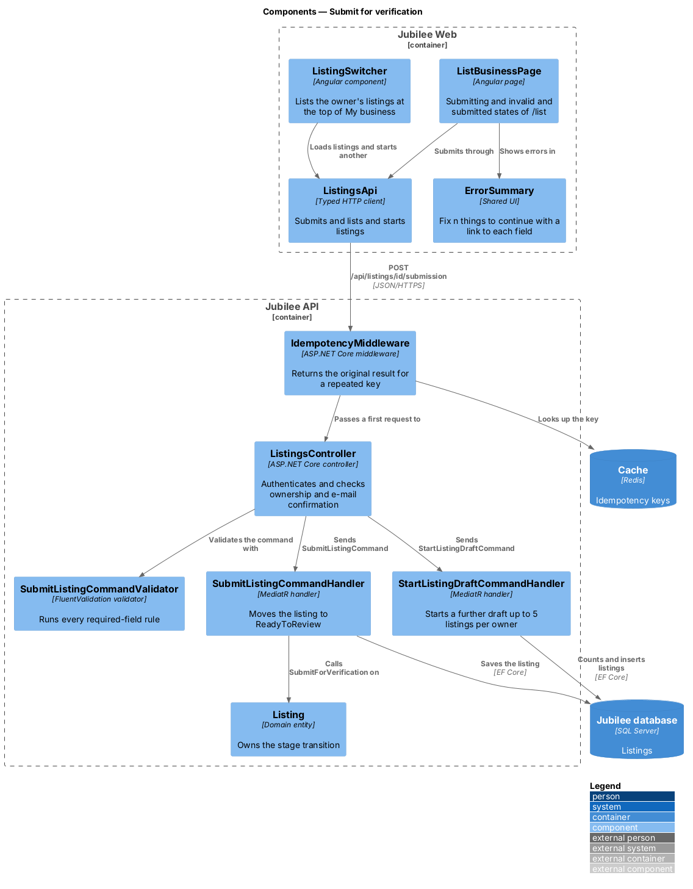
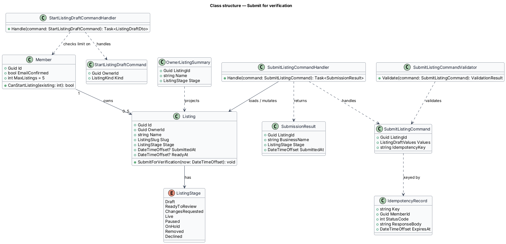
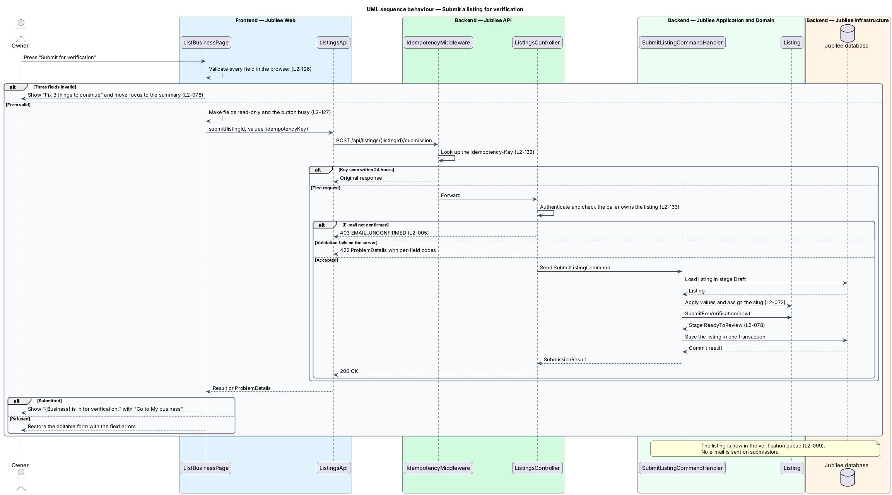
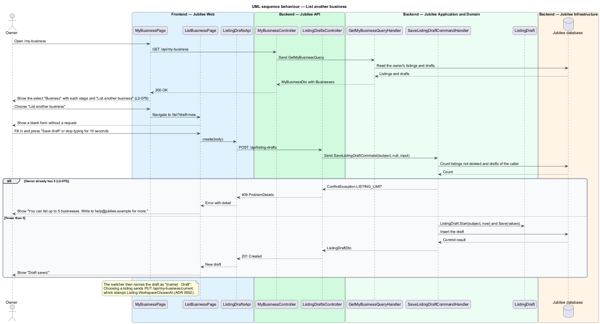

# Submit for verification

## Overview

A business appears on Jubilee only after the verification team approves it.
Submission is the step at which the owner hands a finished draft over: the form
at `/list` is validated in full, the listing leaves the stage `Draft` and enters
the verification queue. This feature covers that step
and the rule that lets one owner hold more than one listing.

The slice uses three local terms.

- **submission** — transition of a listing from `Draft` to `ReadyToReview`, requested by its owner
- **listing stage** — position of a listing in its lifecycle, one value of `ListingStage`
- **listing switcher** — control at the top of My business that lists each listing of the owner

`ListingStage` has eight values: `Draft`, `ReadyToReview` ("Ready to
review"), `ChangesRequested` ("Changes requested"), `Live`, `Paused`,
`OnHold`, `Removed` and `Declined`. A submitted listing shows the
mark "Pending verification" to its owner until it is `Live`.

Submission is a create request and carries an idempotency key, so a double
press or a network retry submits the listing once. An unconfirmed member may
fill in the form but may not submit it.

## Description

The feature is a vertical slice from the `/list` page to the `Jubilee database`.
Submission sends no e-mail and involves no third party: the listing goes
straight to the verification queue.

- **`ListBusinessPage`** — Angular page at `/list`. On "Submit for
  verification" it validates the form, makes the fields read-only and shows the
  button busy with `aria-busy="true"`. On success it shows "{Business} is in
  for verification. Nothing more to do right now. We'll e-mail you the moment
  you're live." with "Go to My business" and "Add more products" (or "Add more
  services"). Under "What happens next" it shows three steps: "You submitted
  {Business}" (complete), "We review your listing" with "Within two business
  days" (current) and "You're live" with "We e-mail you the moment members can
  find you" (upcoming). A submission that takes longer than `10 s` fails with the page's
  failed state (L2-127).
- **`ErrorSummary`** — shared component. For three invalid fields it shows "Fix
  3 things to continue" with `role="alert"`, lists each error as a link to its
  field, and receives focus.
- **`IdempotencyKeyFactory`** — creates the key that `ListingsApi` sends in the
  `Idempotency-Key` header of the submission.
- **`ListingsApi`** — typed HTTP client.
  `POST /api/listings/{listingId}/submission` submits, `GET /api/my/listings`
  feeds the switcher, and `POST /api/listings` starts a further draft.
- **`IdempotencyMiddleware`** — stores the key with the response in the `Cache`
  for `24 hours` and returns the original result for a repeated key.
- **`ListingsController`** — ASP.NET Core controller. It authenticates the
  session and checks that the caller owns the listing (HTTP 403 otherwise). An
  unconfirmed member receives HTTP 403 with code `EMAIL_UNCONFIRMED`; the page
  keeps the button disabled with "Confirm your e-mail to submit."
- **`SubmitListingCommandValidator`** — runs every submission rule on the
  server: the listing details (L2-072) and the statement of faith agreement
  (L2-075). A failure returns HTTP 422 with
  per-field codes that match the browser messages.
- **`SubmitListingCommandHandler`** — MediatR handler. It applies the final
  values, assigns the slug, records the agreement, and calls
  `Listing.SubmitForVerification`. It saves the listing in one transaction.
- **`Listing`** — domain entity. `SubmitForVerification` allows the transition
  only from `Draft`, sets `Stage` to `ReadyToReview` and sets
  `SubmittedAt` and `ReadyAt`. `SubmittedAt` orders the verification queue
  (L2-099).
- **`ListingSwitcher`** — component at the top of `MyBusinessPage`. It shows
  each listing of the owner with its stage and the action "List another
  business". After submission, My business shows the pending state for the
  listing (L2-086).
- **`StartListingDraftCommandHandler`** — starts a new draft. It counts the
  owner's listings and refuses a sixth with HTTP 409 and code
  `LISTING_LIMIT_REACHED`, shown as "You can list up to 5 businesses. Write to
  help@jubilee.example for more."
- **`OwnerListingSummary`** — projection of a listing's name and stage. The
  switcher uses it, and the review screen shows it under "Other listings" so
  that a verification team member sees the owner's other listings with their
  stages.

## Requirements

The feature realizes the following level-2 (L2) requirements. Each L2
requirement refines a level-1 (L1) requirement, cited by identifier.

| L2 ID | Refines (L1) | Requirement |
|-------|--------------|-------------|
| `L2-078` | `L1-011` | When a valid form is submitted, the system shall make the fields read-only, move the listing to the stage "Ready to review" in the verification queue and show the submitted state with the three steps of "What happens next". An invalid form shall show the summary "Fix {n} things to continue" with a link to each field. |
| `L2-079` | `L1-011` | An owner may hold up to 5 listings, shown in a switcher at the top of My business, and the system shall refuse a sixth. The verification team shall see an owner's other listings with their stages when reviewing one. |
| `L2-005` | `L1-001` | Until the e-mail is confirmed, a member shall be able to browse, search and save but shall not message, book, request or list a business; the API shall respond 403 with code `EMAIL_UNCONFIRMED`. |
| `L2-126` | `L1-018` | A page form submitted with errors shall show the summary "Fix {n} thing(s) to continue", mark each invalid field, keep typed values, and apply the same rules and message codes on the server. |
| `L2-127` | `L1-018` | While a form is submitting, the fields shall be read-only, the primary button shall show a spinner with `aria-busy="true"`, and a second press shall send nothing. |
| `L2-132` | `L1-018` | Each create request shall carry a client-generated idempotency key, and the server shall return the original result for a repeated key within 24 hours without creating a duplicate. |

## Diagrams

### System context

The owner submits a listing. Jubilee puts the listing in front of the
verification team.

### Containers

`Jubilee Web` submits with an idempotency key. `Jubilee API` stores the listing
in the `Jubilee database` and the key in the `Cache`.

### Components

`IdempotencyMiddleware` screens repeated keys before `ListingsController`. The
controller validates and sends `SubmitListingCommand` or
`StartListingDraftCommand`.

### Class structure

`SubmitListingCommandHandler` mutates `Listing` and returns a
`SubmissionResult`.
`Member` owns at most 5 listings, and `OwnerListingSummary` projects a listing
for the switcher and the review screen.

### Behaviour — submit a listing for verification

The browser validates first. The server checks the idempotency key, ownership,
e-mail confirmation and the rules, then moves the listing to
`ReadyToReview`, where the verification queue shows it.

### Behaviour — list another business

The switcher lists the owner's listings. Starting a further draft succeeds
below 5 listings and returns HTTP 409 at 5.

