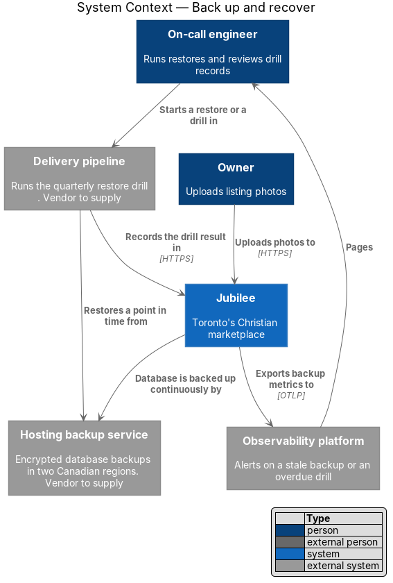
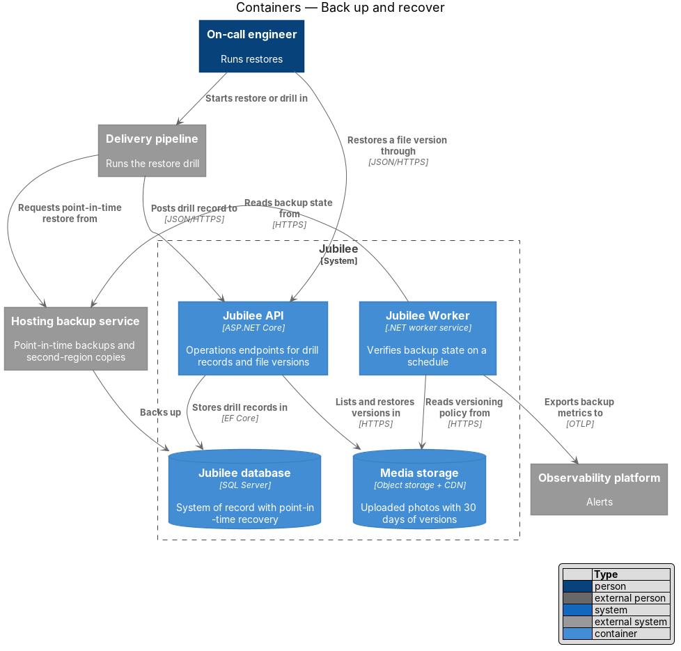
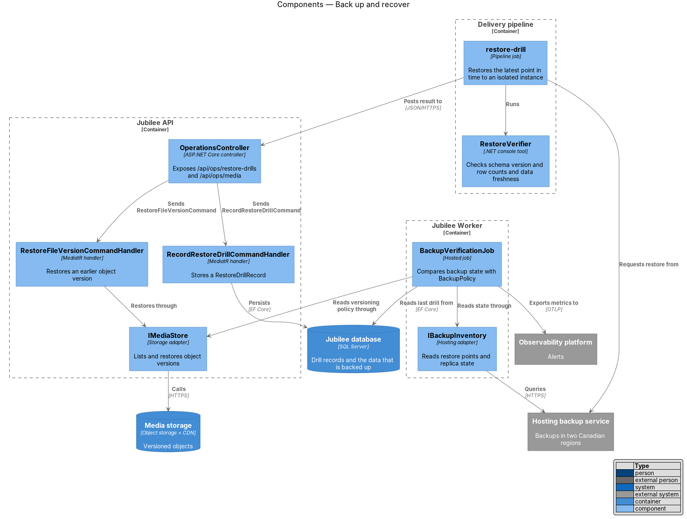
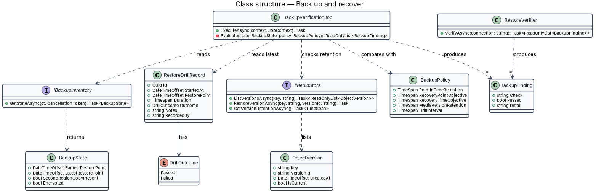
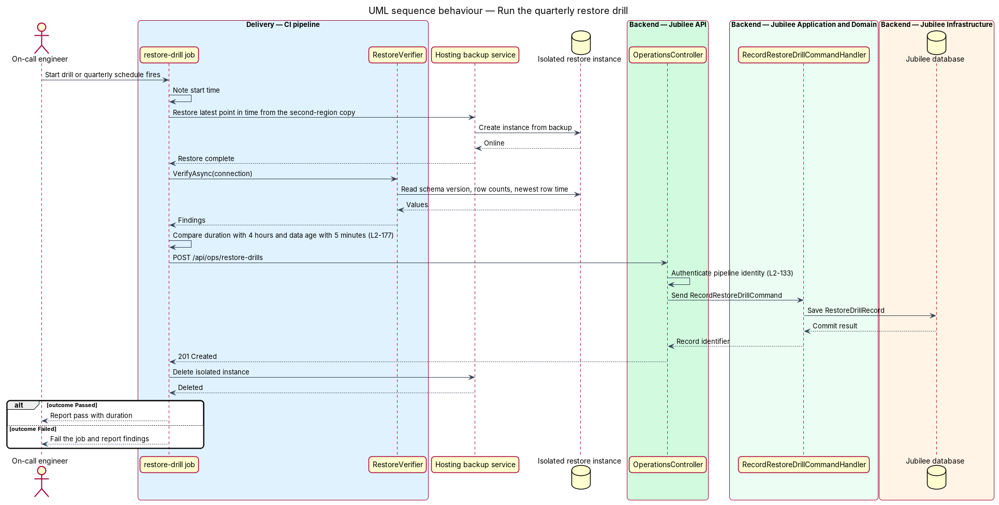
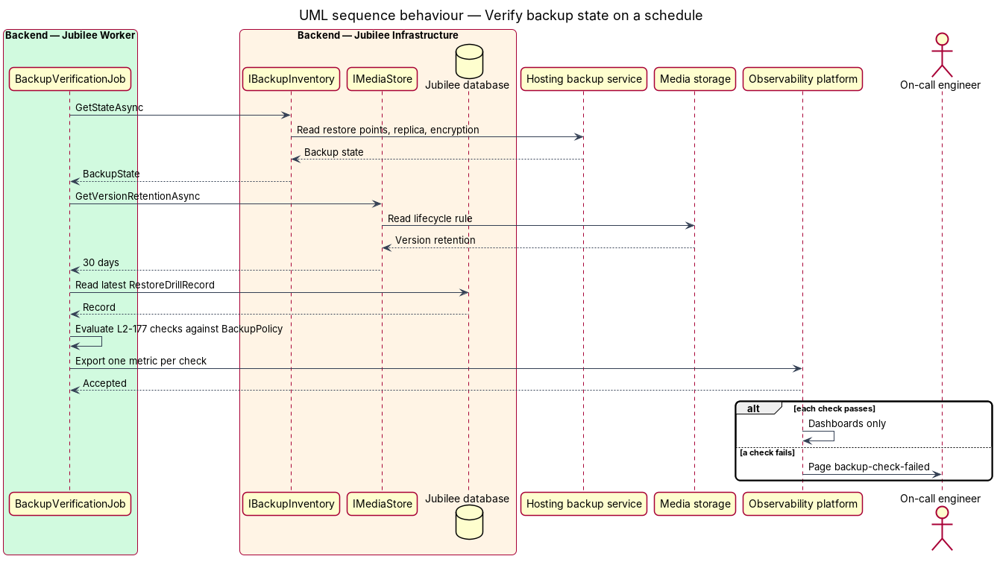
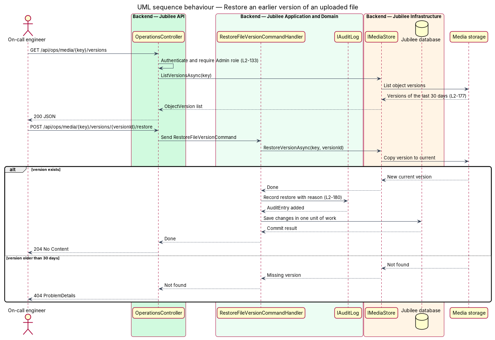

# Back up and recover

## Overview

Jubilee is Toronto's Christian marketplace. Its `Jubilee database` is the system of record
for members, listings, requests and messages, and its `Media storage` holds uploaded photos.
This feature covers how both are protected against loss and how a restore is carried out and
proven to work.

Four terms recur. *point-in-time recovery* — restore of the database to its state at a chosen
instant within the retention period. *recovery point objective* — largest interval of
committed data that a restore may lose; here 5 minutes. *recovery time objective* — longest
time a restore may take; here 4 hours. *restore drill* — rehearsal that restores a backup to
an isolated instance, checks the result, and records the outcome.

The hosting provider's managed backup service takes the backups; Jubilee does not implement
backup software. The design adds three things around that service: a policy defined as code,
a scheduled job that verifies the policy holds, and a drill that is run at least once per
quarter. The hosting provider, both Canadian regions and the key management service are
`<TO SUPPLY>`.

## Description

The slice consists of infrastructure policy, one job in `Jubilee Worker`, one pipeline job
and two operations endpoints.

- **`BackupPolicy`** — single definition of the targets, kept in the infrastructure
  definitions and read by the job: point-in-time retention of 35 days, recovery point
  objective of 5 minutes, recovery time objective of 4 hours, object version retention of
  30 days, and a drill interval of one quarter.
- **Database backup configuration** — infrastructure-as-code settings for the managed SQL
  Server instance: point-in-time recovery retained for 35 days, transaction log backups at an
  interval of at most 5 minutes, backup copies replicated to a second Canadian region, and
  encryption of each backup at rest. The infrastructure tool is `<TO SUPPLY>`.
- **Media versioning configuration** — object versioning on the `Media storage` bucket with a
  lifecycle rule that expires each non-current version after 30 days.
- **`IBackupInventory`** — adapter in `Jubilee.Infrastructure` that reads the earliest and
  latest restore point, the presence of the second-region copy and the encryption flag from
  the hosting backup service, and returns them as `BackupState`.
- **`BackupVerificationJob`** — scheduled job in `Jubilee Worker`. It compares `BackupState`,
  the media version retention and the date of the latest passed `RestoreDrillRecord` with
  `BackupPolicy`, and exports one metric per check. A failed check pages the on-call engineer
  through an alert rule. The schedule of the job is `<TO SUPPLY>`.
- **`restore-drill`** — pipeline job that runs on a quarterly schedule and on demand. It
  restores the latest point in time from the second-region copy to an isolated instance,
  runs `RestoreVerifier`, measures the elapsed time, posts the result and deletes the
  instance. The isolated instance sits inside the production network boundary, because the
  restored data is real personal data and staging holds none (`L2-178`).
- **`RestoreVerifier`** — .NET console tool. It checks that the restored database opens, that
  its migration version equals the production version, that the row counts of the core tables
  are non-zero, and that the newest row is at most 5 minutes older than the restore request.
- **`RestoreDrillRecord`** — entity that stores the result of one drill: start time, restore
  point, duration, `DrillOutcome`, notes and the identity that recorded it. A drill passes
  when each `RestoreVerifier` check passes and the duration is at most 4 hours.
- **`OperationsController`** — exposes `POST /api/ops/restore-drills` to the pipeline
  identity and `GET /api/ops/restore-drills` to the `Admin` role. It also exposes
  `GET /api/ops/media/{key}/versions` and
  `POST /api/ops/media/{key}/versions/{versionId}/restore` to the `Admin` role.
- **`IMediaStore`** — storage adapter. `ListVersionsAsync` and `RestoreVersionAsync` give
  access to the versions that the bucket keeps for 30 days.
- **`RestoreFileVersionCommandHandler`** — restores one object version and writes an
  `AuditEntry` with the reason in the same unit of work (`L2-180`).
- **Recovery runbook** — step list for a production point-in-time restore: choose the
  instant, restore to a new instance, run `RestoreVerifier`, switch the connection setting,
  and record the event. The location of the runbook is `<TO SUPPLY>`. A production restore
  uses the same pipeline steps as the drill, so each drill rehearses the real procedure.

## Requirements

The feature realizes the following level-2 (L2) requirements. Each L2 requirement refines a
level-1 (L1) requirement, cited by identifier.

| L2 ID | Refines (L1) | Requirement |
|-------|--------------|-------------|
| `L2-177` | `L1-025` | The primary database shall offer point-in-time recovery for 35 days with a recovery point objective of at most 5 minutes, and a restore shall complete within 4 hours. Backup copies shall exist encrypted in a second Canadian region, a restore shall be tested at least quarterly with the result recorded, and object storage shall keep versions of uploaded files for 30 days. |
| `L2-180` | `L1-025` | Sensitive actions shall produce an append-only audit record that stores actor, action, target, time, before and after values, and reason. Audit records shall not be editable or deletable through the application, shall be kept for 2 years, and shall be searchable by an admin within 2 seconds. |

## Diagrams

### System context

The hosting backup service backs up the Jubilee database continuously. The delivery pipeline
restores from it during a drill and records the result in Jubilee; the `Observability
platform` pages the on-call engineer when a backup check fails.

### Containers

`Jubilee Worker` reads backup state and the versioning policy. `Jubilee API` stores drill
records in the `Jubilee database` and restores file versions in `Media storage`.

### Components

The `restore-drill` pipeline job runs `RestoreVerifier` and posts to `OperationsController`.
`BackupVerificationJob` reads through `IBackupInventory` and `IMediaStore` and exports its
findings as metrics.

### Class structure

`BackupVerificationJob` compares `BackupState` with `BackupPolicy` and produces
`BackupFinding` values. `RestoreDrillRecord` holds a `DrillOutcome`. `IMediaStore` lists
`ObjectVersion` values.

### Behaviour — run the quarterly restore drill

The pipeline restores the latest point in time to an isolated instance, verifies it, compares
the duration with 4 hours and the data age with 5 minutes, and records the result (`L2-177`).

### Behaviour — verify backup state on a schedule

`BackupVerificationJob` reads the backup state, the version retention and the latest drill
record, and exports one metric per check. A failed check pages the on-call engineer.

### Behaviour — restore an earlier version of an uploaded file

An operator with the `Admin` role lists the versions of one object and restores one of them.
A version older than 30 days no longer exists and returns `404`.

