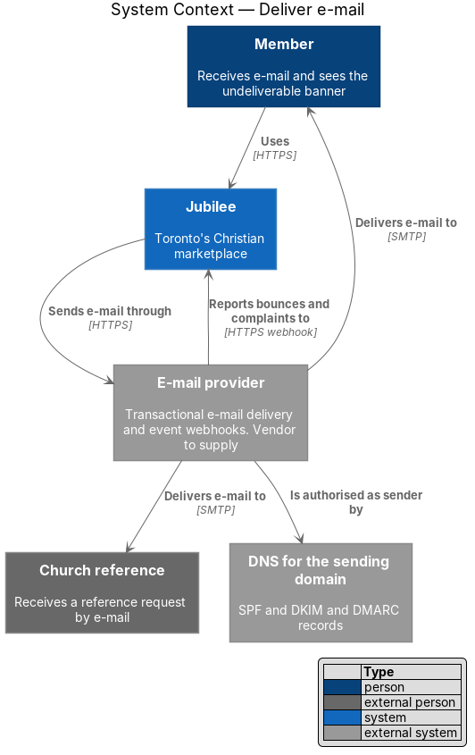
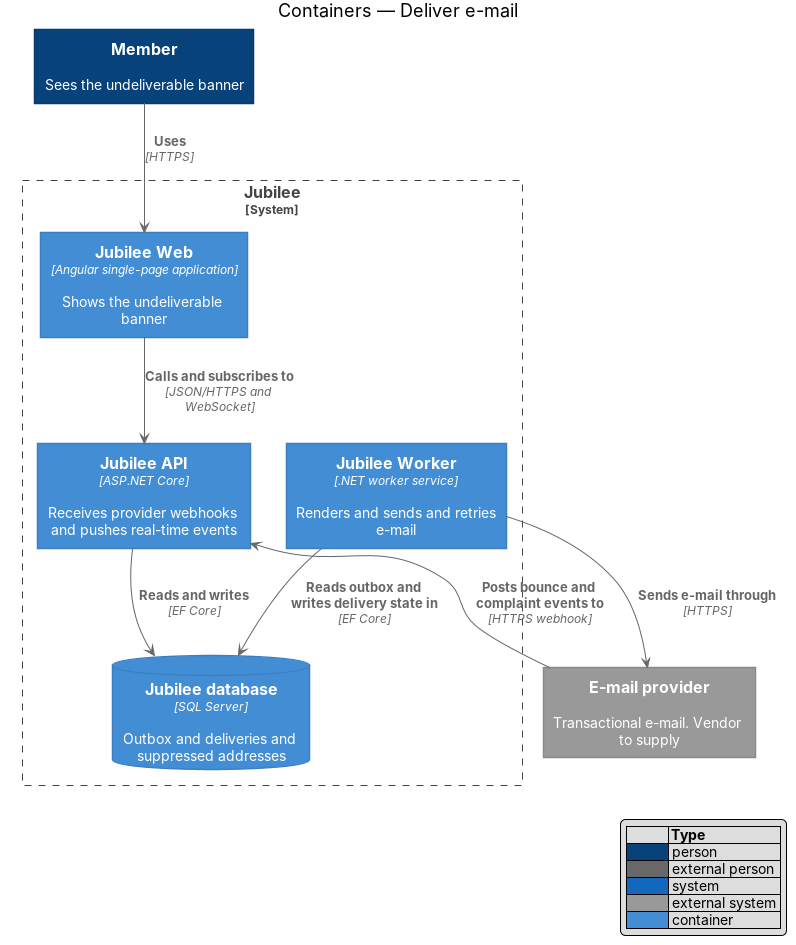
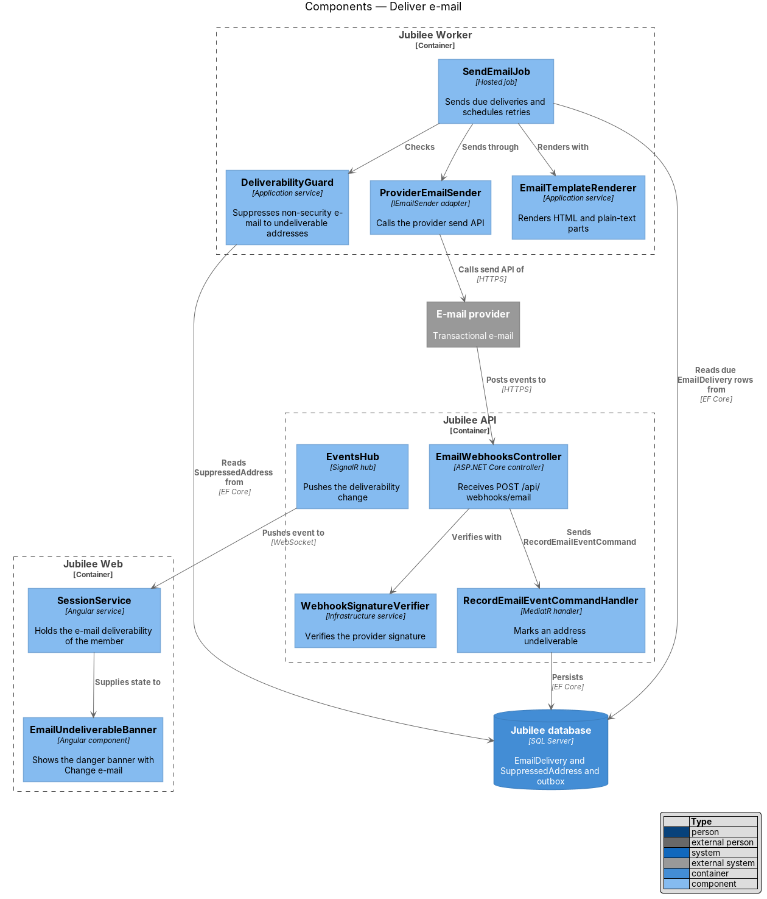
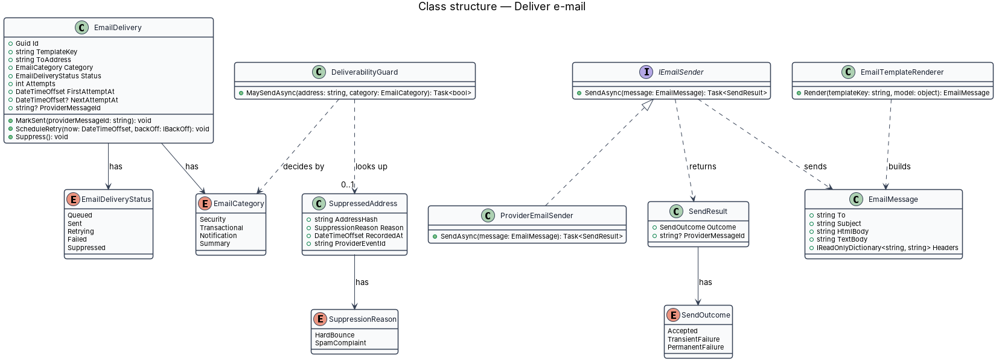
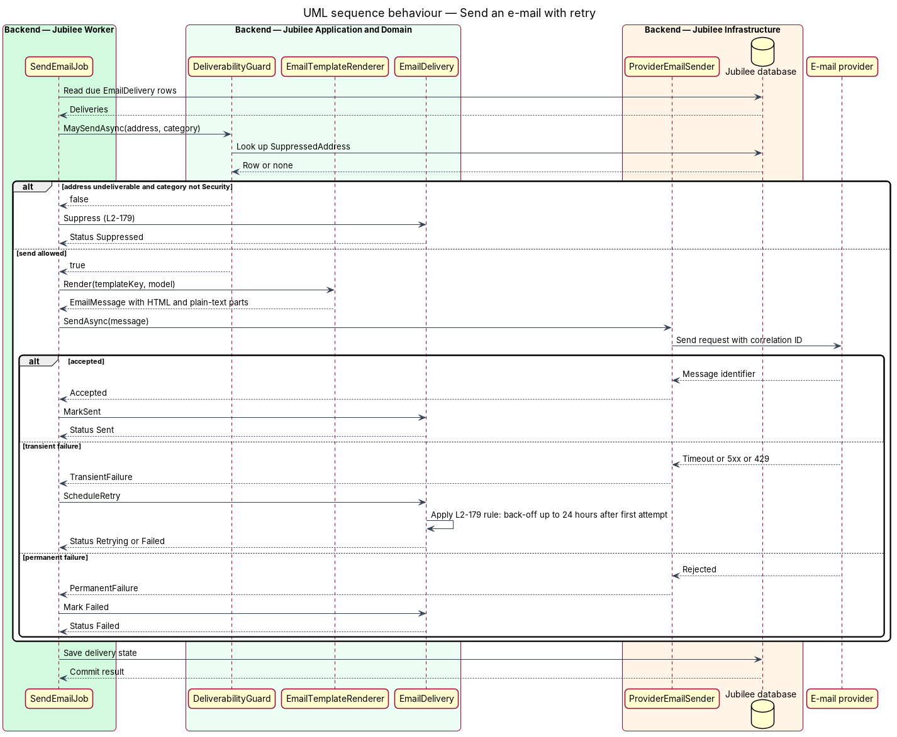
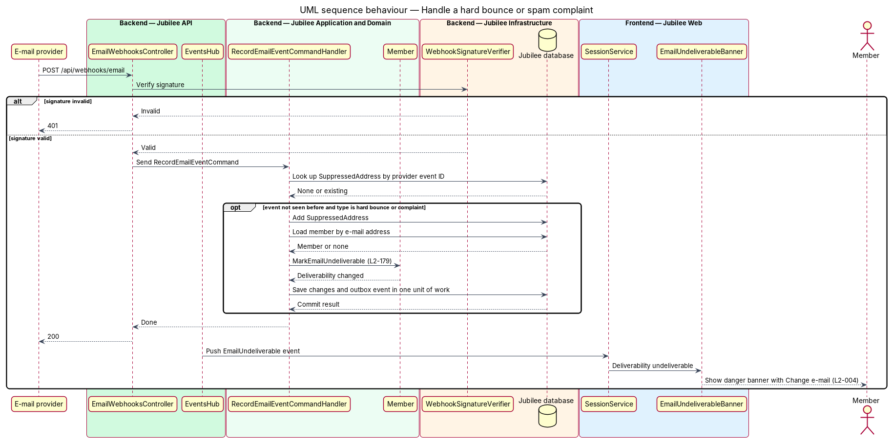

# Deliver e-mail

## Overview

Jubilee is Toronto's Christian marketplace. It sends e-mail for account security
(confirmation and reset links), for church reference requests, for verification decisions and
for the notifications a member has turned on. This feature covers the delivery path shared by
each of those: how an e-mail leaves the system, how a failed send is retried, and how the
system reacts when an address stops accepting mail.

Five terms recur. *transactional e-mail provider* — external service that accepts a message
over an API and delivers it to the recipient's mail server. *hard bounce* — permanent
rejection of a message by the recipient's mail server. *spam complaint* — report by a
recipient that a message is unwanted. *undeliverable address* — address for which a hard
bounce or a spam complaint has been received. *security e-mail* — message that protects the
account, such as an e-mail confirmation or a password reset.

No request handler calls the provider. A handler writes an outbox message in the same
transaction as its state change, and `Jubilee Worker` sends the e-mail. The provider is Azure
Communication Services Email and the sending domain is `notify.jubilee.to` (ADR 0038).

## Description

The slice runs from the outbox to the provider and from the provider's delivery reports back to
a banner in `Jubilee Web`. ADR 0038 chose the smallest shape that meets `L2-179`; where an
earlier draft of this design named more (a delivery entity, a suppression list, one file per
template), the list below says what is built instead.

- **`OutboxMessage`** — one e-mail to one address, written by a handler as a subject and a
  plain-text body, with the member, an optional category (set for an e-mail a member can turn
  off, `L2-068`) and the attempt state. `EmailPolicy.Queue` writes the e-mails a member can turn
  off and skips a member who turned the category off or whose address bounced.
- **`OutboxDispatcher`** — run by `OutboxDispatcherJob` in `Jubilee Worker`. It takes the due
  messages, renders each with `EmailLayout`, and hands it to `IEmailSender`. A send that throws
  is retried: `OutboxMessage.MarkAttemptFailed` waits 2, 4, 8 … minutes, capped at 4 hours, and
  gives up 24 hours after the e-mail was queued (`L2-179` criterion 3). A sent or abandoned
  message drops its body, which holds a link token.
- **`EmailLayout`** — renders the HTML part from the text when the e-mail is sent, so every
  e-mail has both parts and they cannot drift. A paragraph of the text is a paragraph; a link on
  a line of its own is a button, named by its path (`/verify-email/` is "Confirm your e-mail") or
  by the sentence that leads to it ("Answer here: https://…"), with the link repeated as text;
  a link inside a sentence stays a link; everything is HTML-encoded. The layout
  (`EmailLayout.html`, embedded in `Jubilee.Application`) is a 600 px table, fluid below that,
  inline-styled, with `color-scheme: light dark` and a `prefers-color-scheme: dark` block. It
  adds the header with the wordmark "jubilee" as text, the preheader (the first paragraph after
  the greeting) and the footer "Jubilee · Toronto’s Christian marketplace" with the unsubscribe
  link of a notification e-mail. It holds no image, so nothing can track an open.
- **`EmailMessage`** — what `IEmailSender` takes: recipient, subject, text body, HTML body and
  the unsubscribe address of a notification e-mail.
- **`AzureCommunicationEmailSender`** — the `IEmailSender` used when `Email:ConnectionString` is
  set. It posts to `{endpoint}/emails:send` with an HMAC-SHA256 signed request, both parts,
  `List-Unsubscribe` and `List-Unsubscribe-Post` (RFC 8058) and
  `userEngagementTrackingDisabled`. Any answer other than `202` is thrown, so the outbox
  retries; the sender has no retry of its own.
- **`LoggingEmailSender`** — the `IEmailSender` used when no provider is configured (local
  development, the e2e API, tests of the host). Nothing leaves the system; it logs the recipient
  and the subject, never the body, and with `Email:PreviewFolder` set it writes the HTML and the
  text of each e-mail there (`L2-179` criterion 7).
- **Sending domain records** — SPF (TXT), two DKIM CNAME records and the verification TXT at
  `notify.jubilee.to`, and DMARC with `p=quarantine` at `_dmarc.notify.jubilee.to`, published at
  Namecheap. `eng/azure/README.md` lists them. The domain's own `@` SPF record belongs to
  Namecheap's e-mail forwarding and is not touched; that is why the sender is a subdomain.
- **`EmailEventsController`** — `POST /api/webhooks/email-events`, closed unless the caller
  sends the shared secret of `Email:WebhookSecret` in `X-Webhook-Secret`. Event Grid posts the
  Communication Service's `EmailDeliveryReportReceived` events there with that header; the
  controller answers Event Grid's validation handshake, and a report with the status `Bounced`
  or `Suppressed` sends `RecordEmailBounceCommand`.
- **`RecordEmailBounceCommandHandler`** — marks the member whose address it is with
  `Member.MarkEmailBounced`. `EmailPolicy.Queue` then sends that member no e-mail they could
  turn off; security e-mails are still sent. An address without an account (a church reference)
  is not recorded.
- **Verify-e-mail banner** — `GET /api/session` carries `emailBounced`, and the banner shows
  "We couldn't deliver e-mail to {address}. Check the address for a typo." with "Change e-mail"
  (`L2-004` criterion 6). A confirmed new address clears it.

Not built: a per-e-mail delivery record, a suppression list for addresses without an account,
delivery metrics and the pipeline check that resolves the DNS records.

## Requirements

The feature realizes the following level-2 (L2) requirements. Each L2 requirement refines a
level-1 (L1) requirement, cited by identifier.

| L2 ID | Refines (L1) | Requirement |
|-------|--------------|-------------|
| `L2-179` | `L1-025` | E-mail shall be sent through a transactional e-mail provider with SPF, DKIM and DMARC (policy at least `quarantine`) on the sending domain, and each template shall have a plain-text part, work in light and dark mail clients, and contain no tracking pixels. A hard bounce or spam complaint received by webhook shall mark the address undeliverable and stop further non-security e-mail to it, and a transient send failure shall be retried with back-off for up to 24 hours. |
| `L2-004` | `L1-001` | A confirmation link at `/verify-email/:token` shall confirm the member's e-mail once within 24 hours. When a confirmation e-mail bounces, the member shall see the danger banner "We couldn't deliver e-mail to {address}. Check the address for a typo." with "Change e-mail". |
| `L2-068` | `L1-010` | The system shall send an e-mail within 2 minutes for each event the member has e-mail turned on for, and shall send none for an event the member has turned off. Each transactional e-mail shall be sent regardless of preferences from a domain authenticated with SPF, DKIM and DMARC. |

## Diagrams

### System context

Jubilee sends through the e-mail provider, which delivers to members and church references
and reports bounces and complaints back by webhook. DNS records authorise the provider as a
sender for the domain.

### Containers

`Jubilee Worker` reads the outbox and sends. `Jubilee API` receives the provider's webhook
and pushes the result to `Jubilee Web`. Delivery state lives in the `Jubilee database`.

### Components

`SendEmailJob` consults `DeliverabilityGuard`, renders with `EmailTemplateRenderer` and
sends through `ProviderEmailSender`. `EmailWebhooksController` verifies the signature and
dispatches to `RecordEmailEventCommandHandler`; `EventsHub` carries the change to the banner.

### Class structure

`EmailDelivery` holds an `EmailDeliveryStatus` and an `EmailCategory`. `ProviderEmailSender`
implements `IEmailSender` and returns a `SendResult`. `DeliverabilityGuard` decides from the
category and a `SuppressedAddress` lookup.

### Behaviour — send an e-mail with retry

`SendEmailJob` skips a non-security e-mail to an undeliverable address. Otherwise it renders
and sends; a transient failure schedules a retry with back-off for up to 24 hours after the
first attempt (`L2-179`).

### Behaviour — handle a hard bounce or spam complaint

The webhook is verified, the address is recorded as undeliverable once per provider event,
and the member's open page shows the danger banner of `L2-004`.

