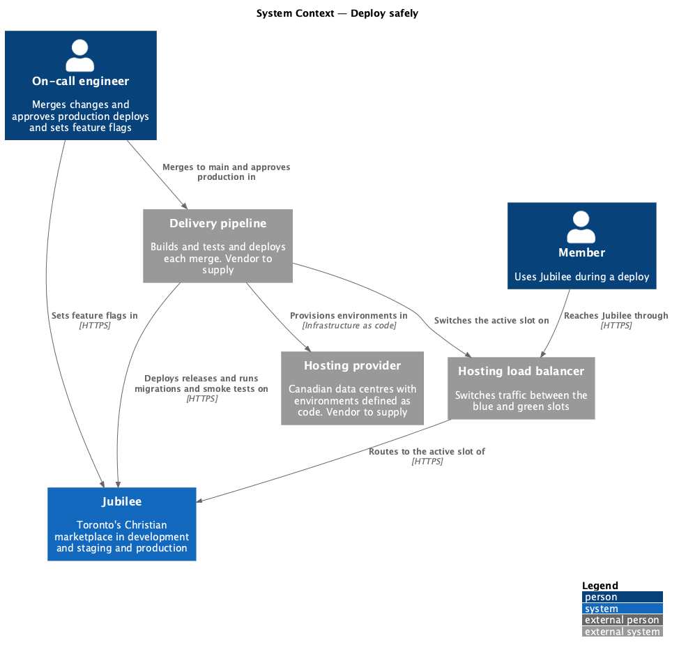
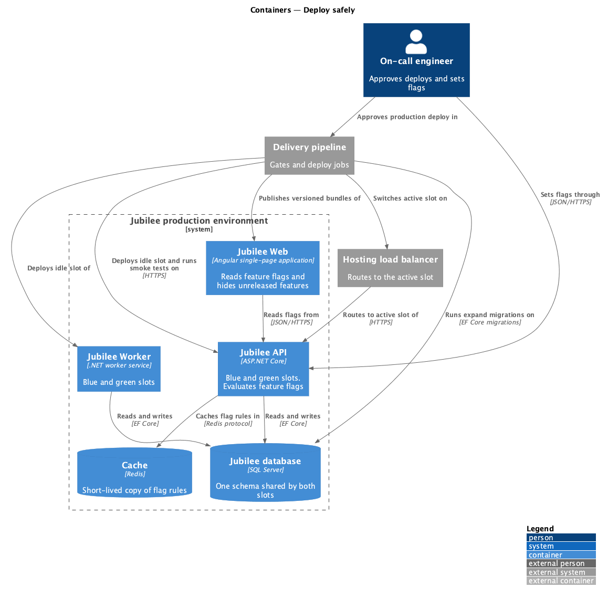
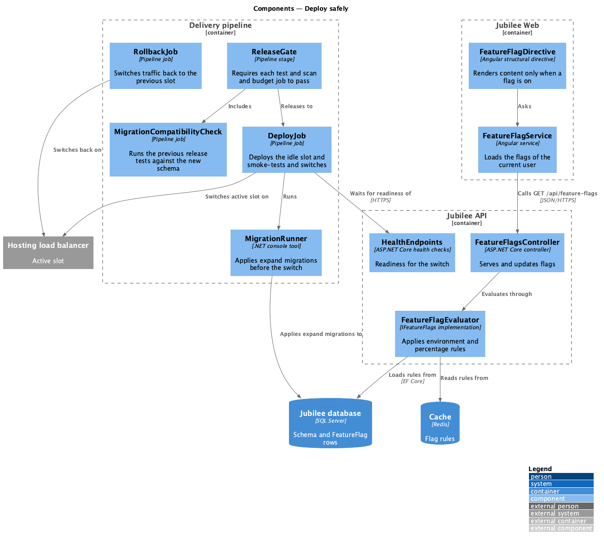
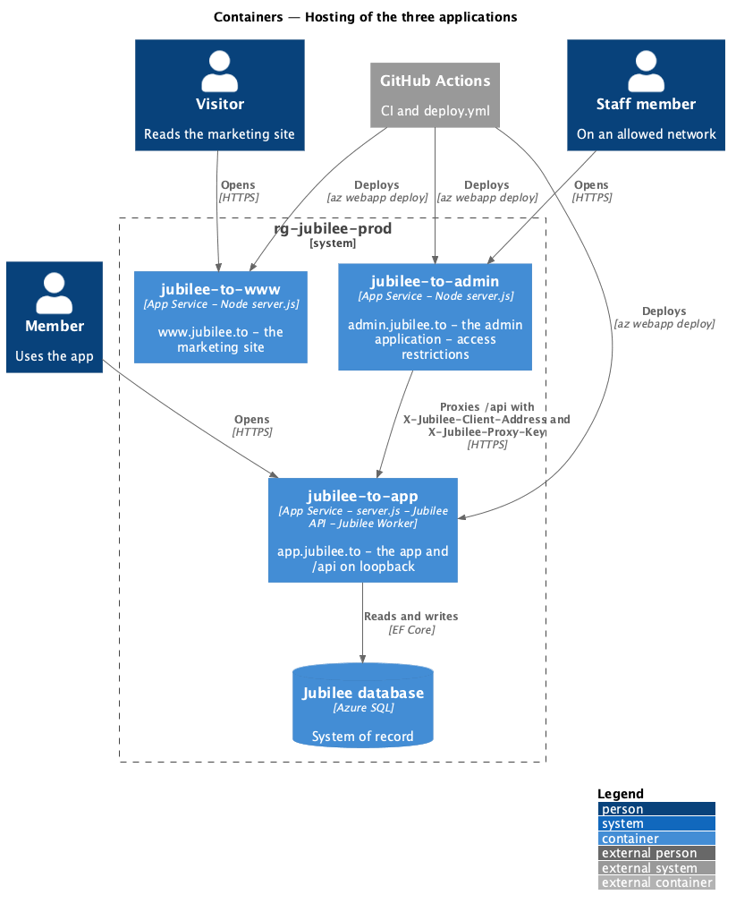
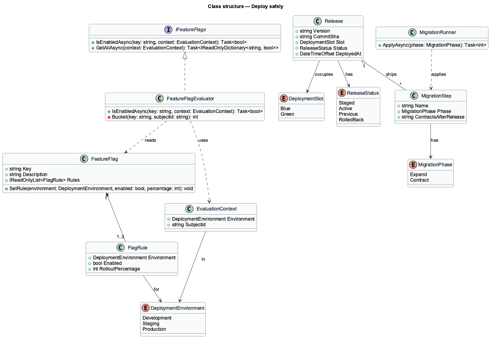
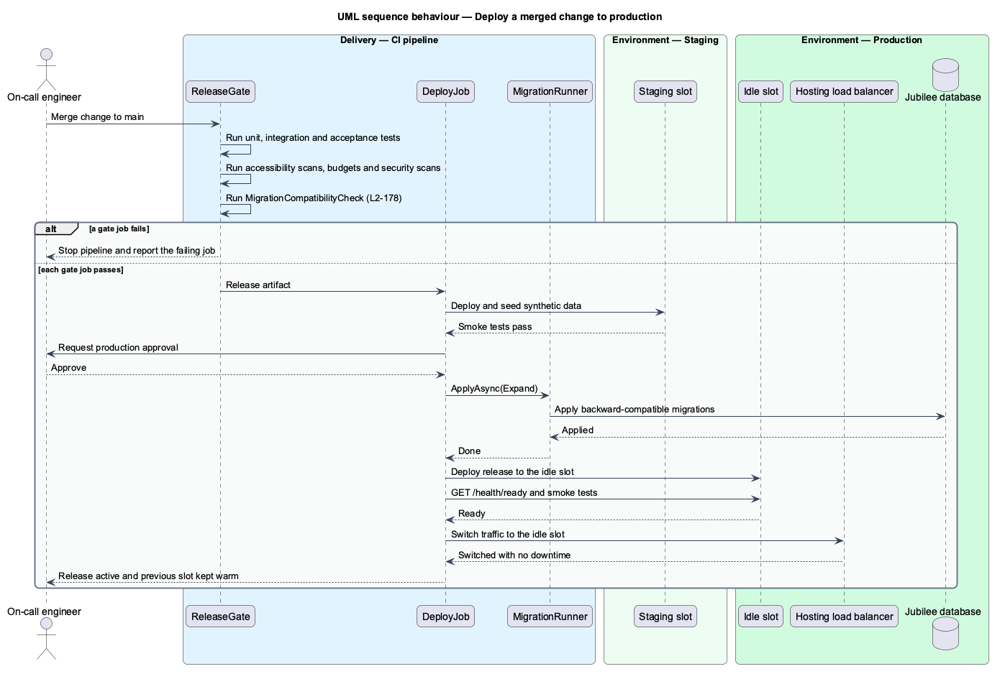
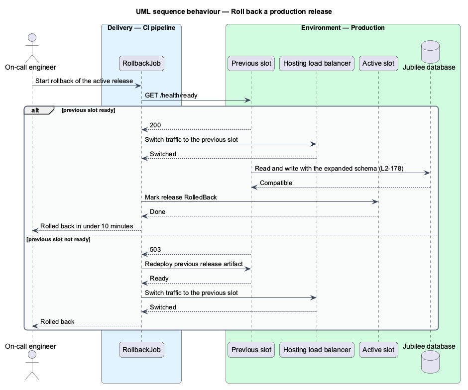
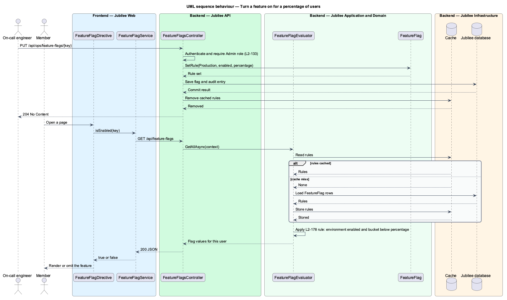

# Deploy safely

## Overview

Jubilee is Toronto's Christian marketplace. This feature covers the path a change takes from
a merge to the main branch to production, and the controls that keep that path safe: gates,
an approval, a deploy without downtime, a fast rollback, compatible database migrations,
feature flags and environments defined as code.

Five terms recur. *gate* — pipeline job whose failure stops the release. *slot* — one of two
complete copies of the application tier, named `Blue` and `Green`, of which one receives
production traffic. *expand and contract* — migration pattern in which one release adds
schema that the previous release ignores, and a later release removes schema that no running
release reads. *feature flag* — named switch that turns a feature on per environment and per
percentage of users without a deploy. *synthetic data* — generated records that describe no
real person.

The design chooses a blue-green deploy over a rolling deploy, because the idle slot keeps the
previous release warm and makes a rollback a traffic switch. The pipeline vendor, the
infrastructure-as-code tool, the scan tools and the hosting provider are `<TO SUPPLY>`.

## Description

The slice consists of pipeline stages, two console tools, and the feature flag components in
`Jubilee API` and `Jubilee Web`.

- **`ReleaseGate`** — pipeline stage that runs on each merge to the main branch. A deploy to
  staging starts only when each of these jobs passes: unit tests, integration tests,
  acceptance tests, accessibility scans, payload and performance budgets, and security scans.
- **`MigrationCompatibilityCheck`** — gate job. It applies the new migrations to an empty
  database and runs the integration tests of the previous release against the result. A
  failure shows that the migration is not backward compatible.
- **`MigrationRunner`** — .NET console tool around the EF Core migrations of
  `JubileeDbContext`. Each `MigrationStep` is tagged `Expand` or `Contract`. The deploy
  applies `Expand` steps before the traffic switch. A `Contract` step ships only in a release
  after the one that stopped reading the old schema.
- **`DeployJob`** — pipeline job. It deploys to staging and runs the smoke tests, waits for
  the production approval, runs `MigrationRunner`, deploys the release to the idle slot of
  `Jubilee API` and `Jubilee Worker`, waits for `GET /health/ready` to return `200`, runs the
  smoke tests against the idle slot, and switches the load balancer.
- **Production approval** — protection rule on the production environment of the pipeline. A
  named approver confirms each production deploy; the list of approvers is `<TO SUPPLY>`.
- **`Release`** — record of one deployed version: version, commit, `DeploymentSlot` and
  `ReleaseStatus`. `Jubilee Web` bundles are published under versioned file names, so both
  slots can serve their own assets during the switch.
- **`RollbackJob`** — pipeline job that switches the load balancer back to the slot holding
  the previous release. The previous slot stays deployed until the next release. Because the
  schema is only expanded, the previous release runs against it unchanged, and the rollback
  completes in under 10 minutes.
- **`FeatureFlag`** and **`FlagRule`** — entity and its per-environment rule: `Enabled` and a
  `RolloutPercentage` from 0 to 100.
- **`FeatureFlagEvaluator`** — implementation of `IFeatureFlags`. A flag is on for a subject
  when the rule of the current environment is enabled and the subject's bucket is below the
  percentage. The bucket is a stable hash of the flag key and the subject identifier, taken
  modulo 100, so a subject keeps the same answer as the percentage rises. The subject is the
  member identifier, or an anonymous visitor identifier for a visitor.
- **`FeatureFlagsController`** — serves `GET /api/feature-flags` with the values for the
  caller, and `PUT /api/ops/feature-flags/{key}` for the `Admin` role. An update takes effect
  without a deploy and writes an audit entry. Flag rules are cached in the `Cache`; the cache
  lifetime is `<TO SUPPLY>`.
- **`FeatureFlagService`** and **`FeatureFlagDirective`** — Angular service and structural
  directive. The directive renders its content only when the named flag is on. The server
  evaluates the same flag again on each protected endpoint.
- **Environment definitions** — `development`, `staging` and `production` are declared in one
  infrastructure-as-code module with per-environment parameters, and the pipeline applies it.
  No environment is changed by hand.
- **`SyntheticDataSeeder`** — console tool that fills staging with synthetic data. No job
  copies production data into staging, and the restore drill of `L2-177` targets an isolated
  instance instead of staging.
- **Three applications** — the frontend `build` script and CI build, lint and format-check
  the app (`jubilee`), the marketing site (`marketing`) and the admin application (`admin`).
  `eng/azure/deploy.sh` packages each with `server.js` and deploys it to its own App Service:
  `jubilee-to-app` (the app, the API and the worker), `jubilee-to-www` and `jubilee-to-admin`.
  The admin host runs `server.js` with `API_ORIGIN=https://app.jubilee.to` and `PROXY_KEY`, so
  its `/api` reaches the one API with the caller's address kept (`L2-192`, ADR 0040). The
  admin host's access restrictions, its host name and the Entra app registration are set by
  hand from `eng/azure/README.md`, never by the pipeline.

## Requirements

The feature realizes the following level-2 (L2) requirements. Each L2 requirement refines a
level-1 (L1) requirement, cited by identifier.

| L2 ID | Refines (L1) | Requirement |
|-------|--------------|-------------|
| `L2-178` | `L1-025` | A change merged to the main branch shall pass unit, integration and acceptance tests, accessibility scans, budgets and security scans before it deploys to staging, and a production deploy shall require an approval. A production deploy shall cause no downtime and shall be reversible in under 10 minutes, database migrations shall be backward compatible with the previous release, features shall be switchable per environment and per percentage of users, and development, staging and production shall be defined as code with no real personal data in staging. |
| `L2-195` | `L1-025` | The build script and CI shall build, lint and format-check the app, the marketing site and the admin application; `npm run start:admin` shall serve the admin application on port 4202 with a development identity the API refuses outside Development; a deployment shall put the admin application on its own App Service behind `https://admin.jubilee.to` with `/api` sent to the API and the caller's address kept; the e2e suite shall serve it as a further web server answered from the recording. |
| `L2-133` | `L1-019` | Each API endpoint shall check the caller's role and ownership of the specific object on the server before doing anything, and no check shall rely on the client hiding a control. |
| `L2-180` | `L1-025` | Sensitive actions shall produce an append-only audit record that stores actor, action, target, time, before and after values, and reason. Audit records shall not be editable or deletable through the application, shall be kept for 2 years, and shall be searchable by an admin within 2 seconds. |

## Diagrams

### System context

The on-call engineer merges and approves in the delivery pipeline, which provisions the
environments, deploys releases and switches the load balancer. Members reach Jubilee through
the load balancer throughout a deploy.

### Containers

Both slots of `Jubilee API` and `Jubilee Worker` share one `Jubilee database`, which is why
each migration is backward compatible. `Jubilee Web` reads feature flags from the API.

### Components

`ReleaseGate` includes `MigrationCompatibilityCheck` and releases to `DeployJob`, which runs
`MigrationRunner` and switches the slot. `FeatureFlagDirective` asks `FeatureFlagService`,
which reads the values that `FeatureFlagEvaluator` computes.

### Hosting of the three applications

Each application has its own App Service; the admin host sends `/api` to the API on
`jubilee-to-app`, which runs beside the app on loopback (`L2-195`).

### Class structure

A `FeatureFlag` owns one `FlagRule` per `DeploymentEnvironment`. `FeatureFlagEvaluator`
implements `IFeatureFlags`. A `Release` occupies a `DeploymentSlot` and ships `MigrationStep`
values tagged with a `MigrationPhase`.

### Behaviour — deploy a merged change to production

Each gate job passes before staging receives the release. After the approval, the pipeline
applies the expand migrations, deploys the idle slot, checks readiness and switches traffic
(`L2-178`).

### Behaviour — roll back a production release

`RollbackJob` switches traffic to the previous slot, which still runs the previous release
against the expanded schema. When the previous slot is not ready, the job redeploys the
previous artifact first.

### Behaviour — turn a feature on for a percentage of users

An operator sets the production rule of a flag. `FeatureFlagEvaluator` then answers each
caller from the environment rule and the caller's bucket, and `FeatureFlagDirective` renders
or omits the feature.

