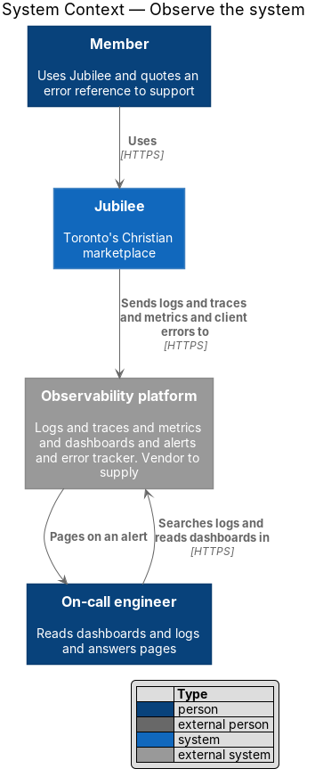
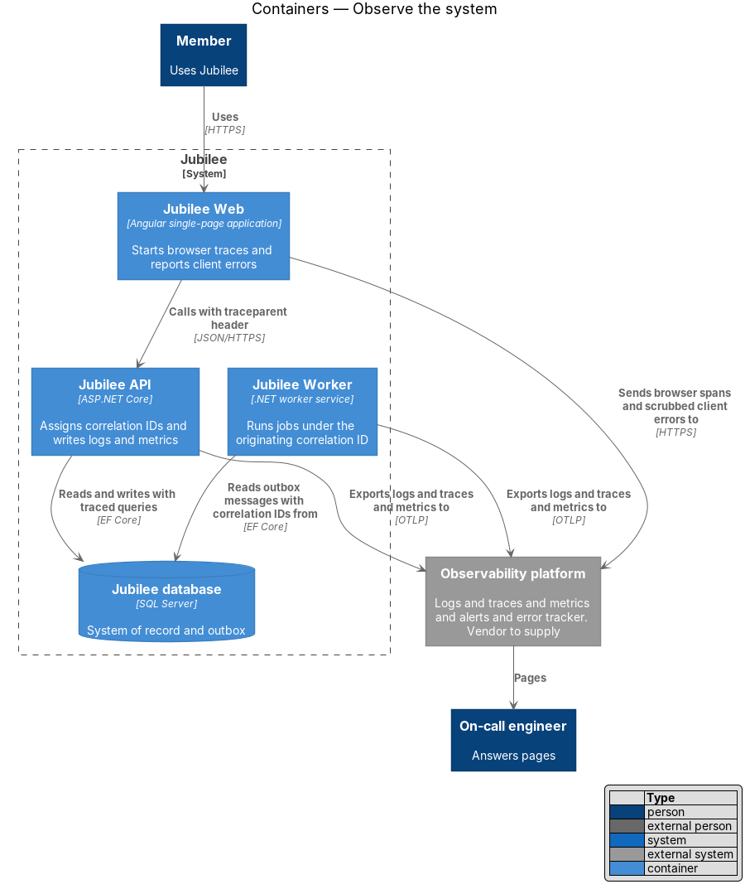
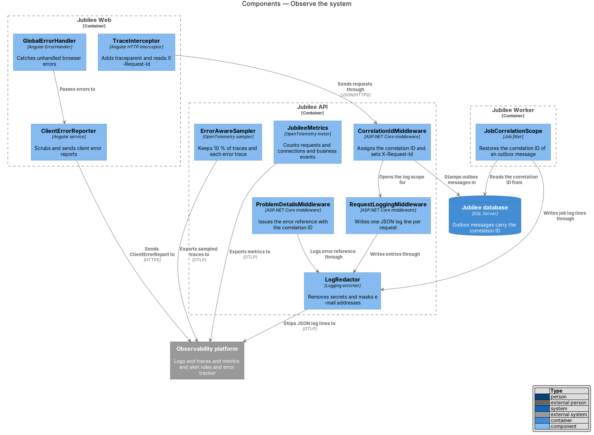
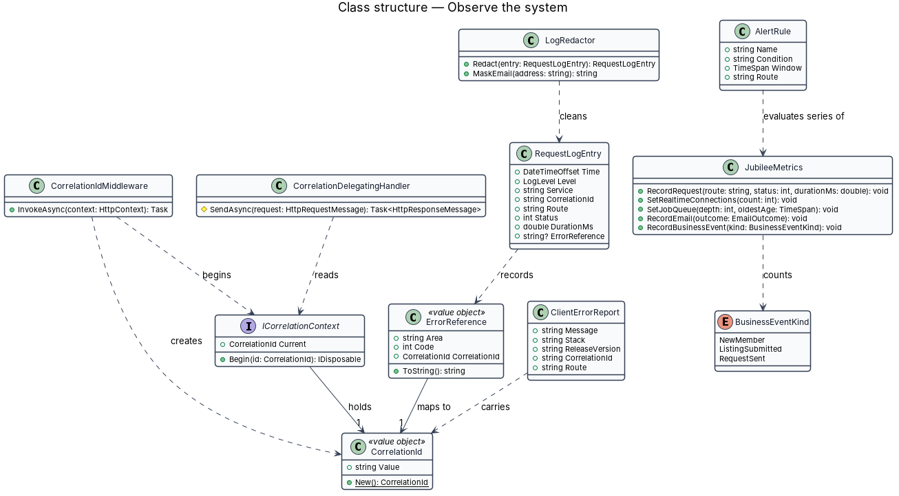
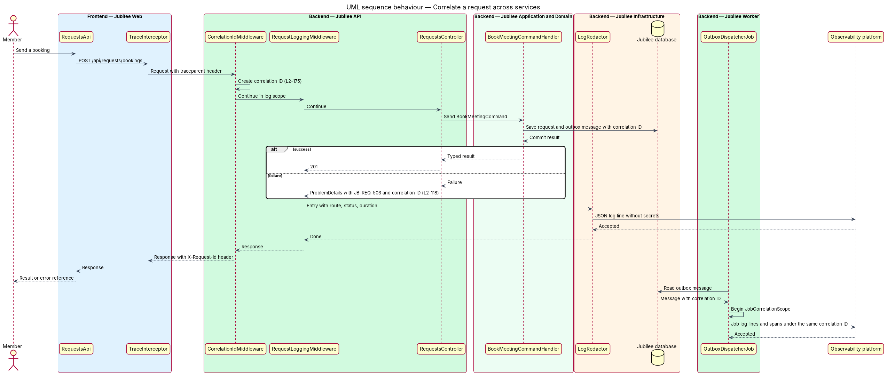
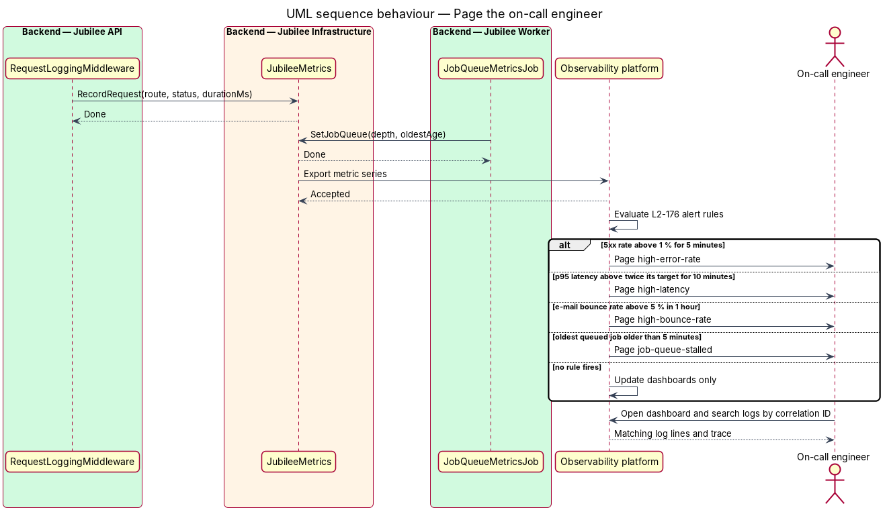
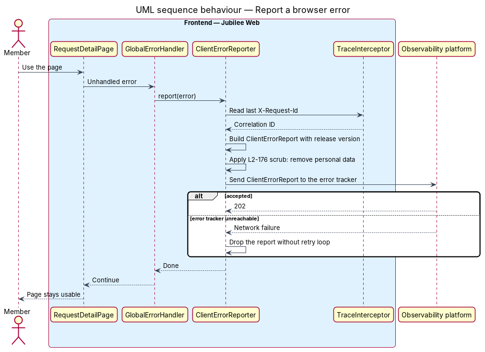

# Observe the system

## Overview

Jubilee is Toronto's Christian marketplace. This feature covers the signals that let an
engineer see what the running system does: logs, traces, metrics, dashboards, alerts and
browser error reports. It exists so that a failure a member reports can be found in minutes,
and so that the on-call engineer learns of a fault before members report it.

Four terms recur. *correlation ID* — identifier assigned to one request and carried by each
downstream call, job and log line that the request causes. *error reference* — code of the
form `JB-<AREA>-<NNN>` shown to a user in an error state (`L2-118`). *trace* — tree of timed
spans that follows one request from the browser through the API to the database. *alert
rule* — condition on a metric series that pages the on-call engineer when it holds for a
stated time.

`Jubilee Web`, `Jubilee API` and `Jubilee Worker` each emit signals to the `Observability
platform`, which stores them, draws the dashboards, evaluates the alert rules and hosts the
error tracker. The vendor of that platform and the paging service are `<TO SUPPLY>`.

## Description

The slice consists of instrumentation in each container and of rules held in the
`Observability platform`.

- **`CorrelationIdMiddleware`** — first middleware in `Jubilee.Api`. It creates a
  `CorrelationId` for each request, stores it in `ICorrelationContext`, opens a log scope with
  it, and sets the `X-Request-Id` response header on each response, including errors.
- **`CorrelationDelegatingHandler`** — `HttpClient` handler in `Jubilee.Infrastructure`. It
  adds `X-Request-Id` to each outbound call to the e-mail provider, the `Search index`, and
  each other external system.
- **`JobCorrelationScope`** — filter in `Jubilee.Worker`. Each `OutboxMessage` stores the
  correlation ID of the request that wrote it; the filter restores that ID before the job
  runs. A scheduled job with no originating request receives a new ID per run.
- **`RequestLoggingMiddleware`** and **`RequestLogEntry`** — one structured JSON log line per
  request with the fields `time`, `level`, `service`, `correlationId`, `route`, `status` and
  `durationMs`. `route` is the route template, not the raw URL.
- **`LogRedactor`** — enricher that each log line passes through. It removes passwords,
  tokens and message bodies and replaces a full e-mail address with a masked form. A unit
  test suite feeds it each command type and fails the build when a forbidden value survives.
- **`ErrorReference`** — value object built by `ProblemDetailsMiddleware`. The middleware
  writes the reference and the correlation ID to the `ProblemDetails` body and logs the
  reference as the field `errorReference`, so a search for the reference and the time returns
  the failing request (`L2-118`).
- **`TraceInterceptor`** — Angular HTTP interceptor. It starts a browser span, sends the W3C
  `traceparent` header, and keeps the last `X-Request-Id` for error reports.
- **`ErrorAwareSampler`** — OpenTelemetry sampler configuration shared by the API and the
  Worker. It keeps 10 % of request traces and 100 % of traces that contain an error. EF Core
  instrumentation adds a database span to each kept trace.
- **`JubileeMetrics`** — single meter class. It records request rate, error rate and latency
  per endpoint, the `EventsHub` connection count, job queue depth and oldest job age, e-mail
  send and bounce counts, and the business counters `NewMember`, `ListingSubmitted` and
  `RequestSent`. `JobQueueMetricsJob` in `Jubilee Worker` measures the queue depth and the age of
  the oldest queued job.
- **Dashboards** — one dashboard per group of series above, defined as code beside the alert
  rules. The definition format is `<TO SUPPLY>`.
- **`AlertRule`** — four rules defined as code and applied by the deployment pipeline. Each
  pages the on-call engineer: 5xx error rate above 1 % for 5 minutes; p95 latency above twice
  its target for 10 minutes; e-mail bounce rate above 5 % in 1 hour; oldest queued job older
  than 5 minutes.
- **`GlobalErrorHandler`** and **`ClientErrorReporter`** — Angular `ErrorHandler` and service.
  The reporter builds a `ClientErrorReport` with the release version and the correlation ID,
  removes personal data, and sends it to the error tracker. The report carries the route
  template and no form values, names, e-mail addresses or message text.

## Requirements

The feature realizes the following level-2 (L2) requirements. Each L2 requirement refines a
level-1 (L1) requirement, cited by identifier.

| L2 ID | Refines (L1) | Requirement |
|-------|--------------|-------------|
| `L2-175` | `L1-025` | Each request shall receive a correlation ID that is returned in the `X-Request-Id` header and propagated to each downstream call, job and log line. Logs shall be structured JSON without passwords, tokens, message bodies or full e-mail addresses, and traces shall cover browser to API to database for at least 10 % of requests and 100 % of errors. |
| `L2-176` | `L1-025` | Dashboards shall show request rate, error rate and latency per endpoint, real-time connection counts, job queue depth, e-mail send and bounce rates, and business metrics. The on-call engineer shall be paged when the 5xx rate, p95 latency, e-mail bounce rate or job queue age crosses its threshold, and browser errors shall be reported with the release version and correlation ID, without personal data. |
| `L2-118` | `L1-016` | Each load-error state shall show a reference that the user can quote to support, and a log search for that reference and the time shall find the correlation ID and log entries of the failing request. |

## Diagrams

### System context

Jubilee sends its signals to the `Observability platform`. The platform pages the on-call
engineer, who searches logs and reads dashboards there.

### Containers

`Jubilee Web` starts the trace and reports browser errors. `Jubilee API` and `Jubilee Worker`
export logs, traces and metrics; the outbox in the `Jubilee database` carries the correlation
ID from a request to its jobs.

### Components

`CorrelationIdMiddleware` opens the scope that `RequestLoggingMiddleware` and
`ProblemDetailsMiddleware` log in. Each log line passes through `LogRedactor`.
`JobCorrelationScope` restores the correlation ID in `Jubilee Worker`.

### Class structure

`ICorrelationContext` holds the current `CorrelationId`. `ErrorReference` maps to one
`CorrelationId`, and `RequestLogEntry` records it. `AlertRule` evaluates the series that
`JubileeMetrics` records.

### Behaviour — correlate a request across services

The middleware creates the correlation ID, the handler stores it on the outbox message, and
the Worker logs under the same ID. A failure returns the error reference together with the
correlation ID (`L2-175`, `L2-118`).

### Behaviour — page the on-call engineer

The API and the Worker record metric series. The `Observability platform` evaluates the four
alert rules of `L2-176` and pages the on-call engineer when one holds.

### Behaviour — report a browser error

`GlobalErrorHandler` passes an unhandled error to `ClientErrorReporter`, which attaches the
release version and the last correlation ID, removes personal data, and sends the report to
the error tracker (`L2-176`).

