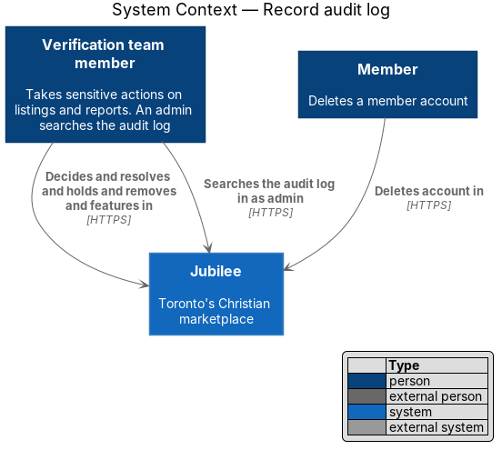
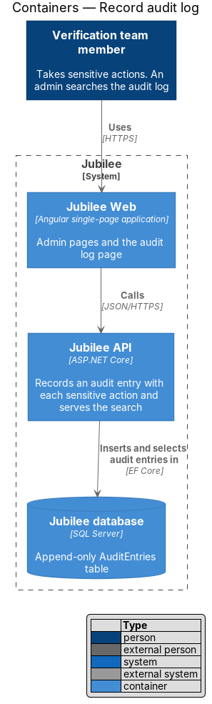
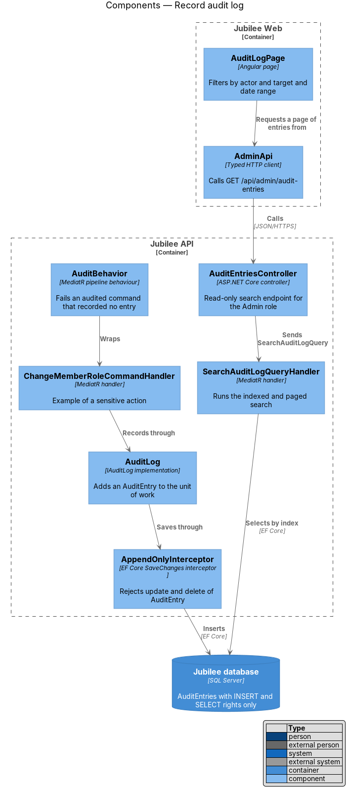
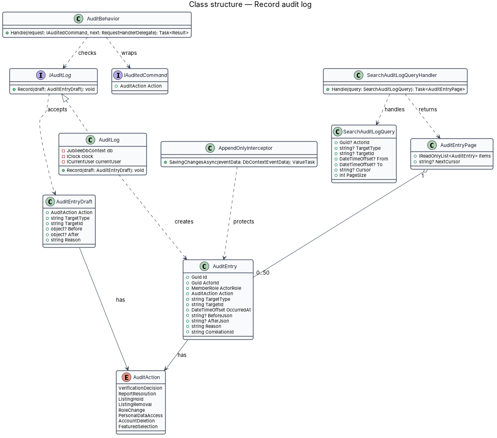
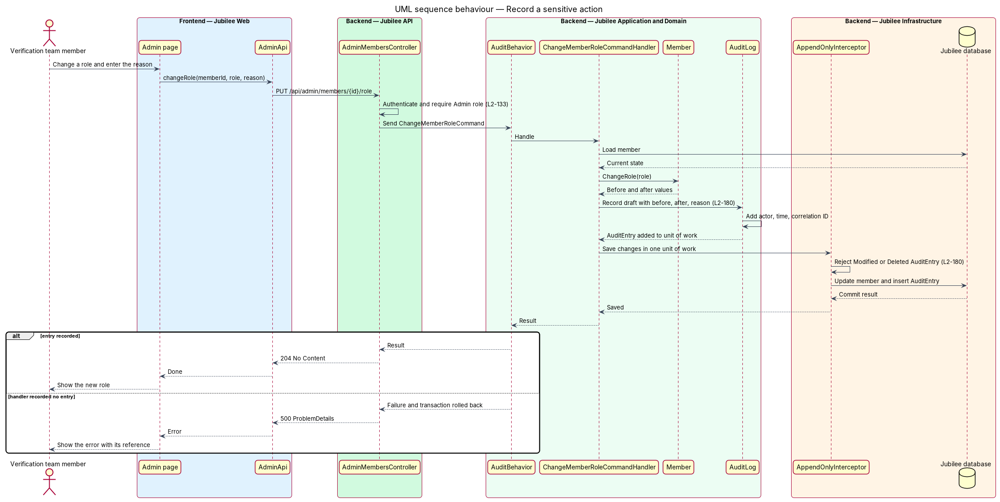
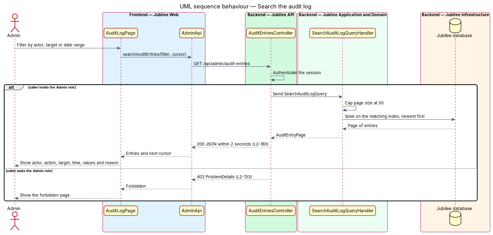

# Record audit log

## Overview

Jubilee is Toronto's Christian marketplace. A small Jubilee team takes down listings that misrepresent a business,
resolves reports, places listings on hold, removes listings, selects featured businesses and
can read personal data while doing so. This feature keeps a permanent record of each such
action, so that a later question about who did what, when and why has an answer.

Three terms recur. *sensitive action* — one of: a takedown of a listing, a report resolution,
a hold or removal of a listing, a role change, staff access to personal data, an account
deletion, a featured selection. *audit entry* — one stored record of a sensitive action with
its actor, action, target, time, before and after values, and reason. *append-only* —
property of a store that accepts new records and offers no way to change or remove an
existing one.

The feature is a shared service used by other slices. Each slice that performs a sensitive
action calls `IAuditLog` inside its own unit of work, so the action and its audit entry
commit together or not at all. An admin, a member holding the `Admin` role, searches the
entries through a read-only endpoint.

## Description

The slice consists of the recording service, three layers that enforce append-only storage,
and the search.

- **`AuditEntry`** — entity in `Jubilee.Domain` with `ActorId`, `ActorRole`, `Action`,
  `TargetType`, `TargetId`, `OccurredAt`, `BeforeJson`, `AfterJson`, `Reason` and
  `CorrelationId`. It has no public setter and no method that changes state. The actor is
  stored as an identifier, without a name or an e-mail address.
- **`AuditAction`** — enumeration of the sensitive actions: `ListingTakedown` (written as
  `listing.taken-down`, ADR 0057),
  `ReportResolution`, `ListingHold`, `ListingRemoval`, `RoleChange`, `PersonalDataAccess`,
  `AccountDeletion`, `FeaturedSelection`.
- **`IAuditLog`** and **`AuditLog`** — application service and its implementation.
  `Record(draft)` takes an `AuditEntryDraft`, adds the actor from the session, the time from
  `IClock` and the correlation ID, serializes the before and after values, and adds the
  `AuditEntry` to the current `JubileeDbContext`. The handler's `SaveChanges` call commits it
  with the state change.
- **`AuditEntryDraft`** — input of `Record`. `Reason` is the reason the actor entered, or for
  `PersonalDataAccess` the report identifier or listing identifier that justifies the access
  (`L2-150`). Before and after values exclude passwords, tokens and message bodies.
- **`IAuditedCommand`** and **`AuditBehavior`** — marker interface for each command that
  performs a sensitive action, and a MediatR pipeline behaviour around it. The behaviour
  fails the command and rolls back the transaction when the handler finishes without having
  recorded an entry, so an omission surfaces in the first test run.
- **`AppendOnlyInterceptor`** — EF Core `SaveChanges` interceptor. It throws when an
  `AuditEntry` is in the `Modified` or `Deleted` state.
- **Database permissions** — the database principal of `Jubilee API` and `Jubilee Worker`
  holds `INSERT` and `SELECT` on the `AuditEntries` table and is denied `UPDATE` and `DELETE`.
  A migration test asserts these grants.
- **No write endpoint** — `AuditEntriesController` exposes `GET` only. No route, command or
  admin page edits or deletes an audit entry, for any role.
- **Retention** — entries are kept for 2 years. The backups of `L2-177` include the table.
  The handling of entries older than 2 years is `<TO SUPPLY>`.
- **`AuditEntriesController`** — serves `GET /api/admin/audit-entries` with the optional
  filters `actorId`, `targetType`, `targetId`, `from`, `to` and a `cursor`. The endpoint
  policy requires the `Admin` role; each other caller receives `403`.
- **`SearchAuditLogQueryHandler`** — runs the search newest first with keyset paging and a
  page size of at most 50. Three indexes support the three filters: `(ActorId, OccurredAt)`,
  `(TargetType, TargetId, OccurredAt)` and `(OccurredAt)`. A performance test with 2 years of
  generated entries asserts a response within 2 seconds for each filter.
- **`AuditLogPage`** and **`AdminApi`** — Angular page and typed client for the search. The
  page shows actor, action, target, time, before and after values, and reason, and offers no
  edit or delete control. Its route and its mock are `<TO SUPPLY>`.

## Requirements

The feature realizes the following level-2 (L2) requirements. Each L2 requirement refines a
level-1 (L1) requirement, cited by identifier.

| L2 ID | Refines (L1) | Requirement |
|-------|--------------|-------------|
| `L2-180` | `L1-025` | Sensitive actions shall produce an append-only audit record that stores actor, action, target, time, before and after values, and reason. Audit records shall not be editable or deletable through the application, shall be kept for 2 years, and shall be searchable by an admin by actor, target or date range within 2 seconds. |
| `L2-133` | `L1-019` | Each API endpoint shall check the caller's role and ownership of the specific object on the server before doing anything, and no check shall rely on the client hiding a control. |
| `L2-150` | `L1-020` | Each view of a member's personal data or of a reported conversation by a moderator shall be recorded in the audit log with the reason (report ID or listing ID). |
| `L2-098` | `L1-014` | Only a holder of the `admin` role shall grant or remove roles, and each role change shall be written to the audit log. |

## Diagrams

### System context

Jubilee team members and members take the sensitive actions inside Jubilee, and an
admin searches the resulting audit log. The feature involves no external system.

### Containers

`Jubilee API` inserts an audit entry with each sensitive action and serves the search. The
`Jubilee database` stores the entries in a table that accepts inserts and selects only.

### Components

`AuditBehavior` wraps each audited command handler, which records through `AuditLog`.
`AppendOnlyInterceptor` guards each save. `AuditEntriesController` dispatches the search to
`SearchAuditLogQueryHandler`.

### Class structure

`AuditLog` implements `IAuditLog` and creates an `AuditEntry` from an `AuditEntryDraft`.
`AuditBehavior` wraps each `IAuditedCommand`. `SearchAuditLogQueryHandler` returns an
`AuditEntryPage` of at most 50 entries.

### Behaviour — record a sensitive action

A role change serves as the example. The handler changes the `Member`, records the draft
through `AuditLog`, and saves both in one unit of work; `AuditBehavior` fails a command that
recorded nothing (`L2-180`).

### Behaviour — search the audit log

The controller admits only the `Admin` role. The handler caps the page size at 50 and seeks
on the index that matches the filter, so that results return within 2 seconds.

