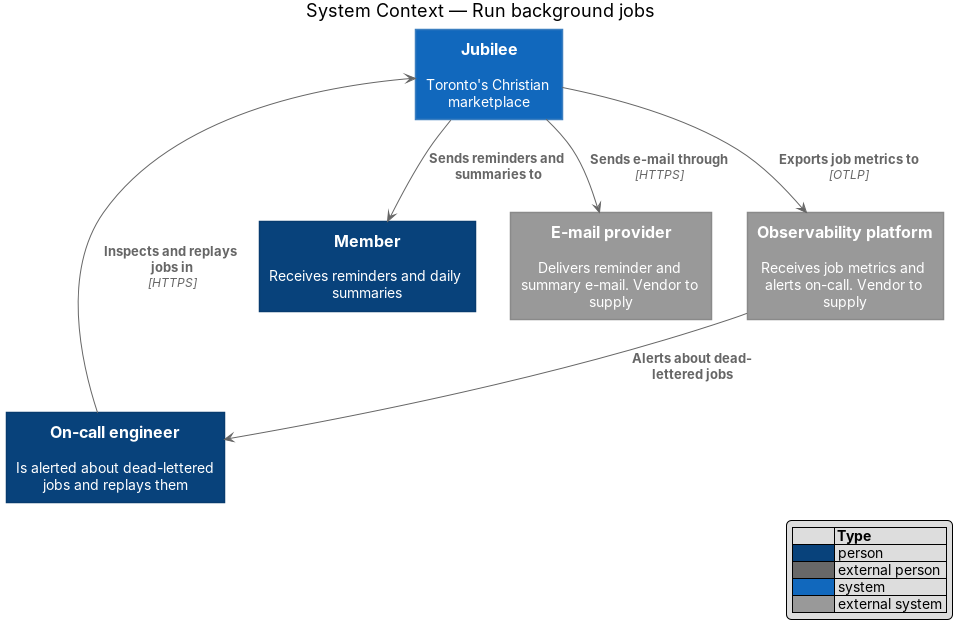
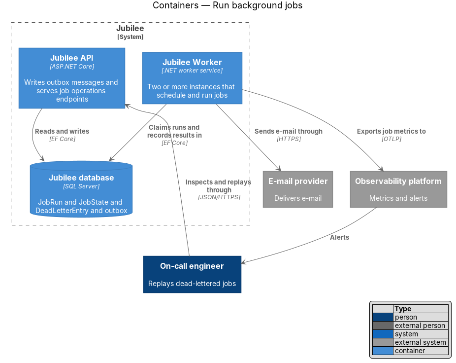
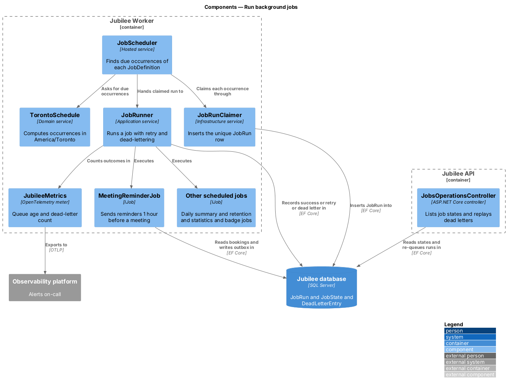
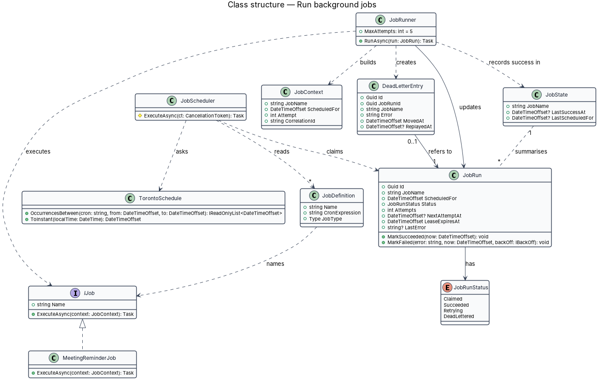
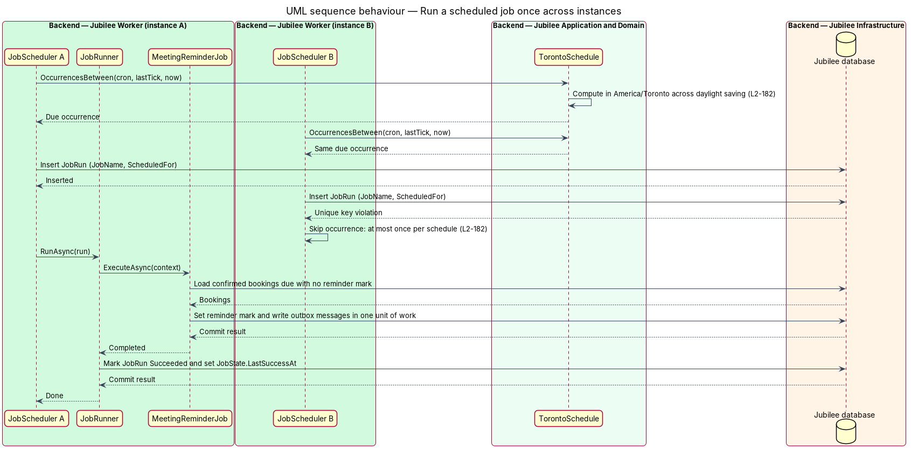
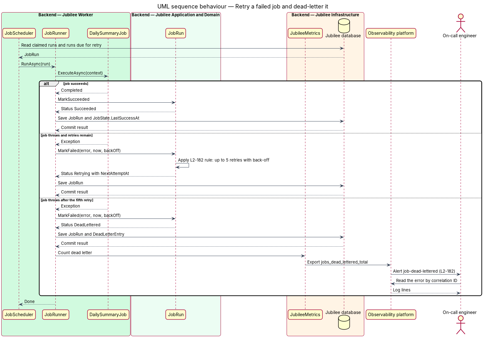

# Run background jobs

## Overview

Jubilee is Toronto's Christian marketplace. Part of its work happens without a waiting
request: meeting reminders 1 hour before a booking, daily e-mail summaries, deletions under the retention schedule, listing statistics and
response-time badges. This feature is the runtime in `Jubilee Worker` that schedules and runs
that work, and the rules each job follows.

Five terms recur. *job* — unit of background work with a name and a handler. *occurrence* —
one scheduled instant at which a job is due. *job run* — execution of one job for one
occurrence, including its retries. *idempotent* — property of a job whose repeated execution
for the same occurrence leaves the same result as one execution. *dead-letter queue* — store
of job runs that failed each retry and wait for an engineer.

`Jubilee Worker` runs as two or more instances, so each schedule is evaluated by each
instance. The design uses the `Jubilee database` as the single arbiter: one unique row per
job and occurrence decides which instance runs it. Schedules are written in Toronto local
time and converted to instants by one service, so a daylight saving change cannot shift or
duplicate a reminder.

## Description

The slice lives in `Jubilee.Worker`, with its entities in `Jubilee.Domain` and two operations
endpoints in `Jubilee.Api`.

- **`IJob`** — interface each job implements: `Name` and `ExecuteAsync(JobContext)`. The
  scheduled jobs are `MeetingReminderJob`, `DailySummaryJob`,
  `RetentionDeletionJob`, `StatisticsJob` and `ResponseTimeBadgeJob`. `OutboxDispatcherJob`
  and `SendEmailJob` run continuously under the same runner.
- **`JobDefinition`** — registration of one job: its name, its cron expression in Toronto
  local time, and its handler type. The cron expression of each job is `<TO SUPPLY>`.
- **`TorontoSchedule`** — domain service that expands a cron expression into instants using
  the `America/Toronto` time zone and `IClock`. A local time skipped by the spring change
  maps to the first valid instant after it. A local time repeated by the autumn change maps
  to its first instant only. A reminder relative to an event, such as 1 hour before a
  meeting, is computed on instants and is unaffected by either change.
- **`JobScheduler`** — hosted service in each Worker instance. On each tick it asks
  `TorontoSchedule` for the occurrences since the previous tick and tries to claim each one.
  The tick interval is `<TO SUPPLY>`.
- **`JobRun`** and **`JobRunClaimer`** — entity and the service that inserts it. A unique
  index on `(JobName, ScheduledFor)` lets one instance insert the row; each other instance
  receives a key violation and skips the occurrence. `LeaseExpiresAt` lets another instance
  take over a run whose instance stopped; the takeover counts as one retry. The lease length
  is `<TO SUPPLY>`.
- **`JobRunner`** — runs a claimed job inside a `JobCorrelationScope`. On success it sets the
  run to `Succeeded` and writes `JobState.LastSuccessAt`. On an exception it calls
  `JobRun.MarkFailed`.
- **`JobRun.MarkFailed`** — retry rule. It schedules up to 5 retries with an increasing
  back-off and then sets the status `DeadLettered`. The back-off intervals are `<TO SUPPLY>`.
- **`JobState`** — one row per job with the time of its last success and the last occurrence
  handled. The scheduler reads it after a restart to find occurrences missed while no
  instance ran.
- **Idempotent handlers** — each job selects its work by a durable marker and sets that
  marker in the same unit of work as its outbox messages. `MeetingReminderJob` selects
  confirmed bookings whose reminder mark is empty; `RetentionDeletionJob` selects rows past
  their retention date. A second execution for the same occurrence finds nothing to do.
- **`DeadLetterEntry`** — record of a run that exhausted its retries, with the job name, the
  error and the time. `JobRunner` increments the counter `jobs_dead_lettered_total`, and an
  alert rule on that counter alerts the on-call engineer.
- **`JobsOperationsController`** — exposes `GET /api/ops/jobs` with each `JobState` and
  `POST /api/ops/dead-letters/{id}/replay` to the `Admin` role. A replay creates a new claim
  for the same occurrence with the attempt count reset.
- **Queue metrics** — `JobQueueMetricsJob` exports the number of waiting runs and the age of
  the oldest one, which feed the job-queue alert of `L2-176`.

## Requirements

The feature realizes the following level-2 (L2) requirements. Each L2 requirement refines a
level-1 (L1) requirement, cited by identifier.

| L2 ID | Refines (L1) | Requirement |
|-------|--------------|-------------|
| `L2-182` | `L1-025` | Each scheduled job (meeting reminders, daily summaries, retention deletions, statistics, response-time badges) shall be idempotent, shall run at most once per schedule across instances, and shall record its last success. A failed job shall be retried up to 5 times with back-off and then moved to a dead-letter queue that alerts on-call, and reminder and summary times shall be computed in America/Toronto and be correct across daylight saving changes. |
| `L2-175` | `L1-025` | Each request shall receive a correlation ID that is returned in the `X-Request-Id` header and propagated to each downstream call, job and log line. Logs shall be structured JSON without passwords, tokens, message bodies or full e-mail addresses, and traces shall cover browser to API to database for at least 10 % of requests and 100 % of errors. |

## Diagrams

### System context

Jubilee sends reminders and summaries to members, partly through the e-mail provider. Job
metrics go to the `Observability platform`, which alerts the on-call engineer about
dead-lettered jobs.

### Containers

Each `Jubilee Worker` instance claims job runs in the `Jubilee database` and records the
results there. `Jubilee API` writes outbox messages and serves the operations endpoints.

### Components

`JobScheduler` asks `TorontoSchedule` for due occurrences, claims each through
`JobRunClaimer`, and hands the claimed run to `JobRunner`, which executes the job and records
the outcome.

### Class structure

`JobRunner` executes an `IJob` with a `JobContext`, updates the `JobRun`, records success in
`JobState`, and creates a `DeadLetterEntry` when retries are exhausted.

### Behaviour — run a scheduled job once across instances

Two instances compute the same occurrence. The unique `JobRun` row admits one of them; the
other skips. The job marks its work and writes its outbox messages in one unit of work
(`L2-182`).

### Behaviour — retry a failed job and dead-letter it

A failing run is retried up to 5 times with back-off. After the fifth retry the run moves to
the dead-letter queue and the on-call engineer is alerted (`L2-182`).

