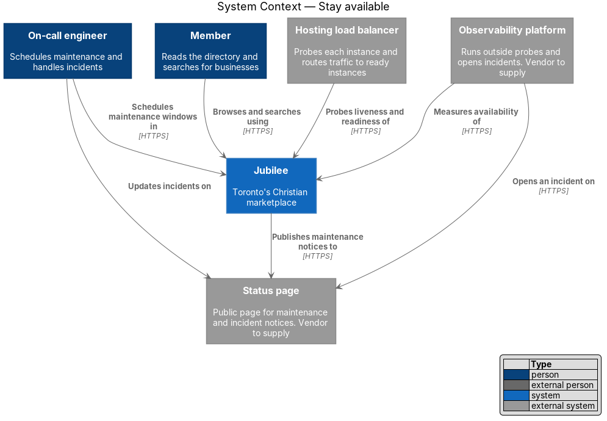
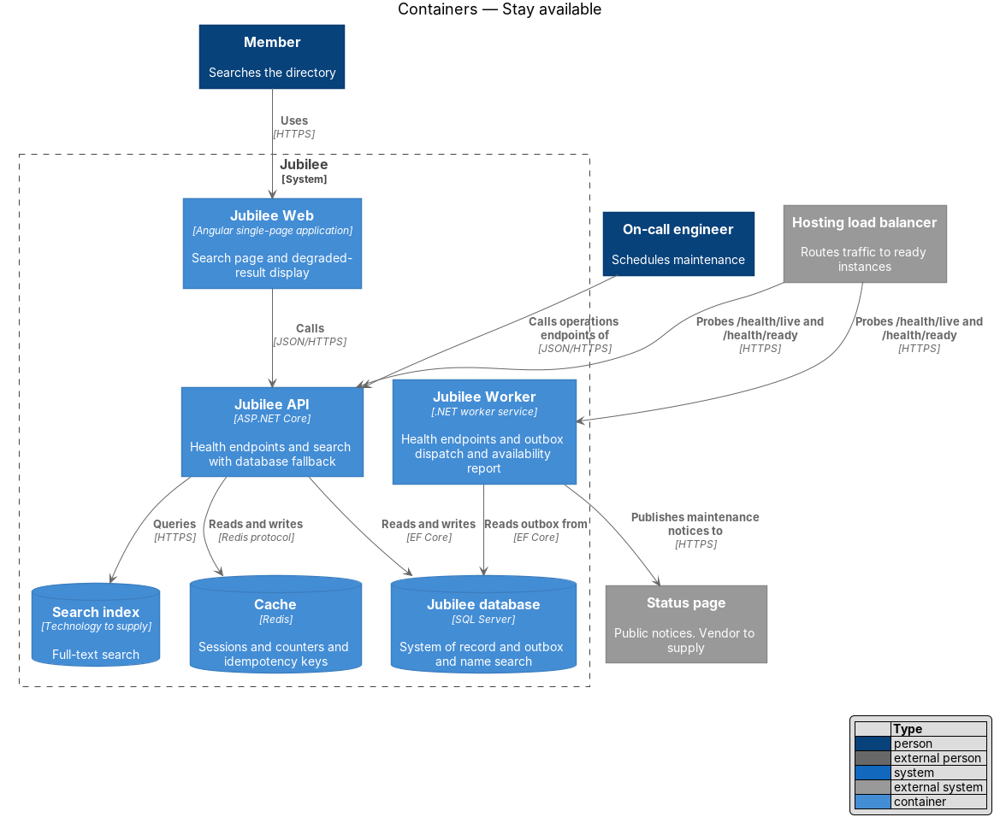
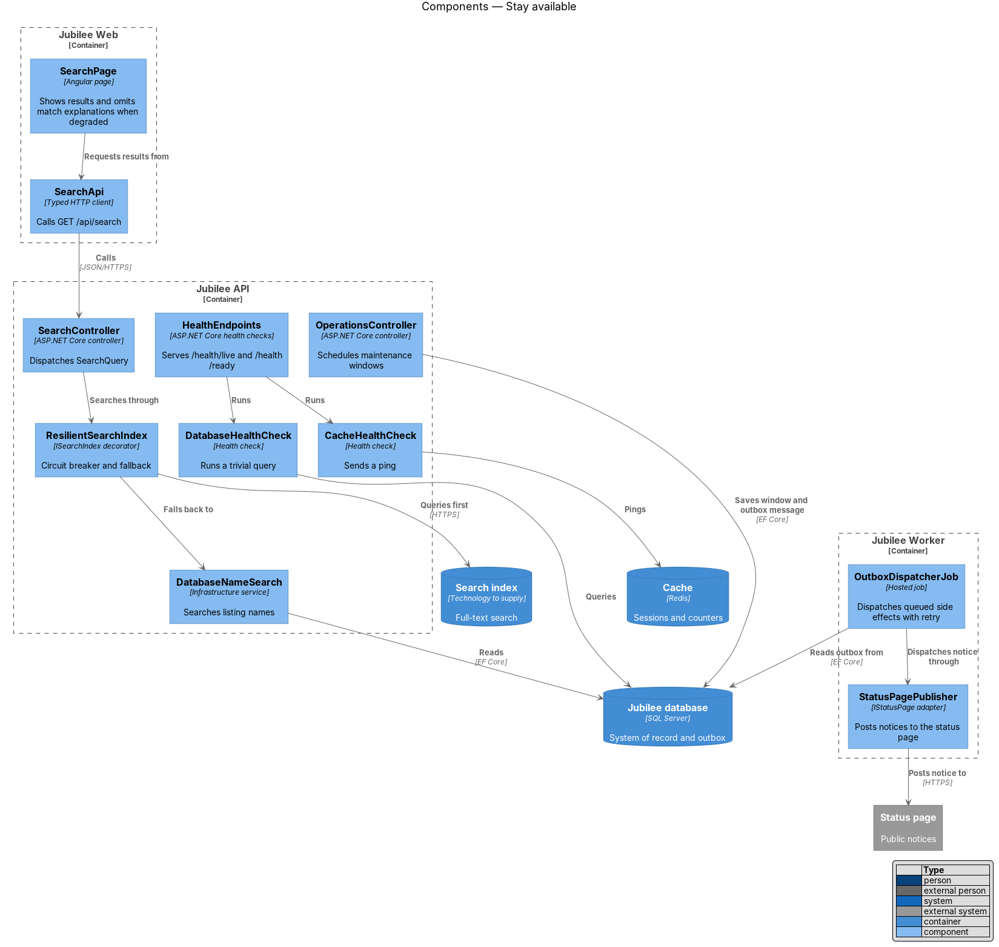
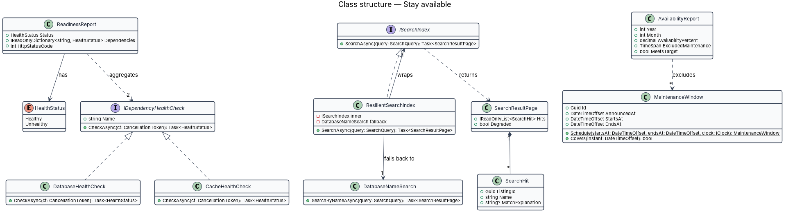
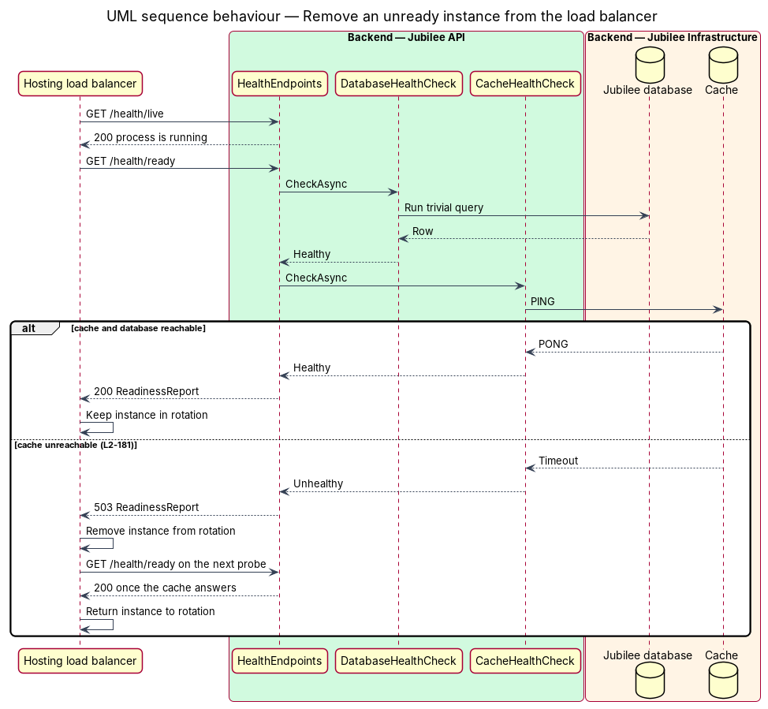
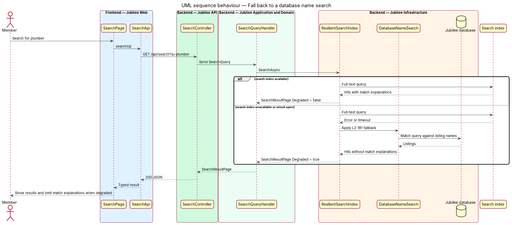
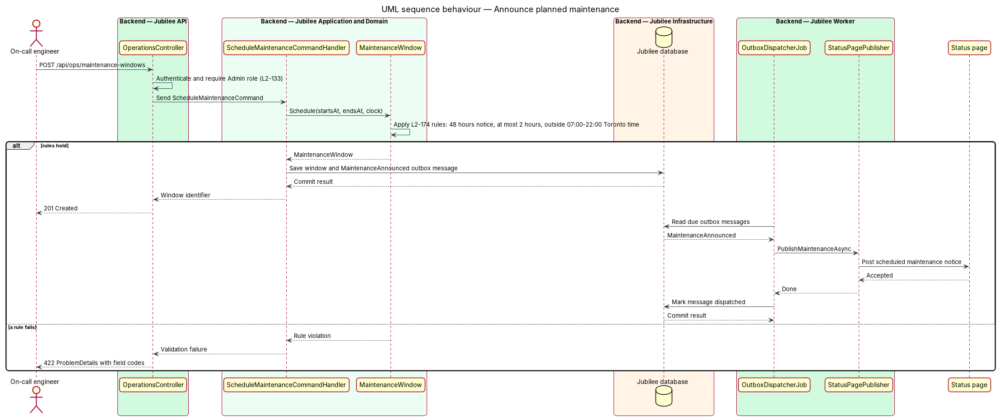

# Stay available

## Overview

Jubilee is Toronto's Christian marketplace: a directory in which members find verified
businesses, send requests and exchange messages. This feature covers the mechanisms that keep
the web application and the API reachable. The target is an availability of at least 99.9 %
in each calendar month, measured without announced maintenance (`L2-174`).

Three terms recur. *liveness* — property of a process that is running and able to answer a
request. *readiness* — property of an instance that can reach the dependencies it cannot work
without, the `Jubilee database` and the `Cache`. *degraded mode* — state in which an optional
dependency is down and the application continues with a reduced result instead of an error.

The feature has three parts. Health endpoints let the hosting load balancer remove an instance
that is not ready. Fallbacks and the transactional outbox keep core reading and messaging
working while the e-mail provider, the `Search index` or the `Cache` is down. A maintenance
window model and a public status page keep planned and unplanned interruptions announced.
The hosting provider, its load balancer and the status page vendor are `<TO SUPPLY>`.

## Description

The slice runs from the load balancer probe to the search page, and from the operations
endpoints to the status page.

- **`HealthEndpoints`** — ASP.NET Core health-check endpoints mapped in both `Jubilee API`
  and `Jubilee Worker`. `GET /health/live` returns `200` while the process runs and checks no
  dependency. `GET /health/ready` runs each `IDependencyHealthCheck` and returns `200`, or
  `503` when any check is `Unhealthy`. Both endpoints skip authentication and rate limiting
  and return no internal host names.
- **`DatabaseHealthCheck`** and **`CacheHealthCheck`** — the two readiness checks. The first
  runs a trivial query through `JubileeDbContext`; the second sends a Redis `PING`. The
  timeout of each check is `<TO SUPPLY>`.
- **`ReadinessReport`** — response body of `GET /health/ready`: the overall `HealthStatus`
  and the status of each named dependency. The load balancer removes an instance that answers
  `503` and returns it to rotation when a later probe answers `200`. The probe interval and
  failure threshold are `<TO SUPPLY>`.
- **`ResilientSearchIndex`** — decorator over the `ISearchIndex` adapter. It wraps each call
  in a timeout and a circuit breaker. When the `Search index` fails or the circuit is open, it
  calls `DatabaseNameSearch` and marks the `SearchResultPage` as `Degraded`. The breaker
  thresholds are `<TO SUPPLY>`.
- **`DatabaseNameSearch`** — infrastructure service that matches the query against listing
  names in the `Jubilee database`. Each `SearchHit` it returns has no `MatchExplanation`.
- **`SearchPage`** and **`SearchApi`** — Angular page and typed client for `GET /api/search`.
  When `Degraded` is `true` the page shows the results without match explanations.
- **Cache fallbacks** — `SessionStore` reads the `Session` row from the database when the
  `Cache` is unreachable, `IdempotencyMiddleware` reads `IdempotencyRecord` rows, and
  `RateLimitMiddleware` counts in process memory. Short-lived read caches are bypassed. The
  behaviour of the load balancer when each instance fails readiness at once is `<TO SUPPLY>`.
- **`OutboxMessage`** and **`OutboxDispatcherJob`** — queue for side effects. A handler writes
  notifications, e-mail and search-index updates to the outbox in the same transaction as the
  state change. `Jubilee Worker` dispatches each message and retries it when the dependency is
  down, so a request never waits on the e-mail provider or the `Search index`.
- **`MaintenanceWindow`** — domain entity for planned maintenance. `Schedule` rejects a window
  announced less than 48 hours before `StartsAt`, a window longer than 2 hours, and a window
  that overlaps 07:00–22:00 in the `America/Toronto` time zone.
- **`OperationsController`** — exposes `POST /api/ops/maintenance-windows` to callers with the
  `Admin` role. A rule violation returns `422` with a per-field code. The operator tooling
  that calls this endpoint is `<TO SUPPLY>`. At the start of the window the operator turns on
  maintenance mode (`L2-117`).
- **`StatusPagePublisher`** — `IStatusPage` adapter in `Jubilee Worker`. It posts the
  `MaintenanceAnnounced` outbox message to the status page as a scheduled notice.
- **Incident notice** — the status page is hosted outside the Jubilee hosting environment. An
  alert of the `Observability platform` opens an incident on the status page when it pages the
  on-call engineer, so the first update appears within 15 minutes of detection without a call
  to Jubilee. The on-call engineer writes each later update.
- **`AvailabilityReportJob`** and **`AvailabilityReport`** — monthly job in `Jubilee Worker`.
  It reads the results of the outside probes that the `Observability platform` runs against
  the web application and `GET /health/ready`, subtracts the intervals covered by an
  announced `MaintenanceWindow`, and stores the percentage and whether it meets 99.9 %. The
  probe interval is `<TO SUPPLY>`.

## Requirements

The feature realizes the following level-2 (L2) requirements. Each L2 requirement refines a
level-1 (L1) requirement, cited by identifier.

| L2 ID | Refines (L1) | Requirement |
|-------|--------------|-------------|
| `L2-174` | `L1-025` | The web app and API shall be available at least 99.9 % of each month, excluding announced maintenance. Planned maintenance shall be announced on the status page at least 48 hours ahead, shall last at most 2 hours outside 7:00 a.m.–10:00 p.m. Toronto time, and the status page shall be updated within 15 minutes of detecting an incident. |
| `L2-181` | `L1-025` | Each service shall expose liveness and readiness endpoints, and readiness shall fail when the database or cache is unreachable so that the instance is removed from the load balancer. When the e-mail provider, search index or cache is down, core reading and messaging shall keep working, side effects shall be queued and retried, and search shall fall back to a database name search without match explanations. |

## Diagrams

### System context

The member reads and searches through Jubilee while the hosting load balancer and the
`Observability platform` probe it. Jubilee publishes maintenance notices to the status page,
and the alerting path opens incidents there independently of Jubilee.

### Containers

The load balancer probes `Jubilee API` and `Jubilee Worker`. The API depends on the
`Jubilee database` and the `Cache` for readiness and treats the `Search index` as optional.

### Components

`HealthEndpoints` runs the two dependency checks. `ResilientSearchIndex` queries the
`Search index` first and falls back to `DatabaseNameSearch`. `OperationsController` saves a
maintenance window, and `OutboxDispatcherJob` hands the notice to `StatusPagePublisher`.

### Class structure

Both health checks implement `IDependencyHealthCheck` and feed `ReadinessReport`.
`ResilientSearchIndex` implements `ISearchIndex`, wraps the real adapter and holds the
fallback. `AvailabilityReport` excludes the intervals of each `MaintenanceWindow`.

### Behaviour — remove an unready instance from the load balancer

The liveness probe checks only the process. The readiness probe checks the database and the
cache; a `503` answer removes the instance from rotation until a later probe succeeds
(`L2-181`).

### Behaviour — fall back to a database name search

When the `Search index` fails or its circuit is open, `ResilientSearchIndex` returns hits
from `DatabaseNameSearch` and marks the page as degraded. `SearchPage` then omits the match
explanations (`L2-181`).

### Behaviour — announce planned maintenance

`MaintenanceWindow.Schedule` applies the notice, duration and time-of-day rules of `L2-174`.
A valid window is saved with an outbox message, which `Jubilee Worker` publishes to the status
page; an invalid window returns `422`.

