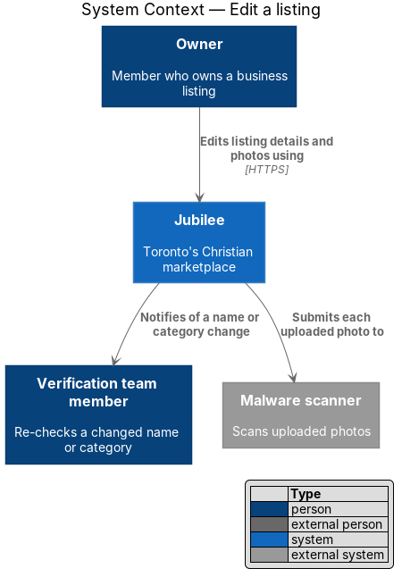
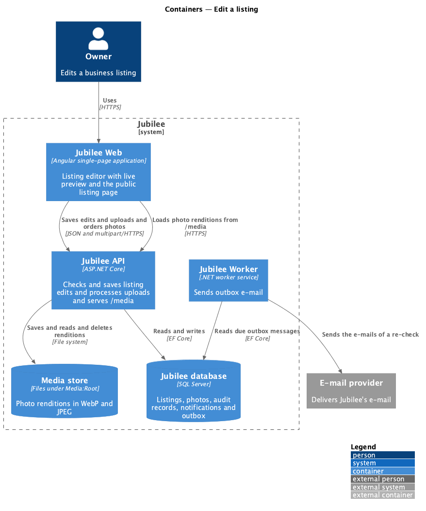
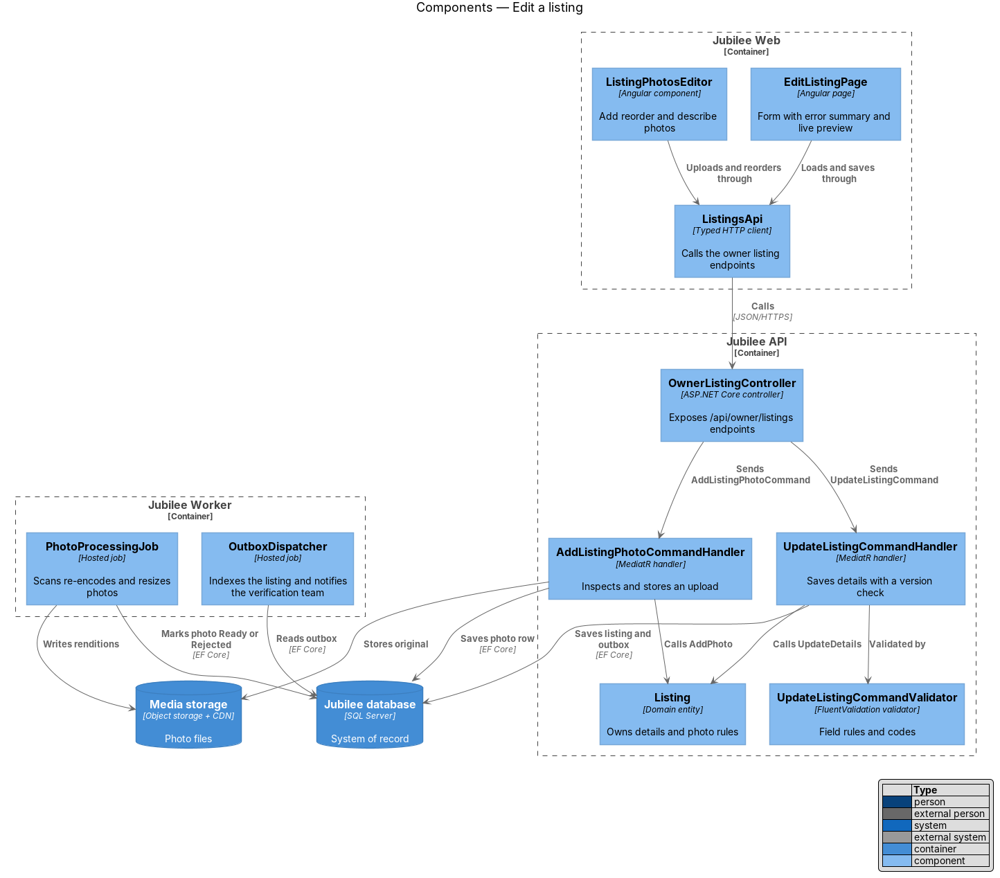
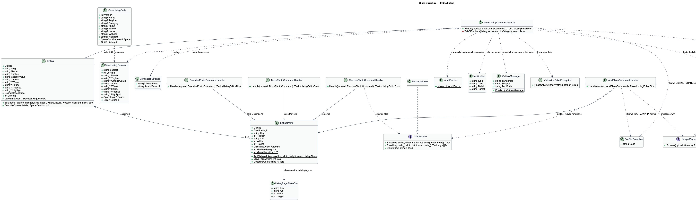
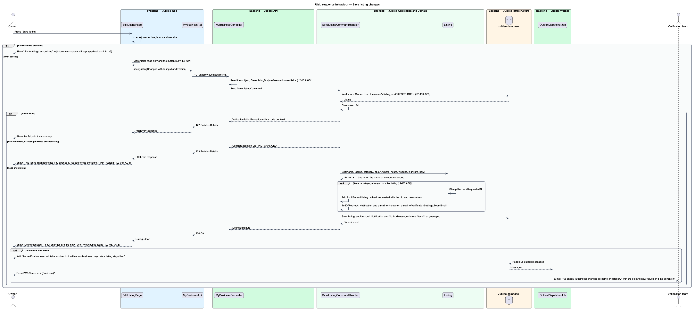
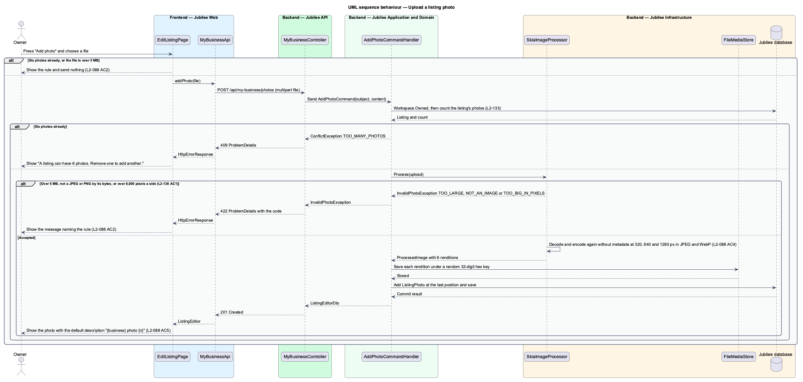
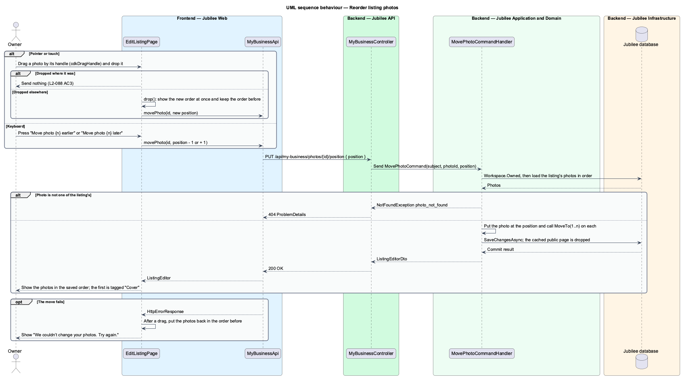

# Edit a listing

## Overview

Jubilee is Toronto's Christian marketplace: a directory of verified
Christian-owned businesses. A *listing* is the public page of one business. The
*owner* manages it in the owner workspace under `/my-business`. This feature
covers the "Listing" tab at `/my-business/listing`, where the owner edits the
details and the photos of a listing, and the showing of those photos on the
listing's public page.

There is no draft step for a live listing: changes publish when the owner saves.
The page says so ("Changes are published when you save") and shows a *live
preview* — card that renders the listing as members see it while the owner
types. A change to the business name or the category is also live at once. It
asks for a *re-check*: the verification team is e-mailed to look at the listing
again within two business days, and the owner is e-mailed and notified.

A listing carries up to 6 photos. The first photo is the *cover* — photo that
stands at the top of the listing page in place of the category's tinted tile.
The server verifies each upload by its content, drops its metadata, and keeps it
only as resized *renditions* — copies 320, 640 and 1280 pixels wide in WebP and
JPEG. The owner reorders photos by dragging a handle or with move buttons.

Two tabs can open the editor at once. *Optimistic concurrency* — refusal of a
save that is based on an older version of the record — prevents the second save
from overwriting the first.

## Description

The feature is a vertical slice from `EditListingPage` in `Jubilee Web` to
`Jubilee database` and the media store, with the e-mails of a re-check sent by
`Jubilee Worker`. The names below are the names in the code; the parts decided
in ADR 0052 are marked with it. ADR 0023 holds the earlier decisions.

- **`EditListingPage`** — Angular page at `/my-business/listing`
  (`frontend/projects/jubilee/src/app/pages/edit-listing`), a container of
  `jb-*` components under `WorkspaceHeader`. It shows Photos, "Business name",
  "One line on what you do" with a "{n} / 90" counter, "About", "Category",
  "Where", "Hours", "Website" (optional), "Highlight" (optional), "Discard
  changes" and "Save listing". Input stops at 1,500 characters in "About" and at
  30 in "Highlight". The form carries the `jbDraft` directive (ADR 0046). While
  a save is in flight the fields are read-only, "Save listing" is busy and a
  second press sends nothing (`L2-127`). On a load failure it shows "We couldn’t
  load your listing" with `JB-LST-503`, "Try again" and "Back to overview"; an
  answer of HTTP 403 navigates to `/forbidden`.
- **Browser checks** — `check` requires a name of at most 80 characters, a line
  of at most 90, hours, and a website that starts with `http://` or `https://`.
  Problems show in `jb-form-summary` (`FormSummary`), which takes the focus, and
  under each field; nothing is sent (`L2-126`). The messages include "Shorten
  this to 90 characters. It has {n}.", "Enter your hours, or “By appointment”."
  and "Enter a web address starting with https://".
- **After a save** — the page adopts the returned `ListingEditor` and shows the
  success alert "Listing updated" with "Your changes are live now." and "View
  public listing". When the name or category changed and `recheckRequested` is
  set, the alert adds "Because you changed the name or category, the
  verification team will take another look within two business days. Your
  listing stays live." HTTP 409 shows "This listing changed since you opened it.
  Reload to see the latest." with "Reload". HTTP 422 shows the server's field
  codes in the summary. Any other failure shows "We couldn’t save your changes"
  with "Nothing was changed. Check your connection and try again."
- **Live preview** — `jb-business-card` (`BusinessCard`) under "How members see
  you", fed by the draft as the owner types.
- **Photos area** — a list inside the form, drawn by the page itself; there is
  no separate photos component. Each photo is a square `jb-media-tile` with the
  tag "Cover" on the first, a text input for its description (at most 125
  characters, placeholder the default "{business} photo {n}"), a drag handle,
  "Move photo {n} earlier", "Move photo {n} later" and "Remove photo {n}". "Add
  photo" opens a file input that accepts `image/jpeg` and `image/png`; it is
  absent at 6 photos. The page refuses a file over 5 MB before sending it. The
  help text reads "Up to 6 photos, JPG or PNG, 5 MB each. The first is your
  cover. Drag a photo by its handle, or use the arrows, to change the order."
  Each photo action sends at once and does not wait for "Save listing".
- **Reordering** (ADR 0052, `L2-088` AC3) — the list carries `cdkDropList` with
  `cdkDropListOrientation="mixed"`, each photo `cdkDrag`, and the handle
  `cdkDragHandle` from the Angular CDK, so a touch elsewhere on a photo still
  scrolls the page. `drop` shows the new order at once and calls
  `MyBusinessApi.movePhoto` with the new position; a drop in the same place
  sends nothing. When the move fails the photos return to the order before the
  drag and the page shows "We couldn’t change your photos. Try again." The
  handle is a pointer affordance only (`aria-hidden="true"`, `tabindex="-1"`,
  title "Drag to reorder"): the two move buttons are the keyboard equivalent and
  send the same request. The list is disabled for dragging while a photo request
  is in flight.
- **`MyBusinessApi`** — service contract behind the `MY_BUSINESS_API` injection
  token, implemented by `HttpMyBusinessApi`. `editor` calls
  `GET /api/my-business/listing`; `save` calls `PUT /api/my-business/listing`
  with `ListingChanges`; `addPhoto` posts multipart `file` to
  `POST /api/my-business/photos`; `movePhoto` calls
  `PUT /api/my-business/photos/{id}/position`; `describePhoto` calls
  `PUT /api/my-business/photos/{id}/alt`; `removePhoto` calls
  `DELETE /api/my-business/photos/{id}`. Each answers `ListingEditor`.
- **`MyBusinessController`** — ASP.NET Core controller in `Jubilee.Api` at
  `api/my-business`. It reads the subject of the session cookie and sends the
  queries and commands through MediatR. `SaveListingBody`, `MovePhotoBody` and
  `DescribePhotoBody` are marked `JsonUnmappedMemberHandling.Disallow`: a body
  that names `stage`, `verified` or `ownerId` returns HTTP 400 and nothing is
  changed (`L2-133` AC4). `AddPhoto` limits the request to 6 MB, answers HTTP
  201, and writes an `InvalidPhotoException` as HTTP 422 with its code.
- **`Workspace.Owned`** — finds the listing the owner works on (the one chosen
  last in the switcher, else the live one, else the oldest). A caller who owns
  nothing receives HTTP 403 with code `FORBIDDEN` (`L2-097` AC1, `L2-133` AC3).
  There is no authorization policy class; every handler below starts with it.
- **`GetListingEditorQuery`** and **`ListingEditorDto`** — the editor's read:
  `Id`, `Version`, `Slug`, `Stage`, `Paused`, the page fields, `Categories`
  (`CategoryOptionDto`), `Photos` (`ListingPhotoDto`), `RecheckRequested` and
  `Space`. `Workspace.Editor` builds it and every command of this feature
  returns it.
- **`SaveListingCommand`** and **`SaveListingCommandHandler`** — the handler in
  `Jubilee.Application` (`OwnerWorkspace/OwnerWorkspace.cs`) checks the fields
  itself; there is no separate validator. Name and line are `REQUIRED` or
  `TOO_LONG` (80 and 90, `Workspace.MaxName` and `Workspace.MaxTagline`), hours
  `REQUIRED` or `TOO_LONG` (200), category `INVALID`, website `INVALID` (not an
  absolute `http` or `https` address, or above 300), and About (1,500),
  Highlight (30) and Where (200) `TOO_LONG`. A failure throws
  `ValidationFailedException`, HTTP 422 with one code per field. A `Version`
  other than `Listing.Version` throws `ConflictException`, HTTP 409 with code
  `LISTING_CHANGED`. The same answer refuses a save whose `ListingId` names
  another listing than the one being worked on, which happens after a switch of
  business in another tab (ADR 0052). The handler then calls `Listing.Edit` and
  saves once.
- **`Listing.Edit`** — sets the fields, increments `Version`, and returns true
  when the name or the category changed. On a live listing that also stamps
  `RecheckRequestedAt`. The listing stays live.
- **Re-check** (ADR 0052, `L2-087` AC6) — when `Edit` returns true on a live
  listing the handler adds the `AuditRecord` `listing.recheck-requested` with
  the old and new name and category and calls `TellOfRecheck`. That writes the
  owner a `Notification` "We’ll re-check {Business}" through
  `NotificationRules.Tell` (kind `listing`, target `/my-business`) and an e-mail
  `OutboxMessage` of the same title with "Your change is live now. Because the
  name or category changed, the verification team looks at the listing again
  within two business days. You don’t need to do anything." When
  `VerificationSettings.TeamEmail` is set it adds a second `OutboxMessage`,
  "Re-check: {Business} changed its name or category", with the old and the new
  name and category, the owner's name and the address
  `{AdminBaseUrl}/verifications/{listingId}`. All of it is saved with the change
  in one `SaveChangesAsync`, so the e-mails are sent once or the change is not
  saved. A save that changes neither, a refused save, and a listing that is not
  live tell nobody.
- **`VerificationSettings`** — `TeamEmail` is read from `Verification:TeamEmail`
  and falls back to `Launch:TeamEmail`; with neither set the team is not
  e-mailed and the audit record remains. `AdminBaseUrl` is read from
  `StaffSignIn:PublicBaseUrl`.
- **`OutboxDispatcherJob`** — hosted job in `Jubilee Worker`. It sends the due
  e-mail `OutboxMessage` through `OutboxDispatcher` and `IEmailSender`.
- **Left open** — the admin application has no list of listings awaiting a
  re-check and no action to mark a re-check done; nothing clears
  `RecheckRequestedAt` (ADR 0052). The two-business-day promise is the
  verification team's and no timer enforces it.
- **`AddPhotoCommandHandler`** — refuses a seventh photo with HTTP 409
  `TOO_MANY_PHOTOS` (`ListingPhoto.MaxPerListing`), passes the upload to
  `IImageProcessor`, saves each `Rendition` through `IMediaStore` under a random
  32-digit hex key, and adds a `ListingPhoto` at the last position.
- **`SkiaImageProcessor`** — the `IImageProcessor` in `Jubilee.Infrastructure`.
  It accepts JPEG and PNG by the first bytes of the file, up to 5 MB and
  8,000 × 8,000 pixels, and throws `InvalidPhotoException` with `TOO_LARGE`
  ("Photos can be 5 MB at most."), `NOT_AN_IMAGE` ("Add a JPG or PNG photo.") or
  `TOO_BIG_IN_PIXELS` ("Photos can be 8,000 by 8,000 pixels at most."). It
  decodes the image and encodes it again, which drops every piece of metadata,
  GPS included, at 320, 640 and 1280 pixels wide in WebP and JPEG, never wider
  than the original. The processing is synchronous, in the request; the original
  is not kept.
- **`FileMediaStore`** and **`MediaController`** — the `IMediaStore` keeps the
  renditions as files under `Media:Root`, one folder per key.
  `GET /media/{key}/{width}.{jpg|webp}` is anonymous, answers only a 32-digit
  hex key and a width of 320, 640 or 1280, and sets a fixed `Content-Type`,
  `X-Content-Type-Options: nosniff` and
  `Cache-Control: public, max-age=31536000, immutable`. Of `L2-138` AC2, the
  malware scan and the separate cookieless domain are not built.
- **`MovePhotoCommandHandler`**, **`DescribePhotoCommandHandler`** and
  **`RemovePhotoCommandHandler`** — move a photo to a position and renumber the
  rest from 1; set or clear `ListingPhoto.Alt` (above 125 characters is HTTP 422
  `alt: TOO_LONG`); remove the row, renumber, and delete the files. A photo of
  another listing is HTTP 404 `photo_not_found`.
- **`ListingPhoto`** — domain entity with `ListingId`, `Key`, `Position`, `Alt`,
  `Width`, `Height` and `AddedAt`. The first by `Position` is the cover. There
  is no status: a photo exists only after its renditions are stored.
  `ListingPhotoDto` gives `Alt` as the owner's text or the default "{business}
  photo {n}", and `CustomAlt` as the owner's text alone.
- **Photos on the public page** (ADR 0052, `L2-221`) —
  `GetListingPageQueryHandler` adds `Photos` (`ListingPagePhotoDto`: `Key`,
  `Alt`, `Width`, `Height`) to `ListingPageDto` in the owner's order;
  `CoverPhoto` stays null and is not read. `BusinessPage` shows the first photo
  in place of the tinted tile with `priority`, and the others under the heading
  "Photos". A listing with no photos shows the tile and no "Photos" section
  (`L2-088` AC6). The photos of a listing that is not public reach only its
  owner and the verification team, as the page does (`L2-028` AC3).
- **`MediaTile`** (`jb-media-tile`) — component of the `components` library.
  With `photoKey`, `photoWidth` and `photoHeight` it renders a `picture`: a WebP
  `source` and a JPEG `img`, each with a `srcset` of the three renditions at
  their true widths (a 500 pixel photo offers 320w and 500w), the `sizes` input,
  explicit `width` and `height`, and `fetchpriority="high"` when `priority` is
  set or `loading="lazy"` otherwise (`L2-155` AC1 and AC2). The editor's own
  thumbnails use the same inputs.
- **`DirectoryCacheInvalidationInterceptor`** — drops the cached public reads
  after a save that changed a `Listing` or a `ListingPhoto`, so an edit or a new
  cover shows on the next request of the public page.

The business card in lists still shows the category tile; its photo is deferred
with the CDN of `L2-155` AC3 (ADR 0052).

The integration tests are in `OwnerWorkspaceTests` and `RecheckNoticeTests`
(`backend/tests/Jubilee.Api.Tests`), among them
`L2_087_AC6_a_new_name_e_mails_the_team_the_old_and_new_values_with_the_listing_in_the_admin_application`,
`L2_087_AC6_without_an_address_of_its_own_the_re_check_goes_to_the_launch_team_address`
and `L2_087_AC8_a_save_from_an_editor_opened_on_another_business_is_refused`.
The Playwright behaviour specs are in `e2e/tests/my-business.spec.ts` and
`e2e/tests/listing-photos.spec.ts`, with the page object
`e2e/pages/edit-listing.page.ts`.

### Spaces

For a space, the screen shows Photos, "Listing title", the line, "About" and
the space fields of `L2-199` with their stored values, the exact address
included, and not "Category", "Hours" or "Website". `GET
/api/my-business/listing` returns `ListingEditorDto` with `Space`
(`SpaceDraftDto`, with the address, for the owner only), and `PUT
/api/my-business/listing` takes `space` (`SpaceInput` on `SaveListingCommand`),
validated by `Drafts.ValidateSpace`; hours are not required for a space. A save
that moves a space out of "Rooms & rentals", or a business into it, is refused
with HTTP 422 and `category` `CATEGORY_LOCKED`. A change of
term is live immediately in the space's cards and page. Photos follow
`L2-088`; onboarding has none, so they are added here (ADR 0042; see
[Describe a space](../../onboarding/describe-space/README.md)).

## Requirements

The feature realizes the following level-2 (L2) requirements. Each L2
requirement refines a level-1 (L1) requirement, cited by identifier.

| L2 ID | Refines (L1) | Requirement |
|-------|--------------|-------------|
| `L2-087` | `L1-013` | The system shall let the owner edit the live listing at `/my-business/listing`, and changes shall publish when saved. A change to the business name or category on a live listing shall be live and shall notify the verification team to re-check it within two business days: the team shall be e-mailed the old and the new name and category with a link to the listing in the admin application, the owner shall be e-mailed and notified "We’ll re-check {Business}", and the change shall be written to the audit log. A save that changes neither shall send nothing. A save over a newer version shall be refused with "This listing changed since you opened it. Reload to see the latest." |
| `L2-088` | `L1-013` | The system shall accept up to 6 listing photos in JPG or PNG of at most 5 MB each, checked by content, with the first photo as the cover. Photos shall be reordered by drag or by keyboard: each photo shall have a drag handle that works with a mouse and by touch, the buttons "Move photo {n} earlier" and "Move photo {n} later" shall do the same from the keyboard, and a photo dropped where it was shall send nothing. Stored photos shall have metadata stripped, renditions at 320, 640 and 1280 px wide in WebP and JPEG, and alt text of at most 125 characters that defaults to "{business} photo {n}". |
| `L2-221` | `L1-005`, `L1-021` | On the page of a public listing with photos, the cover photo shall stand in place of the category's tinted tile with its alt text, and the other photos shall follow under the heading "Photos" in the owner's order. Each photo shall be a `picture` with a WebP source and a JPEG fallback, each with a `srcset` of the renditions at their true widths and a `sizes` hint, with explicit `width` and `height`. The cover shall be fetched first (`fetchpriority="high"`) and the photos under it shall load lazily (`loading="lazy"`). |
| `L2-155` | `L1-021` | A listing image shall use `srcset` with the renditions of L2-088, modern formats (WebP or AVIF) with JPEG fallback, explicit width and height, and `loading="lazy"` below the fold; the largest image above the fold shall be prioritised (`fetchpriority="high"`). |
| `L2-126` | `L1-018` | A page form submitted with errors shall show the summary "Fix {n} thing(s) to continue" with a link to each field, shall keep typed values, and the server shall enforce each browser rule with the same message code. |
| `L2-127` | `L1-018` | While a form submits, its fields shall be read-only, the primary button shall show a spinner with `aria-busy="true"`, and a second press shall send nothing. |
| `L2-133` | `L1-019` | The server shall check ownership of the listing before doing anything, shall return 403 to an owner API call for a listing the caller does not own, and shall reject an update that includes fields the caller may not set. |
| `L2-138` | `L1-019` | The server shall check each upload by its magic bytes, accept only JPEG and PNG up to 5 MB and 8,000 × 8,000 pixels, re-encode the image, strip metadata, scan it for malware and serve it from a separate cookieless domain. |
| `L2-209` | `L1-028` | `/my-business/listing` for a space shall show the space fields with their stored values and not "Category", "Hours" or "Website", validate them as on `/list`, and publish a change of term to the cards and page. |
| `L2-208` | `L1-028` | The exact address shall reach only the member whose space request is `confirmed` or `completed`, and the owner shall see and change it on Edit listing. |

## Diagrams

### System context

The owner edits the listing through Jubilee. Jubilee e-mails the owner and a
`Verification team member` through the external e-mail provider when the name or
category of a live listing changes. Members and visitors see the photos on the
public page.

### Containers

`Jubilee Web` sends edits and uploads to `Jubilee API` and loads renditions from
its `/media` path. `Jubilee API` writes `Jubilee database` and the media store.
`Jubilee Worker` sends the e-mails of a re-check from the outbox.

### Components

`EditListingPage` calls `MyBusinessController` through `MyBusinessApi` and draws
each photo with `MediaTile`, as `BusinessPage` does on the public page. In the
API, one controller dispatches the save and the photo commands; each handler
finds the listing with `Workspace`.

### Class structure

`Listing` holds `Version` for optimistic concurrency and `RecheckRequestedAt`;
`ListingPhoto` rows refer to it by `ListingId`. `SaveListingCommandHandler`
checks the fields, calls `Edit` and writes the records of a re-check.

### Behaviour — save listing changes

The handler returns HTTP 422 for invalid fields and HTTP 409 for a stale version
or another listing. A valid save is live at once; a changed name or category on
a live listing also tells the owner and the verification team (`L2-087` AC6).

### Behaviour — upload a photo

The API refuses a seventh photo, an oversized file and a file that is not a real
JPG or PNG. An accepted file is re-encoded into its renditions and stored within
the request.

### Behaviour — reorder photos

A drag by the handle and the two move buttons send the same request. A drop in
the same place sends nothing, and a failed move restores the order (`L2-088`
AC3).

