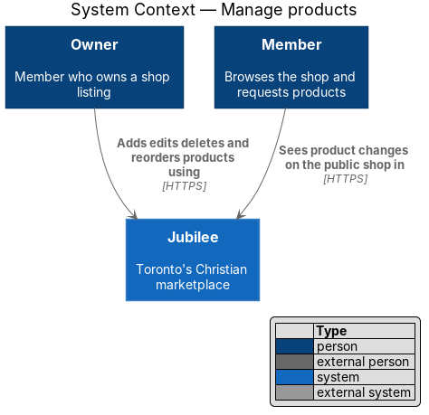
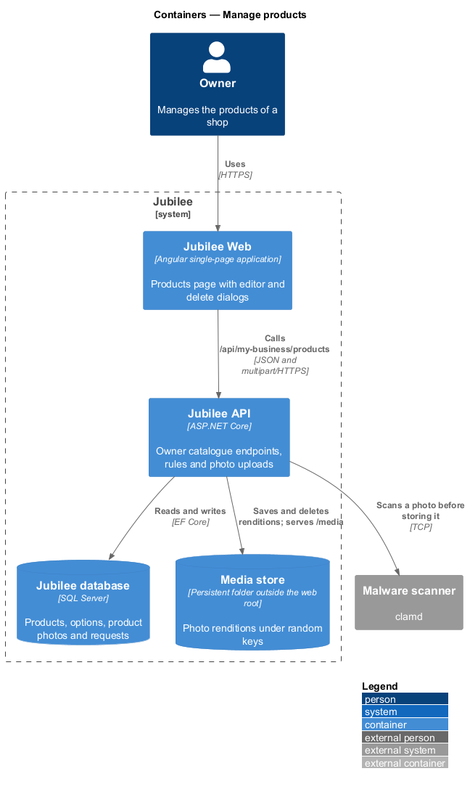
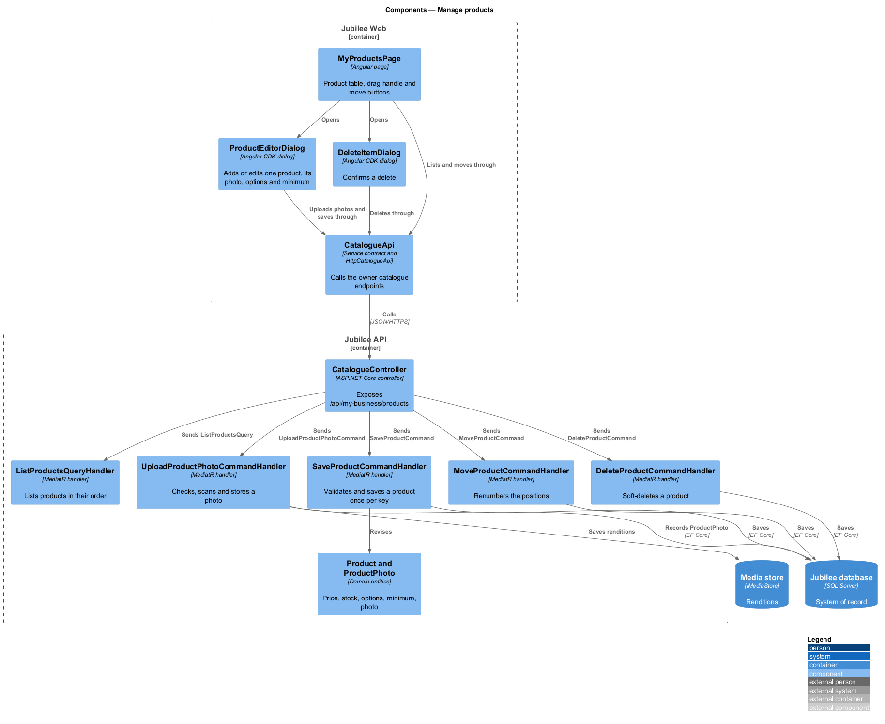
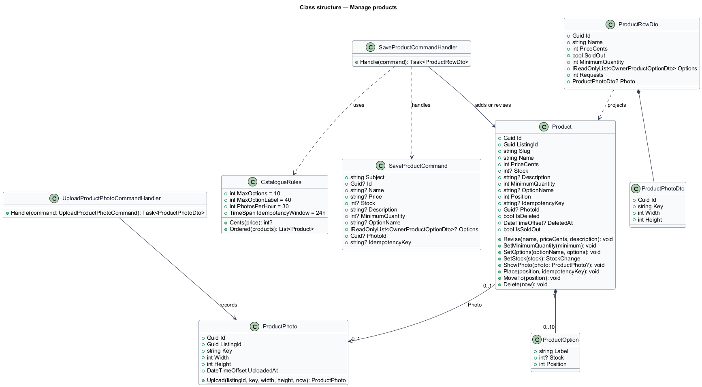
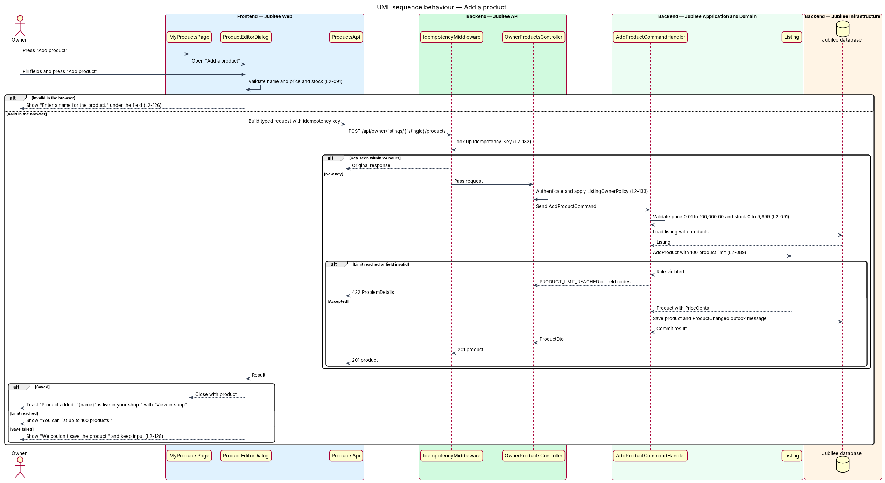
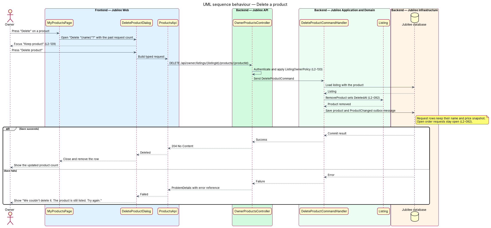
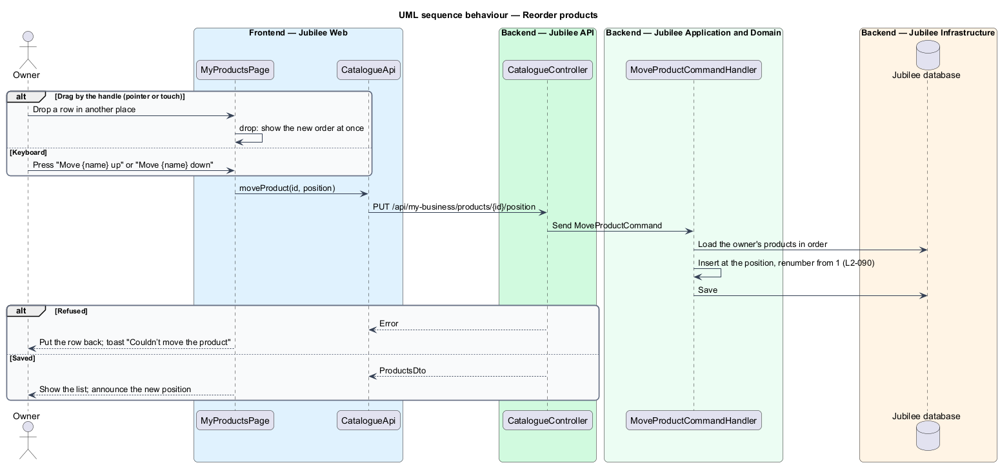

# Manage products

## Overview

Jubilee is Toronto's Christian marketplace: a directory of
Christian-owned businesses. A *shop* is a listing that sells physical items. A
*product* is one item of a shop, with a name, a price in Canadian dollars, an
optional photo and an optional stock count. Members do not pay through Jubilee;
they send an *order request* for a product and the owner confirms or declines it.

This feature covers the "Products" tab of the owner workspace at
`/my-business/products`. The owner sees every product in a table, adds and edits
products in a dialog, deletes a product after a confirmation, and moves products
up or down to set the order that the public shop shows.

Changes show on the public listing as soon as the owner saves. A product with a
stock of 0 shows as *sold out*; an empty stock field means the stock is not
tracked. A shop holds at most 100 products.

Deleting a product removes it from public pages at once but does not rewrite
history. Past requests keep a *snapshot* — copy of the product's name and price
taken when the request was sent — and open order requests stay open.

## Description

The feature is a vertical slice from the products page in `Jubilee Web` to the
`Jubilee database`.

- **`MyProductsPage`** — Angular page at `/my-business/products`. It shows the
  summary (for example "4 products · 1 sold out"), "Add product" and a table with
  Product, Price, Status ("Listed" or "Sold out"), Requests (all-time count) and
  Actions ("Edit", "Delete"). Row actions are always visible on a device without
  hover and also show on row hover and focus elsewhere. The empty state reads
  "No products yet. Add what you sell with a photo and a price. Members can
  request an item and you confirm it." The load-error state carries `JB-PRD-503`.
- **`ReorderControls`** — shared Angular component with a drag handle and move
  up and move down buttons. `MyProductsPage` sends the new order on save.
- **`ProductEditorDialog`** — dialog titled "Add a product" or "Edit product".
  It holds "Add photo" ("JPG or PNG, 5 MB at most"), "Product name" (required),
  "Price (CAD)" (required), "In stock" (hint "0 shows as sold out."),
  "Description" (optional), up to 10 options and a minimum order quantity. Its
  primary button reads "Add product" or "Save changes". A failed save shows "We
  couldn't save the product. Nothing was changed and what you typed is still
  here. Try again."
- **`DeleteProductDialog`** — confirmation titled "Delete “{name}”?" with "It
  disappears from your shop now. The {n} past requests for it stay in your
  records. This can't be undone.", "Keep product" (focused by default) and
  "Delete product". A failed delete shows "We couldn't delete it. The product is
  still listed. Try again."
- **`ProductsApi`** and **`OwnerProductsStore`** — typed HTTP client and signal
  store. The client attaches an idempotency key from `IdempotencyKeyFactory` to
  each create.
- **`OwnerProductsController`** — ASP.NET Core controller for
  `GET` and `POST /api/owner/listings/{listingId}/products`,
  `PUT` and `DELETE /api/owner/listings/{listingId}/products/{productId}`, and
  `PUT /api/owner/listings/{listingId}/products/order`. It applies
  `ListingOwnerPolicy`; a member who does not own the listing receives `403`.
- **`AddProductCommand`**, **`UpdateProductCommand`** and
  **`ProductCommandValidator`** — the editor requests and their shared rules.
  Failures return `422` with per-field codes: `PRODUCT_NAME_REQUIRED` ("Enter a
  name for the product."), `PRICE_INVALID` ("Enter a price in dollars, like
  24.00." for a price outside 0.01 to 100,000.00 or with more than two
  decimals), `STOCK_INVALID` (not a whole number from 0 to 9,999),
  `OPTIONS_LIMIT` (more than 10 options) and `MIN_QUANTITY_INVALID` (outside 1
  to 999).
- **`AddProductCommandHandler`** and **`UpdateProductCommandHandler`** — load
  the listing, call `Listing.AddProduct` or `Product.Update`, and save the
  product with a `ProductChanged` outbox message in one unit of work. On a 101st
  product the handler returns `422` with `PRODUCT_LIMIT_REACHED` and the page
  shows "You can list up to 100 products."
- **`DeleteProductCommandHandler`** — calls `Listing.RemoveProduct`, which sets
  `Product.DeletedAt`. Public queries filter deleted products, so the product
  leaves public pages at once. Request rows keep their own name and price
  snapshot and are not touched, and `SavedItem` rows that point to the product
  resolve to "No longer available".
- **`ReorderProductsCommandHandler`** — validates that the submitted IDs are
  exactly the listing's products and calls `Listing.ReorderProducts`, which
  rewrites each `SortOrder`.
- **`Product`** — domain entity. It stores the price as `PriceCents`, an integer
  number of cents, a nullable `Stock` (null means not tracked), `SortOrder`,
  `MinimumOrderQuantity` and its `ProductOption` list. `IsSoldOut` is true when
  `Stock` is 0.
- **`OutboxDispatcher`** — hosted job in `Jubilee.Worker` that applies
  `ProductChanged` to the `Search index`.

The product photo uses the upload pipeline of the `edit-listing` feature
(`ImageInspector`, `IMediaStore`, `PhotoProcessingJob`). Products are manageable
while the listing is not live (`L2-097`); they become public with the listing.

## Requirements

The feature realizes the following level-2 (L2) requirements. Each L2
requirement refines a level-1 (L1) requirement, cited by identifier.

| L2 ID | Refines (L1) | Requirement |
|-------|--------------|-------------|
| `L2-089` | `L1-013` | The system shall show the owner's products with a count summary, "Add product" and a table of Product, Price, Status, Requests and Actions, and an empty state when there are none. The system shall refuse a product beyond the maximum of 100 with "You can list up to 100 products." |
| `L2-090` | `L1-013` | When the owner moves a product or service up or down by drag or keyboard buttons, the public listing shall show items in the new order after save. |
| `L2-091` | `L1-013` | The system shall let the owner add and edit a product in a dialog with a photo, name, price, stock, description, up to 10 options and a minimum order quantity of 1 to 999. A price shall be between 0.01 and 100,000.00 with at most two decimals and stored as integer cents; stock shall be a whole number from 0 to 9,999 or empty for not tracked; a saved product shall be live at once. |
| `L2-092` | `L1-013` | After the owner confirms a delete, the product shall be removed from public pages immediately, past requests shall keep a snapshot of its name and price, members who saved it shall see "No longer available", and its open order requests shall stay open. |
| `L2-132` | `L1-018` | A create request shall carry a client-generated idempotency key, and the server shall return the original result for a repeated key within 24 hours without creating a duplicate. |
| `L2-133` | `L1-019` | The server shall check ownership of the listing before doing anything and shall return 403 to an owner API call for a listing the caller does not own. |
| `L2-128` | `L1-018` | When a dialog submission fails, an error alert at the top of the dialog shall say what did not happen, and everything typed shall be kept. |
| `L2-129` | `L1-018` | A delete shall be confirmed in a dialog that states the consequence with real counts and names, says "This can't be undone." and focuses the safe choice by default. |

## Diagrams

### System context

The owner manages products through Jubilee. Members appear because the shop they
browse reflects each change at once.

### Containers

`Jubilee Web` calls the `Jubilee API`, which writes the `Jubilee database` and
uses the `Cache` for idempotency keys. The `Jubilee Worker` applies product
changes to the `Search index`.

### Components

The page opens the two dialogs and shares `ProductsApi` with them. In the API,
one controller dispatches four command handlers that act on the `Listing`
aggregate.

### Class structure

`Listing` owns up to 100 `Product` entities, and each `Product` owns up to 10
`ProductOption` values. The validator holds the price, stock and quantity limits.

### Behaviour — add a product

The dialog validates in the browser and the server repeats the rules. A valid
product is saved once per idempotency key and is live at once.

### Behaviour — delete a product

The confirmation states the consequence. The handler soft-deletes the product
and leaves requests untouched, so snapshots and open order requests remain.

### Behaviour — reorder products

Moves change the order in the page only; the save sends the complete order and
the public shop reads `SortOrder` afterwards.

