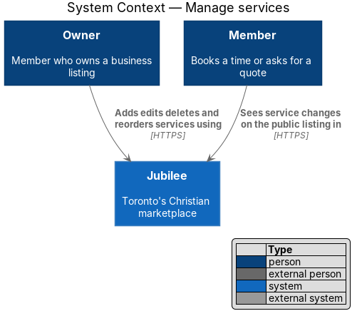
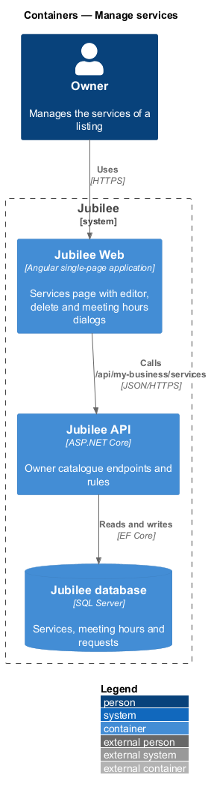
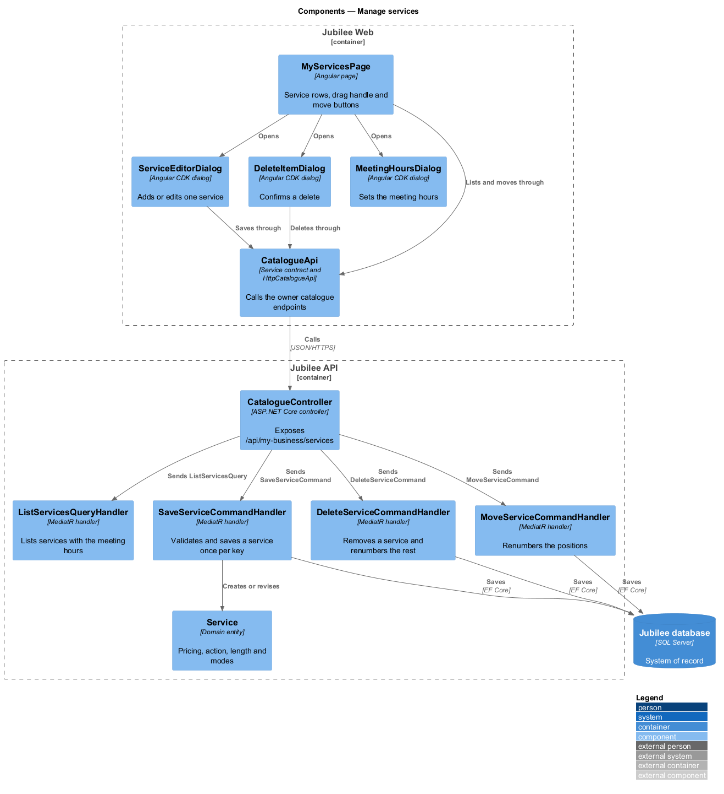
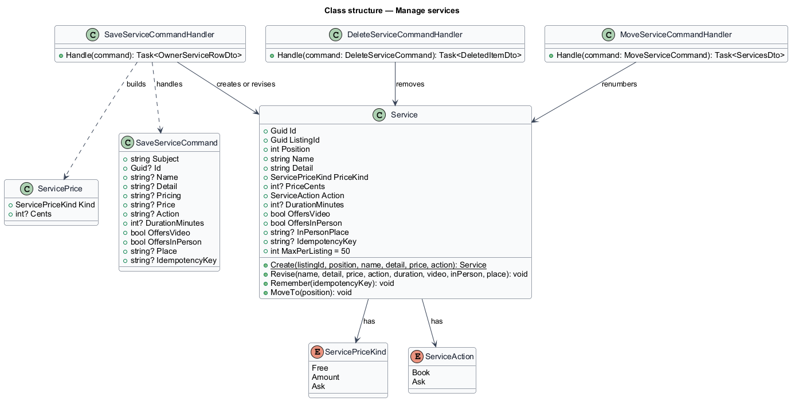
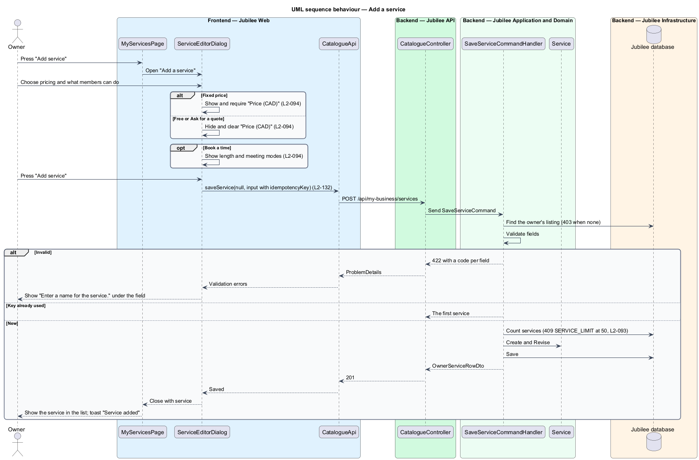
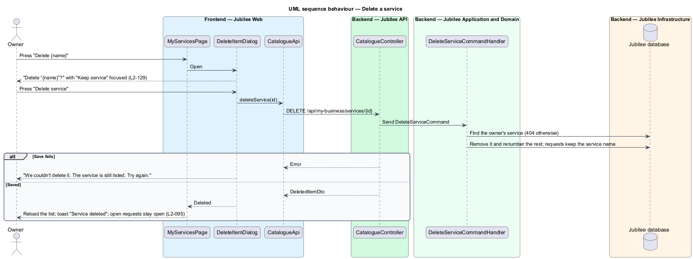

# Manage services

## Overview

Jubilee is Toronto's Christian marketplace: a directory of
Christian-owned businesses. A *service* is one piece of work a business offers,
such as a consultation, a lesson or custom work. Members do not pay through
Jubilee; they either book a time for a service or ask for a quote, and the owner
confirms or declines the request.

This feature covers the "Services" tab of the owner workspace at
`/my-business/services`. The owner sees each service with its name, detail and
price, adds and edits services in a dialog, deletes a service after a
confirmation, and sets the public order by dragging a service by its handle or
with the move buttons.

Each service has a *pricing* — one of "Free", "Fixed price" or "Ask for a quote"
— and a *member action* — what "Members can" do with it: "Book a time" or "Ask
for a quote". A bookable service has a duration and one or more *meeting modes*
(video, or in person at a place), and its bookable slots come from the listing's
meeting hours (`L2-220`). A listing holds at most 50 services.

## Description

The feature is a vertical slice from the services page in `Jubilee Web` to the
`Jubilee database`.

- **`MyServicesPage`** — Angular page at `/my-business/services`. It shows the
  workspace header, the count (for example "2 services"), "Meeting hours", "Add
  service" and each service as a row (`jb-rows`) with name, detail, price
  ("Free", an amount, or "Ask") and the row actions. The empty state reads "No
  services yet. Offer custom work, consultations or lessons? Add them here so
  members can book or ask for a quote." The load-error state carries
  `JB-SVC-503` and a `403` sends the owner to `/forbidden`. At 50 services "Add
  service" is refused with "You can list up to 50 services." "Meeting hours"
  opens `MeetingHoursDialog` with the hours the list returns as `meetingHours`
  (the dialog and its endpoint are described in `requests/book-meeting`).
- **Reordering** — the rows are a CDK `cdkDropList`; each row is a `cdkDrag`
  whose handle is a `jb-button` reading `⋮⋮` with the title "Drag to reorder",
  `aria-hidden` and `tabindex="-1"`. `MyServicesPage.drop` shows the new order
  at once and sends the one move; a drop in the same place sends nothing, and a
  refused move puts the row back and shows "Couldn’t move the service" with
  "The order is unchanged. Try again." "Move {name} up" and "Move {name} down"
  are the keyboard equivalent (`MyServicesPage.move`). A line under the list
  reads "Drag a service by its handle, or use the arrows, to change the order."
- **`ServiceEditorDialog`** — CDK dialog titled "Add a service" or "Edit
  service". It holds "Service name" (required), "Short detail" (optional,
  "Length, place or what to bring. 60 characters at most."), "Pricing" (Free,
  Fixed price, Ask for a quote), "Price (CAD)" and "Members can" (Book a time,
  Ask for a quote). "Price (CAD)" shows only for "Fixed price"; choosing "Free"
  or "Ask for a quote" hides and clears it. Choosing "Book a time" reveals the
  length in minutes and the meeting modes (video, in person with a place). Its
  primary button reads "Add service" or "Save changes". A failed save shows "We
  couldn't save the service. Nothing was changed and what you typed is still
  here. Try again." Closing with typed text asks "Discard what you typed?"
  first. One idempotency key is made when the dialog opens.
- **`DeleteItemDialog`** — confirmation titled "Delete “{name}”?" with "Members
  can no longer ask for it. Open quote requests stay open. This can't be
  undone.", "Keep service" (focused by default) and "Delete service". A failed
  delete shows "We couldn't delete it. The service is still listed. Try again."
- **`CatalogueApi`** (`CATALOGUE_API`, implemented by `HttpCatalogueApi`) —
  `services()`, `saveService(id, input)`, `deleteService(id)`,
  `moveService(id, position)` and `setMeetingHours(input)`.
- **`CatalogueController`** — ASP.NET Core controller under `/api/my-business`:
  `GET services`, `POST services`, `PUT services/{id}`, `DELETE services/{id}`
  and `PUT services/{id}/position`. Every body is a closed record
  (`SaveServiceBody`, `MoveItemBody`): an unknown field is a `400`. A failed
  list is `503` with `JB-SVC-503`, a failed save `503` with `JB-SVC-504`.
  `Workspace.Owned` refuses a member who owns no listing with `403`
  `FORBIDDEN`; a service of another owner is `404`.
- **`ListServicesQueryHandler`** — the services in `Position` order with the
  meeting hours, as `ServicesDto` of `OwnerServiceRowDto`.
- **`SaveServiceCommandHandler`** — adds a service, or with an id changes one.
  It refuses with `422` and a code per field: `name` `REQUIRED` or `TOO_LONG`
  (80 characters), `detail` `TOO_LONG` (60 characters), `pricing` `INVALID`,
  `price` `REQUIRED` or `INVALID` (as in `L2-091`), `action` `INVALID`,
  `duration` `INVALID` (outside 15 to 480 minutes), `modes` `REQUIRED` and
  `place` `REQUIRED` or `TOO_LONG`. A 51st service is `409` `SERVICE_LIMIT`. A
  repeated idempotency key returns the first service. `Service.Revise` clears
  the price unless it is fixed, and the booking fields unless members book.
- **`DeleteServiceCommandHandler`** — removes the service and renumbers the
  others. Request rows keep the service name they were made with, so open
  requests for it stay open. It answers `DeletedItemDto`.
- **`MoveServiceCommandHandler`** — places one service at the given position,
  renumbers every `Position` from 1 and answers the whole list.
- **`Service`** — domain entity with `Position`, `Name`, `Detail`, `PriceKind`
  (`ServicePriceKind`), nullable `PriceCents`, `Action` (`ServiceAction`),
  nullable `DurationMinutes`, `OffersVideo`, `OffersInPerson`, `InPersonPlace`
  and `IdempotencyKey`.

Services are manageable while the listing is not live (`L2-097`); they become
public with the listing. `DirectoryCacheInvalidationInterceptor` drops the cached
public reads when a service changes. The booking features compute slots from
`Service.DurationMinutes` and the listing's meeting hours.

## Requirements

The feature realizes the following level-2 (L2) requirements. Each L2
requirement refines a level-1 (L1) requirement, cited by identifier.

| L2 ID | Refines (L1) | Requirement |
|-------|--------------|-------------|
| `L2-093` | `L1-013` | The system shall show the owner's services with a count, "Meeting hours", "Add service", and each service's name, detail, price and Edit and Delete actions, and an empty state when there are none. The system shall refuse a service beyond the maximum of 50 with "You can list up to 50 services." |
| `L2-094` | `L1-013` | The system shall let the owner add and edit a service in a dialog with a name, a short detail of at most 60 characters, a pricing of Free, Fixed price or Ask for a quote, and a member action of Book a time or Ask for a quote. A fixed price shall be required and validated as in `L2-091`; a bookable service shall have a duration of 15 to 480 minutes and its meeting modes, and shall use the listing's meeting hours for bookable slots. |
| `L2-095` | `L1-013` | After the owner confirms a delete, the service shall be removed from the public listing and open requests for it shall stay open. |
| `L2-090` | `L1-013` | When the owner moves a product or service up or down by drag or keyboard buttons, the public listing shall show items in the new order after save. A drag shall be made by a handle hidden from assistive technology, and a refused move shall put the item back. |
| `L2-097` | `L1-013` | The owner shall manage services while the listing is not live, and the header shall show its stage. |
| `L2-128` | `L1-018` | When a dialog submission fails, an error alert at the top of the dialog shall say what did not happen, and everything typed shall be kept. |
| `L2-129` | `L1-018` | A delete shall be confirmed in a dialog that states the consequence with real names, says "This can't be undone." and focuses the safe choice by default. |
| `L2-132` | `L1-018` | A create request shall carry a client-generated idempotency key, and the server shall return the original result for a repeated key within 24 hours without creating a duplicate. |
| `L2-133` | `L1-019` | The server shall check ownership before doing anything, shall refuse an owner API call by a member who owns no listing with 403, and shall refuse fields the caller may not set. |

## Diagrams

### System context

The owner manages services through Jubilee. Members appear because the public
listing they browse reflects each change.

### Containers

`Jubilee Web` calls the `Jubilee API`, which writes the `Jubilee database`.

### Components

The page opens the editor, the delete confirmation and the meeting hours, and
shares `CatalogueApi` with them. In the API, one controller sends the commands
of the owner's catalogue through MediatR.

### Class structure

A listing has up to 50 `Service` entities. Each `Service` holds a
`ServicePriceKind`, a `ServiceAction` and, when members book it, its length and
meeting modes.

### Behaviour — add a service

The dialog adapts its fields to the chosen pricing and member action, and the
server repeats every rule before it stores the service.

### Behaviour — delete a service

The confirmation states the consequence. The handler removes the service and
renumbers the rest; requests keep the service name, so open requests stay open.

